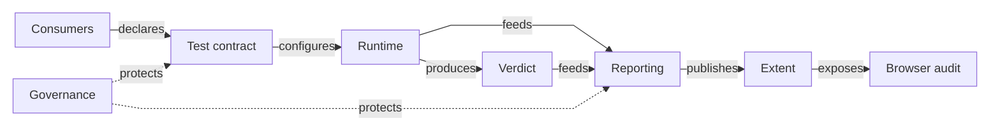
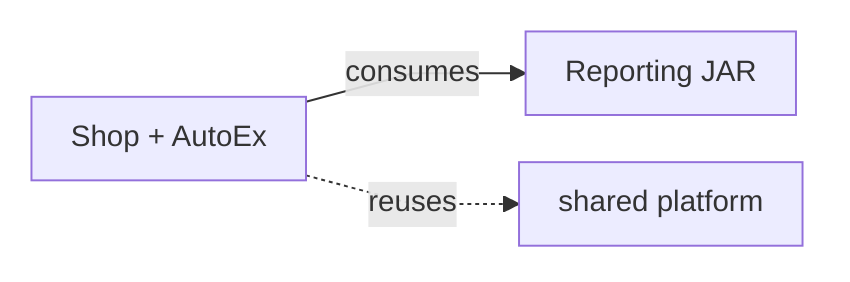
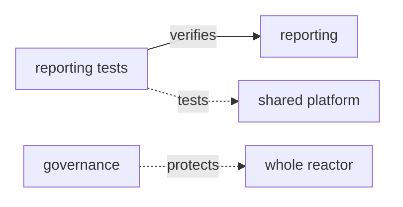
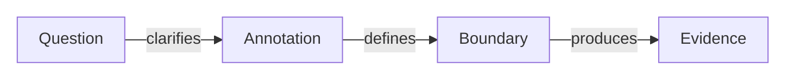
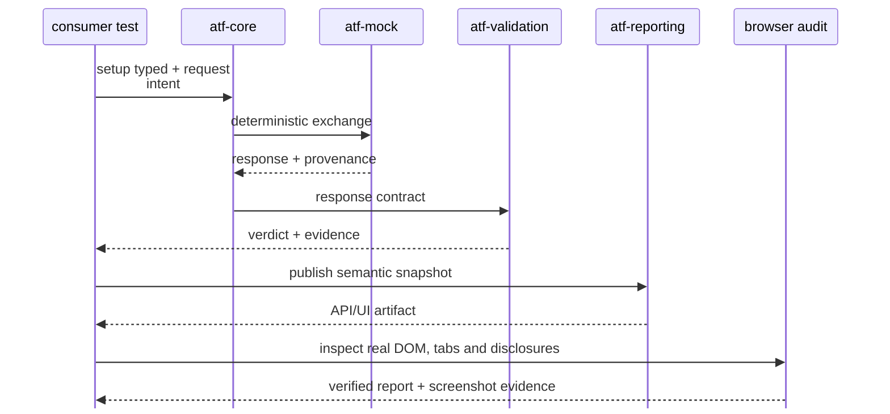
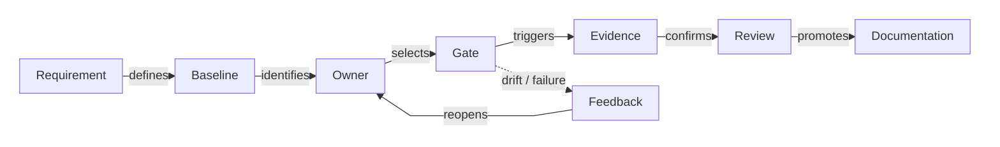

# ATF — modular platform for testing and verifiable results

[The shared libraries](lib/README.md) keep their source and feedback in J0; this repository owns the adapters and domain acceptance.

`main` contains the English documentation edition, and `main_RO` contains the Romanian edition.
Both keep the same Markdown inventory and structure; governance declares the
branch language in `config/atf-governance-policy.json`.

`atf_j0` is the source reference for Core/Reporting/Console/Mock and their regressions; distribution to J1–J7 consumers follows the [workspace synchronization protocol](docs/ATF_Workspace_Synchronization.md).

J1 is the primary project for AutoEx/Shop tests and their integration.
Shared infrastructure is reconciled with the affected owners; J2 is reserved
for queue and messaging tests, with its own bootstrap and acceptance.
The generic library and regressions are maintained in `atf_j0`, then delivered
here as JARs; [ownership and synchronization](docs/ATF_Reporting_Consumer.md) have explicit directions.

`Deterministic API → semantic validation → Extent report → UI audit`

## ATF Java — executive overview

| Workspace | Role and entry point |
|---|---|
| J0 | 12 modules, Reporting source, and native/mock/browser regressions; [source atlas](../atf_j0/docs/ATF_Context_Atlas.md) |
| J1 | 6 source modules, AutoEx/Shop scenarios, and five J0 libraries through JAR/POM. [Consumer atlas](docs/ATF_Context_Atlas.md) |
| J2 · WIP | 5 source modules, Core/Reporting JARs, one Kafka/messaging test module, and PowerShell setup in Podman; [WIP atlas](../atf_j2/docs/ATF_Context_Atlas.md) |

The project's role is distinct from the result it verifies: a green build or MOCK does not certify the external service, broker, or the whole ATF.

ATF Java connects deterministic API test execution to semantic validation,
Extent artifact publication, and UI auditing of the result. For quick
orientation, modules are grouped by the question they answer rather than
listed as a Maven inventory:

| Area | Live modules | Responsibility | Reader's question |
|---|---|---|---|
| **Contract & foundation** | `atf-test-kit`, Core JAR C3 | test annotations, neutral resolvers, lifecycle, transport ports | what can be reused without reporting or business logic? |
| **Execution & verdict** | `atf-mock`, `atf-validation`, `atf-console` | deterministic exchange, semantic verdict, and diagnostics | how does a test become reproducible and explainable? |
| **Reporting & UI audit** | Reporting JAR, `atf-ui`, `atf-debug-ui` | standalone artifact, browser audit, and read-only publishing | how does the result become observable and verifiable? |
| **Composition + consumers** | `atf-test-practice-shop`, `atf-test-auto-ex` | Shop and AutoEx compose journeys; Reporting Tests verify the binary in an external TMP gate | who verifies the libraries, and who uses them in a product? |
| **Governance** | `atf-tests` | reactor graph and boundary gates | who protects module separation? |

## Core diagram

<strong>Legend — flow, ownership, and boundaries</strong>

**Flow**

- **Consumers** provide intent, configuration, and fixtures;
- **Contract** fixes the test layer and reusable boundary;
- **Runtime** executes the generic exchange and, when needed, fake transport;
- **Verdict** evaluates the response and produces diagnostics/evidence;
- **Reporting** publishes the standalone Extent artifact;
- **Artifact** is the inspectable HTML/CSS/JavaScript result;
- **Audit** verifies the DOM, tabs, filters, and browser rendering;
- **Governance** protects dependency direction without entering production.

The diagram quickly answers “what does ATF do, and where does each module
stop?”. Implementation details, class contracts, and run steps continue in
the owner documents below.

**Ownership and verification**

The table below explains each boundary's responsibility and its verification
level. It is not a second navigation map; it is the operational part of the
same legend.

| Boundary | Owner | Role | Verification |
|---|---|---|---|
| test contract | `atf-test-kit` | layer/channel/output/setup/docs annotations and cross-cutting guards | architecture/unit |
| kernel | `atf-core` | neutral models, lifecycle, transport, and ports | unit |
| deterministic transport | `atf-mock` | configurable fake routes and responses | component |
| verdict | `atf-validation` | response contracts, evaluation, and evidence | unit |
| diagnostics | `atf-console` | console projection and formatter | unit |
| external reporting library | `atf-reporting` in `lib` | Extent/HTML renderer; source and regressions are owned by `atf_j0` | J1 binary acceptance; standalone acceptance at the producer |
| browser runtime | `atf-ui` | Playwright session and generic policies | component |
| debug inspector | `atf-debug-ui` | serves an HTML file read-only over loopback | component |
| external reporting test harness | `atf_j0/atf-reporting-tests`, in TMP only | component/API mock-to-publisher and UI/E2E tests for the reporting library | component/integration/E2E |
| consumer applications | `atf-test-practice-shop`, `atf-test-auto-ex` | independent config, locators, pages, and journeys | component/E2E |
| whole-ATF governance | `atf-tests` | reactor module graph and boundaries | component/architecture |
The short labels have the following meanings:

| In the diagram | Full meaning |
|---|---|
| Runtime | Generic runtime |
| Verdict | Verdict + diagnostics |
| Reporting | Standalone reporting |
| Extent | Extent artifact |
| exposes | exposes for inspection |
| protects | architecture gates |
| protects | dependency gates |

## Module map

Two views of the same reactor: its consumers, followed by governance checks.
J1 contains six source modules: three platform modules, two consumers, and
governance. Reporting is consumed separately as an external library; its test
harness remains with the producer.

### Consumption

<strong>Legend — consumers and shared modules</strong>

- `Consumers` groups `atf-test-practice-shop` and `atf-test-auto-ex`; each keeps
  its own configuration, selectors, and journey;
- `Reporting` is `atf-reporting`, the shared library used by the consumers;
- `Platform` represents the reusable modules and libraries listed in the
  table; the arrows distinguish reporting from shared contracts.

### Verification and governance

<strong>Legend — verification and boundaries</strong>

- `ReportingTests` is `atf-reporting-tests`: it verifies `atf-reporting` and
  uses the other shared modules only in `test` scope;
- `Governance` is `atf-tests`; the `whole reactor` includes all six local source
  modules and external library integrations, not only the shared libraries;
- arrows are straight to keep their labels readable; each module's details and
  ownership appear in the table and its module README.

| Group | Module | Owns | Does not own |
|---|---|---|---|
| platform | `atf-test-kit` | annotations, neutral resolvers, and guards | runtime or business fixtures |
| platform | `atf-core` | request/response, lifecycle, transport, and ports | HTML, Extent, business services |
| library | `atf-mock` | fake transport and deterministic catalog | live HTTP or verdicts |
| platform | `atf-validation` | response contracts, verdict, and evidence | transport or HTML |
| library | `atf-console` | diagnostic output | reporting UI or transport |
| reporting library | `atf-reporting` | renderer, semantic document, and artifact | ATF modules, mock, or browser |
| platform | `atf-ui` | Playwright session and browser policies | product page objects |
| platform | `atf-debug-ui` | read-only publishing for inspection | HTML generation or modification |
| test harness | `atf-reporting-tests` | reporting library tests and their fixtures, in `test` scope | testing a real application or production runtime |
| consumer | `atf-test-practice-shop` | Practice Shop application tests | whole-ATF governance |
| consumer | `atf-test-auto-ex` | Automation Exercise UI E2E tests | Practice Shop tests |
| governance | `atf-tests` | reactor graph and boundary gates | YAML, pages, flows, or purchase E2E |

Maven dependency details are in [`docs/ATF_Architecture.md`](docs/ATF_Architecture.md).
The map above does not replace the POM; it explains ownership and dependency direction.

## Test layer map

The layer is selected explicitly through an annotation from `atf-test-kit`, not
inferred from a folder name. The same rule applies to API, UI, and reporting tests:

<strong>Legend — choosing the test layer</strong>

- choose the smallest layer that can demonstrate the contract;
- move to component/integration/E2E only when the verified boundary requires it;
- `support` provides input, locators, fixtures, or helpers, but does not produce
  an independent verdict;
- the same report can have unit tests for markup/CSS/JS, component tests for
  contracts, and E2E tests for observable browser behavior.
The short labels have the following meanings:

| In the diagram | Full meaning |
|---|---|
| Question | the test question |
| Annotation | annotation from atf-test-kit |
| Boundary | boundary and controlled input |
| Evidence | evidence and verdict |

| Layer | Annotation | Verified boundary | The verdict must demonstrate |
|---|---|---|---|
| unit | `@AtfUnitTest` | pure rule, model, markup, CSS/JS, or asset | deterministic behavior without an external boundary |
| component | `@AtfComponentTest` | renderer, loader, auditor, locator, or controlled fixture | component contract and its evidence |
| integration | `@AtfIntegrationTest` | two or more real modules plus transport/mock | integration and resulting artifact |
| e2e | `@AtfE2eTest` | published artifact plus browser/Playwright | observable DOM, tabs, filters, disclosures, and rendering |
| support | — | fixtures, locators, loaders, flows, and assertion helpers | has no independent verdict and does not become an implicit test |

Plug-and-play composition follows the same axis: a test declares its layer and
scope, support provides its input, and the verified module remains the contract
owner. E2E tests validate the observable flow; they do not replace unit or
component tests for each internal combination.

## Evolution and verification model

ATF evolves by strengthening the existing platform, not by adding an isolated
test and a parallel abstraction. Every change must be traceable from the
observed contract to the evidence it produces:

```mermaid
%%{init: {"themeVariables":{"fontSize":"15px"},"themeCSS":".nodeLabel, .nodeLabel p { font-size: 15px !important; line-height: 1.35 !important; } .edgeLabel, .edgeLabel p { font-size: 12px !important; font-weight: 400 !important; line-height: 1.2 !important; } .edgeLabel .labelBkg, .edgeLabel p { background: transparent !important; } .edgeLabel foreignObject { transform: translateY(-18px); overflow: visible; } .node rect { rx: 6px; ry: 6px; }","flowchart":{"curve":"linear","nodeSpacing":24,"rankSpacing":40,"padding":10,"diagramPadding":16}}}%%
flowchart LR
    Need[Requirement]
    Inspect["Live code"]
    Layer[Minimum layer]
    Change["Change"]
    Verify["Evidence"]
    Harden["Contract"]

    Need -->|clarifies| Inspect
    Inspect -->|selects| Layer
    Layer -->|defines| Change
    Change -->|produces| Verify
    Verify -->|real gap| Change
    Verify -->|confirms| Harden
```

<strong>Legend — evolution discipline</strong>

- **live inspection**: read the implementation, POM, tests, and documented
  contract before assuming a TODO is still active;
- **minimum layer**: choose unit/component/integration/E2E based on the
  demonstrated boundary, not on how visible the test is;
- **minimum change**: modify the responsible owner and do not duplicate
  vocabulary, configuration, fixtures, or renderer logic in a consumer;
- **verification**: run the narrowest test that can prove the change, then
  inspect the artifact if the result is HTML/UI;
- **hardening**: promote the solution into a reusable contract only after the
  evidence is stable and reproducible without the original run context.

Even without adding business functionality, a new test can be useful: it may
demonstrate a real reporting, boundary, or UI projection limit. In that case,
the test is evidence for strengthening ATF, not a reason to keep a duplicate
class.
The short labels have the following meanings:

| In the diagram | Full meaning |
|---|---|
| Live code | Live inspection |
| Change | Local change |
| Evidence | Test + evidence |
| Contract | Stable contract |
| confirms | sufficient evidence |

## Executive API → report → audit sequence

<strong>Legend — API → report → audit sequence</strong>

- the consumer composes the typed setup and request intent;
- `atf-core` executes the generic contract through the selected transport;
- `atf-validation` turns the response into a verdict and evidence;
- `atf-reporting` publishes the semantic snapshot as an API/UI artifact;
- the browser verifies the DOM, tabs, disclosures, and visible evidence;
- the body, headers, sections, screenshots, CSS, and tabs are defined in
  [ATF_Reporting_Contract.md](docs/ATF_Reporting_Contract.md) and verified by
  the reporting consumer; they are not duplicated here.

## Consistency and governed changes

ATF changes follow a controlled decision rather than an isolated edit. Owner
READMEs, tests, and gates remain stable contracts; feedback is updated as
evidence appears, ToDos close, or gaps change.

<strong>Legend — what the process protects</strong>

- **The explicit requirement** defines what is authorized; do not infer a major
  refactor from a local failure or change a gate just to turn it green;
- **The live baseline** is read before editing: current code, POMs, tests,
  READMEs, and feedback take precedence over an old copy or generated report;
- **The owner and boundary** determine where a solution belongs: `atf-tests`
  protects the reactor, `atf-test-kit` classifies layers, and modules retain
  their local contracts;
- **An existing gate** is not incidental refactoring material. Changing a
  normative README or an existing test gate requires an explicit requirement,
  explicit approval, a documented reason, and new evidence for the changed
  contract;
- **Active feedback** is the living work register: it can be updated, narrowed,
  reorganized, or closed when code and tests confirm progress; it does not
  become a permanent contract simply because it was recorded there;
- **A failure** is a signal to investigate: fix the owner or implementation;
  do not delete, weaken, or mask an assertion to hide the problem;
- **Review and synchronization** close an increment only after the relevant
  test, a new artifact when UI/reporting is involved, and selective updates to
  the owner's README and feedback.

Staging, active process, promotion, and anti-undo details are in
[`ATF_Build_And_Execution_Safety.md`](docs/ATF_Build_And_Execution_Safety.md),
and are not repeated in this overview.
The short labels have the following meanings:

| In the diagram | Full meaning |
|---|---|
| Requirement | Explicit requirement |
| Baseline | Live baseline |
| Owner | Owner + boundary |
| Gate | Existing gate |
| Evidence | Test + evidence |
| Review | Review + approval |
| Documentation | README + feedback |
| Feedback | Active feedback |

## Module and contract details

The overview defines the flow and ownership; the documents below hold local
details. Readers can go directly to the owner they need without repeating the
same explanation in the root and every module. The documentation index is in
[`docs/README.md`](docs/README.md).

<strong>Open the module README map</strong>

| Area | Owner document | Question answered |
|---|---|---|
| cross-cutting contract | [TestKit](lib/README.TestKit.md#scope-and-integration), [implemented annotations](docs/ATF_Test_Infrastructure_Annotations.md) | how do we declare a test's layer, channel, output, and setup? |
| reusable kernel | [`atf-core/README.md`](../atf_j0/atf-core/README.md) | which models, lifecycle, and ports are neutral? |
| deterministic transport | [`atf-mock/README.md`](../atf_j0/atf-mock/README.md) | how do we get reproducible API exchanges? |
| semantic verdict | [`atf-validation/README.md`](atf-validation/README.md) | how is a response turned into a verdict? |
| diagnostics | [`atf-console/README.md`](../atf_j0/atf-console/README.md) | how do neutral events reach the console? |
| standalone reporting | [Reporting JAR atlas](docs/ATF_Reporting_Library_Atlas.md) | how is the JAR consumed without Reporting source? |
| browser runtime | [`atf-ui/README.md`](atf-ui/README.md) · [locator conventions](atf-ui/README.md#ui-locator-conventions) | how are the browser and generic locator conventions controlled without product logic? |
| read-only inspector | [`atf-debug-ui/README.md`](atf-debug-ui/README.md) | how do we inspect generated HTML? |
| reporting test harness | [`atf-reporting-tests/README.md`](../atf_j0/atf-reporting-tests/README.md) | how are API/mock composition and reporting UI rendering verified? |
| application consumer | [`atf-test-practice-shop/README.md`](atf-test-practice-shop/README.md) | how does a real application use ATF infrastructure? |
| Automation Exercise consumer | [`atf-test-auto-ex/README.md`](atf-test-auto-ex/README.md) | how are separate UI E2E tests composed with Test Kit annotations? |
| reactor governance | [`atf-tests/README.md`](atf-tests/README.md) | who protects modules and dependency direction? |

Cross-cutting contracts, documentation rules, and the execution protocol are
in the normative references below; they are not duplicated in this map.

## Normative references

| Topic | Document |
|---|---|
| architecture, modules, and dependencies | [`docs/ATF_Architecture.md`](docs/ATF_Architecture.md) |
| reporting, evidence, and rendering | [`docs/ATF_Reporting_Contract.md`](docs/ATF_Reporting_Contract.md) · [`docs/ATF_Reporting_Display_Contract.md`](docs/ATF_Reporting_Display_Contract.md) |
| build, staging, and MCP verification | [`docs/ATF_Build_And_Execution_Safety.md`](docs/ATF_Build_And_Execution_Safety.md) |
| OOP, naming, and layer rules | [`docs/README_Atf_BestPractices.md`](docs/README_Atf_BestPractices.md) |
| writing READMEs and diagrams | [`docs/README_Atf_DocumentationBestPractices.md`](docs/README_Atf_DocumentationBestPractices.md) |
| active feedback, live reconciliation, and closure criteria | [`docs/feedback/README.md`](docs/feedback/README.md) |

The root README describes the system from the top down. Internal lifecycle,
complete YAML schemas, class contracts, CSS, and run logs belong to their
owners and are protected by their tests.

## Core library ownership and deployment

J1 consumes Core, Reporting, Console, Mock, and Test Kit as external libraries; the module inventory is in the table above.

[The Core contract](docs/ATF_Core_Consumer.md) separates source, publication, and consumer acceptance.
Native tests stay in J0; binary acceptance runs in TMP.

[JSON C2/J9 acceptance](docs/ATF_JSON_Binary_Verification.md) separates source, JAR, renderers, and remaining limits.

## Core — consolidated contract

[Core verification](docs/ATF_Core_C3_Verification.md) connects the new JAR/POM pair to the source/JAR natives and each consumer's acceptance. C3 acceptance used Reporting; the current Reporting delivery is recorded separately below with preview 240 and independent oracles.

## Reporting library and audit contracts

[Library provenance](library-provenance.json) records the delivered Core / Reporting pair and each consumer's independent acceptance. J0 owns Reporting source and permanent mock, contract and browser regressions.

| Topic | Current owner contract |
|---|---|
| neutral ACTION/OBSERVE, failures and assertion ownership | [Reporting API](../atf_j0/atf-reporting/README.md#neutral-ui-attribution-and-failure-ownership) |
| complete PNG, redacted inline evidence and preview 240 | [Inline audit](../atf_j0/docs/ATF_Inline_Audit_Contract.md) |
| incremental navigation, cold readiness and original deadlines | [Navigation](docs/ATF_Large_Report_Navigation.md) |
| latest verification note beside the producer package | [Evidence retention](docs/ATF_Workspace_Synchronization.md#release-evidence-retention) |

Library publication/rendering acceptance is separate from new business, device, broker or acoustic ASR execution. Release notes are not stored in project documentation or consumer `lib`.

The [current consumer findings](docs/feedback/ATF_Consumer_Business_Test_Focus_Feedback.md) retain application failures and their independent rechecks separately from Reporting library acceptance.
