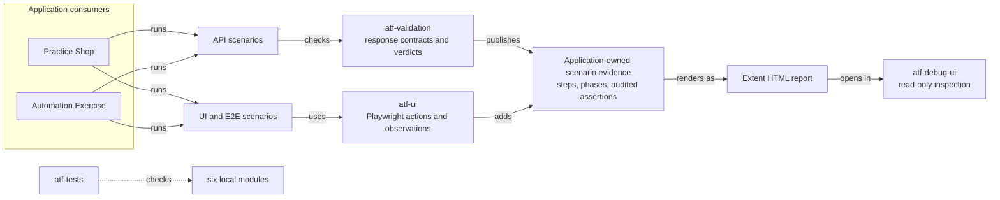

# ATF J1

ATF J1 is a Java/Maven project for testing two sample applications: Practice Shop and Automation
Exercise (AutoEx). It exercises their API flows and browser behavior; each consumer module owns the
application's expected results and verdicts.

## At a glance

- Practice Shop and AutoEx own their application data, journeys, business assertions, and verdicts;
  atf-validation checks response contracts, and atf-ui supplies shared Playwright behavior.
- Application suites with a report contract publish Extent HTML. Audited component checks appear in
  the collapsible **Component assertions** step; unit tests do not publish Extent reports.
- atf-debug-ui opens generated reports read-only. atf-tests checks module boundaries, code and test
  quality, documentation, and packaging.

## Local modules

| Module | Responsibility |
|---|---|
| atf-validation | Response contracts, validation rules, and local verdict publication |
| atf-ui | Shared Playwright adapter, browser policies, and neutral observations |
| atf-debug-ui | Read-only local inspection of generated HTML reports |
| atf-test-practice-shop | Practice Shop configuration, API/UI/E2E journeys, business expectations, and evidence |
| atf-test-auto-ex | AutoEx configuration, API/UI journeys, business expectations, and opt-in E2E |
| atf-tests | Reactor architecture, dependency, packaging, code, test, and documentation governance |

## Local evidence flow



<details>
<summary><strong>Legend — evidence flow and boundaries</strong></summary>

- Shop and AutoEx keep application setup, expected outcomes, and business verdicts in their own test
  modules.
- atf-ui performs generic browser actions and returns observations; the application tests decide
  which observations satisfy their assertions.
- The report presents the evidence selected by the test. atf-debug-ui reads the generated HTML and
  does not execute tests.
- The dotted governance edge covers the local module graph and its code, test, and documentation
  rules.

</details>

## Test layers

| Layer | Use it for | Evidence |
|---|---|---|
| Unit | Pure rules, models, and markup contracts | Deterministic result; no Extent report |
| Component | An adapter, renderer, or fixture with neighboring behavior controlled | Local contract; audited checks in a collapsible report step |
| Integration | Collaboration across real J1 modules | Composed behavior and report output when selected |
| E2E | Observable application and browser behavior | DOM interaction; report rendering when selected |
| Support | Fixtures, locators, and reusable setup | Test input; no independent verdict |

Choose the smallest layer that proves the behavior. The [testing guide](docs/ATF_Testing_Guide.md)
defines suite selection; the [API guide](docs/ATF_Api_Test_Guide.md) and
[report display contract](docs/ATF_Reporting_Display_Contract.md) describe request evidence and
report rendering.

## Verify

Run the Maven governance gate from a dedicated staging checkout. The
[build and execution guide](docs/ATF_Build_And_Execution_Safety.md) explains staging and
generated-artifact locations.

```powershell
mvn -B -ntp -pl atf-tests -Dtest=WholeAtfGovernanceSuiteTest test
```

## Further reading

- [Project architecture and module responsibilities](docs/ATF_Architecture.md)
- [Documentation index](docs/README.md)
- [Practice Shop test suites](atf-test-practice-shop/README.md)
- [Automation Exercise test suites](atf-test-auto-ex/README.md)
- [Extent report semantics](docs/ATF_Reporting_Contract.md)
- [Code and testing practices](docs/README_Atf_CodeBestPractices.md)
- [Documentation practices](docs/README_Atf_DocumentationBestPractices.md)
- [Active feedback and closure criteria](docs/feedback/README.md)

## Consumed library index

This reactor consumes versioned shared JAR/POM artifacts listed in the local lib directory. The
[library index](lib/README.md) records the selected contracts and J1 acceptance scope.
