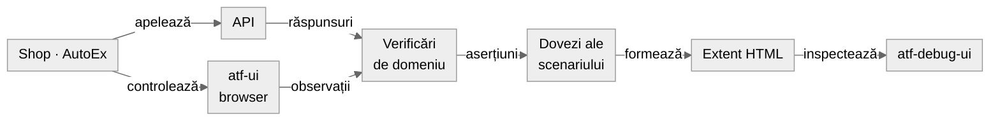
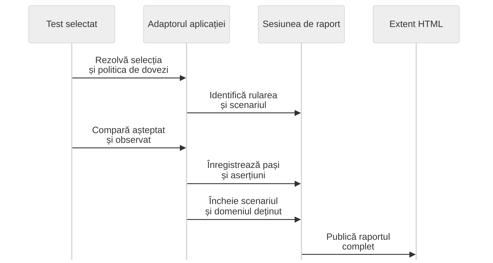
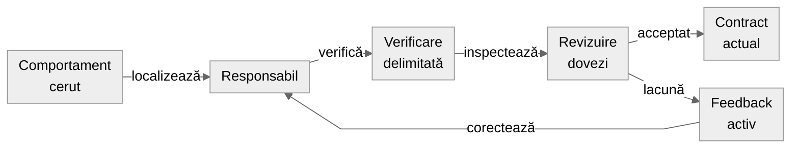

# ATF J1

ATF J1 este un proiect Java/Maven pentru testarea automată a două aplicații demonstrative: Practice Shop și Automation Exercise (AutoEx). Acoperă fluxuri API și comportamentul în browser, cu rezultate așteptate, verdicte și dovezi de raport deținute de fiecare aplicație.

<a id="at-a-glance"></a>
<a id="pe-scurt"></a>

## Pe scurt

- **Responsabilitatea aplicației:** Shop și AutoEx dețin configurația, paginile, contractele API, scenariile și rezultatele așteptate. Acțiunile comune de browser întorc observații; aplicația decide dacă respectă contractul său.
- **Rezultate auditabile:** suitele aplicațiilor care au raportarea în contract publică rapoarte HTML Extent. Verificările auditate de componentă apar într-un pas colapsabil **Component assertions**; testele unitare nu publică rapoarte Extent.
- **Inspectare independentă:** un vizualizator de rapoarte doar pentru citire expune HTML-ul generat; guvernanța verifică reactorul, limitele codului, convențiile testelor și documentația.

<a id="local-modules"></a>
<a id="module-locale"></a>

## Module locale

[POM-ul rădăcină](pom.xml) declară șase module. Tabelul descrie responsabilitățile; săgețile diagramelor de mai jos descriu execuția și dovezile, fără a reprezenta direcția dependențelor Maven.

| Modul | Deține | Limită |
|---|---|---|
| atf-validation | [Contracte de răspuns și reguli de validare](atf-validation/README.md) | Port reutilizabil de validare; Shop și AutoEx își păstrează propriile verificări de domeniu. |
| atf-ui | [Sesiuni Playwright, politici de browser și observații](atf-ui/README.md) | Mecanisme de browser, fără verdicte specifice aplicației. |
| atf-debug-ui | [Inspectare HTML doar pentru citire](atf-debug-ui/README.md) | Citește un raport existent; nu execută scenariul testat. |
| atf-test-practice-shop | [Scenarii și dovezi Practice Shop](atf-test-practice-shop/README.md) | Rezultatele așteptate pentru API, UI și checkout aparțin Shop. |
| atf-test-auto-ex | [Scenarii și dovezi Automation Exercise](atf-test-auto-ex/README.md) | AutoEx deține adaptoarele sale API/UI și scenariile E2E activate explicit. |
| atf-tests | [Guvernanța reactorului](atf-tests/README.md) | Verifică arhitectura, artefactele, codul, testele și ghidurile. |

<a id="local-evidence-flow"></a>
<a id="fluxul-dovezilor"></a>

## Fluxul dovezilor

### De la observație la verdict

Un răspuns de transport sau o observație din browser devine dovadă când modulul aplicației îl asociază unui scenariu și unui rezultat așteptat explicit. Atât scenariile exclusiv API, cât și cele UI pot publica rapoarte; execuția unui browser nu este o condiție pentru raportul API.



<details>
<summary>Legendă — responsabilități și limitele dovezilor</summary>

- Shop și AutoEx dețin rezultatele HTTP așteptate, starea paginii și rezultatul de business. Mapările de dovezi API și publicarea rapoartelor păstrează această responsabilitate.
- `atf-ui` întoarce observații neutre. Capturile, traficul selectat și detaliile aserțiunilor respectă politica de dovezi a scenariului.
- `atf-validation` este un modul reutilizabil separat, fără a fi o etapă automată în traseele API ale celor două aplicații. Contractul său este verificat independent.
- `atf-debug-ui` inspectează fișierul generat. Scrierea reușită a fișierului nu demonstrează că elementele se randează sau se expandează corect. [Contractul de raportare](docs/ATF_Reporting_Contract.md)

</details>

### Ciclul de viață al raportului

Ciclul de mai jos descrie testele care produc rapoarte. Auditarea componentelor și scenariile de browser folosesc adaptoare diferite, păstrând vizibile identitatea scenariului, aserțiunile explicite și publicarea finală.



<details>
<summary>Legendă — încheiere, aserțiuni de componentă și randare</summary>

- Responsabilitatea rulării controlează închiderea sesiunii și publicarea fișierului. Metadatele de lansare identifică selecția reală; nu transformă un test neexecutat în dovadă.
- Aserțiunile auditate de componentă sunt grupate sub **Component assertions**. Pașii aplicației și dovezile de eșec își păstrează structura scenariului.
- Acceptanța raportului verifică artefactul generat și comportamentul randat, inclusiv controalele imbricate de expandare. [Ghidul de testare](docs/ATF_Testing_Guide.md) precizează nivelul necesar.

</details>

<a id="test-layers"></a>
<a id="niveluri-de-testare"></a>

## Niveluri de testare

Alege nivelul minim care observă contractul. Nivelul testului, canalul de execuție și politica de dovezi descriu aspecte diferite; un apel API nu transformă singur testul în E2E.

| Nivel | Demonstrează | Limita dovezilor |
|---|---|---|
| Unitar | Reguli pure și transformări de valori. | Rezultate JUnit; fără raport Extent. |
| Componentă | O componentă de producție prin colaboratori controlați. | Aserțiuni auditate în raportul de componentă; fără pretenția acceptanței site-ului live. |
| Integrare | Compunere între limite locale. | Doar contractele și artefactele exercitate efectiv. |
| E2E | Un scenariu selectat al aplicației în mediul configurat. | Verdictele aplicației, dovezi API/UI selectate și acceptanța raportului randat. |
| Suport | Fixture-uri și probe reutilizabile. | Contribuie observații; nu oferă un verdict de business independent. |

<a id="verify"></a>
<a id="verificare"></a>

## Verificare

Folosește JDK 21 și Maven dintr-o copie izolată, cu directoare de ieșire și cache Maven proprii. Începe cu suita de guvernanță a întregului reactor; comanda include modulele necesare fără a cere aceeași suită modulelor care nu o dețin.

```powershell
mvn -B -ntp -pl atf-tests -am test '-Dtest=WholeAtfGovernanceSuiteTest' '-Dsurefire.failIfNoSpecifiedTests=false'
```

Apoi selectează modulul responsabil și suita necesară de componentă, API sau browser din ghidul său. Scenariile live cer endpointurile configurate și cerințele de browser; reușita guvernanței nu demonstrează singură acele scenarii. [Execuție sigură](docs/ATF_Build_And_Execution_Safety.md)

### O schimbare guvernată



<details>
<summary>Legendă — dovezi și întreținerea documentației</summary>

- Guvernanța protejează limitele codului, convențiile testelor, linkurile, scopul local al documentației și paritatea EN/RO. Completează testele de comportament.
- O corecție finalizată actualizează contractul responsabil unde aduce valoare durabilă. Feedback-ul păstrează lacune acționabile, fără jurnale de rulări încheiate.
- Edițiile engleză și română păstrează aceleași căi, comenzi, topologie a diagramelor și informații tehnice. [Standardul de documentație](docs/README_Atf_DocumentationBestPractices.md)

</details>

<a id="further-reading"></a>
<a id="lecturi-suplimentare"></a>

## Lecturi suplimentare

| Întrebare | Ghid responsabil |
|---|---|
| Cum sunt compuse modulele și adaptoarele de dovezi? | [Arhitectură](docs/ATF_Architecture.md) |
| Ce reguli de raportare și aserțiuni se aplică? | [Contract de raportare](docs/ATF_Reporting_Contract.md) · [Ghid de testare](docs/ATF_Testing_Guide.md) |
| Cum trebuie să evolueze codul și ghidurile? | [Practici de cod](docs/README_Atf_CodeBestPractices.md) · [Practici de documentație](docs/README_Atf_DocumentationBestPractices.md) |
| Unde sunt ghidurile detaliate și lacunele rămase? | [Indexul documentației](docs/README.md) · [Feedback activ](docs/feedback/README.md) |

## Indexul bibliotecilor consumate

<a id="consumed-library-index"></a>
<a id="indexul-bibliotecilor-consumate"></a>

Contractele dependențelor, artefactele selectate și notele privind sursa lor sunt reunite în [indexul local al bibliotecilor](lib/README.md).
