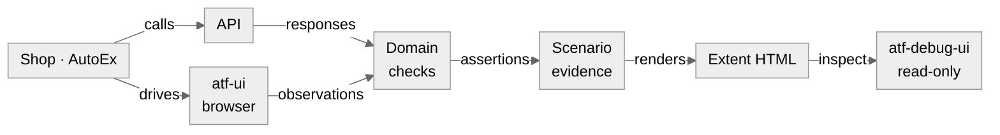
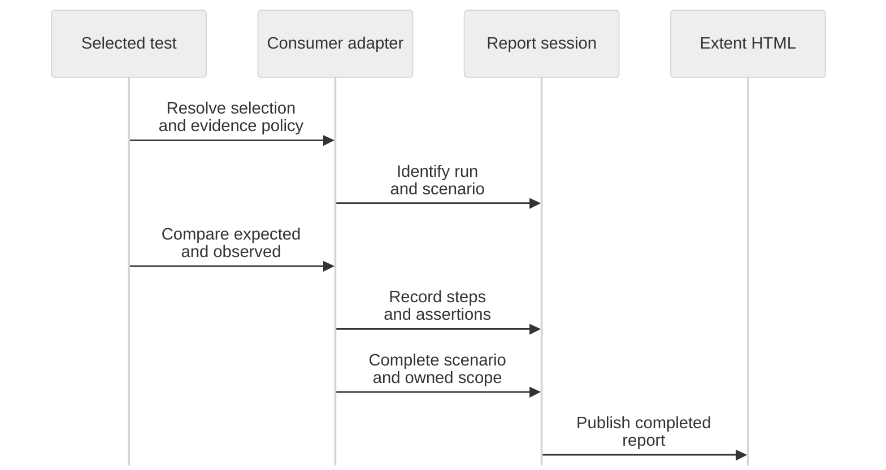
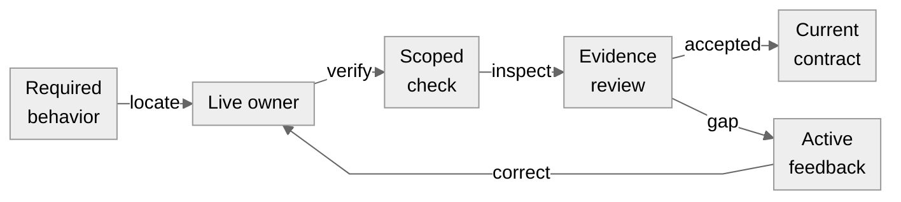

# ATF J1

ATF J1 is a Java/Maven project for testing two sample applications: Practice Shop and Automation Exercise (AutoEx). It exercises API flows and browser behavior, with application-owned expectations, verdicts and report evidence.

<a id="at-a-glance"></a>
<a id="pe-scurt"></a>

## At a glance

- **Application ownership:** Shop and AutoEx own configuration, pages, API contracts, journeys and expected results. Shared browser actions return observations; the application decides whether they meet its contract.
- **Auditable results:** application suites with a report contract publish Extent HTML. Audited component checks appear in a collapsible **Component assertions** step; unit tests do not publish Extent reports.
- **Independent inspection:** a read-only report viewer exposes generated HTML; governance checks the reactor, source boundaries, test conventions and documentation.

<a id="local-modules"></a>
<a id="module-locale"></a>

## Local modules

The [root POM](pom.xml) declares five local modules. The table describes local ownership; diagram arrows below describe execution and evidence, rather than Maven dependency direction.

| Module | Owns | Boundary |
|---|---|---|
| atf-validation | [Response contracts and validation rules](atf-validation/README.md) | Reusable validation port; Shop and AutoEx keep their own domain checks. |
| atf-ui | [Playwright sessions, browser policies and observations](atf-ui/README.md) | Browser mechanics, without application-specific verdicts. |
| atf-test-practice-shop | [Practice Shop scenarios and evidence](atf-test-practice-shop/README.md) | API, UI and checkout expectations belong to Shop. |
| atf-test-auto-ex | [Automation Exercise scenarios and evidence](atf-test-auto-ex/README.md) | AutoEx owns its API/UI adapters and opt-in E2E journeys. |
| atf-tests | [Reactor governance](atf-tests/README.md) | Checks architecture, artifacts, code, tests and guides. |

<a id="local-evidence-flow"></a>
<a id="fluxul-dovezilor"></a>

## Local evidence flow

### From observation to verdict

A transport response or browser observation becomes evidence only when the consumer binds it to a scenario and an explicit expectation. API-only and UI journeys can both publish reports; browser execution is not a prerequisite for an API report.



<details>
<summary>Legend — ownership and evidence boundaries</summary>

- Shop and AutoEx own the expected HTTP results, page state and business outcome. Their API evidence mappers and report publishers retain that ownership.
- `atf-ui` returns neutral observations. Screenshots, selected traffic and assertion details follow the scenario's evidence policy.
- `atf-validation` is a separate reusable module, not an automatic stage in the two consumers' API paths. Its contract is verified independently.
- The read-only inspector examines the generated HTML; it does not create the report or establish that controls render or expand correctly. [Reporting contract](docs/ATF_Reporting_Contract.md)

</details>

### Report lifecycle

The lifecycle below describes report-producing tests. Component auditing and browser journeys use different adapters, while keeping scenario identity, explicit assertions and final publication visible.



<details>
<summary>Legend — completion, component assertions and rendering</summary>

- Run ownership controls session closure and file publication. Launch metadata identifies the real selection; it does not turn an unexecuted test into evidence.
- Audited component assertions are grouped under **Component assertions**. Application steps and failure evidence retain their own scenario structure.
- Report acceptance checks the generated artifact and rendered behavior, including nested disclosure controls. See the [testing guide](docs/ATF_Testing_Guide.md) for the required layer.

</details>

<a id="test-layers"></a>
<a id="niveluri-de-testare"></a>

## Test layers

Choose the smallest layer that observes the contract. Test level, execution channel and evidence policy describe different concerns; an API call alone does not make a test E2E.

| Layer | Establishes | Evidence boundary |
|---|---|---|
| Unit | Pure rules and value transformations. | JUnit results; no Extent report. |
| Component | A production component through controlled collaborators. | Audited assertions in the component report; no claim of live-site acceptance. |
| Integration | Composition across local boundaries. | Only the contracts and artifacts actually exercised. |
| E2E | A selected application journey through its configured environment. | Application verdicts, selected API/UI evidence and rendered report acceptance. |
| Support | Reusable fixtures and probes. | Contributes observations; does not supply an independent business verdict. |

<a id="verify"></a>
<a id="verificare"></a>

## Verify

Use JDK 21 and Maven from an isolated copy with its own output directories and Maven cache. Start with the whole-reactor governance suite; this command includes required modules without requesting the same suite from modules that do not own it.

```powershell
mvn -B -ntp -pl atf-tests -am test '-Dtest=WholeAtfGovernanceSuiteTest' '-Dsurefire.failIfNoSpecifiedTests=false'
```

Then select the owning module and the required component, API or browser suite from its guide. Live journeys require their configured endpoints and browser prerequisites; governance success alone does not establish those journeys. [Safe execution](docs/ATF_Build_And_Execution_Safety.md)

### A governed change



<details>
<summary>Legend — proof and documentation maintenance</summary>

- Governance protects source boundaries, test conventions, links, local documentation scope and EN/RO parity. It complements behavior tests.
- A completed fix updates its owning contract where it adds lasting value. Feedback retains actionable gaps rather than completed-run journals.
- The English and Romanian editions keep the same paths, commands, diagram topology and technical facts. [Documentation standard](docs/README_Atf_DocumentationBestPractices.md)

</details>

<a id="further-reading"></a>
<a id="lecturi-suplimentare"></a>

## Further reading

| Question | Owner guide |
|---|---|
| How are modules and evidence adapters composed? | [Architecture](docs/ATF_Architecture.md) |
| Which report and assertion rules apply? | [Reporting contract](docs/ATF_Reporting_Contract.md) · [Testing guide](docs/ATF_Testing_Guide.md) |
| How should code and guides evolve? | [Code practices](docs/README_Atf_CodeBestPractices.md) · [Documentation practices](docs/README_Atf_DocumentationBestPractices.md) |
| Where are deeper guides and remaining gaps? | [Documentation index](docs/README.md) · [Active feedback](docs/feedback/README.md) |

## Consumed library index

<a id="consumed-library-index"></a>
<a id="indexul-bibliotecilor-consumate"></a>

Dependency contracts, selected artifacts and their source notes are collected in the [local library index](lib/README.md).

The producer-owned Debug UI dependency is test-scoped and inspects existing HTML; it does not create or qualify reports. See the [J1 consumer guide](lib/README.DebugUi.md).
