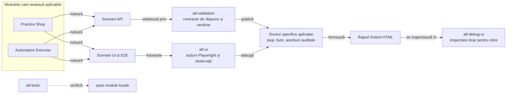

# ATF J1

ATF J1 este un proiect Java/Maven pentru testarea automată a două aplicații demonstrative: Practice
Shop și Automation Exercise (AutoEx). Acoperă fluxuri API și comportamentul în browser; modulul
fiecărei aplicații deține rezultatele așteptate și verdictul.

## Pe scurt

- Modulele Practice Shop și AutoEx dețin datele aplicației, fluxurile de test, verificările
  funcționale și verdictele; atf-validation verifică contractele răspunsurilor, iar atf-ui oferă
  acțiuni Playwright comune.
- Suitele cu raportarea în contract publică rapoarte HTML Extent. Verificările auditate de
  componentă apar în pasul colapsabil **Component assertions**; testele unitare nu publică rapoarte
  Extent.
- atf-debug-ui deschide rapoartele generate doar pentru citire, iar atf-tests verifică arhitectura,
  calitatea codului și a testelor, documentația și împachetarea.

## Module locale

| Modul | Responsabilitate |
|---|---|
| atf-validation | Contracte pentru răspunsuri, reguli de validare și publicarea verdictului local |
| atf-ui | Adaptor Playwright comun, politici de browser și observații neutre |
| atf-debug-ui | Inspectarea locală, doar pentru citire, a rapoartelor HTML generate |
| atf-test-practice-shop | Configurația Practice Shop, fluxuri API/UI/E2E, reguli funcționale și dovezi |
| atf-test-auto-ex | Configurația AutoEx, fluxuri API/UI, reguli funcționale, dovezi și E2E opțional |
| atf-tests | Guvernanța arhitecturii, dependențelor, împachetării, codului, testelor și documentației reactorului |

## Fluxul dovezilor



<details>
<summary><strong>Legendă — fluxul și limitele dovezilor</strong></summary>

- Practice Shop și AutoEx își păstrează configurarea, rezultatele așteptate și verdictul aplicației
  în propriile module de testare.
- atf-ui execută acțiunile generice de browser și returnează observații; testele aplicației decid
  care observații îndeplinesc aserțiunile.
- Raportul prezintă dovezile selectate de test. atf-debug-ui citește HTML-ul generat și nu execută
  teste.
- Săgeata punctată arată că guvernanța verifică modulele locale și regulile pentru cod, teste și
  documentație.

</details>

## Niveluri de testare

| Nivel | Se folosește pentru | Dovezi |
|---|---|---|
| Unitar | Reguli pure, modele și contracte de markup | Rezultat determinist; fără raport Extent |
| Componentă | Adaptor, componentă de randare sau date de test, cu modulele vecine controlate | Contract local; verificări auditate într-un pas colapsabil |
| Integrare | Colaborarea dintre module J1 reale | Comportament compus și raport atunci când suita îl publică |
| E2E | Comportament observabil al aplicației și al browserului | Interacțiune cu DOM-ul; randarea raportului când suita o verifică |
| Suport | Date de test, selectori și configurare reutilizabilă | Date de intrare; fără verdict independent |

Alege nivelul minim care demonstrează comportamentul. [Ghidul de testare](docs/ATF_Testing_Guide.md)
definește selecția suitelor; [ghidul API](docs/ATF_Api_Test_Guide.md) și
[contractul de randare a raportului](docs/ATF_Reporting_Display_Contract.md) descriu dovezile
cererilor și afișarea raportului.

## Verificare

Rulează poarta de guvernanță Maven dintr-o copie de lucru dedicată pentru verificare.
[Ghidul de compilare și execuție](docs/ATF_Build_And_Execution_Safety.md) descrie staging-ul și
locul artefactelor generate.

```powershell
mvn -B -ntp -pl atf-tests -Dtest=WholeAtfGovernanceSuiteTest test
```

## Lecturi suplimentare

- [Arhitectura proiectului și responsabilitățile modulelor](docs/ATF_Architecture.md)
- [Indexul documentației](docs/README.md)
- [Suitele Practice Shop](atf-test-practice-shop/README.md)
- [Suitele Automation Exercise](atf-test-auto-ex/README.md)
- [Semantica raportului Extent](docs/ATF_Reporting_Contract.md)
- [Practici de cod și testare](docs/README_Atf_CodeBestPractices.md)
- [Practici de documentare](docs/README_Atf_DocumentationBestPractices.md)
- [Feedback activ și criterii de închidere](docs/feedback/README.md)

## Indexul bibliotecilor consumate

Acest reactor consumă artefacte JAR/POM versionate din directorul local lib.
[Indexul bibliotecilor](lib/README.md) înregistrează contractele selectate și aria de acceptanță din
J1.
