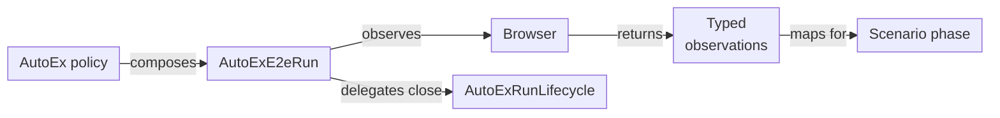

# AutoEx runtime — composition, observation, and finalization

## At a glance

This package composes the browser, checkpoints, and AutoEx publishing without
JUnit annotations. The AutoEx consumer owns it; business rules stay in the
flow/gate, and runner integration stays in `src/test`.

## Execution and ownership

Legend — scope, ownership and evidence

The runtime composes acquired resources and observation. AutoEx supplies expected values and evidence mapping; the lifecycle port keeps runner-specific finalization outside main. The source and starting tests below define acquisition, cleanup and cause preservation.

## Entry points and responsibilities

| When investigating | Read first | Boundary |
|---|---|---|
| a checkpoint or run finalization | [AutoExE2eRun](AutoExE2eRun.java) | facade over the browser, evidence, and finalization port |
| account owner before checkout | [identity observation](account/AutoExCustomerIdentityObservation.java) | reads a non-empty identity; the gate compares the owner |
| cleanup/publish/close order | [AutoExRunLifecycle](AutoExRunLifecycle.java) | runtime port; Kit/JUnit implementation stays in test |
| controlled business failure | [explicit acceptance](../../../../../test/java/atf/autoex/tests/e2e/failures/AutoExBusinessFailureAcceptance.java) | test fixture; real journey, original capture, cleanup of the owned account, and preserved JUnit FAIL |
| configuration and report session | [AutoExReportSession](AutoExReportSession.java) | factory and delegation to the Reporting library |
| invoice download | [AutoExInvoiceDownload](invoice/AutoExInvoiceDownload.java) | one click; recovery only for the observed queue-full invoice GET |
| invoice amount verdict | [pure validator](../business/invoice/AutoExInvoiceValidator.java) → [adapter](../support/checkout/AutoExInvoiceAssertions.java) | complete clause, syntax check before BigDecimal, faithful FAIL; no replay |
| product confirmation after click | [AutoExProductTransition](catalog/AutoExProductTransition.java) | one pointer action, explicit Close if an ad intercepts it, owned 2xx GET and configured name; one budget |
| search response and DOM | [AutoExCatalogSearch](catalog/AutoExCatalogSearch.java) / [AutoExSearchDocument](catalog/AutoExSearchDocument.java) | one pointer and owned 2xx GET, exact decoded term, fresh visible first product; queue-full fails without replay |
| ad shown after pointer action | [AutoExVignetteHandler](../support/browser/AutoExVignetteHandler.java) | explicit Close, no replay; child INFO within the parent duration |
| read-only readiness | [AutoEx navigation](navigation/AutoExReadOnlyNavigation.java) | policy specific to the AutoEx document and origin |
| mapping observed traffic | [AutoExObservedExchangeMapper](AutoExObservedExchangeMapper.java) | retains the typed query, service, and response availability in Reporting |

## Invariants to preserve

- Observation does not receive the client's expected value or authorize
  checkout. Delayed text and a replaced document use the original deadline.
- Product transition reads the visible heading/queue-full locator once per
  observation and avoids waiting again for a URL that is already confirmed.
  The document and product remain separate oracles; a refused Purchase port
  stops the flow before the business verdict and cart mutation.
- `AutoExE2eRun` explicitly requires configuration, browser, phase, and
  lifecycle; extracting runtime code does not move JUnit or Test Kit into main.
- Browser, publishing, timing, and cleanup are separate responsibilities.
  Finalization preserves the initial cause and distinct cleanup failures.
  If the original error was already captured, a later cleanup refusal publishes
  its own diagnostic without a new capture. It does not replace the original
  image or authorize replay; a publishing refusal remains suppressed on the
  cleanup error. The first failure caused by cleanup itself follows the existing
  capture path before the browser closes.
- Download is a measured action; a successful click does not confirm it. Only
  the real event authorizes reading the file; the validator checks the invoice.
- Queue-full permits only the exact same-origin invoice GET, within the existing
  budget and attempts. POST, foreign documents, and excessive backoff are refused.

## Tests to run before a change

| Contract | Starting test |
|---|---|
| product and refusals | [AutoExProductTransitionComponentTest](../../../../../test/java/atf/autoex/tests/component/pages/AutoExProductTransitionComponentTest.java) |
| search ownership and terminal outcomes | [response contracts](../../../../../test/java/atf/autoex/tests/component/pages/AutoExSearchResponseComponentTest.java) / [readiness](../../../../../test/java/atf/autoex/tests/component/pages/AutoExSearchReadinessComponentTest.java) |
| invoice and refusals | [AutoExInvoiceDownloadComponentTest](../../../../../test/java/atf/autoex/tests/component/pages/AutoExInvoiceDownloadComponentTest.java) |
| identity and single checkout | [AutoExCustomerIdentityObservationComponentTest](../../../../../test/java/atf/autoex/tests/component/pages/AutoExCustomerIdentityObservationComponentTest.java) |
| runtime boundary | [AutoExRuntimeBoundaryComponentTest](../../../../../test/java/atf/autoex/tests/component/lifecycle/AutoExRuntimeBoundaryComponentTest.java) |
| lifecycle order | [AutoExRunLifecycleAdapterComponentTest](../../../../../test/java/atf/autoex/tests/component/lifecycle/AutoExRunLifecycleAdapterComponentTest.java) |

Local tests verify the boundary; the same purchase run individually and through
a filtered suite verifies live integration. A new FAIL remains in feedback,
even if a later run passes. Normative details are in the [module contract](../../../../../../README.md).

Continue in the [AutoEx module guide](../../../../../../../atf-test-auto-ex/README.md).

The mapper uses the [Reporting query contract](../../../../../../../docs/ATF_Reporting_Library_Atlas.md#api-exchange-and-identity)
for safe aggregate identity. Browser capture removes values and carries only
the opaque fingerprint; the mapper does not fabricate pairs from placeholders.

Endpoint policy and checkpoint selection remain with AutoEx; the library
receives neutral contracts without a UI dependency.
`ReportAssertionSummary` owns only diagnostic formatting and redaction;
`AutoExE2eRun` retains comparisons and the business decision.

## Timing test boundary

The functional transition test uses the browser after fixture preparation,
with the action deadline unchanged. Deadline arithmetic and propagation are
verified deterministically by the UI owner through
`ObservationBudgetComponentTest`; Chromium startup or shutdown time is not an
oracle for that contract.
