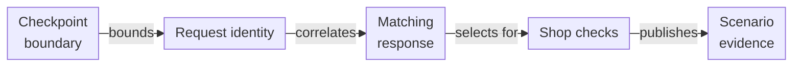

# Shop support — screen contracts and causal evidence

## At a glance

This package adapts Shop observations into screen contracts, validations, and
API evidence. It stays in main; the JUnit harness and suite selection stay in
test. The Shop model is the consumer reference for this separation, not a rule
for copying its endpoints or policies into AutoEx.

## Execution and ownership

Legend — scope, ownership and evidence

The flow follows evidence membership, not a second HTTP execution. Request start identity and the checkpoint boundary select the response; Shop compares independent expected values before publication. A late response or toast alone cannot establish a new successful mutation.

## Entry points and responsibilities

Conversion in [ShopApiEvidenceMapper](api/ShopApiEvidenceMapper.java) retains
the [typed query](../../../../../../docs/ATF_Reporting_Library_Atlas.md#api-exchange-and-identity)
for aggregate identity; the legacy view remains separate. Available pairs are
retained in full. For redacted browser capture, the journal and `withTrace`
retain only the opaque fingerprint; they do not reconstruct values or
parameters from placeholders.

Routes, the personal-field policy, and order selection belong to Shop.

The runtime factory passes the configured API origin to response capture. This
preserves delivery at `response`, as used by Shop gates; subscribing to the UI
inspector's `request-finished` event requires explicit reconciliation of when
observations are consumed.

| Entry point | Boundary |
|---|---|
| `attach(Page, URI)` | configured API origin with normalized scheme/host/port; used by runtime |
| `attach(Page)` | compatibility for existing adapter tests, using the historical demo host |
| `attach(UiNetworkInspector)` | neutral subscription is available; the caller must consume completed observations before the business gate |

Publishing non-HTTP groups and safe summaries is delegated to Reporting.
`ShopApiReportPublisher` retains the title, expected values, and business
result; an assertion group is no longer represented by an artificial `ASSERT`
request.

| When investigating | Read first | Boundary |
|---|---|---|
| what is read from the screen | [ShopPageValidator](validation/ShopPageValidator.java) | observes the page contract and produces typed results |
| which traffic belongs to a checkpoint | [ShopApiNetworkJournal](api/ShopApiNetworkJournal.java) | journal from the same UI session; does not create another cart |
| which exchange is selected | [ShopApiExchangeSelector](api/ShopApiExchangeSelector.java) | ordered selection; checks query and payload separately |
| whether the order request is new | [ShopOrderRequestWindow](api/correlation/ShopOrderRequestWindow.java) | identity at request start, distinct from response order |
| confirmation that an item was added to the cart | [ShopCartAdditionConfirmation](cart/ShopCartAdditionConfirmation.java) | request started after arming, owned payload, and response for that same request |
| why the catalog is not ready | [ShopCatalogReadiness](catalog/ShopCatalogReadiness.java) | observes GET/QUERY; permits at most one home GET after a confirmed transient state |
| which event the catalog produced | [ShopCatalogObservation](catalog/ShopCatalogObservation.java) | listeners, current request, receipt, and document; no refresh decision |
| where the observed address comes from | [ShopPostalLookup](billing/ShopPostalLookup.java) and [ShopBillingPage](../pages/ShopBillingPage.java) | new request, current tuple, complete response, and matching DOM |

## Invariants to preserve

- Expected values come from configuration/fixtures; actual values are read
  independently. Do not replace missing values or derive expected values from
  the report preview.
- The latest eligible order can FAIL. An old `201` does not cover a later `500`;
  a capture started before the marker does not become new when it arrives.
- The numeric marker reads the receipt after the browser barrier and saves the
  fence at the returned key. A collision between different windows is
  ambiguous and refused; the typed marker remains independent and is used by Confirm.
- A toast does not confirm the mutation. The response to the corresponding POST
  is awaited within the single click's budget; the cart is then validated
  independently, without replay.
- Browser acquisition belongs in runtime, and captures belong in evidence.
  `support` does not become a second composition root or JUnit registry.
- Billing arms observation before input and consumes the application's debounce
  within the existing budget. Configured fields drain possible autofill, then
  are typed once; postal lookup requires a current response and matching DOM.
- Catalog and lookup compose the UI scope: callbacks are inert during partial
  attachment and after close; removals preserve the primary cause and distinct
  failures.
- Catalog observation is separate from transient-state classification and the
  single home refresh. Readiness consumes the same `ObservationBudget`; GET/QUERY
  and the latest eligible request remain Shop policy, distinct from the strict
  backend observer.

## Tests and related contracts

| Contract | Starting test |
|---|---|
| cart acceptance without a toast | [ShopCartAcknowledgementComponentTest](../../../../test/atf/shop/tests/component/cart/ShopCartAcknowledgementComponentTest.java) |
| ownership at request start | [ShopOrderRequestStartComponentTest](../../../../test/atf/shop/flow/ShopOrderRequestStartComponentTest.java) |
| numeric snapshot and collisions | [ShopLegacyMarkerComponentTest](../../../../test/atf/shop/tests/api/network/causality/ShopLegacyMarkerComponentTest.java) |
| nominal catalog state and refusal | [ShopCatalogReadinessComponentTest](../../../../test/atf/shop/tests/component/catalog/ShopCatalogReadinessComponentTest.java) |
| catalog lifecycle errors | [ShopCatalogLifecycleComponentTest](../../../../test/atf/shop/tests/component/catalog/lifecycle/ShopCatalogLifecycleComponentTest.java) |
| autofill/input race and refusals | [ShopBillingSynchronizationComponentTest](../../../../test/atf/shop/tests/component/billing/ShopBillingSynchronizationComponentTest.java) |
| address from the current lookup | [ShopPostalLookupComponentTest](../../../../test/atf/shop/tests/component/billing/ShopPostalLookupComponentTest.java) |
| Account/Cart/Purchase failure and healthy sibling | [explicit acceptance](../../../../test/atf/shop/tests/e2e/failures/ShopBusinessFailureAcceptance.java) — real flow and validations; injection only in test, individual/shared report |

The concrete purchase starts in [ShopBrowserRuntime](../runtime/ShopBrowserRuntime.java).
Contracts and tests for the other checkpoints remain in the [module contract](../../../../../README.md).

The reusable scope has a [UI contract](../../../../../../atf-ui/README.md#observation-listener-scope).
Lookup observes application traffic; it does not issue a second GET or overwrite generated fields.

Continue in the [Shop module guide](../../../../../../atf-test-practice-shop/README.md).
