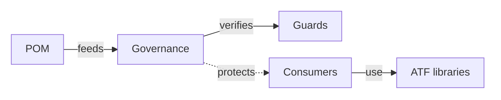
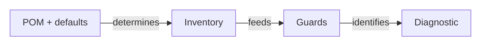

# ATF Tests — Whole-Reactor Governance

## At a glance

**Quick links:** [Whole-ATF](#whole-atf-suite-and-compatibility-residue) · [Java source roots](#shared-java-source-inventory) · [Git controls](#test-change-governance) · [Gates and limits](#quick-verification)

- `atf-tests` is ATF's project-control module;
- it verifies the reactor, Maven/source boundaries, and architecture gates;
- it does not own product tests;
- it contains no locators, page objects, or application flows.



<details>
<summary><strong>Legend — what atf-tests governs</strong></summary>

- the root POM and module graph are included in the whole-reactor gate;
- atf-tests verifies boundaries; it does not implement application flows;
- Practice Shop and AutoEx are local application consumers; the libraries they
  use are selected as versioned binary dependencies;
- `Checks` groups architecture, scope, and runtime-safety checks;
- the dotted edge shows a guard applied to consumers, not ownership transferred to governance;
- consumers use libraries through explicit dependencies, and governance verifies
  that direction without becoming part of runtime.
Short labels carry the following meanings:

| In the diagram | Full meaning |
|---|---|
| Guards | architecture + runtime guards |
| Consumers | consumer modules |
| ATF libraries | ATF libraries |

</details>

| Responsibility | Owner | Explicit exclusion |
|---|---|---|
| reactor, POM, and dependency direction | `atf-tests` | does not modify production code |
| source/package ownership and module placement | `ArchitectureModuleBoundaryTest`, `ArchitectureOwnershipBoundaryTest` | does not own application selectors |
| relocatable documentation and consistent sources | `governance.documentation.*`, `AtfSourceReadabilityGovernanceTest` | does not validate one consumer's content |
| constant ownership and package cohesion | `ConstantsOwnershipGovernanceTest`, `AtfPackageCohesionGovernanceTest` | maximum 8 classes per package in production and test source sets across all reactor modules; exceptions must be explicit |
| Practice Shop purchase journey | `atf-test-practice-shop` | is not copied here |
| Shop/AutoEx consumer report scenarios and assertions | their own consumer modules | remain with the consumer |

## Choose the gate for the change

| Change | Entry point | What it confirms |
|---|---|---|
| README, map, or feedback | [documentation](#documents-and-responsibilities) | links, structure, diagrams, prose, and factual claims covered by the guard |
| protected test changed | [Git control](#test-change-governance) | one eligible owner per path and base; no oracle relaxation |
| dependency, package, or source set | [Whole-ATF](#whole-atf-suite-and-compatibility-residue) | the reactor's executable boundary |
| business outcome or rendering | the owning module's test | actual behavior, in addition to governance |

An intact structural gate certifies the rules it implements. A statement's
accuracy, a report verdict, and an application outcome also require the owning
proof; YAML `proof` commands are run separately.

For IntelliJ and Maven, use the same [staging with real Git](../docs/ATF_Build_And_Execution_Safety.md#staging-for-test-change-governance).
The [Java source roots](#shared-java-source-inventory) map explains consumer
layouts before moving any tests.

## Library artifact and module-boundary governance

| Surface | Local source of truth | Governing evidence |
|---|---|---|
| J1 reactor | root Maven POM and six declared modules | module and dependency-boundary checks |
| Consumed libraries | five versioned JAR/POM pairs in `lib` | coordinates, physical bytes, provenance, and loaded identity |
| Reporting acceptance | selected J1 component and UI scenarios | assertion structure, HTML rendering, and report navigation |

A declared local module that is missing is an error; profiles are not inferred
from directories. The suite checks this reactor and does not inspect a sibling
workspace.

`WholeAtfGovernanceSuiteTest` selects the explicit local gates. The
[deployment package](src/test/java/atf/api/tests/governance/distribution/README.md)
documents the library-artifact and module-boundary checks.

| Rule | Local reactor | Consumed artifact |
|---|---|---|
| modules and dependencies | live POM defines module inventory and scopes | selected library coordinates resolve from flat JAR/POM pairs |
| documentation | local module contracts and feedback | artifact catalog matches POM properties and physical filenames |
| source boundary | module ownership and package restrictions | no source shadow or forbidden duplicate classes in the JAR |
| independence | declared module dependencies | published POM and bytecode dependency checks with JDK `jdeps` |
| identity | Maven module and loaded class | version, JAR/POM, provenance hashes, embedded POM, and CodeSource |
| verification evidence | selected J1 tests | provenance catalogs package inputs; it does not claim native tests ran in J1 |

Deleted modules, missing coordinates, altered artifacts, and hidden dependencies
have negative controls. Documentation mutants change only the documented claim
while keeping the POM and files intact.

Git test-change governance uses this checkout's review base. It does not compare
against or require a neighboring workspace.
## Whole-ATF suite and compatibility residue

[`ReportUiActionAdapters`](src/test/java/atf/ui/tests/support/reporting/ReportUiActionAdapters.java)
is compatibility support in the test source set, not an executable test or
production code. Its presence does not transfer UI test or reporting ownership
to `atf-tests`; `ArchitectureOwnershipBoundaryTest` protects
this boundary.

```text
src/test/java/atf/api/tests/governance/
├── ArchitectureModuleBoundaryTest.java
├── ArchitectureOwnershipBoundaryTest.java
├── AtfPackageCohesionGovernanceTest.java
├── AtfGovernanceRules.java
├── AtfGovernanceTestSupport.java
├── AtfSourceReadabilityGovernanceTest.java
├── ConstantsOwnershipGovernanceTest.java
├── changes/          change-control schema, Git diff, and negative checks
├── console/          UI/API defaults and composition roots
├── layers/           global classification and disjoint consumer-suite coverage
├── documentation/
│   ├── language/     branch policy and visible-prose checks
│   ├── structure/    owner README hierarchy, document population, and collapsible-block checks
│   ├── factual/      POM, workspace, and consumer-configuration evidence
│   ├── links/        Markdown heading and HTML anchor index
│   ├── relationship/ direct J1 documentation relationship boundary
│   ├── DocumentationDiagramGovernanceTest.java
│   ├── DocumentationProseGovernanceTest.java
│   ├── DocumentationAnchorGovernanceTest.java
│   ├── DocumentationStyleGovernanceTest.java
│   ├── DocumentationTargetGovernanceTest.java
│   ├── DocumentationGovernanceSupport.java
│   └── DynamicPathDocumentationArchitectureTest.java
└── WholeAtfGovernanceSuiteTest.java
```

`config/atf-governance-policy.json` declares `documentationLanguage` for the
current branch. The `tools/documentation-editions.mjs` tool compares the
`main` and `main_RO` worktrees, including the Markdown inventory, list/table/diagram
structure, link destinations, and parity of non-Markdown files. The Node.js test
is `tools/documentation-editions.test.mjs`.

`WholeAtfGovernanceSuiteTest` is the explicit entry point for whole-reactor
verification. It groups reactor and documentation checks while each consumer
keeps ownership of its application scenarios:

- `ArchitectureModuleBoundaryTest` — reactor, POM, dependency direction,
  forbidden imports, process output, static state, and removal of
  `atf-execution`;
- `ArchitectureOwnershipBoundaryTest` — module placement, package roots,
  reporting/UI ownership, and absence of duplicates;
- `AtfPackageCohesionGovernanceTest` — cohesion of governed production packages
  and test source sets in the six modules declared by the root POM;
  the limit is eight classes maximum, and the diagnostic identifies the module,
  package, and concrete classes for any new hotspot or stale exception;
- `AtfSourceReadabilityGovernanceTest` — duplicate imports in local Maven main/test sources and the configured reporting-call boundary; comments and literals are lexically excluded;
- `layers.AtfTestLayerArchitectureTest` — inventories `sourceDirectory` and
  `testSourceDirectory` roots from the POM (using Maven defaults), then checks
  the level of every executable class; nested fixtures do not change the level
  of the enclosing class;
- `layers.ConsumerSuiteCoverageGovernanceTest` — exactly three primary suites
  per consumer, with no omitted classes, overlapping selections, or mixed
  local/E2E/live API coverage; reads the owner's declaration and executable
  selectors, without promoting comments or nested fixtures to gates. It also
  checks explicit scope for component reports;
- `consumers.ConsumerModuleArchitectureGovernanceTest` and
  `ConsumerAuditSourceGraphTest` — shared annotation resolver for audit/layer,
  aliases, inheritance, and imported helpers; comments, literals, and nested
  fixtures do not exclude the executable owner. Source analysis does not replace
  launcher/report evidence;
- `ConstantsOwnershipGovernanceTest` — protocol vocabulary, routes, and the
  selected library binary boundary;
- `governance.documentation.DynamicPathDocumentationArchitectureTest` — relocatable documentation,
  relocatable, without machine paths or concrete generated artifact names;
- `governance.documentation.structure.DocumentationReadmeStructureGovernanceTest` — one title,
  an orientation section that matches the policy (`At a glance` on `main`, `Pe scurt`
  on `main_RO`), balanced `<details>` blocks, and resolvable local links in all
  READMEs and `docs/ATF_Architecture.md`;
- `governance.documentation.language.DocumentationLanguageGovernanceTest` — checks the language
  of visible Markdown prose and Mermaid labels across all documents, while
  preserving identifiers, commands, and code examples;
- `governance.documentation.relationship.DocumentationDirectRelationshipGovernanceTest` — checks
  every current J1 Markdown line, including fenced examples, and `AGENTS.md` for
  references to other ATF workspaces; only the historical
  test-change baseline is excluded and retains its original audit identifiers;
- `governance.documentation.DocumentationStyleGovernanceTest` — ATF semantic style:
  typed fences, headings without skipped levels, `-` bullets, and no font/CSS/HTML
  presentation markup in READMEs or the canonical architecture document;
- `governance.documentation.DocumentationProseGovernanceTest` — limits quick-scan
  prose to at most three sentences per paragraph and two consecutive dense
  paragraphs; dense responsibilities, boundaries, and relationships should move
  into bullets, tables, diagrams, or `<details>`;
- `governance.documentation.DocumentationTargetGovernanceTest` — plug-and-play example
  with `@DocumentationTarget("atf-test-practice-shop/README.md")`; the same class
  can validate any README across all documentation modules;
- `governance.documentation.DocumentationDiagramGovernanceTest` — `LR` orientation,
  immediate legend, balanced fences, and labeled relationships in non-root
  READMEs;
- `governance.documentation.DocumentationGovernanceSupport` — shared vocabulary for
  diagnostics: code, file, line, rule, and fix. It does not hide exceptions or
  turn feedback into “pass.”

Each documentation violation must dynamically identify the file and line,
the rule that is violated, and the minimum change that can fix it. A README may
intentionally remain red during reconciliation; the suite must make the gap
reproducible, not bury it in an exception.

Governance tests are a protected contract: do not modify, disable, or weaken
them to turn a red README into a pass. Change them only through direct feedback
that changes the rule, owner, criterion, or required evidence; otherwise, fix
the target document.

For a targeted check, change only the annotation value:

```java
@DocumentationTarget("atf-test-practice-shop/README.md")
class ConsumerReadmeGovernanceTest {
}
```

The targeted test calls the same validators as the whole-ATF suite: structure,
style, prose, diagrams, relocatability, and artifact names.

The repeatable `DocumentationTarget` declaration belongs to
`atf.testkit.documentation`; the target list and validators remain here.
The [annotation contract](../docs/ATF_Test_Infrastructure_Annotations.md) explains
ownership and composition limits.

The suite checks local reactor rules and the consumed library artifacts. It
does not replace consumer tests for application behavior or generated report
output.

<details>
<summary><strong>Cleanup target tracked in feedback</strong></summary>

- `atf-tests` should retain the whole-reactor guard and only the support strictly
  required by it;
- reporting/UI adapters are moved or removed only after boundary evidence and
  verification of the canonical consumer;
- an existing test-scope dependency is not declared “removed” merely because
  the desired ownership is described in the table;
- every change is closed through the POM, import scan, and architecture test.

</details>

## Shared Java source inventory

`layers.AtfJavaSourceInventory` is test support in `atf-tests`, used by layer
and readability governance. It reads the same roots for each POM, including
Shop's `src/main` and `src/test`.



<details>
<summary><strong>Legend — implemented source inventory</strong></summary>

- POM + defaults: direct `build/sourceDirectory` and
  `build/testSourceDirectory` declarations, with Maven defaults when absent.
- Inventory: distinct, ordered Java files, even when roots overlap.
- Guards: the same sources for architecture and duplicate-import checks.
- Diagnostic: the file/rule or POM that declares an invalid root.

</details>

- POM discovery stops traversal of `target`, `artifacts`, `.tmp`, and `.git`
  output directories. Declared Java roots are then traversed completely; a
  package's legal name does not exclude compilable source.
- An empty, out-of-module, unsafe, or unresolved Maven-expression root produces
  a diagnostic.
- The inventory reads literal paths from the POM; it does not replace the
  effective POM, inheritance, or Maven profile activation. XML comments do not
  declare roots.
- The expression guard applies when reporting composition sources are part of
  the declared reactor. This binary consumer verifies artifact identity and
  rejects copied reporting namespaces; the source-call rule retains its three
  reviewed adapters.

### Two inventories with distinct responsibilities

| Entry point | What it inspects | Evidence limit |
|---|---|---|
| `atf.api.tests.governance.layers.AtfJavaSourceInventory` | Maven main/test roots for layer and readability guards | literal selection and the exclusions described above |
| `atf.core.files.AtfJavaSourceInventory` | package declarations from an already selected root, for cohesion | does not resolve POMs or demonstrate Maven inventory coverage |

A passing Core grouping test does not close the Maven guard-selection gap.
The [coverage criterion](README.md#shared-java-source-inventory) requires
comparing compilable sources with those actually inspected.

The [inventory test](src/test/java/atf/api/tests/governance/AtfSourceReadabilityGovernanceTest.java)
independently compiles sources in `target`/`artifacts` packages and requires the
violation to be detected in each file; module output remains outside the selection.

## Test change governance

Tests in ATF modules are changed through structured technical controls tied to
the owner's requirement. The only
exception is `atf-test-practice-shop`; the cohesion limit and other architecture
rules continue to apply to it.

| Control | Rule |
|---|---|
| Scope | all files under `<module>/src/test/`, including support, resources, and suites; the root `pom.xml` and module POMs, with only Shop excluded |
| Request/control | YAML `testChanges` block, unique ID, `ACTIVE` in owner feedback or `VERIFIED` in the baseline, reason, Maven proof command, expiry, and baseline SHA |
| Files | exact relative paths; no wildcard, traversal, or multiple owners for the same change |
| Deletion / rename | `allowDelete: true` for the old path; a rename is evaluated as a deletion plus an addition |
| Git diff | committed changes against the baseline, staged, unstaged, and new files; new tests ignored by Git are not exempt either |
| Infrastructure failure | invalid checkout or baseline, conflict, or invalid YAML produces FAIL, not skip |

`TestChangeGovernanceTest`, `TestChangePolicyTest`, and `GitTestChangesTest` are
included in `WholeAtfGovernanceSuiteTest`. Negative checks cover missing,
closed, expired, incomplete requests, requests with a foreign baseline,
duplicates, and unauthorized deletions; the real Git fixture also checks names
with spaces and renames.

For local runs, including IntelliJ, the default base is `HEAD`. For a complete
branch, set `-Datf.governance.testChanges.baseRef=<review-base>`; CI requires
this property or `ATF_TEST_CHANGE_BASE_REF` explicitly and rejects the literal
value `HEAD`. The base must be an ancestor of the current commit; the request
pins the resolved SHA, not a moving ref.

### Documents and responsibilities

[DocumentationLinkGovernanceTest](src/test/java/atf/api/tests/governance/documentation/links/DocumentationLinkGovernanceTest.java)
checks local destinations and fragments in all READMEs and Markdown documents
under `docs`, including architecture, owner contracts, and feedback. Generated outputs
are excluded. [Anchor checks](src/test/java/atf/api/tests/governance/documentation/DocumentationAnchorGovernanceTest.java)
also check a renamed heading in a document that is not named README. Both are
included in the whole-ATF suite; `@DocumentationTarget` applies the same check
to explicitly selected documents. The target's existence does not certify the
meaning of its label.

[DocumentationContextArtifactGovernanceTest](src/test/java/atf/api/tests/governance/documentation/structure/DocumentationContextArtifactGovernanceTest.java)
rejects general project maps, dated or library-versioned verification/acceptance
snapshots, and provenance pointers to committed run reports. Its negative fixture
writes only under JUnit temporary storage.

[DocumentedBuildContractTest](src/test/java/atf/api/tests/governance/documentation/factual/DocumentedBuildContractTest.java)
compares the modules and Kit scope with the actual POMs.
[DocumentedLibraryCatalogTest](src/test/java/atf/api/tests/governance/documentation/factual/DocumentedLibraryCatalogTest.java)
compares the five documented library coordinates and JAR/POM paths with the root POM, physical files, and local library guides. Mutants in version, artifact path, and guide inventory must be rejected. It requires no neighboring checkout.
[DocumentedUiGeometryContractTest](src/test/java/atf/api/tests/governance/documentation/factual/DocumentedUiGeometryContractTest.java)
extends the same factual boundary to selected numeric geometry, without
Reporting sources. These checks are explicitly selected by
`WholeAtfGovernanceSuiteTest`.

| Bounded claim | Executable source | Observable rejection |
|---|---|---|
| module count in the architecture | direct `modules/module` declarations in the POM | different count, missing claim, or duplicate claim |
| consumed library inventory | root POM, physical `lib` pairs, and library index | stale version, missing pair, or missing/duplicate guide |
| Kit in the consumer matrix | direct POM dependency; omitted scope means `compile` | different scope, Kit absent, or Kit present in both columns |
| generic zoom versus configured example | `UiBrowserConfiguration.defaults()` | a specific example does not redefine the runtime default |
| CSS and DPR in the UI example | `UiViewportScale` for declared inputs | derived geometry does not match the executable model |
| output, zoom, CSS, and DPR in Shop/AutoEx | delivered YAML and the same UI model | each numeric field can be rejected independently; no parallel value registry |

Mutants change only the document; the YAML and POM remain intact. Missing,
duplicate, and fence-hidden declarations are rejected with the document, line,
declared/observed value, and executable source.

The numeric guard checks configured intent and the layout model, not screenshot
pixels. [Native UI checks](../atf-ui/README.md#native-context-geometry)
separately verify the pointer, viewport, DPR, and browser capture.
Prose ambiguities and unselected claims remain subject to manual review.

| Information | Documentation owner | Content |
|---|---|---|
| Functional requirement | [owner feedback](../docs/feedback/README.md) | observable gap, owner, criterion, and missing evidence |
| Active technical control | owner's feedback document in [`docs/feedback`](../docs/feedback/README.md) | only `ACTIVE` entries for in-progress diffs, alongside the requirement they authorize |
| Verified technical control | [verified register](../docs/ATF_Test_Changes_Baseline.md) | business context, roles, lifecycle, and collapsed `VERIFIED` entries |
| Stable behavior | owner's README or contract | implemented and demonstrated rule |

The parser discovers YAML blocks in all Markdown documents under
`docs/feedback` and in `docs/ATF_Test_Changes_Baseline.md`. Project procedure
keeps `ACTIVE` controls with the owner's feedback and `VERIFIED` controls in
the baseline; a separate active register is not needed.

<details>
<summary><strong>Control schema and field effects</strong></summary>

| Field | Executable contract |
|---|---|
| `id` | unique identifier across all read documents, including ineligible entries |
| `status` | `ACTIVE` and `VERIFIED` may be eligible; `DRAFT` and `CLOSED` do not authorize the change |
| `base` | immutable SHA, equal to the resolved base for the gate run |
| `expires` | ISO date; the control remains eligible on that date |
| `reason` | text of at least 20 characters explaining the change |
| `proof` | declared Maven `test` or `verify` command, run separately from the gate |
| `paths` | non-empty list of exact relative protected paths, distinct within the control |
| `allowDelete` | optional boolean, `false` by default; `true` for a deletion |

- The YAML block has one `testChanges` key and a non-empty list; unknown fields
  and duplicate keys are rejected.
- Do not copy an ID when transferring a control; among eligible controls, each
  changed path has one owner for the run's base and date.
- Governance also reads YAML inside `<details>` that are collapsed by default;
  Markdown visibility does not change eligibility.

</details>

### Reconciliation and closure

1. Inspect live sources, the functional criterion, and the diff against the review base.
2. Record the `ACTIVE` control in the owner's feedback, with exact paths, before making the protected change.
3. Run the relevant proof and gate in [external staging with real Git](../docs/ATF_Build_And_Execution_Safety.md#staging-for-test-change-governance); the renderer also requires a rendering check.
4. Promote the demonstrated contract to its owner; remove only the fulfilled criterion from feedback.
5. Move the control to the `VERIFIED` baseline if the diff still requires it, retaining its ID and removing the `ACTIVE` block from feedback.
6. Remove the control when the base used by the gate no longer reports the covered changes; recheck the diff-to-control mapping.

`VERIFIED` attests to the verified increment, separately from acceptance of the
entire requirement. The gate validates metadata and diff-to-control mapping;
`proof` commands run separately, and approval of a rule change remains explicit.

At expiration or when the base changes, review the scope and evidence before
updating the control. Active controls do not have a dedicated file: they stay
in the owner's feedback only as long as needed; the procedure remains here, and
the `docs/feedback/README.md` index is retained permanently.

## Console detail governance

`ConsoleDefaultsGovernanceTest` protects the local default details and UI/API
wiring used by consumer modules. The selected Console library supplies event
formatting and delivery; the YAML `false` override remains supported.

## Separate consumer modules

Tests for `https://practicesoftwaretesting.com` are isolated in
`atf-test-practice-shop`. Its YAML, checkout configuration, locators, page
objects, flows, and component/E2E tests live there. The primary guest flow does
not require a secret. `ShopNewAccountPurchaseE2eTest` creates a synthetic
account; when run separately, `ShopAuthenticatedPurchaseE2eTest` uses the local
fixture and reuses the newly created account in `ShopE2eSuite`.

```text
atf-test-practice-shop/src/
├── main/atf/shop/
│   ├── api/         client, request factory, and screen API flows
│   ├── config/      typed records loaded from YAML
│   ├── locators/    sole owner of application selectors
│   ├── pages/       page objects
│   ├── flow/        composed business steps
│   └── support/     context and evidence adapters
├── test/atf/shop/tests/
│   ├── component/       fast module tests
│   ├── api/component/   positive/negative fake variations
│   ├── api/integration/ live login precondition, opt-in
│   └── e2e/             purchase journey and report/browser lifecycle
└── test/resources/atf-practice-shop.yaml
```

`atf-tests` does not own business classes, locators, flows, or Practice Shop/AutoEx
fixtures. It scans local consumer sources for reactor rules without importing
their test classes. Tests that verify the external application and generated
report behavior stay with Shop or AutoEx; shared report behavior comes from the
selected Reporting library.

## Running and staging

```text
mvn -pl atf-tests -am "-Dtest=WholeAtfGovernanceSuiteTest" "-Dsurefire.failIfNoSpecifiedTests=false" test
mvn -pl atf-tests -am test
mvn -pl atf-tests -am "-Dtest=ConsumerModuleArchitectureGovernanceTest" "-Dsurefire.failIfNoSpecifiedTests=false" test
```

Business commands are in [Shop](../atf-test-practice-shop/README.md#quick-verification)
and [AutoEx](../atf-test-auto-ex/README.md#run-selection), with their own opt-ins.

Builds run in external staging (`${ATF_STAGING_ROOT}/...`), without stopping
active executions. Synchronize only approved files, after rereading live state
and reconciling parallel changes; do not copy `target`, `artifacts`, or caches
over live content. The normative procedure is
[`docs/ATF_Build_And_Execution_Safety.md`](../docs/ATF_Build_And_Execution_Safety.md).

## Ownership rule

```text
whole reactor / module graph / architecture gates → atf-tests
Practice Shop config / locators / pages / flows / E2E → atf-test-practice-shop
Shop / AutoEx scenarios and local report checks → their J1 modules
renderer / HTML / CSS / public reporting API → selected Reporting library
```

General OOP, locator boundary, and layering rules are in
[`docs/README_Atf_BestPractices.md`](../docs/README_Atf_BestPractices.md), and
the migration status is in [`docs/feedback/README.md`](../docs/feedback/README.md).

### README links to sections

The structure guard resolves Markdown paths and fragments, in the source file
or across files. The index preserves Unicode, duplicate-heading suffixes, and
explicit HTML anchors; it ignores examples in backtick/tilde fences and keeps
the original line in the diagnostic. Percent-encoded paths and fragments are
decoded without converting `+` to a space.

`DocumentationAnchorGovernanceTest` also checks heading deletion after a valid
link: `DOC-README-ANCHOR` identifies the README, line, and fix even if the
deleted heading still appears in a fenced example. The heading rule follows
[GitHub's convention](https://docs.github.com/en/get-started/writing-on-github/getting-started-with-writing-and-formatting-on-github/basic-writing-and-formatting-syntax#section-links).

## Quick verification

| Decision | Source and limit |
|---|---|
| whole-reactor boundaries, ownership, and documentation | [WholeAtfGovernanceSuiteTest](src/test/java/atf/api/tests/governance/WholeAtfGovernanceSuiteTest.java); [language check](src/test/java/atf/api/tests/governance/documentation/language/DocumentationLanguageGovernanceTest.java); [negative anchor checks](src/test/java/atf/api/tests/governance/documentation/DocumentationAnchorGovernanceTest.java); [project map and snapshot gate](src/test/java/atf/api/tests/governance/documentation/structure/DocumentationContextArtifactGovernanceTest.java) |
| dependencies and source sets | [POM](pom.xml); declared scope is authoritative for integration |
| What this check does not demonstrate | The gate does not prove a business journey or artifact rendering. |

<details>
<summary><strong>Command for a local check</strong></summary>

Run from the root of [external staging](../docs/ATF_Build_And_Execution_Safety.md), with JDK 21 and Maven.

```powershell
mvn -B -pl atf-tests -am "-Dtest=WholeAtfGovernanceSuiteTest,DocumentationContextArtifactGovernanceTest,DocumentationAnchorGovernanceTest,DocumentationLanguageGovernanceTest" "-Dsurefire.failIfNoSpecifiedTests=false" test
node --test atf-tests/tools/documentation-editions.test.mjs
node atf-tests/tools/documentation-editions.mjs compare $env:ATF_MAIN_STAGE $env:ATF_RO_STAGE
```

The command selects the named check and builds its dependencies; it does not
claim that the entire module passed. The gate does not prove a business journey
or artifact rendering. Run the Node.js comparison after staging both editions;
it fails if the inventory, Markdown structure, link destinations, or
non-Markdown files differ.

</details>

### Binary bridge in the Reporting model

The general cohesion limit remains eight. The exact inventory for the model
allows eight active contracts and the only deprecated facade,
ReportTagNormalizer, whose implementation is in the semantic owner ReportTags.

- A tenth class is rejected.
- Replacing a contract with a different type at the same physical count is rejected.
- The legacy API remains executable; the bridge does not receive a new tag policy.
