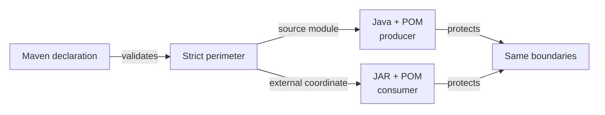

# ATF Governance — Source or Binary Deployment

## At a glance

This package adapts the inspected surface while keeping the rules and suite
selection intact. The producer verifies Core/Reporting sources; the consumer
verifies the published and loaded library, without fake sources or disabled tests.

## Declared catalog

Maven declares the catalog; a missing module or POM remains rejected.

| Profile | Live modules | Explicit harness in TMP |
|---|---:|---:|
| Core/Reporting source | 12 | included |
| journeys with binary Core | 9 | 10 |
| foundation with source Core (fixture) | 8 | 9 |
| Eventuate with binary Core, no UI | 7 | 8 |

`atf.consumer.profile=foundation` excludes Shop/AutoEx; missing directories do
not select the profile, and an undeclared harness is not accepted.

Binary distribution reads the JAR and POM directly from `lib`, with the same
provenance checks, including the POM and CodeSource. A nested copy cannot
replace the artifact required at the declared path. `lib` contains one JAR/POM
pair for Core and Reporting; hashes and the native-test catalog are recorded
in the root `library-provenance.json`.

| Entry point | Responsibility | Proof |
|---|---|---|
| [GovernanceDeployment](GovernanceDeployment.java) | strict Maven catalog and real documents for each deployment | [modules and targets](GovernanceDeploymentTest.java) |
| [CoreGovernanceSurface](core/CoreGovernanceSurface.java) | parentless POM, C1 pair, bytecode ownership, and loaded identity | [Core mutants](core/CoreGovernanceSurfaceTest.java) |
| [ReportingGovernanceSurface](ReportingGovernanceSurface.java) | POM, ownership, provenance, and source/JAR dependencies | [provenance and mutants](ReportingGovernanceSurfaceTest.java) |
| [DeploymentFixture](DeploymentFixture.java) / [BinaryReportingFixture](BinaryReportingFixture.java) | private fixtures with isolated mutations | no changes to producer source, cache, or live JAR |

## Choosing the surface

- A declared harness keeps all source audits and required files intact.
- An external harness requires its module and namespaces to be absent from all
  local sources; examples in literals are not mistaken for Java declarations.
- Negative proofs reject a declared-but-missing fixture, shadow source, and
  copies in Core/AutoEx. Reporting contracts run separately against the JAR in TMP.

<strong>Legend — adaptation with explicit rejection</strong>

- The perimeter preserves the canonical catalog; it does not silently remove missing modules.
- Binary Reporting requires an explicit version and rejects shadow source in the reactor.
- Source distribution keeps lexical proofs and Java layout; binary distribution
  verifies classes, the POM, provenance, CodeSource, and dependencies with JDK `jdeps`.
- Edges describe the evidence choice; they are not additional Maven dependencies.

## Invariants and limits

- Foundation rejects unknown profiles, Reporting source overrides, missing shared
  modules, and Shop/AutoEx shadow sources, including namespaces hidden in other modules.
- Application guards verify the declared source or explicit exclusion; negative
  fixtures remain active in both profiles. Deployment-absent geometry is proved
  with private YAML/README fixtures in TMP.

- The producer's Reporting target remains its README; J1 validates the binary
  atlas and consumer guide with the same validators.
- A required file must remain a regular file; a directory cannot satisfy it.
  Missing ownership and directory prohibition remain separate checks.
- Hashes in the unique provenance record link the JAR, POM, and producer inputs;
  the embedded POM must match the distributed POM. CodeSource rejects another loaded binary.
- A clean POM does not justify bytecode that depends on Core, Validation, Kit,
  or JUnit; a proof hides a Core reference in a fixture JAR and requires it to be detected.
- The native catalog included in provenance is a hash-verified declaration, not
  execution of Java tests in the consumer. Source audits and native regressions remain at the producer.
- The documentation mutant changes only the declared module count; the 10/11/12
  fixtures retain the POM and separately verify Kit scope and duplicate/missing claims.
- `jdeps` is part of the required JDK; if it is missing, verification is rejected
  without falling back to a weaker text-only check.

## Maintenance

A packaging change updates the catalog, proof, and both deployments in the
same increment. Removing Reporting Tests requires a separate decision and
acceptance; it is not triggered by a missing directory or this adaptation.

## Source or binary Core

`atf.core.version` explicitly selects external Core; directory disappearance
alone cannot shrink the catalog. Consumers reject any shadow Core directory,
including one without a POM, and any extra file in lib.

J0 continues to verify Core source style and implementation. J1/J2 verify the
POM and published classes, bytecode dependencies, and CodeSource hash; the
[C1 contract](../../../../../../../../../docs/ATF_Core_Consumer.md) separates these checks.
