# ATF Java Architecture

ATF Java is divided into modules with distinct responsibilities. Dependencies
flow from scenarios toward infrastructure; infrastructure does not know the
routes or intent of a product test.

## At a glance

- The reactor retains exactly the 6 existing modules.
- Core, Reporting, Console, Mock, and Test Kit are consumed through JAR/POM pairs.
- The [J1 POM](../pom.xml) fixes the inventory and versions.
- The [library guide](../lib/README.md) explains how to consume libraries and report defects.

| Boundary | Owner | Stable contract | Executable gate |
|---|---|---|---|
| kernel and policies | `atf-core` | models, ports, snapshots, and physical vocabulary | unit + governance |
| generic API execution | `atf-core` | executor, lifecycle, and transport binding | unit/component + consumer |
| verdicts | `atf-validation` | rules and `ValidationResult` through a neutral port | unit/component |
| external artifact | Reporting JAR | models and Extent/HTML; produced in `atf_j0` | binary consumption in J1; source/native tests at producer |
| external reporting composition | `atf_j0/atf-reporting-tests`, TMP only | mock → API → report, with component/integration proofs and browser/E2E for the reporting contract | component + integration/API + Chromium/Playwright |
| Practice Shop consumer | `atf-test-practice-shop` | UI/API journey, configuration, pages, and application runtime | component + live API + E2E |
| Automation Exercise consumer | `atf-test-auto-ex` | UI journey, API contracts, and runtime separate from the JUnit adapter | component + live API + opt-in E2E |
| whole-ATF governance | `atf-tests` | graph, dependency direction, and architecture boundaries | architecture/component |

- `atf-reporting` is a standalone library and does not compose the suite;
- `atf-reporting-tests` proves API/mock integration and browser rendering;
- `atf-tests` applies the same suite to [source and binary surfaces](../atf-tests/README.md#source-or-binary-deployment-governance), with its own evidence and Git bases;
- Reporting Tests remains with the producer and verifies each binary in a TMP consumer;
- active feedback retains only reproducible risks that could change code or
  packaging; it does not redefine closed contracts.

### Module map: platform and consumers

Read the platform, consumer scopes, and verification separately. Maven
dependencies and governance relationships have distinct, explicit meanings.

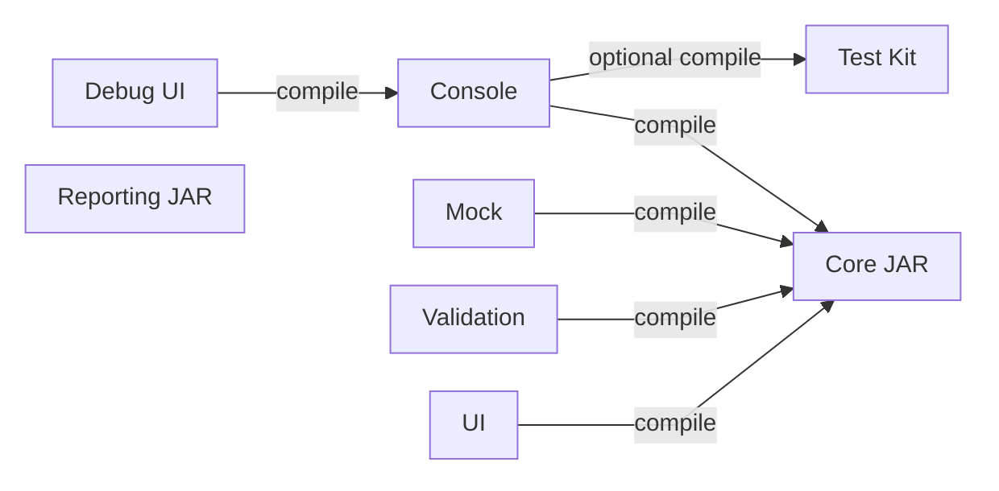

<details>
<summary><strong>Legend — module map and dependency direction</strong></summary>

- the arrow starts at the module declaring the dependency; `compile` and `test scope`
  describe the POM scope, not functional ownership;
- `atf-reporting` has no production ATF dependencies; `atf-console` consumes
  Core's neutral events and contracts independently of Reporting;
- `atf-reporting-tests` is the composition root for reporting proofs, while
  `atf-tests` owns whole-reactor guards; their full test-scope links are in the
  POMs, not drawn as a web of edges;
- edges labeled `guard, not dependency` are repository-verification relations,
  not Maven edges;
- Practice Shop and AutoEx declare Test Kit in `test` scope, as shown in their POMs;
- `atf-console` declares Test Kit as an `optional` compile dependency because its
  JUnit adapter in `src/main` reads its annotations and resolvers; this does not
  turn Test Kit into a business library.

Short labels carry the following meanings:

| In the diagram | Full meaning |
|---|---|
| Mock | atf-mock |
| Core | atf-core |
| Validation | atf-validation |
| Test Kit | atf-test-kit |
| UI | atf-ui |
| Debug UI | atf-debug-ui |
| Shop | atf-test-practice-shop |
| AutoEx | atf-test-auto-ex |

</details>

**Consumer dependencies.** The matrix keeps the POM scopes separate; each item
in a cell represents a direct dependency on the listed module.

| Consumer | `compile` | `test` |
|---|---|---|
| Shop | Core, Console, Reporting, UI | Test Kit |
| AutoEx | Core, Reporting, UI | Console, Test Kit |

**Verification relationships.** Reporting composition consumes the library in
test scope; governance inspects consumer sources and the declared binary.
Reporting proofs run externally in TMP.
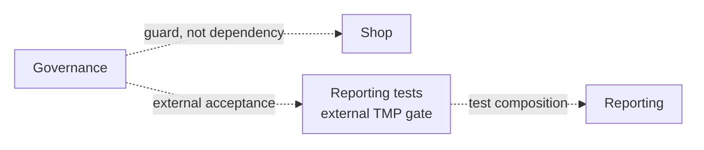
<details>
<summary><strong>Legend — composition and governance</strong></summary>

- `Reporting tests` means `atf-reporting-tests`; the `test composition` edge is
  its `test` dependency on `atf-reporting`.
- `Governance` means `atf-tests`; verification edges inspect the repository and
  declare external acceptance; they add no Maven dependencies on Shop or Reporting Tests.
- Read full composition scopes in the POMs. This map selects explanatory
  relationships while preserving the distinction between consumption and verification.

</details>

In this diagram, meaning comes from the edge label and must not be inferred
from node position:

- `atf-validation` and reporting fixtures depend on `atf-core`;
- `atf-reporting` has no production dependency on an ATF module;
- Reporting composition tests live in `atf-reporting-tests/src/test/java`, with
  mock, console, Playwright, and debug UI strictly in test scope;
- `atf-tests` separately runs `atf.api.tests.governance.ArchitectureModuleBoundaryTest`
  for whole-reactor governance;
- `atf-test-practice-shop` hosts tests for the consumer application; application
  configuration and flows do not belong in `atf-reporting-tests`;
- `atf-test-auto-ex` is an independent consumer; it does not share selectors,
  data, or page objects with Practice Shop.

- Standalone describes the producer library: the consumed JAR's POM has no
  runtime dependencies on ATF modules; J1 does not contain
  `atf-reporting/src/main`.
- Integration tests may compose ATF modules in test scope through explicit
  adapters.
- `ReportModelAdapters` normalizes existing models at the mapping boundary; it
  does not move business rules into reporting or authorize renderer
  dependencies on ATF models.

`atf-test-kit` exposes the unit/component/integration/e2e vocabulary and
cross-cutting testing annotations. Current boundaries are:

- use by tested applications remains test-only; infrastructure adapters may
  need compile scope for JUnit integration, and exceptions are checked in each
  module POM;
- Practice Shop and AutoEx consume Test Kit in `test` scope; harnesses and
  console composition remain in test sources;
- Console and Reporting are independent; composition passes the fields
  of the external event to the neutral factory `AtfConsoleEvent.fromExternalEnums`
  in Core, while Reporting Tests verify the actual vocabularies;
- `atf-mock` depends only on `atf-core`, and `atf-debug-ui` is a read-only
  launcher; starting it from tests or IntelliJ does not make it a renderer dependency.

### Reusable platform versus composition point

Generic contracts that do not need JUnit, the filesystem, YAML, or a browser
belong in the lower-level modules. `atf-core` provides the neutral contract for
programmatic selection of API scenarios, while `atf-reporting` provides the pure contract for
validating a static UI artifact:

```mermaid
%%{init: {"themeVariables":{"fontSize":"15px"},"themeCSS":".nodeLabel, .nodeLabel p { font-size: 15px !important; line-height: 1.35 !important; } .edgeLabel, .edgeLabel p { font-size: 12px !important; font-weight: 400 !important; line-height: 1.2 !important; } .edgeLabel .labelBkg, .edgeLabel p { background: transparent !important; } .edgeLabel foreignObject { transform: translateY(-18px); overflow: visible; } .node rect { rx: 6px; ry: 6px; }","flowchart":{"curve":"linear","nodeSpacing":24,"rankSpacing":24,"padding":6,"diagramPadding":20}}}%%
flowchart LR
    Core["Core contract"] -->|provides| Catalog["Catalog"]
    Catalog -->|composes| ApiArtifact["API artifact"]
    ApiArtifact -->|is inspected by| Browser["Browser audit"]
    Browser -->|verifies| Reporting["Reporting"]
    Reporting -->|publishes| UiArtifact["UI artifact"]
```

<details>
<summary><strong>Legend — production and composition boundaries</strong></summary>

- Core exposes typed selection, while the concrete catalog belongs to the consumer;
- the API artifact is read-only input for the UI inspector;
- the UI validator belongs to the Reporting library, while the browser remains in test scope;
- no `Page`, `Locator`, or JUnit enters production Reporting.

The short labels mean:

| In diagram | Full meaning |
|---|---|
| Core contract | core contract |
| Catalog | test catalog |
| Browser audit | browser audit |
| Reporting | reporting contract |
| provides | provides the contract |

</details>

Composition and ownership boundaries:

- `atf-reporting-tests` resolves deterministic sources, the JUnit lifecycle, and Playwright report audit;
- `atf-tests` owns whole-ATF governance; application tests remain in the Shop and AutoEx consumers;
- production Reporting does not receive `Page`, `Locator`, or JUnit;
- Core models do not read YAML or receive the concrete catalog; the
  `atf.core.config.source` source adapter remains separate and is called from the composition root;
- `atf-reporting` does not receive `Page` or `Locator`;
- this separation enables unit, component, and E2E testing without duplicating rules.

## Responsibilities

| Module | Owns | Does not own |
|---|---|---|
| atf-core | request/response, transport, typed configuration and source adapter, authentication, retry, redaction, status, ports, and `ApiScenarioSelection` | HTML, CSS, Extent, JUnit, YAML reading in neutral models, browser, concrete catalogs, and product routes |
| atf-mock | configurable fake transport and deterministic response catalog | real HTTP, Extent, JUnit, business validation |
| atf-validation | response contracts, rules, evaluator, verdict, and publication through a neutral port | HTTP, Extent, HTML, CSS, lifecycle |
| atf-console | formatter for console events, `ConsoleSettings`, YAML, nesting, statuses, ASCII/UTF-8 fallback, and exclusive ownership of stdout/stderr | HTML, Extent, HTTP calls, invented verdicts |
| atf-reporting | session, Extent tree, theme, HTML finalization, renderer-neutral audit kernel and plans, renderer-neutral API contracts, failure-surface metadata, pure `api.contract` engine, static API artifact audit, static JSON auditor, pure UI report contract, and generic evidence lifecycle | HTTP/transport calls, concrete console, acceptance scenarios, browser/Playwright, and test fixtures; no runtime dependency on `atf-mock` |
| atf-ui | browser configuration and Java Playwright adapter for automated UI checks | HTML generation and executable tests |
| atf-debug-ui | serves an existing HTML file read-only on loopback and provides the target for TAB MCP | renderer, artifact modification, verdicts, and executable tests |
| atf-test-kit | annotations, resolvers, and test-only acquisition/rollback/cleanup primitives; [contract](../lib/README.TestKit.md#scope-and-integration) | production code, renderer, browser, and business rules |
| atf-reporting-tests | API/mock component/integration contracts and UI E2E checks that exclusively verify `atf-reporting`; report fixtures and adapters | does not become an application suite or move these responsibilities into production |
| atf-test-practice-shop | application tests, runtime, pages, flows, and business-evidence mapping | generic renderer/publisher and whole-ATF governance |
| atf-test-auto-ex | component/UI E2E/live API tests and JUnit adapters in test; configuration, pages, flows, and module-specific runtime in main | Practice Shop fixtures or flows |
| atf-tests | whole-ATF governance and architecture gates | product tests and internal `atf-reporting` contracts |

| **Required evidence** | **Owner** |
|---|---|
| the fake needs to verify the model, renderer, markup, or publisher | `atf-reporting` |
| JUnit/mock composition or report rendering needs verification | `atf-reporting-tests` |
| application behavior needs verification | the consumer module, for example `atf-test-practice-shop` |
| another UI/API practice site needs verification | separate `atf-test-auto-ex` consumer, with its channel declared through Test Kit |
| a real service needs to be contacted | separate test with explicit opt-in |

## API test and UI audit ownership boundaries

`atf.reporting.api.tests.api` is exclusively for API tests: resources, requests,
headers, contracts, stateful scenarios, and lifecycle. It cannot import browser,
Playwright, `Page`, `Locator`, DOM, screenshots, or Debug UI.

The API→UI audit is divided as follows:

- browser audit: `atf.ui.tests.extent` in `atf-reporting-tests/src/test/java`;
- pure contract: snapshots, verdicts, reconciliation, plans, checks, validators, and failure surfaces in `atf.reporting.audit` and `atf.reporting.ui.audit.*`;
- generic browser and capture: `atf-ui`;
- output configuration, audit suite, and report input: `atf-reporting-tests/src/test/java/atf/ui/tests/extent/support/config`;
- read-only serving for TAB MCP: `atf-debug-ui`;
- the only facade for API preconditions: `ApiReportAuditSetup`;
- lifecycle and pure section contracts: `atf-reporting`;
- DOM, computed style, clicks, collapse, and rendering: browser test scope;
- acceptance plan and API→Extent publisher: `atf.reporting.api.acceptance`.

The API report contract has an additional boundary without a browser:

```text
YAML/mock catalog or live adapter
        → ApiReportContractCatalog
        → ApiReportContractAuditor
        → body / metadata / execution / JSON-tree validators
        → ValidationResult
        → optional HTML evidence publisher
```

`atf-reporting` exposes only the renderer-neutral port and models. `atf-mock` is
used by Reporting tests in `test` scope, not by production Reporting;
`atf-reporting-tests` exclusively retains the adapter that extracts
`ApiReportContractInput` from the DOM. This lets the same contract be checked as a
unit, component, or integration test, while the browser remains a separate
verification layer.

The UI contract has a pure kernel and two browser compositions; the browser remains
exclusively in the `atf-reporting-tests` test scope:

| Package | Input | Scope |
|---|---|---|
| `atf.ui.tests.extent.e2e.section` | generated or static API report | setup/mock, projection, request/response evidence, API parity in browser |
| `atf.reporting.ui.contract` | annotation, spec, checks, snapshot, and pure validator | structural rules without DOM/browser |
| `atf.ui.tests.extent.e2e.uireport` | previous, static UI report | input resolution, tabs, DOM structure, style, collapsed state, Fails, and UI validation |

The `atf.ui.tests.extent.e2e.uireport` audit does not read expected business values
from YAML or require API requests. It starts with `@UiExtentReportContract` and `-Datf.ui.report=...`, then
publishes a new UI artifact without modifying the input.

The observable chain is:

```text
configurable setup
  → API scenarios
  → atf-reporting-tests/src/test/resources/atf-mock.yaml / AtfMockTransport
  → read-only API report
  → Playwright audit in atf.ui.tests.extent
  → DOM/evidence validation
  → separate UI report
```

Rules for expected values and suite selection:

- UI expected values are built before the browser from API selection, catalog, and mock;
- actual values are read from the DOM through semantic locators;
- selectors live in `ReportUiLocators`, actions in adapters, order in flows, and verdicts in validators/snapshots;
- do not introduce `ui.enabled`; suite and rule selection come from annotations, YAML, or JVM properties.

Rules for E2E smoke tests:
- explicit selection through `@ApiScenarioSetup` takes precedence over `families`;
- methods are exact and non-redundant; family remains the fallback for suite/YAML;
- the full API matrix and Reporting contracts retain broad coverage;
- the browser proves only the setup → mock → artifact → DOM connection and real interactions.

The `SETUP` rule:

- publish a compact `Setup evidence` table (`CHECK / EXPECTED / ACTUAL / RESULT`)
  for preconditions and preparation state; the table does not replace technical
  evidence;
- if setup produces real exchanges and the profile collects them, they
  remain `API validation` under the same `SETUP` checkpoint, with canonical request, response,
  and execution evidence;
- setup actions do not become `UI validation`, and setup does not receive
  `UI validation`;
- `UI validation` exists only in `TEST BODY`, after real browser actions.

## UI traffic capture and selection

How does browser-generated traffic reach the checkpoint that explains it?
Selection is applied before reading the body and consuming the journal
budget; a cursor separates observations received before and after the
baseline. Requests started before and completed after it require additional
correlation; capture order alone does not prove business causality.

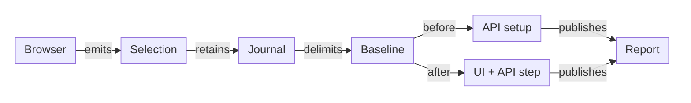

<details>
<summary><strong>Legend — selection and evidence ownership</strong></summary>

- `atf-ui` applies the host allowlist and typed policy for resource type
  and route prefix. Excluded resources are not read as bodies and do not occupy
  the journal; the limit preserves accepted/retained/dropped counters.
- The consumer declares business routes and marks the baseline after setup.
  In AutoEx, `GET /api/productsList` is a fetch in the same browser
  session, published as catalog precondition evidence; it does not become another
  causal exchange for the cart. `GET /add_to_cart/1` is observed after the baseline and
  belongs to the cart-add checkpoint, without replay.
- `atf-reporting` displays the exchange next to its step and separately summarizes scope,
  setup/causal, and `COMPLETE`/`INCOMPLETE`. The inspector does not decide the
  business verdict or clone requests in the summary.

The short labels mean:

| In diagram | Full meaning |
|---|---|
| Selection | UI selection |
| Journal | Bounded journal |

</details>

The generic filter and cursor contract is in the
[ATF UI README](../atf-ui/README.md#network-inspector--generic-responsibility-boundary);
route selection and association with AutoEx steps are in the
[AutoEx README](../atf-test-auto-ex/README.md#causal-boundary-for-ui_api).

## Request flow

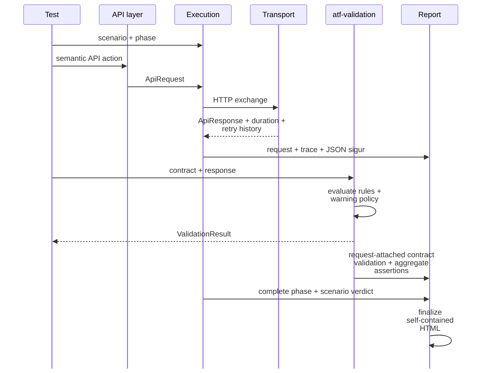

<details>
<summary><strong>Legend — semantic request flow</strong></summary>

- the executor publishes transport facts and retry history;
- validation calculates the verdict, while Reporting only projects evidence;
- the request owns contract validation nested in its evidence; UI/API
  validations remain separate under the Gherkin UI checkpoint;
- finalization produces a self-contained artifact without moving the verdict.

</details>

Transport facts, contract satisfaction, and the scenario verdict are
different things:

```text
completed HTTP exchange  !=  satisfied contract  !=  passed scenario
```

## Transport profiles and acceptance boundary

ATF has two transport profiles with different purposes:

| Profile | Implementation | Network | Owner | Purpose |
|---|---|---:|---|---|
| `acceptance` | `AtfMockTransport` (`atf-mock`) | no | `atf-reporting-tests` test scope | deterministic report, contracts, lifecycle, and rendering |
| `live` | `HttpClientTransport` | yes | live test / consumer | checking an available HTTP service |

The acceptance boundary is explicit:

- `AtfMockTransport` is a test double from `atf-mock`, not a local HTTP server or proxy to `atf.local`;
- it is injected explicitly into `ApiModuleFactory`;
- the URL built by `ApiExecutor` remains in evidence for the semantic route;
- the fake transport does not perform DNS, TLS, or network requests;
- Reporting and its contracts do not depend on an external service.

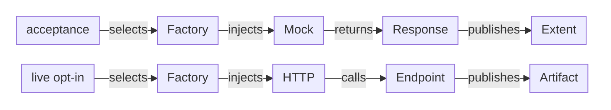

<details>
<summary><strong>Legend — offline acceptance versus live opt-in</strong></summary>

- acceptance uses fake transport and produces a deterministic response;
- live uses HTTP only through policy and explicit opt-in;
- the URL shown in acceptance is semantic evidence, not proof of traffic;
- the two profiles are not implicitly converted into one another.

The short labels mean:

| In diagram | Full meaning |
|---|---|
| Factory | module factory |
| Mock | mock transport |
| Response | deterministic response |
| Extent | Extent artifact |
| HTTP | HTTP transport |
| Endpoint | real endpoint |
| Artifact | live artifact |

</details>

The verifiable rule is:

```text
ApiReportAuditSetup -> AtfMockTransport -> offline artifact
Live API test       -> HttpClientTransport -> real endpoint
```

In an acceptance report, a URL such as `https://atf.local/public/v2/users`
is request metadata, not a claim that the host was contacted.
DNS availability, TLS, authentication, and the service contract can only be
verified in the `live` profile.

`ApiTransportProvenance` travels in `ApiExecutionResult` to the API
publisher. The report therefore shows the transport truth and a safe manual replay:

```text
acceptance → ACCEPTANCE / MOCK → URL metadata + MANUAL REPLAY: NOT EXECUTABLE
live       → LIVE / HTTP       → URL contactat + cURL method/headers/body redacted
```

Do not add an invented fallback URL to the report or claim that an endpoint was
contacted when `AtfMockTransport` was used. In live mode,
the operator fills in redacted credentials before executing the cURL command.

| Live control | Contract |
|---|---|
| opt-in | `-Datf.api.live.optIn=true` or `ATF_API_LIVE_OPT_IN=true` |
| target | explicitly named `api.baseUri` |
| adapter | `ApiLiveTransportCatalog` rejects the acceptance policy and the `https://atf.local` placeholder |
| acceptance | does not consult the catalog or become a network test by default |

## Route vocabulary

Routes are not repeated as strings in tests. The stable path vocabulary
is separate from the operational catalog and environment configuration:

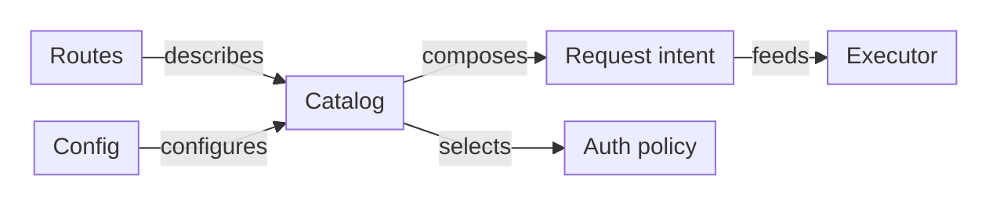

<details>
<summary><strong>Legend — route vocabulary</strong></summary>

- `Paths` defines the stable vocabulary, without hardcoded business endpoints;
- the catalog combines the route, operation, and authentication policy;
- environment configuration can change the base URL without changing tests;
- the executor receives a request already composed semantically.

The short labels mean:

| In diagram | Full meaning |
|---|---|
| Routes | route vocabulary |
| Config | environment config |
| Catalog | operation catalog |
| Request intent | request intent |
| Auth policy | auth policy |
| Executor | API executor |

</details>

The catalog describes the operation, method, resource, and authentication. Configuration
can override the base URL or templates without requiring tests to know
environment details.

## Configuration and snapshot

Configuration follows a single operational path:

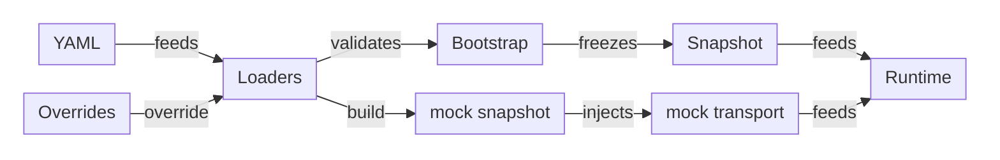

<details>
<summary><strong>Legend — from source to runtime</strong></summary>

- `YAML sources` = `atf.yaml`, the `atf-mock.yaml` catalog, and consumer
  configuration, including `atf-practice-shop.yaml`;
- `owner loaders` = separate loaders for API, mock, and application;
- `typed bootstrap` = validation at the composition root, before execution;
- `immutable snapshot` = frozen configuration passed to consumers;
- `mock transport` = transport selectat de politica `acceptance`;
- `runtime consumers` = executor, validation, Reporting, and test fixtures;
- the arrow represents configuration data flow, not a Maven import.

The short labels mean:

| In diagram | Full meaning |
|---|---|
| Overrides | explicit overrides |
| feeds | are read by |

</details>

<details>
<summary><strong>Sources and ownership</strong></summary>

- `atf.yaml` is the general configuration for the consumer project;
- `api`, `validation`, and `reporting` sections belong to the project composing
  the run, not to an individual request;
- UI audit configuration and the mock catalog for the Reporting contract are
  test-owned by `atf-reporting-tests`;
- the catalog is in
  `atf-reporting-tests/src/test/resources/atf-mock.yaml` and is loaded through
  `ReportingTestResources`;
- application configuration is test-owned by `atf-test-practice-shop`;
- application configuration is in
  `atf-test-practice-shop/src/test/resources/atf-practice-shop.yaml`;
- Automation Exercise configuration is test-owned by `atf-test-auto-ex` and
  is located in `atf-test-auto-ex/src/test/resources/atf-auto-ex.yaml`;
- there is no `ui.enabled`;
- routes, responses, bodies, and Reporting fallback are loaded
  explicitly through the test resource, not from an external endpoint.

</details>

<details>
<summary><strong>Bootstrap and transport policy</strong></summary>

- `ApiBootstrapConfiguration` composes `ApiSettings` and `ApiTransportPolicy`;
- `ApiBootstrapConfigurationLoader` reads the `api` section once,
  validates it, and passes it to `ApiModuleFactory`;
- `AtfMockConfigurationLoader` reads the mock catalog; accepted overrides
  are `atf.mock.config`, `ATF_MOCK_CONFIG`, and explicit test sources;
- `api.baseUri`, timeout, retry, auth profile, and `transport` are
  typed at bootstrap;
- `ApiReportAuditSetup` injects `AtfMockTransport` for `acceptance`;
- a `baseUri` in YAML does not activate the network by itself;
- `api.transport` accepts `acceptance` (with compatible alias `mock`) or `live`;
- `acceptance` is the default; `live` requires
  `-Datf.api.live.optIn=true` or `ATF_API_LIVE_OPT_IN=true`;
- the `atf-reporting` loader consumes `reporting.extent` for the HTML artifact;
  the console is not the renderer fallback and is not loaded by Extent.

</details>

<details>
<summary><strong>Snapshot and operational rules</strong></summary>

- `AtfRuntimeSnapshot` retains `ApiSettingsSnapshot` and `ReportingSettings`
  without YAML, filesystem, environment, or Extent in `atf-core`;
- `atf-core` owns the typed models, snapshots, and explicit adapter
  [ApiBootstrapConfigurationLoader](../../atf_j0/atf-core/src/main/java/atf/core/config/source/ApiBootstrapConfigurationLoader.java).
  The adapter reads sources at the composition root; models do not read YAML or the environment.
  API test composition is in `atf-reporting-tests`, and consumers retain their own wiring;
- `ApiModuleFactory` projects the snapshot into the API executor, while Reporting
  consumes its own policy separately;
- `reporting.extent` remains owned by Reporting; timeout, retry, auth,
  routes, redaction, and schema roots are neutral runtime settings;
- the loader fails clearly on unknown keys, invalid URI, invalid timeout, missing
  schema root, or unsafe output path;
- relative paths resolve against the YAML file, not `user.dir`;
- secrets are references to an explicit provider, not published YAML values;
- each run receives immutable snapshots; parallel runs cannot
  modify one another;
- no `atf-config` module is introduced; `atf-reporting` retains its
  specialized loader for `reporting.extent`.

</details>

## Architecture contracts verified in live code

Current reconciliation separates implemented contracts from evolution risks:

| Verified contract | Implementation | Evidence |
|---|---|---|
| `Overview`, `Tests`, `Categories`, `Fails`, `Evidence`, `UI validation` sections | `SectionAuditCheckExecutor` → `SectionAuditCheckPolicy` → `SectionAuditResult` | `ExtentSectionAuditPublisher` + component/E2E tests |
| read-only UI report on the main tabs | `@UiExtentReportContract` and `StaticUiExtentReportContractTest` | `atf-reporting-tests` |
| HTML/CSS/JavaScript and asset manifest | pure contracts in `atf-reporting` | `UiReportArtifactContractTest` |
| module direction, constant/CSS ownership, output, and import graph | Maven/source boundaries | `atf-tests` + architecture tests |
| Extent ↔ fallback parity | `AtfReportSemanticSnapshot` | [renderer comparison test](../../atf_j0/atf-reporting-tests/src/test/java/atf/reporting/semantic/AtfReportSemanticSnapshotTest.java) |
| fallback internal consistency | `AtfReportSemanticSnapshot.from(ReportExecutionModel)` | the document and recorder from the same session are compared before rendering |

These capabilities are closed and normative. A feedback document does not
repeat them or turn them into a score; they reopen only through a reproducible regression,
a consumer change, or a public contract change.

### Semantic parity between renderers

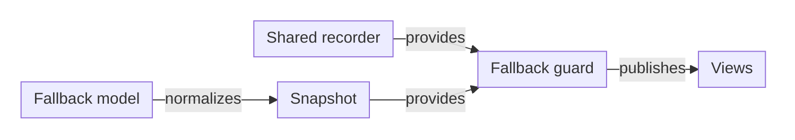

<details>
<summary><strong>Legend — semantic parity between renderers</strong></summary>

- the guard in `HtmlReportSession.render()` compares the fallback model with
  the semantic recorder for the same session, before constructing views;
- the adapter normalizes the fallback model without forcing the same internal structure;
- the comparison covers class, scenario, phase, request, validation, and evidence counts;
- fix differences in the provider/model, not by hiding them in the UI;
- Extent/fallback parity is checked separately by publishing the same
  facts in both sessions and comparing their snapshots in a test.

The short labels mean:

| In diagram | Full meaning |
|---|---|
| Shared recorder | semantic recorder for the fallback session |
| Fallback model | fallback execution document |
| Snapshot | semantic snapshot |
| Fallback guard | internal consistency check before rendering |
| Views | coherent views |

</details>

| Model | Owner | Role |
|---|---|---|
| `ReportExecutionModel` | fallback | `Overview`, `Categories`, and `Fails` projections |
| `AtfReportSemanticSnapshot` | shared recorder and adapters | renderer-neutral semantic contract |

The local guard checks the `class → scenario → phase → request → validation` tree,
package, and evidence counts. [AtfReportSemanticSnapshotTest](../../atf_j0/atf-reporting-tests/src/test/java/atf/reporting/semantic/AtfReportSemanticSnapshotTest.java)
separately compares Extent/fallback results. The models remain distinct; the fallback renderer
does not open an Extent session to verify its output.

### Controlled evolution and reopening

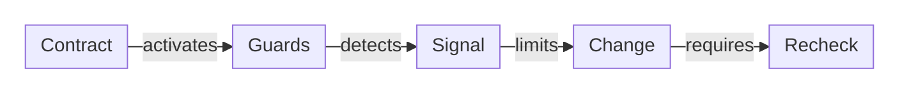

<details>
<summary><strong>Legend — when a contract is reopened</strong></summary>

- **Closed**: the boundary is documented, and the implementation has consumers and tests.
- **Protected**: neutral snapshots are validated by `ExtractionValidationConvergenceTest`;
  live↔staging sync is guarded by `AtfPromotionManifest` and `AtfPromotionGuard`;
  explicit live transport is `ApiLiveTransportCatalog`.
- **Justified reopening**: a reproducible defect, a second consumer, or a public contract change.
- **Targeted change**: add only the necessary coverage, such as a snapshot/golden; avoid a cosmetic split.
- **Closure**: revalidate the code and tests, then consolidate the decision in the owner README.
- **Feedback**: retain future regressions only; do not duplicate decisions already closed.

`AtfReportTheme` and `UiExtentReportSession` have documented boundaries and
sufficient semantic collaborators for the live code. `ExtentReportRuntimeBehaviour`
composes `Core`, `Tests`, `Overview`, `Evidence`, `Navigation`, `Duration`, and
`Failure`, while `ExtentReportRuntimeScriptTest` protects the composition. These decisions
remain in the Reporting README and are not copied into the feedback register.

The HTML fallback keeps the same separation: `HtmlReportSession` is the composition
root for the document/lifecycle, while tab behavior is an asset injectable through
`HtmlReportScript`, implemented by `HtmlReportNavigationScript`. Semantic markup,
lifecycle, and JavaScript have independent seams without a browser or DOM in the
reporting model.

In `atf.reporting.html.scope`, `HtmlReportScenarioScope`,
`HtmlReportPhaseScope`, `HtmlReportRequestScope`, and `HtmlReportValidationScope`
implement the `AtfReportPorts` ports. The session creates the scopes, the semantic
model exposes only controlled mutations, and the renderer receives no internal
fields and does not become dependent on the lifecycle.

The short labels have the following meanings:

| In diagram | Full meaning |
|---|---|
| Contract | contract closed |
| Guards | guards active |
| Signal | valid signal |
| Change | targeted change |
| Recheck | owner revalidation |

</details>

## Lifecycle and responsibilities

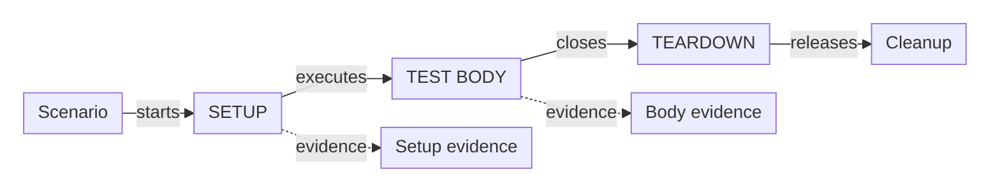

<details>
<summary><strong>Legend — lifecycle and ownership</strong></summary>

- solid arrow = lifecycle progress; phases appear only when they contain
  actual content;
- dotted arrow = visual grouping of local evidence, not a new phase;
- contract validation is nested under the evaluated request; UI/API validations
  remain semantic children of the Gherkin UI checkpoint;
- cleanup closes created resources in reverse order;
- verdict precedence remains the lifecycle's responsibility, not the renderer's.

The short labels have the following meanings:

| In diagram | Full meaning |
|---|---|
| Cleanup | cleanup invers |
| Setup evidence | Setup evidence |
| Body evidence | Body evidence |

</details>

The request lifecycle keeps evidence under the exchange that produced it:

- the request closes only after technical evidence and validation have been published;
- in direct API use, `Contract validation` is a child of the evaluated request;
- multiple assertions for the same response form a single table;
- in UI, `UI validation` and `API validation` are children of the same checkpoint,
  and requests remain under `API validation`.

Required responsibilities:

- the executor publishes HTTP facts and duration;
- the validator calculates results and publishes the aggregated table;
- the lifecycle closes phases and applies verdict precedence;
- reporting renders the structure without changing the verdict;
- cleanup owns created resources and runs on a best-effort basis in reverse order.

## Namespaces and source roots

The package name comes from the `package` declaration; the source root comes from
the module POM. We do not infer one from the other or reconstruct the inventory from
historical namespaces.

Maven coordinates have a different role: `groupId` can remain `atf.api` without Java
packages retaining that prefix. Renaming a namespace does not implicitly rename the artifact.

| Owner | Runtime / test namespace | Current Maven roots |
|---|---|---|
| [Shop](../atf-test-practice-shop/README.md) | `atf.shop` / `atf.shop.tests` | `src/main` / `src/test`, declared in the POM |
| [AutoEx](../atf-test-auto-ex/README.md) | `atf.autoex` / `atf.autoex.tests` | `src/main/java` / `src/test/java`, Maven default convention |

Rebuild the structure from source on every refactor:

```text
POM → source roots → package declarations → callers and suites → owner README
```

The whole-reactor gate discovers sources from `sourceDirectory` and
`testSourceDirectory` declared in each POM; if they are absent, it uses the Maven
conventions `src/main/java` and `src/test/java`. This means a module declaring
`src/test` does not disappear from the inventory merely because it does not use
the default layout.

- The package identifies the application/owner and responsibility; business names,
  pages, and application ports are not moved into the Kit for uniformity.
- A rename preserves callers, resources, and verified case identities;
  physical movement does not demonstrate semantic separation of flows.
- The inventory uses current files, without `target`, artifacts, or staging copies.
  The layer annotation classifies the test, not the directory name.
- Source links and import examples are updated together;
  historical paths in `testChanges` checks retain their approved base.

`AtfJavaSourceReferences` in Core recognizes Java namespaces in code,
including regular/static/wildcard imports, package declarations, and FQCNs in
signatures or method bodies. It distinguishes identifiers (`atf.ui` is not
`atf.uikit`) and ignores comments, strings, character literals, and text blocks.

- A documentation example does not mask an adjacent real reference.
- The whole-ATF and API/UI guards use the same rule; controlled probes
  introduce violations before and after movement and verify the path and diagnostic rule.
- Unicode escapes are translated before comments and literals are separated.

Verification of a move follows the
[executable inventory](ATF_Testing_Guide.md#executable-inventory-after-moves-and-reclassification)
and [consumer governance](../atf-tests/README.md). Roots declared in the POM
take precedence over the assumption that every module uses the default convention.

## OOP rules

1. Facades coordinate; status, retry, redaction, and aggregation policies are
   small, pure, testable objects.
2. Models in atf-core know nothing about HTML, CSS, selectors, or
   the viewport.
3. Execution state is per session and per scenario; do not introduce mutable
   static state shared between tests.
4. An interface exists for a real seam: transport, reporter, clock, auth, or
   cleanup. Do not create decorative interfaces.
5. A component that decides transport, verdict, and layout at the same time
   has too many responsibilities and must be split.

## Testability

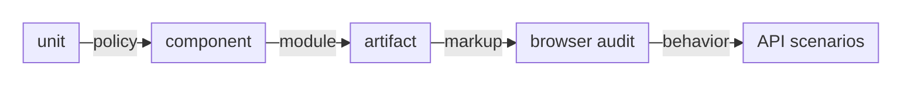

<details>
<summary><strong>Legend — proof levels</strong></summary>

- unit verifies the pure policy;
- component verifies the module and fake transport;
- artifact verifies the generated markup/CSS/JavaScript;
- TAB MCP verifies real interaction, while the API scenario verifies live behavior.

</details>

Every reporting change that affects structure, collapse, tabs, font, color,
scroll, or overflow needs a code test and artifact verification. Finding a string
in HTML does not prove that the element behaves correctly when clicked.

## Consumer support and primary selections

| Contract | Owner |
|---|---|
| Account, catalog, cart, checkout, confirmation, and invoice | Shop/AutoEx business runtime and tests |
| JUnit extension and application scenario configuration | test root in the POM: Shop `src/test`, AutoEx `src/test/java` |
| Initialization, close-once, and armed compensation | `lifecycle` package in `atf-test-kit`, with no new module |
| JUnit comparisons with evidence of evaluated checks | single JUnit evaluation, injected display, and phase collection in the main Test Kit; the consumer adapts safe rows to `AssertionAuditReport` |
| Neutral screen audit, observation cursor, and capture validation | `atf-ui`; no dependency on Reporting or JUnit |
| Failure evidence, replay, and rendering profiles | `atf-reporting-tests`, with neutral fixtures |
| Safe exception description | `ReportFailureDescription` in Reporting; the consumer decides the phase, exchange, and verdict |
| Global classification and disjoint coverage of the three main suites | `atf-tests`, in the whole-ATF suite |

Executable classes for each consumer are assigned exactly once across
local, UI E2E, and live API. External opt-ins remain independent; moving a
helper does not authorize a remote call or turn a fixture into live evidence.

## Core as a library — ownership and deployment

J1 consumes Core, Reporting, Console, Mock and Test Kit as external libraries.

[Core contract](ATF_Core_Consumer.md) separates source, publication, and consumer acceptance.
Native tests remain in J0, while binary acceptance runs in TMP.


## Shared platform libraries

The [platform library guide](ATF_Platform_Libraries.md) describes ownership, flat distribution, Maven/IntelliJ bootstrap and independent consumer acceptance.
