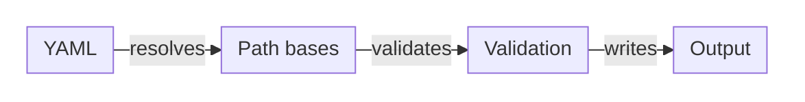
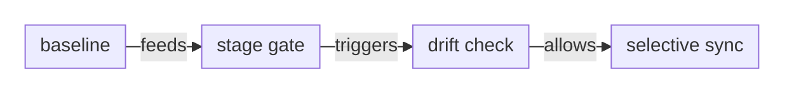
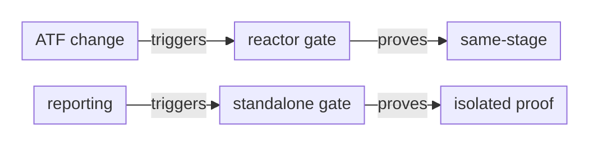
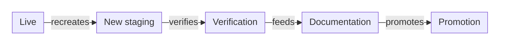

# Safe ATF Builds and Execution

For Core and Reporting sources in `atf_j0` and J1–J7 consumers, apply the
[workspace protocol](ATF_Workspace_Synchronization.md) before selective synchronization.

**J1 perimeter:** Reporting is an external JAR. Commands targeting
`atf-reporting/pom.xml`, native resources, or source audits run in the
`atf_j0` producer staging area; the [J1 guide](ATF_Reporting_Consumer.md)
separates gates and ownership.

## At a glance

- the live checkout is the working context and synchronization source;
- builds and tests run in external staging;
- intermediate outputs are not promoted into the checkout;
- the final artifact is published only after verification in TAB MCP;
- existing processes and runs are not stopped.

## Isolated workflow

```mermaid
%%{init: {"themeVariables":{"fontSize":"15px"},"themeCSS":".nodeLabel, .nodeLabel p { font-size: 15px !important; line-height: 1.35 !important; } .edgeLabel, .edgeLabel p { font-size: 12px !important; font-weight: 400 !important; line-height: 1.2 !important; } .edgeLabel .labelBkg, .edgeLabel p { background: transparent !important; } .edgeLabel foreignObject { transform: translateY(-18px); overflow: visible; } .node rect { rx: 6px; ry: 6px; }","flowchart":{"curve":"linear","nodeSpacing":24,"rankSpacing":8,"padding":6,"diagramPadding":20}}}%%
flowchart LR
    Live["Live"] -->|inspects| Inspect["Inspection"]
    Inspect -->|isolates| Stage["TMP stage"]
    Stage -->|synchronizes| Sync["Source sync"]
    Sync -->|runs| Build["Build"]
    Build -->|publishes| Report["Report"]
    Report -->|validates| MCP["TAB audit"]
    MCP -->|reviews| Review["Review"]
    Review -->|promotes| SyncBack["Promotion"]
```



<details>
<summary><strong>Legend — isolated workflow and anti-undo</strong></summary>

- live is the verified context, and staging is the temporary build location;
- generated output does not return to source or become an implicit baseline;
- review compares sources and evidence before any synchronization back;
- the final edge is selective: only approved and reconciled files are promoted.

Short labels carry the following meanings:

| In the diagram | Full meaning |
|---|---|
| Live | Checkout live |
| Inspection | read-only inspection |
| TMP stage | new staging area in a temporary directory |
| Source sync | source synchronization without outputs |
| Build | build and tests in staging |
| Report | report in staging |
| TAB audit | validation in TAB MCP |
| Review | diff and result review |
| Promotion | controlled synchronization of approved sources only |

</details>

## Actions to avoid

- do not stop existing processes or runs;
- do not use `reset --hard`, `checkout --`, or `git clean`;
- do not delete `target`, `bin`, `obj`, `artifacts`, or another process's files;
- do not reuse staging that may belong to another execution;
- do not run two Maven builds in the same checkout or stage: both use `target`,
  and a concurrent `clean` can cause Surefire classloading false negatives; each
  execution gets its own staging area;
- do not overwrite a report opened by the user;
- do not open the Windows browser to validate a report; use TAB MCP for interaction.

## Safe configuration resolution



<details>
<summary><strong>Legend — configuration captured at the composition root</strong></summary>

Reporting configuration is captured once at the composition root. A relative
YAML path resolves against the captured `startDirectory`, while
`reporting.extent.outputDirectory` resolves against the YAML directory. Paths
that escape that directory through `..` are rejected before publication. This
prevents two IntelliJ runs with different roots from accidentally sharing an
output because `user.dir` changed or a relative path is ambiguous.

The short labels have the following meanings:

| In the diagram | Full meaning |
|---|---|
| YAML | atf.yaml · captured once |
| Path bases | startDirectory + YAML directory |
| Validation | validate boundaries · reject `..` escape |

</details>

## Change workflow for every change

```mermaid
%%{init: {"themeVariables":{"fontSize":"15px"},"themeCSS":".nodeLabel, .nodeLabel p { font-size: 15px !important; line-height: 1.35 !important; } .edgeLabel, .edgeLabel p { font-size: 12px !important; font-weight: 400 !important; line-height: 1.2 !important; } .edgeLabel .labelBkg, .edgeLabel p { background: transparent !important; } .edgeLabel foreignObject { transform: translateY(-18px); overflow: visible; } .node rect { rx: 6px; ry: 6px; }","flowchart":{"curve":"linear","nodeSpacing":24,"rankSpacing":8,"padding":6,"diagramPadding":20}}}%%
flowchart LR
    Live["Live code"] -->|captures| Baseline["Baseline"]
    Baseline -->|isolates| Stage["Staging"]
    Stage -->|bounds| Change["Change"]
    Change -->|verifies| Verify["Verification"]
    Verify -->|audits| Audit["TAB audit"]
    Audit -->|reconciles| Reconcile["Reconciliation"]
    Reconcile -->|closes| Close["Documentation"]
```



<details>
<summary><strong>Legend — required protocol for each increment</strong></summary>

- **Live**: reread the code, tests, READMEs, feedback, and relevant artifact.
- **Baseline**: preserve failures; do not delete, relax, or rewrite tests for a false green.
- **Staging**: use a unique directory; copy only sources and documents, without generated output.
- **Change**: bound responsibility and define nominal and failure-path tests; do not overwrite or reset on conflict.
- **Verify**: run the relevant unit, component, and artifact tests, then the affected suite.
- **Audit**: inspect the new artifact in TAB MCP, including the changed surface and a negative scenario.
- **Reconcile**: compare staging with live again; synchronize approved files only.
- **Close**: update the owner README; close feedback only when there is observable evidence.

<details>
<summary><strong>Operational details — staging, artifact, and publication</strong></summary>

Live code and existing tests are the current context; staging is only the safe
working location and does not automatically become a new source of truth. Do not stop
existing processes or reuse another process's directory.

On refresh, compare hashes: a copied source may have a timestamp older than the
classes in `target`, and Maven may reuse those classes. Use a new stage or invalidate
incremental output only in your own copy, after the previous build has finished;
preserve evidence already produced in TMP.

The report must be new, timestamped, and kept in staging; do not overwrite an
open report or a run's output. In TAB MCP, check tabs, filters, disclosures,
deep links, request/validation, Fails, and Overview as applicable.

Before publication, compare staging with the current live checkout. Keep only
approved sources and documents; do not propagate `target`, `artifacts`, caches,
logs, or generated output. After synchronization, reread the touched files and
check the links.

</details>

The short labels have the following meanings:

| In the diagram | Full meaning |
|---|---|
| Live code | live code · README + feedback |
| Baseline | baseline · inspect + capture |
| Staging | isolated staging · approved sources |
| Change | bounded increment · nominal + failure test |
| Verification | build + tests · new artifact |
| TAB audit | TAB MCP · UI + negative path |
| Reconciliation | live resync · drift check |
| Documentation | feedback + owner README · observable evidence |

</details>

### Software guard for live↔staging sync



<details>
<summary><strong>Legend — manifest, drift, and promotion</strong></summary>

- **Baseline**: the manifest contains only approved files and relative paths.
- **Staging**: the build and tests run separately from the live checkout.
- **Guard**: drift found during baseline prevalidation stops the batch before the first file; the destination is also revalidated on every copy.
- **Sync**: replacement is atomic per approved file; the batch is not transactional and does not implement rollback or implicit deletion.

The protocol above also has an executable mechanism, not just an operational
convention. Before editing, the composition root captures approved files with
`AtfPromotionManifest.capture(liveRoot, approvedFiles)` and can write the JSON
manifest for process auditing. After the staging gate,
`AtfPromotionGuard.promote(stagingRoot, liveRoot, baseline)` checks for parallel
drift and atomically replaces each file in the manifest. A change or creation
detected during the initial check stops the batch before the first file; a path
absent from the baseline is the only explicit approval to create a new file.
There is no unapproved overwrite, reset, or implicit deletion. The manifest
stores only relative paths, presence, sizes, and digests, not absolute local
paths, and is not included in the HTML report.

The guard prevalidates the entire plan before the first write: sources must be
regular, eligible, readable files whose paths reconcile with the manifest.
A later source that is absent or ineligible, or an existing destination parent
that is not a directory, causes the batch to be rejected without live changes.
Preflight does not create missing parents; directories are created only for the
file being executed. Execution revalidates every destination; an I/O failure or
later drift may leave a partially promoted batch. Atomicity remains per file,
without batch rollback; permanent probes are in [Core](../../atf_j0/atf-core/README.md#manifest-și-promovare-guarded).

- Verify and reread the actual state after any error; do not interpret
  an exception as proof that no files changed.
- Keep the digests and approved list for reconciliation; any retry
  requires a baseline that matches the current state, with no implicit overwrite.
- The lock coordinates promoters that use it; per-file revalidation does not
  make external editors participants in a transaction.

The evidence order is: live code → tests → HTML artifact → TAB MCP interaction
→ documentation. If two sources conflict, do not declare success until the
difference has been investigated and reconciled.

PowerShell example, with paths supplied by the operator:

```powershell
$source = '.'
$stage = Join-Path $env:ATF_STAGING_ROOT 'atf-java-staging-<id>'

New-Item -ItemType Directory -Force $stage | Out-Null
robocopy $source $stage /E /XD '.git' 'target' 'artifacts' 'spark' 'bin' 'obj' /XF '*.log' 'hs_err_pid*.log'
mvn -o -f "$stage\pom.xml" test
```

For Java execution, keep the same rule in staging external to the
checkout, for example `${ATF_STAGING_ROOT}/Atf-java-feedback-<id>`. Resynchronize
sources before the build; `target`, reports, and dumps remain
excluded from sync. Reporting tests accept
`-Datf.test.reportDirectory=<stage>\artifacts\reports`, iar testul configured
report test uses `-Datf.report.config=<stage>\atf.yaml`; this makes the report
to inspect deterministic under `<stage>\artifacts\reports`, regardless of the
IDE/Maven working directory.

</details>

### Staging for test-change governance

`TestChangeGovernanceTest` requires a real Git checkout and the review baseline.
A plain copy without history is not evidence for this gate and fails explicitly;
do not disable the check to make staging pass.

- Staging starts without a checkout and takes a snapshot of live, including the
  absence of deleted or relocated files. Check the inventory against live; a clone with
  a checkout cannot implicitly reintroduce the old copy from `HEAD`.
- Identify the remote ref before fetch; do not assume it is named `main`.
  Fetch does not authorize pull, reset, or overwrite of local refactors;
  live state and the actual review base remain separate reconciliation inputs.


- Create an isolated local clone without checkout or hardlinks.
- Initialize the clone index from `HEAD`, then copy live sources without `.git`,
  `target`, `artifacts`, or local credential-bearing configuration.
- Preserve the source differences from the baseline; do not hide them by committing
  an artificial snapshot before verification.
- Run with `-Datf.governance.testChanges.baseRef=<review-base>`; the change check pins
  that base SHA. CI requires the base explicitly, and the live checkout is not reused
  for intermediate output.

This example supplements the source synchronization above:

```powershell
git clone --no-checkout --no-hardlinks . $stage
git -C $stage read-tree HEAD
robocopy . $stage /E /XD .git target artifacts spark bin obj /XF '*.log' '*.local.properties'
mvn -f "$stage\pom.xml" '-Dtest=WholeAtfGovernanceSuiteTest' '-Dsurefire.failIfNoSpecifiedTests=false' '-Datf.governance.testChanges.baseRef=<review-base>' test
```

### The reactor is required for cross-module contracts



<details>
<summary><strong>Legend — two independent gates</strong></summary>

- **Reactor gate**: `mvn -pl <consumer> -am test`; recompiles the changed module together with its consumers in the same stage.
- **Standalone gate — producer `atf_j0`**: `mvn -f atf-reporting/pom.xml test`; checks Reporting in isolation, without consumers.
- **Proof**: the result must come from the stage sources, not an old local JAR.

When a test module consumes APIs changed in `atf-core`, `atf-ui`, or
other reactor modules, run verification with `-am` (for example,
`mvn -pl atf-reporting-tests -am test`). For the standalone library, `mvn -f atf-reporting/pom.xml test`
is the intentionally isolated gate; an isolated `mvn -pl atf-reporting-tests test` may
resolve a previously installed JAR from the local repository and report
missing constructors/methods that are not missing from the stage sources. The isolated
result is acceptable only after a successful reactor build or if the dependencies
used were explicitly built from the same stage; otherwise, it is not evidence
for the live code.

After resyncing into the same staging area, copied timestamps may be
older than already compiled classes, even if the source signature has changed.
A Maven `Nothing to compile` message does not then prove source/class equivalence.
Use a new staging area or `clean test` only in private staging, after
your own build has finished; do not clean the live checkout or another execution's
output. Artifacts already produced remain separate from `target`.

- An interrupted compilation can leave incomplete `.class` files even if
  Maven considers them current. `ClassFormatError` requires checking the compiled output
  before changing the source or assertions.
- After your execution finishes, rebuild the affected output in new or private
  staging, then repeat the complete affected verification; tests run with incomplete
  bytecode do not certify the live sources.

</details>

### Periodic feedback and build sync loop



<details>
<summary><strong>Legend — resuming a ToDo and isolating output</strong></summary>

Whenever resuming a ToDo, start from the live checkout, recreate
staging, and copy sources only; `target`, HTML reports, captures, and
dumps are not sources of truth and are not synchronized back. After the build,
tie the evidence to the synchronized code using three identifiers: the working
commit/snapshot, the timestamped artifact, and interactive verification in TAB MCP. If
an agent works elsewhere, repeat the same sequence before
each build; do not accept an old artifact as evidence for live code.

Publication to the same final path is serialized by a per-path lock in
the process temporary directory; the lock is not written beside the report and does not
change the session's private staging area.

Each Extent staging area is marked with a versioned file and held under an
exclusive lease while the session is active. After a forced interruption,
the operator can explicitly run the bounded sweeper in
`atf.reporting.publication.ReportStagingWorkspace`, de exemplu:

```java
var result = ReportStagingWorkspace.sweep(
        reportDirectory,
        Duration.ofHours(1));
```

The sweeper inspects only marked `.atf-extent-session-*` directories directly
under `reportDirectory`, preserves fresh, active, malformed, or unmarked workspaces,
and returns the `scanned/deleted/skipped/failures` counts.
By default it processes at most 256 candidates; for operational use, the overload
with `maxCandidates` can be used, and `limitReached=true` makes the limit
observable in tests and diagnostics.

<id> is unique to the current session. If there are locally modified files,
check before synchronization so they are not overwritten. Any external project
running in parallel redirects its output to its own staging directories;
the ATF Java build uses its own `target` and artifacts separately.

The short labels have the following meanings:

| In the diagram | Full meaning |
|---|---|
| Live | live checkout |
| New staging | recreate staging |
| Verification | build + artifact + TAB MCP |
| Documentation | feedback / owner README |
| Promotion | selective sync |

</details>

## JVM memory for tests and publication

| Process | Configuration | Role |
|---|---|---|
| Maven | `.mvn/jvm.config`, `MAVEN_OPTS` | Runs the build; does not size the test fork |
| Surefire | `pom.xml`: `atf.test.heap.max=2g` | Maximum heap of 2 GiB per test JVM; initial heap is 64 MiB |
| Direct IntelliJ JUnit | Run Configuration → VM options | Explicitly sets `-Xms64m -Xmx2g -XX:MaxMetaspaceSize=128m` |

- Explicit Maven override: `mvn "-Datf.test.heap.max=3g" ... test`; the limit
  applies to each fork, not the entire reactor.
- `-DargLine=...` does not replace the `argLine` explicitly configured in this POM;
  use `atf.test.heap.max` to override the heap size.
- Keep the normal Surefire fork; `-DforkCount=0` changes execution mode
  and is not the recommended remedy for report memory usage.
- Reports with inline PNGs also need memory during finalization: the pipeline
  post-processes the entire HTML before atomic publication.
- An `OutOfMemoryError: Java heap space` during finalization invalidates publication,
  even if the test methods passed; also check the Maven exit code.
- Do not disable captures to hide insufficient heap. The 2 GiB is the
  default budget, not a guarantee for every volume; concurrent forks and
  browsers consume additional memory.

## Playwright driver runtime identity

Validation runners inherit Playwright Java's bundled Node by default; they
must not silently replace it with the agent application's Node executable.
An intentional `PLAYWRIGHT_NODEJS_PATH` override is a separate environment experiment.

| Evidence | Required distinction |
|---|---|
| SDK default | inspect the published driver bundle and the actual child process used by Java |
| Explicit override | retain its executable/version, configuration and outcomes; preserve the original failing logs |
| Functional fixture | load, native document attachment and viewport capture belong to one existing navigation allowance |
| Native operation | retain its original deadline, strict actionability, trusted-event and negative oracles |
| Resource failures | capture, startup and cleanup remain distinct from an unconfirmed business postcondition |

[First-frame verification](ATF_UI_First_Frame_Verification.md) records the
same-code runtime comparison. A different runtime's result is not silently
substituted for SDK-default Maven/IDE acceptance.

## What to Sync and What to Exclude

Only explicitly reviewed sources and documents may be propagated:

- projects, sources, and their tests;
- READMEs and Markdown documents;
- tracked configuration files, when the change requires them;
- validated and reproducible patches.

Do not propagate:

- target, bin, obj, artifacts, spark, or caches;
- generated reports and execution snapshots;
- logs, dumps, and temporary files;
- files created by another process in the live checkout.

Synchronization back is a selective operation after diff review. If there are
concurrent changes in the same file, stop editing that file only
and reread the live content; do not fix it through overwrite or reset.

### Preventing accidental rollback when returning from staging

Staging is a working copy, not an authoritative source. When returning to live,
do not mirror the directory or recursively copy staging over the
checkout. Promote only files in the task area, following this
sequence:

```text
current live → baseline for approved files
staging      → diff limited to the same files
reconciliation with parallel changes in live
selective promotion only if the baseline is unchanged
reread live and verify the owner/documentation
```

During reconciliation, live remains authoritative for changes made in parallel:

- keep new changes and moves and integrate them selectively;
- a file absent from staging does not authorize deleting it from live;
- make a conflict an explicit ToDo and stop promotion of that file;
- other approved files and active runs may continue.

## The staging report

The report generated in staging is the only source for visual verification of
the change. In TAB MCP:

1. open the exact artifact from staging;
2. check Tests, Category, Fails, and Overview;
3. expand at least one positive and one negative test;
4. confirm request/validation ownership, the aggregated table, and scrollable JSON;
5. test the link from Fails to the original test;
6. verify that Overview is the default and evidence nodes are collapsed by default.

A static HTML check is useful, but it does not replace clicking in TAB
MCP for changes to layout, selectors, collapse, tabs, or scrolling.

## Completion criteria for a safe execution

- the existing process has not been stopped;
- staging is separate and contains no output copied from old runs;
- the build and tests have run in staging;
- the artifact is self-contained and has not overwritten the live report;
- interactive verification was performed in TAB MCP when required;
- synchronization back contains only approved sources/documents;
- no files were deleted and no foreign checkouts were modified.
