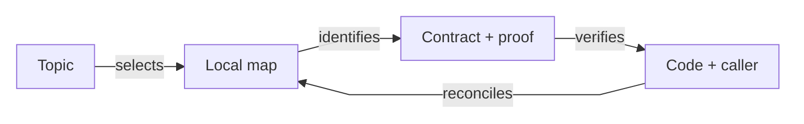
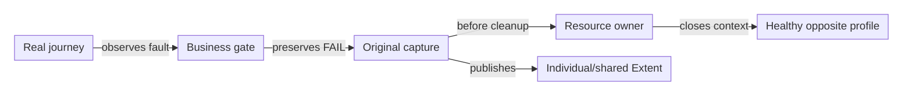

# ATF Context Atlas — Entry Points, Ownership, and Proofs

The [J0 reference and J1–J7 synchronization guide](ATF_Workspace_Synchronization.md)
defines ownership, target status, and evidence for each delivery.

## At a glance

J0 owns Core/Reporting implementation and tests; J1 owns AutoEx/Shop scenarios.
J2 is work in progress for the framework and Kafka/messaging tests, with
PowerShell setup in Podman; the [workspace map](ATF_Workspace_Synchronization.md)
separates copied infrastructure from messaging contracts and acceptance.

This atlas reduces initial context for a reader or AI: choose a boundary,
identify its contract and proof, then open only the relevant source and caller.
For local modules, code, POM, and tests are authoritative; for Reporting, use
the [binary atlas](ATF_Reporting_Library_Atlas.md), delivered POM, CodeSource,
and observable contract without assuming source is available.

| Topic | Local map | Read the code when |
|---|---|---|
| source/binary governance | [deployment](../atf-tests/src/test/java/atf/api/tests/governance/distribution/README.md) | changing the catalog, documentation targets, distributed POM, CodeSource, or independence proof; the same suite protects both forms |
| redaction and literal masking | [Core security](../../atf_j0/atf-core/src/main/java/atf/core/security/README.md) | changing the raw mask, regex replacement encoding, sensitive fields, or fallback; comparison, preview, and renderer have distinct owners |
| main/test inventory and excluded output | [ATF Tests inventory](../atf-tests/README.md#shared-java-source-inventory) | changing POM traversal or segment exclusions; compare compilable sources with the inspected set |
| selective promotion | [Core guard](../../atf_j0/atf-core/README.md#manifest-și-promovare-guarded) | changing the baseline, source/parent eligibility, or atomic copy |
| AutoEx invoice total | [monetary contract](../atf-test-auto-ex/README.md#complete-invoice-amount-validation) | changing clause boundaries, numeric grammar, comparison, or projection; independent checks and auditable negative proofs |
| AutoEx runtime | [AutoEx runtime](../atf-test-auto-ex/src/main/java/atf/autoex/runtime/README.md) | changing composition, account ownership, invoice observation, or completion |
| Shop support | [Shop support](../atf-test-practice-shop/src/main/atf/shop/support/README.md) | changing validation, cart confirmation, traffic selection, or readiness |
| browser operations | [browser operations](../atf-ui/src/main/java/atf/ui/playwright/README.md) | changing deadlines, interaction, or diagnostics |
| AutoEx product transition | [AutoEx contract](../atf-test-auto-ex/README.md#product-transition-confirmation) | changing the single click, observed document, or bounded GET |
| Shop billing and autofill | [Shop contract](../atf-test-practice-shop/README.md#address-lookup-confirmation) | changing debounce, lookup scope, or field ownership |
| Shop report root | [configuration resolution](../atf-test-practice-shop/README.md#report-directory-root) | changing the working directory or source/JAR consumption; the Shop POM defines the base without a Reporting marker |
| geometry and iframe | [UI geometry](../atf-ui/README.md#native-context-geometry) | changing requested output, CSS viewport, DPR, or System projection in consumers |
| 850 ms geometry gate | [fixture preparation](../atf-ui/README.md#geometry-fixture-gate) | separating initialization, stable layout, and capture from the single pointer; verify the non-renewed navigation budget and zero counter |
| observer lifecycle | [UI scope](../atf-ui/README.md#observation-listener-scope) | changing callback activation, rollback, causes, or close-once behavior |
| catalog observation and decision | [UI contract](../atf-ui/README.md#observation-listener-scope) → [Shop map](../atf-test-practice-shop/src/main/atf/shop/support/README.md) | separating passive GET/QUERY listeners from Shop refresh; GET/HEAD control and AutoEx navigation use other protocols |
| executable documentation fidelity | [factual guard](../atf-tests/README.md#documents-and-responsibilities) | changing modules, Kit scope, UI defaults, or Shop/AutoEx YAML geometry; prose is compared with POM/configuration/model through documentation mutants |
| select continuity | [UI contract](../atf-ui/README.md#native-waiting-and-uniqueness) | changing observation before activation, native confirmation, or replay refusal |
| browser network | [browser network](../atf-ui/src/main/java/atf/ui/network/README.md) | changing hooks, identity, retention, or cleanup |
| Reporting library | [Reporting integration](ATF_Reporting_Library_Atlas.md#consumed-api-and-adapter-ownership) | changing the local adapter or diagnosing the binary; model/renderer fixes belong in `atf_j0` |
| Reporting consolidation and proofs | [implementation](feedback/ATF_Reporting_Feedback.md) / [Reporting Tests](feedback/ATF_Reporting_Tests_Feedback.md) | separating a lifecycle/API defect from oracle, binary fixture, and evidence navigation |
| UI session acquisition and close | [UI contract](../atf-ui/README.md#session-lifecycle-and-evidence-boundary) | changing the primary cause, resource rollback, or simultaneous cleanup failures |

## Fidelity boundaries

| Change | Contract and proof |
|---|---|
| literal mask and quoted/truncated Authorization | [Core security](../../atf_j0/atf-core/src/main/java/atf/core/security/README.md); compare original → redaction → preview → Extent/fallback |
| MIME and effective headers | [Core HTTP](../../atf_j0/atf-core/README.md#media-type-headere-și-vocabular-de-protocol); type/subtype, precedence, and a single send |
| artifact URI | [Debug UI](../atf-debug-ui/README.md#uri-path-identity); plus sign, space, and single decoding |
| compilable source versus output | [ATF Tests](../atf-tests/README.md#shared-java-source-inventory); POM discovery separate from Java-root traversal |
| credentials in AutoEx API form | [fixture audit](../atf-test-auto-ex/README.md#credentials-in-api-component-assertions); original-map equality, public projection, and diagnostics without the raw password |

## Context path

<strong>Legend — orientation and revalidation</strong>

| In the diagram | Full meaning |
|---|---|
| Topic | requested behavior and the owner who decides it |
| Local map | package README; entry points, invariants, and limits |
| Contract + proof | stable rule and the test that protects it |
| Code + caller | local source and caller; for Reporting, the binary API and J1 adapter |

Edges are reading and maintenance steps, not Maven dependencies. The atlas
starts an investigation; it does not replace checking the affected source.

## Minimum context for a change

| Initial decision | Source of truth | Its limit |
|---|---|---|
| Which reactor should I use? | [workspaces](ATF_Workspace_Synchronization.md#module-and-reporting-catalog), then the target POM | Live POMs: J0 12, J1 6, J2 WIP 5, J3 speech 4, J4 Android 3, J5 Rentz 2, J6 Hold'em 5, J7 Chess 1; do not infer profiles from absent folders |
| Reporting change? | [J0 source atlas](../../atf_j0/atf-reporting/src/main/java/atf/reporting/README.md) and [permanent regressions](../../atf_j0/atf-reporting-tests/README.md) | J1–J7 have distinct versions and consumer acceptance; J4 retains j24, and source documentation does not certify the consumed JAR |
| Application change? | [Shop](../../atf_j1/atf-test-practice-shop/README.md) or [AutoEx](../../atf_j1/atf-test-auto-ex/README.md) | expected values, capture, and business selection remain with the consumer |
| Kafka/Podman change? | [J2 atlas](../../atf_j2/docs/ATF_Context_Atlas.md), then setup and configuration | three MOCK components and existing scripts; the Java client/real broker are WIP |

1. Read the package map and the relevant module README section. Before refactoring,
   reconcile owner feedback with live source and define the closure proof; update
   the finding throughout the increment.
2. For local source, open the entry point, caller, and positive/negative proof;
   for Reporting, identify the version and adapter, then the JAR API and artifact.
   Escalate implementation changes to the producer; widen the search only when a
   concrete dependency or contradiction appears.
3. Check the POM for scope, configuration for deadline/policy, and the test for
   the exact claim. A class name does not prove behavior.
4. After the change, update the nearby map and entry link if responsibility,
   invariants, or proof change. Gaps remain in feedback.

## Cross-cutting reference points

### Composition and lifecycle

A shared report does not mean a shared browser, account, or business state.
Trace resource ownership and the runner adapter before extracting anything.

| Boundary | Entry point and map | What remains separate |
|---|---|---|
| Shop E2E | [ShopE2eTestSupport](../atf-test-practice-shop/src/test/atf/shop/tests/support/ShopE2eTestSupport.java) → [ShopE2eContext](../atf-test-practice-shop/src/test/atf/shop/tests/support/lifecycle/ShopE2eContext.java) → [ShopBrowserRuntime](../atf-test-practice-shop/src/main/atf/shop/runtime/ShopBrowserRuntime.java) | JUnit harness in test, acquisition in main, browser per invocation, and individual/shared report |
| AutoEx E2E | [AutoExRunFactory](../atf-test-auto-ex/src/test/java/atf/autoex/tests/extension/AutoExRunFactory.java) → [runtime](../atf-test-auto-ex/src/main/java/atf/autoex/runtime/README.md) | JUnit Store/finalization in test; browser, observations, and lifecycle port in main |
| audited components | [audit guide](ATF_Testing_Guide.md#consumer-component-audit) → consumer extension → [Kit](../lib/README.TestKit.md#scope-and-integration) | JUnit comparison is evaluated once; the Reporting library receives neutral evidence |
| browser and actions | [PlaywrightUiSession](../atf-ui/src/main/java/atf/ui/playwright/PlaywrightUiSession.java) → [UI operations](../atf-ui/src/main/java/atf/ui/playwright/README.md) | the session owns the browser/context/page; each new sequence has its own action log |

Reusable support belongs in the owner's main source; controlled fixtures and
JUnit wiring stay in test source. Both consumer POMs keep Kit in
`test` scope; the [architecture matrix](ATF_Architecture.md) and POM define dependencies.

### Business failure and isolation of the next scenario

Start from the explicit acceptance criteria for
[Shop](../atf-test-practice-shop/README.md#business-failure-acceptance) or
[AutoEx](../atf-test-auto-ex/README.md#business-failure-acceptance).
Fixtures alter the observation while the journey and expected values remain real.

<strong>Legend — fault, evidence, and cleanup</strong>

- `Business gate` independently verifies identity, cart, or order confirmation.
- `Original capture` preserves the fixture marker before cleanup navigation.
- `Resource owner` deletes its own AutoEx account or releases the scoped Shop reference;
  differing policies are not generalized through a neutral delete callback.
- `Healthy opposite profile` uses a new browser; the shared report does not transfer the DOM,
  fault state, or verdict between scenarios.

The CLI accepts only the exact number of intentional FAILs and successes, the same
primary cause in JUnit, counted mutations, and one HTML report per launch. Negative
fixtures are excluded from canonical selections and do not become masked live components.

### Determine ownership by effect

| Responsibility | Owner and dependency limit | What the consumer retains |
|---|---|---|
| HTTP execution, request, and observed response | [Core](../../atf_j0/atf-core/README.md); Reporting receives values, not an executor | endpoint, operation, and application expected value |
| comparison and validation result | [Validation](../atf-validation/README.md); no renderer or JUnit | business rule and independent expected value |
| browser, deadline, capture, and listener | [UI](../atf-ui/README.md); no Shop/AutoEx routes | application signal confirming the action and evidence selection |
| runner protocol, scope, and neutral cleanup | [Test Kit](../lib/README.TestKit.md#scope-and-integration); composed at the JUnit boundary | concrete Store, accounts, and resource order |
| typed projection, status, markup, and publication | [Reporting](ATF_Reporting_Library_Atlas.md); no Core, UI, or Kit | observation, verdict, and application metadata |
| observed query and identity | [Reporting contract](ATF_Reporting_Library_Atlas.md#api-exchange-and-identity); UI computes the fingerprint before redaction | mapper preserves available pairs or an opaque fingerprint; business selection stays local |
| console diagnostics | [Console](../../atf_j0/atf-console/README.md); bridge at composition | sink selection; no Console dependency in the Reporting JAR |
| stub, routing, and mock association | [Mock](../../atf_j0/atf-mock/README.md); reporting adapter is verified separately | fixture and scenario intent |
| local read-only inspection | [Debug UI](../atf-debug-ui/README.md) | source selection and inspected session |
| neutral reporting and composition tests | [Reporting Tests](../../atf_j0/atf-reporting-tests/README.md) | real adapter proof and business flow stay in Shop/AutoEx |
| cross-module governance and negative tests | [ATF Tests](../atf-tests/README.md) | contract compliance without local refactor exceptions |

Importing Reporting into a Shop test does not make it a generic test.
A test that verifies the real JUnit extension, application configuration, or order
selection stays with the consumer. A neutral HTML, renderer, or lifecycle fixture
without application policy belongs in the infrastructure owner's tests.

### Reuse without moving application policy

Compare both real uses before extracting anything. INFO composition is owned by UI,
and runner cleanup consumes Kit in test scope; a similar constructor or import does
not justify another generic API.

| Inspected pair | Decision and reason |
|---|---|
| `ShopBackendRecovery.open` / `AutoExBackendRecovery.open` | compose `UiBackendRecovery.recording`; endpoint, method, and operation enum stay local |
| `ShopCatalogReadiness` / `UiRecoveryObserver` | Shop separates its passive observer from the refresh decision; QUERY and the last eligible request do not replace the strict GET/HEAD protocol with stamps and conflicts |
| `ShopApiNetworkJournal` / `AutoExE2eRun` | Shop capture origin is explicitly configured; Shop gates consume delivery at response, while the UI inspector consumes request-finished; moving ownership requires reconciling consumers, marker, and cursor |
| `ShopE2eContext.close` / `AutoExRunLifecycleAdapter.finish` | compose `FailureAwareCleanup` for the primary cause and every stage; browser/report versus account/diagnostic/phase order remains explicit in the adapter |
| `SuiteReportResource` Shop / `ReportResource` AutoEx | the Store owns the report, not the browser; Shop also retains the scoped account reference, while AutoEx owns its own session; do not add a shared container for these different ownership models |
| console bridge and artifact prefixes | application composition; the Reporting library receives the sink and metadata without new Core/Console/JUnit dependencies |

`ScopedTestValue`, `CloseOnceResource`, and `TestRunInitialization` remain Kit
primitives used by harnesses. Error fixtures, browsers, and endpoint policy do not
move into Kit just to make class shapes uniform.

### Minimal investigation paths

| Symptom / change | Reading order and required proof |
|---|---|
| component without auditable assertions | consumer test → Kit adapter → `AssertionAuditReport` → renderer; verify the collapsible group and verdict separately from unit tests |
| browser evidence differs from the executed call | UI capture → Shop/AutoEx main mapper → Reporting request/trace → aggregate; compare the full query and identity, not just the displayed URL |
| wrong order evidence | Shop journal → selector → request window → validator; a display signature does not replace business causality |
| compaction mistaken for no replay | [neutral UI test](../atf-ui/src/test/java/atf/ui/network/UiNetworkPresentationStreamComponentTest.java) → [Shop read-back](../atf-test-practice-shop/src/test/atf/shop/tests/api/network/ShopUiNetworkSettlementComponentTest.java) → [real activation](../atf-test-practice-shop/src/test/atf/shop/tests/component/cart/ShopCartAcknowledgementComponentTest.java); supplied observations do not count executed orders |
| runtime acquisition failure | [ShopBrowserRuntime](../atf-test-practice-shop/src/main/atf/shop/runtime/ShopBrowserRuntime.java) → harness caller → [partial-acquisition test](../atf-test-practice-shop/src/test/atf/shop/runtime/ShopBrowserAcquisitionComponentTest.java); trace native context close, original cause, and transferred ownership |
| failure after AutoEx setup | `AccountPage.registerFromStore` → owned lifecycle → `AutoExAccountCleanupRecoveryComponentTest`; signup/create once, foreign identity without delete, initial cause and capture; local documents do not certify remote integration |
| false-positive HTML oracle | markup marker → published comparison → control without marker, with JavaScript retained; the [evidence rule](ATF_Testing_Guide.md#consumer-component-audit) separates the artifact from the runtime selector |
| individual report versus one suite report | consumer extension and Store → individual/shared resource → publisher; the test discovers only classes selected before execution |
| iframe pointer or capture at 70% | `UiViewportScale` → `PlaywrightUiSession` → neutral UI HTTP test → Shop/AutoEx configuration and metadata; a DOM click does not prove a trusted pointer |
| timeout in native geometry gate | `openReady` fixture → preparation and click trace → real counter; the 5 s budget is consumed once and the pointer retains 850 ms, with no retry |
| external query interrupts account cleanup | [AutoEx listener](../atf-test-auto-ex/src/main/java/atf/autoex/support/account/AutoExAccountDeletionAttempt.java) → [browser test](../atf-test-auto-ex/src/test/java/atf/autoex/tests/component/business/AutoExBusinessFaultComponentTest.java); query and fragment do not participate in redirect matching or diagnostics |
| intermittent cancellation in Core test | [ExecutionResilienceTest](../../atf_j0/atf-core/src/test/java/atf/core/ExecutionResilienceTest.java) → [test contract](../../atf_j0/atf-core/README.md#determinism-și-concurență); the barrier confirms transport entry and FutureTask transfers the result to JUnit |
| confirmation renews the deadline | [ObservationBudgetComponentTest](../atf-ui/src/test/java/atf/ui/playwright/ObservationBudgetComponentTest.java) → [native integration](../atf-ui/src/test/java/atf/ui/playwright/PlaywrightReadinessBudgetComponentTest.java); arithmetic uses controlled ticks, while integration separately verifies the browser and single activation |
| GET timeout is renewed in AutoEx adapter | [native test](../atf-test-auto-ex/src/test/java/atf/autoex/tests/component/navigation/AutoExReadOnlyBudgetBoundaryComponentTest.java) measures timeouts actually sent to the browser separately from UI clock arithmetic; one pointer and two read-only recoveries |
| extracted Reporting library | [JAR atlas](ATF_Reporting_Library_Atlas.md) → delivered POM → CodeSource/hash → adapter → artifact; the source gate runs at the producer, not through an improvised Reporting directory in J1 |

Keep application adaptation in main and JUnit glue in test. Kit provides
neutral primitives; it does not own the browser or business policy. An extraction
requires two real uses, explicit differences, and a test that rejects the former
behavior; moving the same class to another module is not such proof.

### Contracts and governance

| Decision | Starting owner |
|---|---|
| modules and dependency direction | [ATF_Architecture](ATF_Architecture.md) |
| what stays in main and what belongs in test | [ATF_Testing_Guide](ATF_Testing_Guide.md) |
| JUnit primitives and auditable assertions | [Test Kit contracts](../lib/README.TestKit.md#scope-and-integration) |
| OOP rules and responsibility limits | [README_Atf_CodeBestPractices](README_Atf_CodeBestPractices.md) |
| build in TMP and selective promotion | [ATF_Build_And_Execution_Safety](ATF_Build_And_Execution_Safety.md) |
| criteria not yet demonstrated | [feedback register](feedback/README.md) |
| Reporting integration without source | [JAR atlas](ATF_Reporting_Library_Atlas.md) and [sync directions](ATF_Reporting_Consumer.md#ownership-and-synchronization-direction) |

Shop is an explicit exception to the [testChanges Git control](../atf-tests/README.md#test-change-governance),
not to architecture, cohesion, or behavioral checks. Do not add Shop paths to a
formal control or infer from this exception that a test may be relaxed.

Reporting is treated as a library at the consumption boundary. The consumer atlas
does not copy its internal inventory, renderer, or contracts; those remain in the
library documentation, including when the artifact is delivered separately as a JAR.

### Read evidence at the verified level

When investigating the AutoEx transition, separate the GET document, DOM
observation, and product business gate. The [transition contract](../atf-test-auto-ex/README.md#product-transition-confirmation)
owns the single budget; Purchase variants implement the typed port and test
stopping before the checkpoint or mutation, without simulating a successful click.
The package-private injectable clock and `ObservationBudgetComponentTest` belong
to UI; the consumer browser verifies the document, product, and activation,
without a wall-clock oracle or slow-520 race.

| Available evidence | Interpretation limit | Criterion owner |
|---|---|---|
| component with fixture/proxy/loopback | verifies the boundary and local rejections; the external service and full-suite isolation require separate runs | [test levels](ATF_Testing_Guide.md) |
| filtered suite and single report | verifies actual selection; does not certify all UI/UI+API profiles, accounts, or class combinations | [consumer profiles](ATF_Testing_Guide.md#individual-and-suite-business-acceptance) |
| journal with `201` followed by `500` | presentation may compact; business selection reads eligible observations and does not inherit the old PASS | [current Shop order](../atf-test-practice-shop/README.md#current-order-proof) |
| green documentation guard | confirms rules implemented by the guard; validate the statement against the POM/source independently of its wording | [factual fidelity](../atf-tests/README.md#documents-and-responsibilities) |

Feedback identifies the gap and closure criterion, the owner README describes
the contract, and the `VERIFIED` baseline authorizes a precise Git difference.
These three roles are not interchangeable; the [retention process](README_Atf_DocumentationBestPractices.md#retaining-and-deleting-feedback)
determines what moves or is removed after evidence is available.

## Maintenance without drift

- Atlas links and fragments are checked by
  [documentation link governance](../atf-tests/src/test/java/atf/api/tests/governance/documentation/links/DocumentationLinkGovernanceTest.java),
  along with README files and the other documents in `docs`.

- Each map retains stable entry points, ownership, sourced invariants, and
  relevant proofs. It does not copy the entire tree, API, or implementation.
- Best-practice checklists are recurring review criteria;
  implementation gaps belong in feedback. A procedural checkbox is not a defect and must not be
  removed to declare a backlog closed.
- A refactor updates the map in the same increment. Resolve contradictions from
  code/POM/tests; label unimplemented intent in feedback.
- Do not retain counts, notes, or a dated PASS as behavioral guarantees.
  Run evidence stays in staging; the README retains the demonstrated contract.
- Keep intermediate snapshots outside the audited source tree. A README copied
  for a merge must not accidentally become a project document.
- Re-read live hashes before promotion. Previously read context does not authorize
  overwriting parallel changes or automatically certify the new combination.

## Core as a library — ownership and deployment

J1 consumes Core, Reporting, Console, Mock, and Test Kit as external libraries; their contracts are in the [platform guide](ATF_Platform_Libraries.md).

[The Core contract](ATF_Core_Consumer.md) separates source, publication, and consumer acceptance.
Native tests stay in J0, while binary acceptance runs in TMP.

## Shared platform libraries

[Platform library consumption](ATF_Platform_Libraries.md) defines the five library owners, flat distribution, Maven/IntelliJ bootstrap and independent consumer acceptance. Console/Mock native tests stay in J0; consumer adapters and catalogs stay local.
