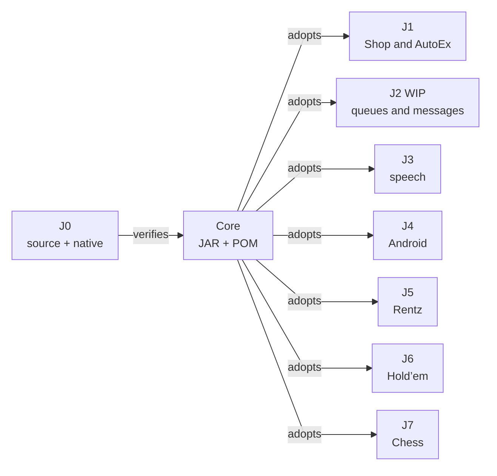

# ATF Core — distribution and binary consumption

## At a glance

J0 retains the Core implementation and all native tests. J1–J7 consume the same
`atf.api:atf-core` library, at the version declared in each consumer POM, with
no source module or native tests copied into the live workspace. Reporting has
separate publication and acceptance.

| Contract | Current rule |
|---|---|
| runtime | Java 21; Jackson Databind and YAML 2.17.2 |
| independence | POM without a reactor parent; no ATF/JUnit/Extent production dependencies |
| consumer layout | `lib/atf-core-${atf.core.version}.jar` and `.pom`; [lib](../lib/README.md) keeps one pair per library |
| provenance | `coreLibrary` in `library-provenance.json`; JAR/POM hashes, entries, and native catalog; build history stays separate |
| source and tests | source owner is J0; no shadow Core in a consumer |

## Maven and IntelliJ

From the root of a consumer's TMP staging area, `mvn -B validate` installs the
five library pairs into the selected Maven repository. Then reload the root POM
in IntelliJ, using the same Maven repository as the bootstrap. Do not use
`systemPath`, a hierarchical file repository, or a JAR added manually in the IDE.

```powershell
mvn -B validate
mvn -B -pl atf-tests -am "-Dtest=WholeAtfGovernanceSuiteTest" "-Dsurefire.failIfNoSpecifiedTests=false" test
```

`WholeAtfGovernanceSuiteTest` is the J1/J2 selection; J3 uses
`SpeechWorkspaceGovernanceTest` in the same command. Run these commands in an
owned staging area and add `-Dmaven.repo.local=<TMP>/m2` to both. A `-pl` that
omits the root requires the earlier bootstrap.

Core is now an external dependency, so `-pl atf-core` is run only in J0. The
source reactor remains at `1.0.0-SNAPSHOT`; only consumer Core dependencies use
`atf.core.version` from the root POM.

## Publication and verification

1. Reconcile the change and tests with the J0 owner; keep code and local tests there.
2. Build in TMP with a parentless POM; publication changes only the project version, not the test Kit version.
3. Run the native tests, then the same tests against the JAR in a TMP harness without Core sources. Kit/JUnit remain test dependencies.
4. Verify J1–J7 separately: compile, affected contracts, governance, CodeSource/hash, and reports; a J2 MOCK does not certify a Kafka broker.
5. Deliver one new pair per library with verified provenance; retire the previous pair without parallel versions.

Governance verifies the coordinates, POM byte-for-byte, hashes, native
catalog, bytecode namespaces, and actual class loading. Negative tests reject
missing coordinates, shadow source, extra/nested files, ATF production
dependencies, and altered metadata. J0 remains responsible for Core source
analysis; the consumer keeps binary checks and tests for its own integration.

Packaging does not change the 240-character preview, collapsible assertions,
business ownership, or existing functional backlog. The full procedure is in
[workspace synchronization](ATF_Workspace_Synchronization.md) and [isolated builds](ATF_Build_And_Execution_Safety.md).

## Core delivery map



<details>
<summary><strong>Legend — one library, separate acceptance</strong></summary>

- Arrows describe publication and adoption, not Maven dependencies between workspaces.
- J0 retains the implementation and all native tests; JAR tests are copied only to a TMP harness.
- Acceptance examples: J1 verifies web integration; J2 verifies MOCK without a browser; J3 verifies speech without downloading models. These tests do not certify a real broker or ASR.
- Reporting has its own version and provenance; Core and Reporting have no production dependency on each other.

</details>

## Reporting acceptance boundary

Reporting owns the explicit profile, captured/published timing, and standard
disclosure. These tests are separate from Core and application acceptance; the
[Reporting owner contract](../../atf_j0/atf-reporting/README.md) defines the
independent publication boundaries.

## Complete JSON documents and faithful evidence

| Boundary | Contract |
|---|---|
| JsonDocuments | one complete document, with no trailing content or duplicate keys, including nested keys; immutable reader, new tree per call |
| syntax and write | scalars and the null literal are JSON; the POST/PUT JSON factory rejects null before a request can be sent |
| explicit request | form/text paths remain available; the executor does not infer JSON from the HTTP method alone |
| Mock equality | BigDecimal values without narrowing; number/string and integer/decimal retain their distinctions; raw body remains intact |
| Core redaction | numeric tokens and duplicate public fields are retained; each sensitive value is fully masked |
| Reporting display | standalone streaming projection with no Core dependency; numbers and duplicates are retained before configured truncation |
| assertions | expected/actual are redacted separately; the caller's verdict remains independent of the default 240-character preview |

- The strict parser rejects ambiguous documents for decisions; the evidence
  projection retains every field occurrence.
- Mock accepts the null literal as syntax, independently of the write-factory restriction.
- Invalid diagnostic JSON does not become a valid payload.

Core native tests and generic Reporting regressions remain in J0. Temporary
harnesses verify the physical JARs without shadow implementation sources.

## Core — console and upstream cancellation

The full lifecycle and public JSON strings use the declared redaction policy.
The HTTP future keeps a best-effort link to the upstream operation; races have
one terminal owner, and cleanup failures remain suppressed.

- URLConnection owns the body, virtual worker, and connection; body collection,
  connect, and reads consume the same deadline. A body delivered after
  termination cannot start the request.

- Cancellation does not confirm a server-side rollback or authorize replay of
  an uncertain mutation. Controlled native tests, a blocked local GET, and the
  JAR test remain separate checks from consumer E2E.


## Shared platform libraries

[Platform library consumption](ATF_Platform_Libraries.md) defines the five library owners, flat distribution, Maven/IntelliJ bootstrap and independent consumer acceptance. Console/Mock native tests stay in J0; consumer adapters and catalogs stay local.
