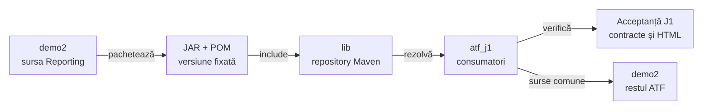

# ATF J1 — proiect principal și biblioteci consumate

## Pe scurt

Acest proiect consumă `atf.api:atf-reporting:1.0.0-j4` prin Maven.
`atf_j1` este proiectul principal pentru restul ATF-ului: modulele comune,
Shop, AutoEx și guvernanța lor. Implementarea, assets și regresiile generice
Reporting au owner în `demo2`; J1 consumă versiunea publicată.

**Trasee rapide:** [atlasul integrării fără sursă](ATF_Reporting_Library_Atlas.md) ·
[ownership și sync](#ownership-și-direcția-sincronizării) ·
[atlasul ATF](ATF_Context_Atlas.md).

| Suprafață | În această copie | Owner |
|---|---|---|
| Reporting producție | JAR și POM în `lib`; fără modul sursă în reactor | producătorul păstrează codul și reconstruiește biblioteca |
| consumatori | 11 module sursă; dependențele Reporting folosesc `atf.reporting.version` | J1 este sursa de adevăr pentru schimbările din afara Reporting |
| Reporting Tests | încă prezent în reactor, cu retragere propusă | `demo2` deține regresiile generice; copia J1 verifică JAR-ul fără evoluție independentă |
| proveniență | `library-provenance.json`, manifestul intrărilor și checksum-uri lângă artifact | identifică exact binarul inclus |
| build și rapoarte | copie de verificare în TMP | [procesul de execuție](ATF_Build_And_Execution_Safety.md) |

## Ownership și direcția sincronizării

| Schimbare | Sursa de adevăr | Livrare către celălalt proiect |
|---|---|---|
| implementare, API, CSS/JS și publicare Reporting | `demo2/atf-reporting` | JAR/POM versionate, checksum-uri, proveniență și documentație de adopție către J1 |
| regresii și fixture-uri generice Reporting | `demo2/atf-reporting-tests` | copie reconciliată în modulul J1 cât timp acesta este păstrat |
| Core, UI, Kit, Validation, Mock, Console, Debug UI | `atf_j1` | surse și contracte comune selectate către `demo2` |
| Shop/AutoEx și adaptoarele lor | `atf_j1` | schimbări de aplicație și probe, cu scope-urile producătorului păstrate |
| reactor, README principal, arhitectură și atlase | proiectul descris | ediții reconciliate; POM-ul cu JAR nu înlocuiește reactorul producătorului |

Nu se face mirror recursiv. `.git`, output-urile, cache-ul Maven și `lib` nu
intră în sincronizarea obișnuită a surselor; build-ul și verificarea rulează
în TMP, iar promovarea este selectivă și protejată față de drift.

## Traseul bibliotecii



<details>
<summary><strong>Legendă — sursă întreținută și consum binar</strong></summary>

- `demo2` păstrează implementarea completă, resursele și probele native ale bibliotecii.
- Repository-ul copiat conține artifactul thin și POM-ul; dependențele externe sunt rezolvate de Maven.
- Consumerii compilează împotriva JAR-ului. Nu folosesc sursa Reporting dintr-un director vecin.
- Acceptanța J1 verifică binarul și integrarea sa. Regresiile generice și
  verificările structurii sursei au owner în producător.
- Muchia inversă transferă schimbările comune non-Reporting, nu configurația
  reactorului J1. Muchiile exprimă livrare, nu dependențe Maven.

</details>

## Contractul unui modul împachetat

Modulul logic nu implică sursă în fiecare consumer. Reporting este primul
boundary livrat binar; alte module pot urma numai după delimitarea API-ului,
a configurației, a lifecycle-ului și a probelor lor.

| Livrabil | Ce poate verifica independent consumerul |
|---|---|
| JAR thin și POM | coordonată, Java minim și dependențe tranzitive efective |
| documentație de adopție | intrări, erori, ownership, exemplu executabil și linkuri fără sursă obligatorie |
| proveniență | hash binar/POM, intrări ale producătorului și versiune coerentă |
| compatibilitate | suprafață susținută și migrare; accesul Java `public` nu este singur o promisiune |
| acceptanță | CodeSource și artifacte efective; probele native rămân la producător |

[Atlasul local Reporting](ATF_Reporting_Library_Atlas.md) explică integrarea
existentă. Completitudinea documentelor livrate și API-ul susținut au
[owner Reporting](feedback/ATF_Reporting_Feedback.md), fără a fi declarate închise prin această hartă.

## Deschiderea proiectului

Folderul `lib` este repository Maven local; păstrează JAR-ul, POM-ul și
checksum-urile împreună, după coordonatele bibliotecii:

```text
lib/
  atf/api/atf-reporting/<version>/
    atf-reporting-<version>.jar
    atf-reporting-<version>.pom
    sidecars SHA-1 și SHA-256 pentru fiecare artifact
```

POM-ul păstrează tranzitivele reale. Versiunea nouă înlocuiește dependența
declarată; nu rescrie în cache bytes pentru aceeași coordonată.

Importă POM-ul rădăcină în IntelliJ ca proiect Maven. Repository-ul local este
rezolvat față de rădăcina Maven identificată prin `.mvn`; nu este necesară
adăugarea manuală a JAR-ului în classpath.

- Fixture-urile UI identifică rădăcina prin POM-ul propriului modul Reporting Tests
  și POM-ul reactorului. Resursa din classpath rămâne reperul pentru lansările
  IntelliJ cu working directory extern; POM-ul producției Reporting nu este cerut.
- Versiunea Reporting este declarată o singură dată în proprietatea
  `atf.reporting.version`. Coordonata J1 este distinctă de snapshot-ul sursei,
  pentru a evita folosirea accidentală a unui artifact vechi din cache.

## Compatibilitatea acestui increment

`ReportAuditSnapshot.Failures` distinge cauzele de scenariile eșuate.
Constructorul cu patru argumente și simbolurile binare anterioare sunt păstrate;
un record pattern Java folosește acum cinci componente la recompilare.
Această migrare explicită nu declară compatibilitatea întregului API public.

## Starea Reporting Tests și retragerea propusă

`atf-reporting-tests` există încă și consumă biblioteca în `test` scope.
Repararea testelor generice se face în `demo2`; copia J1 poate fi executată,
dar nu devine un al doilea owner și nu este dependență runtime a aplicațiilor.

Retragerea nu este executată. Ea cere regresii demonstrate la producător,
păstrarea probelor adaptoarelor Shop/AutoEx și reconcilierea POM-ului,
guvernanței, selecțiilor și linkurilor, conform [criteriului J1](feedback/ATF_J1_Consumer_Feedback.md#j1-reporting-tests-02--retragere-cu-dovadă-păstrată).

- Inventarul executabil este acum de 11 module sursă plus Reporting ca bibliotecă.
- După o retragere acceptată ar rămâne 10 module sursă; acesta este un rezultat
  condiționat, nu configurația actuală sau un motiv pentru un modul gol.

## Validarea consumerului

Comenzile se execută într-o copie TMP a acestui proiect:

```powershell
mvn -B -pl atf-reporting-tests -am "-Dtest=AtfReportingUnitSuite,AtfReportingComponentSuite,AtfReportingIntegrationSuite,ExtentReportingE2eSuite,atf.ui.tests.extent.support.**.*Test" "-Dsurefire.failIfNoSpecifiedTests=false" test
```

| Tip de verificare | Interpretare |
|---|---|
| API, modele, proiecții, renderer și browser | regresii de consum ale JAR-ului; failure-urile cer analiză la contract |
| citirea structurii Java | probe native la build-ul bibliotecii, păstrate la producător; runtime-ul consumerului nu cere sursa |
| distribuție externă | pornește de la JAR-ul încărcat și POM-ul inclus; verifică hash, CodeSource și refuzul assets lipsă în ambele renderere |
| factory-uri de fixture și root IntelliJ | trebuie să pornească din modulul testelor, independent de modul de distribuție |
| guvernanța întregului reactor producător | contractul celor 12 module sursă se păstrează în producător; varianta binară necesită propriul perimetru explicit |

Testele runtime sunt păstrate integral; auditul sursei este executat nativ
la producător. Rezultatele nu se declară implicit verzi prin copiere; limitele sunt în
[feedback-ul consumului binar](feedback/ATF_J1_Consumer_Feedback.md).

## Actualizarea bibliotecii

1. Corectează și verifică Reporting în proiectul producător, cu build în TMP.
2. În copia TMP, setează versiunea POM-ului bibliotecii înaintea build-ului;
   construiește JAR-ul cu testele native și păstrează acel POM efectiv.
3. Adaugă versiunea în repository-ul local, cu SHA-1/SHA-256 și proveniență.
4. Actualizează `atf.reporting.version` și rulează probele consumerilor.
5. Verifică CodeSource-ul încărcat și egalitatea hash-ului cu artifactul inclus.

Actualizarea binarului nu copiază sursele Reporting în acest reactor.
Documentația proiectului descrie J1; regulile sursei standalone și gate-urile
producătorului sunt delimitate explicit. Acest document deține ownership-ul
și sincronizarea; [atlasul integrării](ATF_Reporting_Library_Atlas.md) deține contextul consumerului fără sursă.

