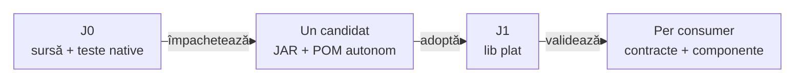

# ATF — consumul bibliotecilor platformei

[Owner, feedback și sincronizare](../lib/README.md) descrie fluxul comun cu J0;
această pagină detaliază integrarea tehnică.

## Pe scurt

J1 consumă Core, Reporting, Console, Mock și Test Kit ca biblioteci externe;
J0 deține implementarea și testele native. Adaptoarele consumerilor,
configurația și acceptanța rămân la fiecare livrare. Numărul curent de module,
rolurile consumerilor și versiunile Reporting sunt întreținute în
[catalogul workspace-urilor](ATF_Workspace_Synchronization.md#catalogul-de-module-și-reporting),
nu copiate în acest ghid al bibliotecilor.

## Limitele Console și Mock

| Bibliotecă | Dependențe de producție | Ownership |
|---|---|---|
| Console | Core, Jackson YAML, JUnit API; Test Kit opțional pentru bridge-ul JUnit | Formatarea evenimentelor neutre, stdout configurat și proiecția lifecycle-ului JUnit |
| Mock | Core și Jackson YAML; Kit și JUnit sunt numai pentru teste | Înlocuitor determinist al portului HTTP, JSON strict și potrivire exactă rută/query/numerică |
| Reporting | Fără dependențe de module ATF | HTML/Extent/fallback, proiecție de audit și randare |

Console își păstrează bridge-ul JUnit existent. Consumerii care îl folosesc
declară Kit separat; o dependență Maven opțională nu aduce Kit tranzitiv.

Console și Mock nu depind de Reporting, Validation sau de modulele aplicațiilor.
Fixture-urile business și cataloagele YAML rămân la consumerul lor.

## Fluxul sursei și al binarelor



<details>
<summary><strong>Legendă — un pachet, acceptanță independentă</strong></summary>

- Săgețile descriu publicarea și acceptanța, nu module Maven suplimentare.
- J0 păstrează toate clasele testelor native; acceptanța binară le reutilizează
  numai într-un harness TMP deținut, fără surse de producție în classpath.
- Fiecare consumer își păstrează baza Git și scope-ul de domeniu proprii; un
  gate trecut într-un consumer nu dovedește alt consumer.
- Proprietățile POM-ului rădăcină selectează coordonatele curente. POM-ul de
  publicare fixează dependența Core testată; versiunea sa este independentă de
  versiunea reactorului consumerului.

</details>

## Maven și IntelliJ

Rulează din rădăcina consumerului, într-o copie TMP deținută:

```powershell
mvn -B -ntp -N validate
mvn -B -ntp -DskipTests test-compile
```

Faza `validate` a POM-ului rădăcină instalează cele cinci perechi POM/JAR reale
în repository-ul Maven local selectat. Folosește aceleași setări și repository
Maven în IntelliJ, apoi reîncarcă POM-ul rădăcină. Dependențele folosesc
`atf.core.version`, `atf.reporting.version`, `atf.console.version`,
`atf.mock.version` și `atf.testkit.version`; nu restaura modulele sursă pentru
a satisface importurile.

Comenzile pentru bibliotecile native se rulează numai în J0. Acceptanța unui
JAR publicat compilează testele native în TMP fără copierea claselor de
producție, verifică CodeSource-ul real și păstrează oracolele negative. Nu
selecta direct clasele fixture JUnit imbricate: eșecurile lor intenționate sunt
verificate de testul exterior.

## Integritate și mentenanță

- `lib` conține zece artifacte binare, indexul și cinci ghiduri de utilizare,
  câte unul per bibliotecă: cinci perechi JAR/POM, fără repository imbricat,
  versiuni vechi, sursă sau note de verificare.
- Fișierul-rădăcină `library-provenance.json` păstrează proveniența Core/Reporting
  inițială și adaugă `platformLibraries.console`, `platformLibraries.mock` și
  `platformLibraries.test-kit`: coordonate, hash-uri binare/POM, digestul inputului
  producătorului, catalogul nativ și dovezile curente ale pachetelor.
- POM-ul Maven încorporat trebuie să fie identic octet cu octet cu POM-ul
  publicat alăturat. Guvernanța consumerului verifică JAR-ul fizic, refuzul sursei
  shadow, limita dependențelor și inventarul plat.
- Build-urile, cache-urile, copiile de recuperare și cea mai recentă notă de
  verificare a pachetului rămân în staging-ul TMP deținut al producătorului.
  Documentația oficială descrie contractele, nu istoricul iterativ al livrărilor.
- Schimbările încep în J0, păstrează preview-ul implicit de 240 de caractere și
  aserțiunile colapsabile și auditabile, apoi primesc acceptanță component
  separată în fiecare consumer afectat. Verificările offline nu implică
  acceptanță pe dispozitiv, broker extern sau ASR.

Vezi [sincronizarea workspace-urilor](ATF_Workspace_Synchronization.md) și
[execuția izolată](ATF_Build_And_Execution_Safety.md). Ownerii sursei sunt
[Console](../../atf_j0/atf-console/README.md) și
[Mock](../../atf_j0/atf-mock/README.md).
