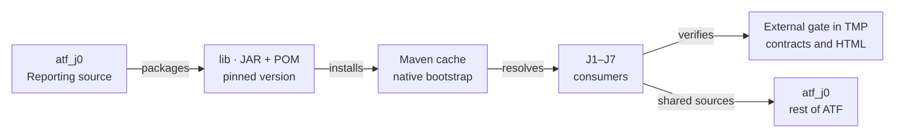

# ATF — Consumers of the Reporting Library

## At a glance

Consumers J1–J7 use Reporting through the JAR/POM pinned in their own POM; the
workspace catalog retains live coordinates and the J4 version exception.
Modules and configuration belong to each consumer; J1 owns Shop/AutoEx journeys,
while J2 Eventuate excludes the UI/Debug UI modules. Implementation, assets,
and generic Reporting regressions are owned by `atf_j0`.

**Quick links:** [integration atlas without source](ATF_Reporting_Library_Atlas.md) ·
[ownership and synchronization](#ownership-and-synchronization-direction) ·
[ATF atlas](ATF_Context_Atlas.md).

| Surface | In this checkout | Owner |
|---|---|---|
| Production Reporting | JAR and POM in `lib`; no source module in the reactor | producer retains code and rebuilds the library |
| consumers | J1–J7 have their own POMs, scopes, and acceptance; inventory and current versions are in the [live catalog](ATF_Workspace_Synchronization.md#module-and-reporting-catalog) | shared changes are reconciled with the J0 reference and each consumer |
| Reporting Tests | external gate, added explicitly in TMP only | `atf_j0` retains all regressions; acceptance verifies the JAR before distribution |
| provenance | one `library-provenance.json` with hashes and source fingerprint | identifies the exact included binary |
| builds and reports | verification copy in TMP | [execution process](ATF_Build_And_Execution_Safety.md) |

The shared protocol for J1–J7 consumers is [workspace synchronization](ATF_Workspace_Synchronization.md).
Each consumer has its own bootstrap, Git base, and acceptance; verifying one
does not certify the others.

J1 owns the AutoEx/Shop web scenarios; J2 targets queues and messages. J2 has
PowerShell/Podman setup and three MOCK components; the Java Kafka client and
broker acceptance remain work in progress.

## Ownership and synchronization direction

An historical foundation profile does not automatically describe current J2.
Read the Eventuate catalog and work-in-progress integration in the [J2 POM](../../atf_j2/pom.xml)
and [J2 atlas](../../atf_j2/docs/ATF_Context_Atlas.md).

| Change | Source of truth | Delivery to the other project |
|---|---|---|
| Reporting implementation, API, CSS/JS, and publication | `atf_j0/atf-reporting` | versioned JAR/POM, provenance, and adoption documentation for J1–J7 |
| generic Reporting regressions and fixtures | `atf_j0/atf-reporting-tests` | external JAR gate in TMP; no retained copy in the consumer |
| shared infrastructure | behavior owner in J0/J1 | selective reconciliation in both directions; J2 receives only modules declared in its profile |
| Shop/AutoEx and their adapters | `atf_j1` | application changes and proofs, retaining producer scopes |
| reactor, main README, architecture, and atlases | project being described | reconciled editions; a POM with a JAR does not replace the producer reactor |

Do not create a recursive mirror. `.git`, outputs, Maven cache, and `lib` are
not included in ordinary source synchronization; builds and verification run
in TMP, and promotion is selective and protected against drift.

## Library path



<details>
<summary><strong>Legend — maintained source and binary consumption</strong></summary>

- `atf_j0` retains the complete implementation, resources, and native library proofs.
- The flat folder contains the thin artifact and POM; root bootstrap installs the pair in the configured Maven cache.
- Consumers compile against the JAR. They do not use Reporting source from a neighboring directory.
- Each consumer's acceptance verifies the binary and its integration. Generic
  regressions and source-structure checks are owned by the producer.
- The reverse edge transfers shared non-Reporting changes, not the consumer's
  reactor configuration. Edges show delivery, not Maven dependencies.

</details>

## Packaged module contract

The logical module does not imply source in every consumer. Reporting is the
first boundary delivered as a binary; other modules can follow only after
their API, configuration, lifecycle, and proofs are defined.

| Deliverable | What the consumer can verify independently |
|---|---|
| thin JAR and POM | coordinate, minimum Java version, and effective transitive dependencies |
| adoption documentation | entry points, failures, ownership, executable example, and links that do not require source |
| provenance | binary/POM hashes, producer inputs, and consistent version |
| compatibility | supported surface and migration; Java `public` access alone is not a promise |
| acceptance | CodeSource and effective artifacts; native proofs remain with the producer |

The [local Reporting atlas](ATF_Reporting_Library_Atlas.md) explains existing
integration. Delivered-document completeness and the supported API are owned by
[Reporting](feedback/ATF_Reporting_Feedback.md); this map does not declare them closed.

## Opening the project

The `lib` folder contains only the distribution included in the project:

```text
lib/
  atf-reporting-<version>.jar
  atf-reporting-<version>.pom
```

Only the latest version is kept. SHA-256 hashes, the producer snapshot
fingerprint, and the catalog of native checks are in the
[single provenance manifest](../library-provenance.json) at the project root.

| Maven bootstrap | Contract |
|---|---|
| [root POM](../pom.xml) | Pinned Install Plugin; `install-file` in `validate`, once, with `inherited=false` |
| dependencies | modules use the Maven dependency and `atf.reporting.version`; full POM, with `generatePom=false`, for transitive dependencies |
| flat folder | local distribution; not declared as a Maven repository |

The first import requires Maven 3.6.3+ and JDK 21. From the project root:

```powershell
mvn -B -N validate
```

1. Run the bootstrap with the same Maven, settings, and local repository that
   you configure in IntelliJ: Settings → Build Tools → Maven.
2. Open the root POM as a Maven project and use Reload All Maven Projects.
3. Select JDK 21 for the project and Maven importer/runner; launch the test
   with its module classpath. Do not add a manual dependency to the JAR.

A build with `-pl atf-test-auto-ex -am` includes the root and runs the bootstrap
before the modules. For a direct Maven launch from a submodule, prepare
the cache with the command above. Changing the version or local repository
requires rerunning the bootstrap and reloading the IDE.

Maven uses the repository configured in settings. For isolation in TMP,
pass the same `-Dmaven.repo.local=<cale>` to both bootstrap and tests;
the IDE must use the same repository if you validate that cache.

- For parallel runs, use a separate TMP cache per consumer. On Windows,
  reinstalling the JAR may be refused while another JVM has it loaded; keep
  existing processes and separate caches before bootstrapping.
The groupId/artifactId/version structure exists in the cache, outside the `lib` folder.

- In the temporary gate, fixtures identify the root through their own POM and
  classpath resource; an external working directory does not require library source.
- A missing local JAR or POM blocks bootstrap even if the version
  already exists in the cache. An omitted file is not replaced by an older artifact.
- Verify SHA-256 against [provenance](../library-provenance.json)
  before updating the distribution; the standard bootstrap is not a signing gate.

## Compatibility for this increment

`ReportAuditSnapshot.Failures` distinguishes causes from failed scenarios.
The four-argument constructor and previous binary symbols are retained;
a Java record pattern now uses five components when recompiled.
This explicit migration does not declare compatibility for the entire public API.

## Reporting Tests at the producer

Reporting Tests is not a module in live consumers. Generic regressions, mocks, and
contracts remain with the [producer](../../atf_j0/atf-reporting-tests/README.md#regresia-permanentă-a-fiecărui-defect-reporting).
Each candidate JAR passes the full gate in a TMP consumer with the harness
added explicitly; Shop/AutoEx adapter checks remain in their modules.

## Consumer validation

Run commands in a TMP copy of this project. Verify the bootstrap and
main/test compilation for declared modules with:

```powershell
mvn -B test-compile
```

`test-compile` checks dependency resolution and compilation; it does not run tests or
certify the copied whole-ATF suite. For application regressions, use
[Shop](../atf-test-practice-shop/README.md) and [AutoEx](../atf-test-auto-ex/README.md).

The same whole-ATF suite checks Maven declarations for source and binary
consumers through the [declared surface](../atf-tests/README.md#source-or-binary-deployment-governance).
The external Reporting harness is added only in TMP staging for this
acceptance and does not change the consumer's permanent inventory.

<details>
<summary><strong>TMP layout for link governance</strong></summary>

Keep the directory pair under the same dedicated TMP root:

```text
<TMP increment>/
  atf_j1/   or atf_j2/ — consumer under verification
  atf_j0/    producer snapshot for documentation link targets
```

- Verify relative links to Reporting tests and documents from
  the same layout as live projects; a consumer without that neighbor does not validate the links.
- The neighboring snapshot is not part of the consumer's reactor, classpath, or `lib` folder.
  Reporting continues to load from the verified JAR.
- The external library runtime gate remains independent of this documentation
  check; it does not receive producer source to satisfy fixtures.

</details>

## External Reporting gate

The [producer's Reporting Tests](../../atf_j0/atf-reporting-tests/README.md) retain
runtime and browser checks. Native tests and source audit remain with the producer;
the consumer gate must load the physical JAR with its POM and transitive dependencies.

For each new version, prepare a temporary consumer:

1. Copy the consumer under verification to TMP, without outputs or caches.
2. Copy only the producer's Reporting Tests module into that consumer and
   add it temporarily to the root POM's `modules` list.
3. In the temporary module's POM, use `${atf.reporting.version}` for
   the Reporting dependency; retain all other dependencies and tests.
4. Run the full gate with the same local repository as the bootstrap:

```powershell
mvn -B -pl atf-reporting-tests -am "-Dtest=atf.reporting.**.*Test,atf.reporting.**.*Tests,atf.ui.tests.extent.**.*Test,atf.ui.tests.extent.**.*Tests" "-Dsurefire.failIfNoSpecifiedTests=false" test
```

| Check type | Interpretation |
|---|---|
| complete inventory | `Test` and `Tests` classes in both namespaces; Surefire identities are reconciled with the sources |
| API, models, projections, renderer, and browser | JAR consumption regressions, including failure paths |
| external distribution | CodeSource and SHA-256 identify the binary; the included POM and rejection of missing assets are checked separately |
| external working directory | fixture does not require the Reporting producer's POM or source |
| artifact and limits | TAB MCP audit covering timing, assertions, expansion, backlink, and default preview 240 |

Canonical unit/component/integration/E2E launchers can be used in the TMP consumer;
aliases do not count as separate gates. Logs, XML, and HTML
remain execution evidence in TMP. Afterward, each consumer retains
the modules and flat distribution for its profile; it does not receive the harness or
validation outputs.

## Updating the library

1. Fix and verify Reporting in the producer project, building in TMP.
2. In the TMP copy, set the library POM version before the build;
   build the JAR with native tests and retain that effective POM.
3. Update the single provenance manifest and include the JAR/POM directly in `lib`.
4. Update `atf.reporting.version` and run consumer checks.
5. Verify the loaded CodeSource and hash equality with the included artifact.

Updating the binary does not copy Reporting source into this reactor.
The documentation describes the consumer and its snapshot; standalone source rules and producer gates
are explicitly scoped. This document owns ownership
and synchronization; the [integration atlas](ATF_Reporting_Library_Atlas.md) owns the consumer context without source.

## Current library and verification

[Library provenance](../library-provenance.json) identifies the current Core / Reporting pair, source snapshot and independent consumer acceptance. Only the latest JAR/POM pairs are kept directly in `lib`; source and the permanent Reporting harness stay in J0.

- The [inline audit contract](../../atf_j0/docs/ATF_Inline_Audit_Contract.md) owns complete PNG and assertion evidence. The [navigation contract](ATF_Large_Report_Navigation.md) owns cold readiness and unchanged deadlines.

- The latest release verification is retained beside the producer package, following [evidence retention](ATF_Workspace_Synchronization.md#release-evidence-retention). It is distinct from fresh application, device, broker and ASR execution.


## Shared platform libraries

The [platform library guide](ATF_Platform_Libraries.md) covers ownership, Maven/IntelliJ bootstrap and consumer acceptance. The [provenance manifest](../library-provenance.json) identifies the installed JAR/POM pairs.
