# Reporting as a library — consumer integration atlas

Current coordinates, hashes, and consumer acceptance are recorded in [library provenance](../library-provenance.json). This guide describes the Reporting contract exercised by J1 and its observable integration boundaries.

## At a glance

This atlas supports J1 integration through the versioned Reporting library. It
starts from the consumed contract, local caller, and loaded JAR; it does not
assume library source is part of the J1 reactor.

| Intent | Entry point | Verify at the caller |
|---|---|---|
| publish a result | [API and tree](#reporting-api-adapter) | independent observation and expected value |
| finalize the artifact | [lifecycle](#lifecycle-and-publication) | close of the owned/shared resource and path notification |
| explain a failure | [diagnostics](#diagnostics-and-navigation) | cause, phase, ordinal, and original capture |
| choose a version | [binary identity](#library-identity) | Maven ownership, hash, POM, and CodeSource |

## Library identity

The version is declared in the [J1 POM](../pom.xml); [lib](../lib) contains
the Core and Reporting JAR/POM pairs directly in the folder. [Provenance](../library-provenance.json) records
the binary/POM hashes, input fingerprint, and catalog of native checks.

The fingerprint identifies the packaged inputs without carrying library source
or later versions. Diagnostics start from the loaded version;
a class name in a stack trace does not imply that source is available in J1.

The API in use can be inspected from the binary:

```powershell
javap -classpath lib/atf-reporting-1.0.0-j26.jar 'atf.reporting.contract.AtfReportPorts$Session'
```

The example uses the included version; after an upgrade, use the coordinate
from the POM. `public` classes are not automatically a stable surface for every
release; verify compatibility for actual usages.

<a id="reporting-api-adapter"></a>

## Consumed API and local adapter

```mermaid
%%{init: {"themeVariables":{"fontSize":"15px"},"themeCSS":".nodeLabel, .nodeLabel p { font-size: 15px !important; line-height: 1.35 !important; } .edgeLabel, .edgeLabel p { font-size: 12px !important; font-weight: 400 !important; line-height: 1.2 !important; } .edgeLabel .labelBkg, .edgeLabel p { background: transparent !important; } .edgeLabel foreignObject { transform: translateY(-18px); overflow: visible; } .node rect { rx: 6px; ry: 6px; }","flowchart":{"curve":"linear","nodeSpacing":24,"rankSpacing":40,"padding":10,"diagramPadding":16}}}%%
flowchart LR
    Caller["J1<br/>execution + comparison"] -->|adapts| DTO["Reporting models<br/>facts + verdict"]
    DTO -->|publishes| Jar["JAR<br/>Extent / fallback"]
    Jar -->|produces| Html["Auditable HTML"]
    Html -->|verifies| Proof["Consumer check"]
```



<details>
<summary><strong>Legend — binary contract and local integration</strong></summary>

- The caller owns HTTP, the browser, expected values, and business policy.
- The models belong to the library; the adapter preserves identity and values,
  without Playwright or Core objects as the default protocol.
- The selected JAR defines the projection; compare rendered output after a
  library version change.
- Edges represent data and verification, not additional source modules.

</details>

| Binary entry point | Role | Local caller |
|---|---|---|
| `AtfReportPorts` | Session → Scenario → Phase → steps/request/validation | JUnit extension and session owner |
| `ExtentReportSession`, `HtmlReportSession` | two renderers over published facts | output selection and finalization |
| `UiExtentReportOptions`, `UiExtentReportSession` | checkpoints and UI/API profile | [Shop factory](../atf-test-practice-shop/src/main/atf/shop/runtime/ShopRunReportFactory.java), [AutoEx runtime](../atf-test-auto-ex/src/main/java/atf/autoex/runtime/README.md) |
| `AtfAssertion`, `AssertionAuditReport` | already evaluated results | [Kit audit](../lib/README.TestKit.md#scope-and-integration) |
| `ReportRequest`, `ReportResponse`, `ReportExecutionEvidence` | exchange and terminal execution | consumer's main mapper |
| `ReportEnvironmentSnapshot`, `ReportingSettings` | metadata and display limits | composition root and configuration |

## Tree and scopes

`SETUP`, `TEST BODY`, and `TEARDOWN` describe the test's existing phases.
Assertion steps, requests, validation, and captures belong to their phase; do not invent
evidence to fill the tree. Complete each child before its parent.

A scope with no children may remain terminal; existing evidence must be
expandable down to the comparison. A rejected transition does not authorize replay.
The [semantic contract](ATF_Reporting_Contract.md) describes the result ATF requires.

<details>
<summary><strong>Runnable example — consumer-provided comparison</strong></summary>

```java
import atf.reporting.configuration.ReportingSettings;
import atf.reporting.contract.AtfAssertion;
import atf.reporting.contract.AtfReportPorts;
import atf.reporting.contract.AtfReportStatus;
import atf.reporting.extent.session.ExtentReportSession;
import java.nio.file.Path;
import java.util.List;

public final class LibraryConsumerExample {
    public static void main(String[] args) {
        if (args.length != 2) throw new IllegalArgumentException("Expected: output.html observed-state");
        String expected = "ready", actual = args[1];
        boolean passed = expected.equals(actual);
        var status = passed ? AtfReportStatus.PASS : AtfReportStatus.FAIL;
        try (AtfReportPorts.Session session = new ExtentReportSession(
                Path.of(args[0]), ReportingSettings.defaults());
             var scenario = session.startScenario("Consumer", "observed state is ready", List.of("component"));
             var phase = scenario.startPhase("TEST BODY");
             var step = phase.startAssertionStep("Component assertions")) {
            step.assertions(List.of(new AtfAssertion("Observed state", expected, actual, passed)));
            step.complete(status);
            phase.complete(status);
            scenario.complete(status);
        }
        if (!passed) throw new AssertionError("Observed state differs; inspect the report");
    }
}
```

The program accepts an output path and an observation; `ready` is the nominal control.
Any other value produces a FAIL artifact and a Java exception after scopes close.
Compilation uses the JAR and transitive dependencies from the POM, without extra ATF modules.

</details>

## Lifecycle and publication

| Boundary | Extent | HTML fallback |
|---|---|---|
| path | absolute and normalized | path passed to the constructor |
| `flush()` | finalizes in the workspace; does not promise the final file | writes the final destination |
| `close()` | closes and publishes from the workspace | final flush and close |
| thread | session confined to its owner | no equivalent guard; thread safety is not implied |

The caller includes close in the result and reports the path only after successful
publication. The JUnit hook belongs to the owned/shared resource; a rejection does not justify
an implicit retry. The primary cause and secondary cleanup errors remain distinct.

## Verdict and assertions

The caller evaluates the comparison once, from an independent expected value and
the observed actual value. The renderer preserves FAIL/SKIP and does not reevaluate
equality from shortened text; a PASS parent or successful cleanup does not erase a FAIL.

The [component audit](ATF_Testing_Guide.md#consumer-component-audit)
preserves the comparison and standard collapsible step. Unit tests have their own
contract, without artificial E2E steps.

## Metadata and configuration

`ReportingSettings.defaults()` keeps the assertion preview at 240.
An override is the effective configuration; the limit applies to display, not
the comparison, Java source length, or a prompt.

`ReportEnvironmentSnapshot` supplies System from allowed fields. The requested viewport
and configured zoom do not replace browser CSS/DPR measurement;
the consumer adapts [its configuration](ATF_Test_Infrastructure_Annotations.md).

## API exchange and identity

`ReportRequest` and `ReportResponse` describe the observed exchange; the query may
contain duplicate pairs and empty values. The mapper preserves available data
or the opaque fingerprint; the displayed URL does not authorize business selection.

When execution ends without a response, `ReportExecutionEvidence` preserves attempts,
termination, provenance, and the terminal cause. Do not invent an HTTP status or zero duration
for an uncaptured value; missing evidence is distinct from success.

## Captures and profiles

The browser and capture belong to the UI/consumer. `ReportScreenshotPolicy` and
the profile select what is published; the renderer receives the original capture, without
navigating or recapturing to improve the report after the fact.

UI and UI_API do not change the business verdict or mutation policy.
The [capture contract](ATF_Evidence_Capture_Contract.md) describes selection,
the uncaptured state, and the checkpoint that owns the evidence.

## Timing measured by the caller

Measure execution, captures, and publication at their respective owners; aggregating requests
does not automatically give the E2E duration. Carry typed timing, keeping unknown
distinct from zero; its models and rendering come from the selected library.

[Runtime AutoEx](../atf-test-auto-ex/src/main/java/atf/autoex/runtime/README.md)
and [Shop support](../atf-test-practice-shop/src/main/atf/shop/support/README.md)
show the local adapters.

## Diagnostics and navigation

An error before a checkpoint preserves the phase and terminal cause; an error
after PASS has a distinct diagnostic. Cleanup does not replace it, and the owner
of business/comparison/execution is not inferred from the title.

`Fails → Tests` opens the scenario, phase, and ordinal of the original evidence.
Two same-named groups require typed identity; the visible tab alone does not certify
expansion. Consumer tests verify the selected report tree and its navigation.

## Tables and rendering

The [display contract](ATF_Reporting_Display_Contract.md) defines columns,
available space, wrapping, local scrolling, and disclosures for
all tables: setup, assertions, Playwright actions, and API.

The semantic snapshot does not test computed style or keyboard behavior. J1 checks
the selected report with its consumer scenarios; the application harness does not
inject corrective CSS or JavaScript.

## Redaction and preview

Full comparison precedes redaction and the display budget. A mismatch after
240 characters remains FAIL without exposing the full secret; valid JSON, invalid input,
and sensitive canaries require separate checks.

The redacted label is not the request-selection key. A fixture result
does not claim universal protection for every sensitive format; redactor or
renderer gaps are recorded against the selected library version and hash.

## Observation and backend recovery

The UI/consumer performs the read-only observation and owns the deadline and policy.
Reporting receives typed facts or adapted INFO rows; a successful observation
does not rewrite a FAIL or authorize mutation replay.

The adapter preserves the operation, attempt, cause, budget, and correlation.
The neutral projection is owned by [Reporting](feedback/ATF_Reporting_Feedback.md);
J1 fixes losses caused by its caller.

## Components and shared report

Kit owns JUnit evaluation and result reconciliation; the application extension
owns the report resource. A shared report does not mean that browser, account, capture,
or verdict is shared across invocations.

For individual and suite runs, verify the collapsible step, expected/actual, FAIL/SKIP,
single finalization, and absolute path after successful close. Shop/AutoEx integration checks
remain with the consumer if the generic test module is retired.

## Diagnostics and handoff

| Observation | Check first in J1 | Fix owner |
|---|---|---|
| missing class or method | version, POM, CodeSource, and compiled call | J1 adapter or compatibility of the selected Reporting version |
| missing report | opt-in, JUnit Store, close cause, and output | J1 caller or the selected library's publication contract |
| wrong verdict/capture | expected value, mapper, and invocation identity | consumer for input; Reporting for projection |
| broken columns or backlink | same HTML, phase/ordinal, viewport, and keyboard | selected Reporting version and the local rendering evidence |

The handoff includes the coordinate/hash, minimal input without secrets, cause,
expected/actual, and reproduction. The [J1 process](ATF_Reporting_Consumer.md) defines delivery;
do not patch library source or JAR contents in `lib`.

## Explicit profile and temporal sources

[Reporting library contract](../lib/README.Reporting.md) separates caller intent from artifact inspection; the legacy call remains Extent/HTTP.
The [current library provenance](../library-provenance.json) identifies the
delivered binary and consumer acceptance; this reactor documents the library
contract and verifies its own use of the selected bytes.
