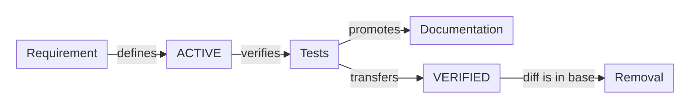

# ATF — test change control register

## AutoEx search owned response

The [AutoEx search contract](../atf-test-auto-ex/README.md) and its permanent
component tests define owned responses, fresh DOM, terminal queue-full behavior
and preserved budgets. Existing controls keep their historical bases.

<details>
<summary><strong>Verified controls — initial J1 review base</strong></summary>

```yaml
testChanges:
  - id: AUTOEX-SEARCH-READINESS-143
    status: VERIFIED
    base: 94b88a3e4d3f9aa8ba300e16e99409d5b0da28ac
    expires: 2026-11-30
    reason: Guard owned search responses and fresh DOM, terminal queue-full/HTTP failures, independent API and transport outcomes; preserve one click, original budgets and independent negative oracles.
    proof: mvn -B -pl atf-test-auto-ex -am "-Dtest=AutoExSearchReadinessComponentTest,AutoExSearchResponseComponentTest" "-Dsurefire.failIfNoSpecifiedTests=false" test
    paths:
      - atf-test-auto-ex/src/test/java/atf/autoex/tests/component/pages/AutoExSearchResponseComponentTest.java
      - atf-test-auto-ex/src/test/java/atf/autoex/tests/component/pages/AutoExSearchReadinessComponentTest.java
  - id: J1-EXISTING-REPORTING-J18-ADOPTION
    status: VERIFIED
    base: 94b88a3e4d3f9aa8ba300e16e99409d5b0da28ac
    expires: 2026-11-30
    reason: Record the existing consumer POM delta from J16 to the previously delivered J18; the physical JAR is unchanged and reverified by search component, real UI and rendered artifact acceptance.
    proof: mvn -B -pl atf-tests -am "-Dtest=ReportingGovernanceSurfaceTest" "-Dsurefire.failIfNoSpecifiedTests=false" test
    paths:
      - pom.xml
```

The POM/library pair predates the search repair and is not promoted again.
Reporting J18 acceptance (historical execution record) remains distinct from this
consumer's fresh execution; no historical control is rebased or extended.

</details>

<details>
<summary><strong>Verified control — undated verification-record governance</strong></summary>

```yaml
testChanges:
  - id: J1-DOC-VERIFICATION-RECORD-SCOPE-20261121
    status: VERIFIED
    base: 72c387e98735b03fe1afd65cab1913b76b1d86b4
    expires: 2026-12-21
    reason: Remove standalone verification reports after moving durable contracts to their owners; reject dated and undated report names and titles with negative fixtures.
    proof: mvn -B -ntp -pl atf-tests -am "-Dmaven.repo.local=$env:ATF_MAVEN_LOCAL_REPO" "-Dtest=WholeAtfGovernanceSuiteTest" "-Datf.governance.testChanges.baseRef=72c387e98735b03fe1afd65cab1913b76b1d86b4" "-Datf.test.heap.max=384m" "-Dsurefire.failIfNoSpecifiedTests=false" test
    paths:
      - atf-tests/src/test/java/atf/api/tests/governance/documentation/structure/DocumentationContextArtifactGovernanceTest.java
```

</details>

<a id="recovery-extent-report-rendering"></a>
<details>
<summary><strong>Verified control — recovery Extent report rendering</strong></summary>

```yaml
testChanges:
  - id: UI-RECOVERY-EXTENT-20261121
    status: VERIFIED
    base: 72c387e98735b03fe1afd65cab1913b76b1d86b4
    expires: 2026-12-21
    reason: Replace AutoEx recovery flags with named scenarios; verify its local recovered and exhausted Extent projections, collapsed observations, expand-all behavior, ordered rows, and body/URL redaction; keep both consumers' report selectors in test-scoped facades.
    proof: mvn -B -ntp -pl atf-ui,atf-test-auto-ex,atf-test-practice-shop,atf-tests -am "-Dmaven.repo.local=$env:ATF_MAVEN_LOCAL_REPO" "-Dtest=AutoExBackendRecoveryComponentTest,ShopBackendRecoveryComponentTest,WholeAtfGovernanceSuiteTest" "-Datf.governance.testChanges.baseRef=72c387e98735b03fe1afd65cab1913b76b1d86b4" "-Datf.test.heap.max=384m" "-Dsurefire.failIfNoSpecifiedTests=false" test
    paths:
      - atf-test-auto-ex/src/test/java/atf/autoex/tests/component/recovery/AutoExBackendRecoveryComponentTest.java
      - atf-test-auto-ex/src/test/java/atf/autoex/tests/support/reporting/AutoExRecoveryExtentReportProbe.java
      - atf-tests/src/test/java/atf/api/tests/governance/consumers/ConsumerModuleArchitectureGovernanceTest.java
```

Both consumer report checks passed in EN and RO. Each component test builds a
synthetic scenario and outcome-bearing step; J1's captured recovery records
pass through the selected renderer. `ConsumerModuleArchitectureGovernanceTest`
enforces the report-selector facade in AutoEx and the existing Shop facade.
Shop component source remains outside protected test-change controls and is
covered by its component test.

</details>

<details>
<summary><strong>Verified control — recovery trace in actual JUnit reports</strong></summary>

```yaml
testChanges:
  - id: J1-RECOVERY-RUNNER-TRACE-20261121
    status: VERIFIED
    base: ac4ec410eb6ad81ebcb56645331f926c03ad0989
    expires: 2026-12-21
    reason: Pin the physical Reporting J26/Test Kit K3 consumer pair and protect the AutoEx phase-observation projection; preserve assertions, verdict and test count, measured attempt fields, redaction, and independent trace disclosure. The Shop companion projection is covered by its focused component test.
    proof: mvn -B -ntp -pl atf-tests,atf-test-auto-ex,atf-test-practice-shop -am "-Dmaven.repo.local=$env:ATF_MAVEN_LOCAL_REPO" "-Dtest=AutoExBackendRecoveryComponentTest,ShopBackendRecoveryComponentTest,DocumentedLibraryCatalogTest,TestChangeGovernanceTest,WholeAtfGovernanceSuiteTest" "-Datf.governance.testChanges.baseRef=ac4ec410eb6ad81ebcb56645331f926c03ad0989" "-Dsurefire.failIfNoSpecifiedTests=false" test
    paths:
      - atf-test-auto-ex/src/test/java/atf/autoex/tests/component/recovery/AutoExBackendRecoveryComponentTest.java
      - atf-test-auto-ex/src/test/java/atf/autoex/tests/extension/AutoExExtentTestExtension.java
      - atf-tests/src/test/java/atf/api/tests/governance/documentation/factual/DocumentedLibraryCatalogTest.java
      - atf-tests/src/test/java/atf/api/tests/governance/distribution/README.md
      - pom.xml
```

The Maven component and whole-reactor checks run in both editions. Actual-report
browser acceptance runs separately in a fresh stage using the generated HTML
path, as documented in each consumer README. IntelliJ output-root parity remains
open as a separate item.

</details>

<details>
<summary><strong>Verified control — typed recovery report projection</strong></summary>

```yaml
testChanges:
  - id: J1-RECOVERY-REPORT-PROJECTION-20261122
    status: VERIFIED
    base: 79f177117dfef986c98ce3846766fe89ff138a98
    expires: 2026-12-22
    reason: Keep typed semantic operation and duration projection, actual report browser acceptance, and consumer-owned selectors protected in AutoEx and governance.
    proof: mvn -B -ntp -pl atf-test-practice-shop,atf-test-auto-ex,atf-tests -am "-Dtest=ShopBackendRecoveryComponentTest,AutoExBackendRecoveryComponentTest,ConsumerModuleArchitectureGovernanceTest,TestChangeGovernanceTest,WholeAtfGovernanceSuiteTest" "-Datf.governance.testChanges.baseRef=79f177117dfef986c98ce3846766fe89ff138a98" "-Dsurefire.failIfNoSpecifiedTests=false" test
    paths:
      - atf-test-auto-ex/src/test/java/atf/autoex/tests/component/recovery/AutoExBackendRecoveryComponentTest.java
      - atf-test-auto-ex/src/test/java/atf/autoex/tests/component/recovery/AutoExRecoveryActualReportAcceptanceTest.java
      - atf-test-auto-ex/src/test/java/atf/autoex/tests/support/reporting/AutoExRecoveryExtentReportProbe.java
      - atf-test-auto-ex/src/test/java/atf/autoex/tests/support/reporting/AutoExRecoveryReportObservation.java
      - atf-tests/src/test/java/atf/api/tests/governance/consumers/ConsumerModuleArchitectureGovernanceTest.java
```

</details>

<details>
<summary><strong>Verified control — project maps and dated verification snapshots</strong></summary>

```yaml
testChanges:
  - id: J1-DOC-MAP-AND-SNAPSHOT-GOVERNANCE-20261120
    status: VERIFIED
    base: ac8c77578400e331c6fa572db05df3208257e9ef
    expires: 2026-11-30
    reason: Remove general project maps and dated/library-versioned verification or acceptance snapshots; block their return with a repository scan, negative fixtures, and whole-suite selection.
    proof: mvn -B -ntp -pl atf-tests -am "-Dmaven.repo.local=$env:ATF_MAVEN_LOCAL_REPO" "-Dtest=WholeAtfGovernanceSuiteTest" "-Datf.governance.testChanges.baseRef=ac8c77578400e331c6fa572db05df3208257e9ef" "-Datf.test.heap.max=384m" "-Dsurefire.failIfNoSpecifiedTests=false" test
    paths:
      - atf-tests/src/test/java/atf/api/tests/governance/documentation/structure/DocumentationContextArtifactGovernanceTest.java
      - atf-tests/src/test/java/atf/api/tests/governance/documentation/DocumentationAnchorGovernanceTest.java
      - atf-tests/src/test/java/atf/api/tests/governance/documentation/DocumentationTargetGovernanceTest.java
      - atf-tests/src/test/java/atf/api/tests/governance/quality/CodeGovernanceSuiteCoverageTest.java
      - atf-tests/src/test/java/atf/api/tests/governance/WholeAtfGovernanceSuiteTest.java
```

</details>

<details>
<summary><strong>Verified control — root overview and governance selection</strong></summary>

```yaml
testChanges:
  - id: J1-ROOT-AND-CODE-GOVERNANCE-20261120
    status: VERIFIED
    base: 4ec3e14b357e0968776399477592fd13c3713631
    expires: 2026-11-30
    reason: Keep the root overview local-first, concise, and top-down; require its API/UI-to-Extent path, collapsible component assertions, unit-test report boundary, and whole-reactor code-quality gate coverage in both editions.
    proof: mvn -B -ntp -pl atf-tests -am "-Dtest=TestChangeGovernanceTest,RootReadmeGovernanceTest,CodeGovernanceSuiteCoverageTest,DocumentationDiagramGovernanceTest,DocumentationProseGovernanceTest,DocumentationReadmeStructureGovernanceTest,DocumentationLinkGovernanceTest,DocumentationDirectRelationshipGovernanceTest,DocumentationLanguageGovernanceTest,DocumentationAnchorGovernanceTest,WholeAtfGovernanceSuiteTest" "-Datf.governance.testChanges.baseRef=4ec3e14b357e0968776399477592fd13c3713631" "-Datf.test.heap.max=384m" "-Dsurefire.failIfNoSpecifiedTests=false" test
    paths:
      - atf-tests/src/test/java/atf/api/tests/governance/documentation/structure/RootReadmeGovernanceTest.java
      - atf-tests/src/test/java/atf/api/tests/governance/quality/CodeGovernanceSuiteCoverageTest.java
```

The focused governance selection passed 37/37, and the whole-reactor entry point
passed 187/187 in EN and RO on 2026-11-20, with no failures, errors, or skips.

</details>

<details>
<summary><strong>Verified control — live commit reconciled after promotion</strong></summary>

The concurrent live commit changed the Git base, with all 372 compiled inputs
and all eleven promoted files byte-identical to the verified snapshot. This
separate control preserves the initial records and covers the current review.

```yaml
testChanges:
  - id: AUTOEX-SEARCH-LIVE-BASE-143
    status: VERIFIED
    base: f2aaa41e1f0939b93ccdab509492f862c09d18cc
    expires: 2026-11-30
    reason: Reconcile the same reviewed search fix against the newly observed J1 live commit, preserving the initial control and independent HTTP/DOM oracles; no source input, deadline or library changes.
    proof: mvn -B -pl atf-tests -am "-Dtest=TestChangeGovernanceTest" "-Dsurefire.failIfNoSpecifiedTests=false" test
    paths:
      - atf-test-auto-ex/src/test/java/atf/autoex/tests/component/pages/AutoExSearchResponseComponentTest.java
      - atf-test-auto-ex/src/test/java/atf/autoex/tests/component/pages/AutoExSearchReadinessComponentTest.java
```

</details>

<details>
<summary><strong>Verified control — J1 Extent API assertions and live catalog</strong></summary>

```yaml
testChanges:
  - id: J1-EXTENT-API-CORRELATION-20261119
    status: VERIFIED
    base: 5773a1567e14b570b17608b25058158bb2b1c114
    expires: 2026-12-19
    reason: Bind catalog assertions to the uniquely selected GET observation, verify the collapsible API assertion and request disclosures in a local Extent viewer, keep Playwright API use in the E2E layer, and enforce the live module and library catalog through documentation governance.
    proof: mvn -B -pl atf-tests,atf-test-auto-ex,atf-ui -am "-Dtest=DocumentedWorkspaceCatalogTest,DocumentationTargetGovernanceTest,ArchitectureOwnershipBoundaryTest,TestChangeGovernanceTest,AtfTestLayerArchitectureTest,AutoExRuntimeBoundaryComponentTest#catalogAssertionsBelongOnlyToTheSelectedGetAmongSamePathNeighbors+catalogApiCheckpointFailsClosedWhenTheSelectedEvidenceIsMissingOrAmbiguous,AutoExCatalogReportPresentationE2eTest,PlaywrightPagePreparationTest" "-Datf.governance.testChanges.baseRef=5773a1567e14b570b17608b25058158bb2b1c114" "-Datf.test.reportDirectory=artifacts/reports/j1-extent-api-20261119" "-Dsurefire.failIfNoSpecifiedTests=false" test
    paths:
      - atf-test-auto-ex/src/test/java/atf/autoex/tests/component/lifecycle/AutoExRuntimeBoundaryComponentTest.java
      - atf-test-auto-ex/src/test/java/atf/autoex/tests/e2e/reporting/AutoExCatalogReportPresentationE2eTest.java
      - atf-test-auto-ex/src/test/java/atf/autoex/tests/suites/AutoExE2eSuite.java
      - atf-test-auto-ex/src/test/java/atf/autoex/tests/support/reporting/AutoExCatalogApiReportFixture.java
      - atf-tests/src/test/java/atf/api/tests/governance/ArchitectureOwnershipBoundaryTest.java
      - atf-tests/src/test/java/atf/api/tests/governance/WholeAtfGovernanceSuiteTest.java
      - atf-tests/src/test/java/atf/api/tests/governance/documentation/DocumentationTargetGovernanceTest.java
      - atf-tests/src/test/java/atf/api/tests/governance/documentation/factual/DocumentedWorkspaceCatalog.java
      - atf-tests/src/test/java/atf/api/tests/governance/documentation/factual/DocumentedWorkspaceCatalogTest.java
      - atf-ui/src/test/java/atf/ui/playwright/PlaywrightPagePreparationTest.java
```

The focused proof checks the selected API response, Extent presentation, factual
documentation and test-layer boundaries. Whole-ATF was run separately and passed
171/171; package cohesion is reconciled through one package move and one precise
reviewed exception with an explicit removal criterion.

</details>

<details>
<summary><strong>Verified control — J1 suite-owned catalog comparison and Extent expansion</strong></summary>

```yaml
testChanges:
  - id: J1-CATALOG-SUITE-EXTENT-20261120
    status: VERIFIED
    base: 4ec3e14b357e0968776399477592fd13c3713631
    expires: 2026-12-20
    reason: Add an offline suite-owned Extent proof that the captured catalog GET alone owns the comparison and that its assertions and request disclosures expand in the published report.
    proof: mvn -B -pl atf-tests,atf-test-auto-ex -am "-Dtest=TestChangeGovernanceTest,AutoExE2eOverviewNarrativeComponentTest" "-Datf.governance.testChanges.baseRef=4ec3e14b357e0968776399477592fd13c3713631" "-Dsurefire.failIfNoSpecifiedTests=false" test
    paths:
      - atf-test-auto-ex/src/test/java/atf/autoex/tests/component/reporting/system/AutoExE2eOverviewNarrativeComponentTest.java
```

`AutoExE2eOverviewNarrativeComponentTest` passed 1/1 in both editions. Its
explicit suite scope generated one local UI/UI_API report; Playwright verified
the selected catalog GET as the only comparison owner and expanded its API
assertions and request disclosure. The canonical public-site suite was not run.

</details>

<details>
<summary><strong>Verified control — J1 bilingual documentation governance</strong></summary>

```yaml
testChanges:
  - id: J1-DOC-EDITION-GOVERNANCE-20261120
    status: VERIFIED
    base: 5773a1567e14b570b17608b25058158bb2b1c114
    expires: 2026-12-20
    reason: Extend bilingual documentation governance for exact language, links, structure, factual claims, and protected test-change controls; move the README structure guard into its cohesive package and preserve deletion governance.
    proof: mvn -B -pl atf-tests -am "-Dtest=WholeAtfGovernanceSuiteTest" "-Datf.governance.testChanges.baseRef=5773a1567e14b570b17608b25058158bb2b1c114" "-Datf.test.heap.max=384m" "-Dsurefire.failIfNoSpecifiedTests=false" test
    allowDelete: true
    paths:
      - atf-tests/src/test/java/atf/api/tests/governance/AtfGovernanceTestSupport.java
      - atf-tests/src/test/java/atf/api/tests/governance/distribution/README.md
      - atf-tests/src/test/java/atf/api/tests/governance/documentation/DocumentationAnchorGovernanceTest.java
      - atf-tests/src/test/java/atf/api/tests/governance/documentation/DocumentationGovernanceSupport.java
      - atf-tests/src/test/java/atf/api/tests/governance/documentation/DocumentationReadmeStructureGovernanceTest.java
      - atf-tests/src/test/java/atf/api/tests/governance/documentation/factual/DocumentedBuildContractTest.java
      - atf-tests/src/test/java/atf/api/tests/governance/documentation/factual/DocumentedBuildContracts.java
      - atf-tests/src/test/java/atf/api/tests/governance/documentation/factual/DocumentedUiGeometryContractTest.java
      - atf-tests/src/test/java/atf/api/tests/governance/documentation/factual/DocumentedUiGeometryContracts.java
      - atf-tests/src/test/java/atf/api/tests/governance/documentation/language/DocumentationLanguageGovernanceTest.java
      - atf-tests/src/test/java/atf/api/tests/governance/documentation/language/DocumentationLanguagePolicy.java
      - atf-tests/src/test/java/atf/api/tests/governance/documentation/language/DocumentationLanguageRules.java
      - atf-tests/src/test/java/atf/api/tests/governance/documentation/structure/DocumentationReadmeStructureGovernanceTest.java
```

`WholeAtfGovernanceSuiteTest` passed 171/171 on 2026-11-20 in both editions. The complete AutoEx E2E suite was not part of this proof.

</details>

<details>
<summary><strong>Verified control — direct J1 documentation relationships</strong></summary>

```yaml
testChanges:
  - id: J1-DOC-DIRECT-RELATIONSHIP-20261120
    status: VERIFIED
    base: 4ec3e14b357e0968776399477592fd13c3713631
    expires: 2026-12-20
    allowDelete: true
    reason: 'Enforce the direct J1 documentation and governance boundary: selected library artifacts, no neighboring-workspace path dependency, and local documentation targets; preserve historical audit entries and verify the bilingual catalog and report expansion.'
    proof: 'mvn -B -o -pl atf-tests,atf-test-practice-shop,atf-test-auto-ex -am "-Dtest=TestChangeGovernanceTest,ArchitectureOwnershipBoundaryTest,GovernanceDeploymentTest,DocumentationDirectRelationshipGovernanceTest,DocumentedLibraryCatalogTest,LibraryDocumentationInventoryTest,PlatformLibraryContractTest,PlatformLibraryIntegrityTest,AutoExE2eOverviewNarrativeComponentTest,ShopApiCallAuditReportComponentTest,AutoExApiContractReportPublisherComponentTest,ShopComponentReportScopeComponentTest,AutoExComponentReportScopeComponentTest" "-Datf.governance.testChanges.baseRef=4ec3e14b357e0968776399477592fd13c3713631" "-Dsurefire.failIfNoSpecifiedTests=false" test; mvn -B -o -pl atf-tests -am "-Dtest=WholeAtfGovernanceSuiteTest" "-Datf.governance.testChanges.baseRef=4ec3e14b357e0968776399477592fd13c3713631" "-Dsurefire.failIfNoSpecifiedTests=false" test'
    paths:
      - atf-tests/src/test/java/atf/api/tests/governance/WholeAtfGovernanceSuiteTest.java
      - atf-tests/src/test/java/atf/api/tests/governance/ArchitectureOwnershipBoundaryTest.java
      - atf-tests/src/test/java/atf/api/tests/governance/distribution/GovernanceDeployment.java
      - atf-tests/src/test/java/atf/api/tests/governance/distribution/GovernanceDeploymentTest.java
      - atf-tests/src/test/java/atf/libraries/PlatformLibraryIntegrityTest.java
      - atf-tests/src/test/java/atf/libraries/PlatformLibrarySurface.java
      - atf-tests/src/test/java/atf/api/tests/governance/distribution/README.md
      - atf-tests/src/test/java/atf/api/tests/governance/documentation/factual/DocumentedWorkspaceCatalog.java
      - atf-tests/src/test/java/atf/api/tests/governance/documentation/factual/DocumentedWorkspaceCatalogTest.java
      - atf-tests/src/test/java/atf/api/tests/governance/documentation/factual/DocumentedLibraryCatalog.java
      - atf-tests/src/test/java/atf/api/tests/governance/documentation/factual/DocumentedLibraryCatalogTest.java
      - atf-tests/src/test/java/atf/api/tests/governance/documentation/relationship/DocumentationDirectRelationshipGovernanceTest.java
```

On 2026-11-20, focused local report and governance checks passed in both editions: Shop 21/21, AutoEx 22/22, and atf-tests 22/22 (65/65 total per edition). AutoEx's local browser check expanded the generated Extent report. Whole-ATF governance passed 179/179 in EN and 179/179 in RO, with no failures, errors, or skips. The edition-tool tests passed 10/10; the comparator found no problems across 56 Markdown documents.

</details>

**J1 context:** copied historical controls retain their original Git bases.
J1 controls use the consumer review base; eligibility
is verified by [Git control](../atf-tests/README.md#test-change-governance), without implicitly converting bases.

## At a glance

The register retains technical VERIFIED controls required for the Git diff
against the review base. Visible sections explain the purpose, roles, and rules;
entries with SHA hashes, paths, and commands are collapsed at the end.

| Reader question | Where to find the answer |
|---|---|
| What behavior still needs correction? | [Feedback register](feedback/README.md): requirement, gap, criterion, and missing evidence |
| What test change is still in progress? | ACTIVE blocks in owner feedback, indexed in the [feedback register](feedback/README.md) |
| Which verified difference still needs follow-up through integration? | [Verified technical controls](#verified-technical-controls): only VERIFIED |
| How does governance verify it? | [ATF Tests README](../atf-tests/README.md#test-change-governance): schema, executable rules, and CI |

## Business purpose

Changing a test must preserve confidence in the behavior it verifies.
The technical control links the change to its requirement and reproducible evidence.

| Objective | Intended result | Acceptance criterion |
|---|---|---|
| Regression confidence | changes preserve the contract or explain its change | explicit requirement and relevant evidence, including negative cases |
| Clear review | reason, scope, and evidence can be traced together | one eligible control per path and baseline |
| Current documentation | readers distinguish delivered behavior from remaining work | owner contract, gaps in feedback, temporary Git control |

These objectives provide context for the register. Concrete functional requirements and
their priority remain with the domain owner and are indexed in the
[feedback register](feedback/README.md).

## Context and responsibilities

| Layer | Question | Responsible owner and outcome |
|---|---|---|
| Business need | Why is this behavior needed? | product/consumer owner: desired outcome and priority |
| Requirement / contract | What must the system do? | domain owner: criteria in feedback, then a stable contract in its documentation |
| Rule | Which invariant must be preserved? | module/governance owner: documented rule and executable guard |
| Acceptance test | How do we demonstrate the behavior? | test owner: suitable unit, component, integration, or E2E test |
| Change control | Which Git difference do we cover? | change author: baseline, exact paths, reason, expiry, and Maven command |
| Integration | When do we remove the entry? | integrator: checks the diff against the new base and keeps the contract with its owner |

A single person may fill several roles; decisions and evidence remain
distinct. VERIFIED describes verification of the technical increment, while
business acceptance is decided separately against the requirement criteria.

## Usage rules

| Rule | Application |
|---|---|
| Exact scope | a control covers only declared paths and the resolved Git base; deletions require allowDelete: true |
| Single transfer | when moving to VERIFIED, move the entry from owner feedback into this baseline; keep its ID and avoid duplicate eligible owners |
| Separate evidence | proof declares a command; the gate checks schema and eligibility without running the command or certifying its result |
| Local status | verifying an increment allows its promotion; the functional requirement remains open while any criteria are unmet |
| Removal from register | remove the control when the diff against the gate base no longer contains the covered changes; a new commit alone is insufficient |
| Reconciliation | expiry or a different baseline requires review of the control and evidence; do not extend or rebase it automatically |

Moving or renaming a test changes its protected path: do not automatically replace
the old path with the new one or add wildcards. A VERIFIED entry
retains the exact path set approved for its base; a new path
or deletion requires an exact, active control authorized in feedback. The proof field
is a proposed reproduction command, not evidence of execution and not
additional permission.

The field schema and exact file protection are defined once
in [test change governance](../atf-tests/README.md#test-change-governance).
The parser reads testChanges blocks from every Markdown document in
docs/feedback and this baseline; active controls stay with the owner feedback
rather than in a separate register.

## Lifecycle



<details>
<summary><strong>Legend — acceptance, transfer, and removal</strong></summary>

- ACTIVE tracks work in progress in the owner document feedback.
- Relevant tests verify the change scope; promote the demonstrated contract
  before removing the corresponding feedback gap.
- VERIFIED retains only a verified increment control that still appears
  in the diff; transfer does not automatically close the entire functional requirement.
- If the diff no longer requires the control, remove the entry directly;
  VERIFIED is not a required archive stage.
- Stable documentation remains with the owner after the technical entry is removed.

Short labels have the following meanings:

| In diagram | Full meaning |
|---|---|
| Requirement | Requirement and criterion |
| ACTIVE | ACTIVE control in owner feedback |
| Tests | Relevant tests |
| Documentation | Owner documentation |
| VERIFIED | VERIFIED control |
| Removal | Removal from the register |
| verifies | verifies the increment |
| promotes | promotes the contract |
| transfers | transfers the control |

</details>

## Verified technical controls <a id="controale-tehnice-verificate"></a>

<details>
<summary><strong>YAML register — VERIFIED controls and their exact scopes</strong></summary>

```yaml
testChanges:
  - id: AUTOEX-STORE-AVAILABILITY-12
    status: VERIFIED
    base: 9b0860bfc734df570c7512b76aa5dbb559527b7d
    expires: 2026-11-25
    reason: Add only bounded recovery for the queue-full page on an observed GET document, a validated origin, and validated read routes. Preserve all scenarios and E2E assertions; do not repeat clicks, POSTs, or account, cart, or payment operations. Add component tests for recovery and exhaustion, foreign origin, missing element, and non-replay, plus strict configuration.
    proof: mvn -pl atf-test-auto-ex,atf-tests -am "-Dtest=AutoExComponentSuite,WholeAtfGovernanceSuiteTest" "-Datf.governance.testChanges.baseRef=9b0860bfc734df570c7512b76aa5dbb559527b7d" "-Datf.test.heap.max=384m" "-Dsurefire.failIfNoSpecifiedTests=false" test
    paths:
      - atf-test-auto-ex/src/test/java/atf/ui/tests/autoex/component/navigation/AutoExAvailabilityFixture.java
      - atf-test-auto-ex/src/test/java/atf/ui/tests/autoex/component/navigation/AutoExStoreAvailabilityComponentTest.java
      - atf-test-auto-ex/src/test/java/atf/ui/tests/autoex/component/configuration/AutoExConfigurationLoaderComponentTest.java
      - atf-test-auto-ex/src/test/resources/atf-auto-ex.yaml
  - id: CONSUMER-SHOP-API-TEST-11
    status: VERIFIED
    base: 9b0860bfc734df570c7512b76aa5dbb559527b7d
    expires: 2026-11-25
    reason: Move the two API contracts and fixture to the canonical api.network namespace, preserving all 19 methods and query decoding. The fixture injects observations through the public inspector; a new test distinguishes the query redacted at capture from the converted value path and query. Make the runtime recorder private; have the mapper facade convert Core observations and executions without exposing the callback or internal alias. Preserve suite selection and protect the new boundary through governance; take exclusive ownership of the CONSUMER-AUTOEX-RUNTIME-10 guard at the same base.
    proof: mvn -pl atf-test-practice-shop,atf-tests -am "-Dtest=ShopComponentSuite,WholeAtfGovernanceSuiteTest" "-Datf.governance.testChanges.baseRef=9b0860bfc734df570c7512b76aa5dbb559527b7d" "-Datf.test.heap.max=384m" "-Dsurefire.failIfNoSpecifiedTests=false" test
    paths:
      - atf-tests/src/test/java/atf/api/tests/governance/consumers/ConsumerModuleArchitectureGovernanceTest.java
  - id: CONSUMER-AUTOEX-RUNTIME-10
    status: VERIFIED
    base: 9b0860bfc734df570c7512b76aa5dbb559527b7d
    expires: 2026-11-24
    reason: Explicitly move the AutoEx runtime into main with a finish port and thin JUnit adapter; preserve selections, steps, business assertions, observed mapping, and Kit cleanup. Keep Maven scopes unchanged; add tests for primary/secondary errors, mapper behavior, and publication from a local DOM. The guard requires the new boundary without an allowlist.
    proof: mvn -pl atf-test-auto-ex,atf-tests -am "-Dtest=AutoExComponentSuite,WholeAtfGovernanceSuiteTest" "-Datf.governance.testChanges.baseRef=9b0860bfc734df570c7512b76aa5dbb559527b7d" "-Datf.test.heap.max=384m" "-Dsurefire.failIfNoSpecifiedTests=false" test
    allowDelete: true
    paths:
      - atf-test-auto-ex/src/test/java/atf/ui/autoex/support/AutoExConsoleBridge.java
      - atf-test-auto-ex/src/test/java/atf/ui/autoex/support/AutoExCustomerApiSetup.java
      - atf-test-auto-ex/src/test/java/atf/ui/autoex/support/AutoExE2eExtension.java
      - atf-test-auto-ex/src/test/java/atf/ui/autoex/support/AutoExE2eRun.java
      - atf-test-auto-ex/src/test/java/atf/ui/autoex/support/AutoExEvidenceProfile.java
      - atf-test-auto-ex/src/test/java/atf/ui/autoex/support/AutoExProjectRoot.java
      - atf-test-auto-ex/src/test/java/atf/ui/tests/autoex/api/AutoExApiContractReportExtension.java
      - atf-test-auto-ex/src/test/java/atf/ui/tests/autoex/component/AutoExEvidenceProfileComponentTest.java
      - atf-test-auto-ex/src/test/java/atf/ui/tests/autoex/component/lifecycle/AutoExRunLifecycleAdapterComponentTest.java
      - atf-test-auto-ex/src/test/java/atf/ui/tests/autoex/component/lifecycle/AutoExRuntimeBoundaryComponentTest.java
      - atf-test-auto-ex/src/test/java/atf/ui/tests/autoex/e2e/AutoExAccountUiE2eTest.java
      - atf-test-auto-ex/src/test/java/atf/ui/tests/autoex/e2e/AutoExCartUiE2eTest.java
      - atf-test-auto-ex/src/test/java/atf/ui/tests/autoex/e2e/AutoExExistingCustomerUiApiE2eTest.java
      - atf-test-auto-ex/src/test/java/atf/ui/tests/autoex/e2e/AutoExPurchaseUiApiE2eTest.java
      - atf-test-auto-ex/src/test/java/atf/ui/tests/autoex/e2e/AutoExPurchaseUiE2eTest.java
      - atf-test-auto-ex/src/test/java/atf/ui/tests/autoex/e2e/AutoExPurchaseUiFinalScreenshotE2eTest.java
      - atf-test-auto-ex/src/test/java/atf/ui/tests/autoex/extension/AutoExE2eExtension.java
      - atf-test-auto-ex/src/test/java/atf/ui/tests/autoex/extension/AutoExEvidenceProfileAdapter.java
      - atf-test-auto-ex/src/test/java/atf/ui/tests/autoex/extension/AutoExRunFactory.java
      - atf-test-auto-ex/src/test/java/atf/ui/tests/autoex/extension/AutoExRunLifecycleAdapter.java
  - id: CONSUMER-ACCOUNT-SCOPE-02
    status: VERIFIED
    base: 9b0860bfc734df570c7512b76aa5dbb559527b7d
    expires: 2026-11-26
    reason: Implement the explicit scope and move the runtime factories as directly requested in feedback; preserve the complete prior ConsumerModuleArchitectureGovernanceTest contract and take sole ownership of its control, retain the Shop account tests, add a real Jupiter lifecycle, and strengthen production code without JUnit/Kit, without relaxing thresholds or external opt-in.
    proof: mvn -pl atf-test-kit,atf-test-practice-shop,atf-tests -am "-Dtest=ScopedTestValueTest,TestRunScopeComponentTest,ShopComponentSuite,WholeAtfGovernanceSuiteTest" "-Datf.governance.testChanges.baseRef=9b0860bfc734df570c7512b76aa5dbb559527b7d" "-Dsurefire.failIfNoSpecifiedTests=false" test
    paths:
      - atf-test-kit/pom.xml
      - atf-test-kit/src/test/java/atf/api/testkit/scope/ScopedTestValueTest.java
      - atf-test-kit/src/test/java/atf/api/testkit/scope/TestRunScopeComponentTest.java
  - id: REPORT-OBSERVED-OWNER-LIVE-08
    status: VERIFIED
    base: 9b0860bfc734df570c7512b76aa5dbb559527b7d
    expires: 2026-11-24
    reason: Verify observed/configured source, confirmed absence versus missing capture, literal JSON null, API/UI ownership, sibling exchanges, and the exact Open in Tests index. Include captures in audit and preserve whitespace at the UI source, sanitization, signature, and publisher; retain all earlier cases and the explicitly reviewed base. Preserve the PRIMARY/SECONDARY chain, quoting independent of header order, and explicit ownership in markup; duration extraction is shared without increasing the asset budget.
    proof: mvn -pl atf-reporting-tests,atf-test-auto-ex,atf-test-practice-shop,atf-tests -am "-Dtest=UiNetworkBodyFidelityComponentTest,UiNetworkInspectorComponentTest,AtfReportingUnitSuite,AtfReportingComponentSuite,AtfReportingIntegrationSuite,UiFailureReportContractTest,ShopComponentSuite,AutoExComponentSuite,WholeAtfGovernanceSuiteTest" "-Datf.governance.testChanges.baseRef=9b0860bfc734df570c7512b76aa5dbb559527b7d" "-Datf.test.heap.max=384m" "-Dsurefire.failIfNoSpecifiedTests=false" test
    paths:
      - atf-reporting-tests/src/test/java/atf/api/reporting/api/request/ReportRequestHeadersTest.java
      - atf-reporting-tests/src/test/java/atf/api/reporting/api/request/ObservedRequestEvidenceComponentTest.java
      - atf-reporting-tests/src/test/java/atf/api/reporting/support/request/ObservedRequestFixture.java
      - atf-reporting-tests/src/test/java/atf/api/reporting/ui/validation/UiApiValidationContractComponentTest.java
      - atf-reporting-tests/src/test/java/atf/api/reporting/api/evidence/ApiBodyMediaComponentTest.java
      - atf-reporting-tests/src/test/java/atf/api/reporting/api/evidence/ApiWhitespaceBodyComponentTest.java
      - atf-reporting-tests/src/test/java/atf/api/reporting/extent/session/ExtentReportFailureProjectionContractTest.java
      - atf-reporting-tests/src/test/java/atf/api/reporting/extent/session/ExtentReportSessionContractTest.java
      - atf-reporting-tests/src/test/java/atf/api/reporting/ui/ExtentReportUiFailureEvidenceTest.java
      - atf-reporting-tests/src/test/java/atf/api/reporting/runtime/core/ExtentReportRuntimeScriptTest.java
      - atf-reporting-tests/src/test/java/atf/ui/tests/extent/support/inspection/parity/ApiExchangeParityProbe.java
      - atf-ui/src/test/java/atf/api/ui/network/UiNetworkBodyFidelityComponentTest.java
      - atf-reporting-tests/src/test/java/atf/ui/tests/extent/support/inspection/reconciliation/UiApiVerdictProjectionProbe.java
  - id: REPORT-OBSERVED-OWNER-07
    status: VERIFIED
    base: 5eb3fd3cb099fc67b49be3c17de564db63755db7
    expires: 2026-11-24
    reason: Verify observed/configured source, confirmed absence versus missing capture, literal JSON null, API/UI ownership, sibling exchanges, and the exact Open in Tests index. Include captures in audit and preserve whitespace at the UI source, sanitization, signature, and publisher; retain all earlier cases and the explicitly reviewed base. Preserve the PRIMARY/SECONDARY chain, quoting independent of header order, and explicit ownership in markup; duration extraction is shared without increasing the asset budget.
    proof: mvn -pl atf-reporting-tests -am "-Dtest=UiNetworkBodyFidelityComponentTest,UiNetworkInspectorComponentTest,AtfReportingUnitSuite,AtfReportingComponentSuite,AtfReportingIntegrationSuite,UiFailureReportContractTest" "-Datf.test.heap.max=384m" "-Dsurefire.failIfNoSpecifiedTests=false" test
    paths:
      - atf-reporting-tests/src/test/java/atf/api/reporting/api/request/ReportRequestHeadersTest.java
      - atf-reporting-tests/src/test/java/atf/api/reporting/api/request/ObservedRequestEvidenceComponentTest.java
      - atf-reporting-tests/src/test/java/atf/api/reporting/support/request/ObservedRequestFixture.java
      - atf-reporting-tests/src/test/java/atf/api/reporting/ui/validation/UiApiValidationContractComponentTest.java
      - atf-reporting-tests/src/test/java/atf/api/reporting/api/evidence/ApiBodyMediaComponentTest.java
      - atf-reporting-tests/src/test/java/atf/api/reporting/api/evidence/ApiWhitespaceBodyComponentTest.java
      - atf-reporting-tests/src/test/java/atf/api/reporting/extent/session/ExtentReportFailureProjectionContractTest.java
      - atf-reporting-tests/src/test/java/atf/api/reporting/extent/session/ExtentReportSessionContractTest.java
      - atf-reporting-tests/src/test/java/atf/api/reporting/ui/ExtentReportUiFailureEvidenceTest.java
      - atf-reporting-tests/src/test/java/atf/api/reporting/runtime/core/ExtentReportRuntimeScriptTest.java
      - atf-reporting-tests/src/test/java/atf/ui/tests/extent/support/inspection/parity/ApiExchangeParityProbe.java
      - atf-ui/src/test/java/atf/api/ui/network/UiNetworkBodyFidelityComponentTest.java
      - atf-reporting-tests/src/test/java/atf/ui/tests/extent/support/inspection/reconciliation/UiApiVerdictProjectionProbe.java
      - atf-test-auto-ex/src/test/java/atf/ui/autoex/support/AutoExE2eRun.java
  - id: REPORT-BODY-AUDITOR-OWNER-09
    status: VERIFIED
    base: 9b0860bfc734df570c7512b76aa5dbb559527b7d
    expires: 2026-11-24
    reason: Explicitly review the body auditor against the shared live base 9b0860b; distinguish confirmed absence from missing capture and literal null, and cover JSON fallback without weakening controls. The three existing tests, ObservedRequestEvidenceComponentTest, ObservedRequestFixture, and UiApiVerdictProjectionProbe, retain sole ownership of REPORT-OBSERVED-OWNER-LIVE-08 and include the QUERY, retry, and real-header hardening.
    proof: mvn -pl atf-reporting-tests,atf-tests -am "-Dtest=AtfReportingUnitSuite,AtfReportingComponentSuite,AtfReportingIntegrationSuite,WholeAtfGovernanceSuiteTest" "-Datf.governance.testChanges.baseRef=9b0860bfc734df570c7512b76aa5dbb559527b7d" "-Dsurefire.failIfNoSpecifiedTests=false" test
    paths:
      - atf-reporting-tests/src/test/java/atf/api/reporting/api/request/ObservedBodyAuditComponentTest.java
      - atf-reporting-tests/src/test/java/atf/api/reporting/api/contract/ApiReportContractAuditorTest.java
      - atf-reporting-tests/src/test/java/atf/api/reporting/support/request/LiveClientHeaderProbe.java
      - atf-reporting-tests/src/test/java/atf/api/reporting/html/contract/HtmlReportStaticContractTest.java
      - atf-reporting-tests/src/test/java/atf/api/reporting/ui/audit/section/CategoriesAndEvidenceSectionValidatorTest.java
      - atf-reporting-tests/src/test/java/atf/ui/tests/extent/support/audit/api/ApiJsonEvidenceAuditor.java
      - atf-reporting-tests/src/test/java/atf/ui/tests/extent/support/audit/mock/MockReportContractAuditor.java
      - atf-reporting-tests/src/test/java/atf/ui/tests/extent/support/locators/ReportEvidenceLocators.java
      - atf-reporting-tests/src/test/java/atf/ui/tests/extent/support/locators/ReportUiLocators.java
      - atf-reporting-tests/src/test/java/atf/ui/tests/extent/support/section/extract/ApiJsonEvidenceExtractor.java
  - id: AUTOEX-DELETE-DIAGNOSTICS-02
    status: VERIFIED
    base: 9b0860bfc734df570c7512b76aa5dbb559527b7d
    expires: 2026-11-26
    reason: Preserve existing cases and verify exactly one document GET navigation in a complete snapshot, distinct from total browser events; any observed request continues to prohibit replay. Negative cases remain FAIL, and both business E2E tests verify dismissal at 70%, including JavaScript Close after the naturally appearing vignette, with no fabricated traffic or ads.
    proof: mvn -pl atf-test-auto-ex,atf-tests -am "-Dtest=AutoExAccountDeletionSafetyComponentTest,AutoExAccountUiE2eTest,AutoExExistingCustomerUiApiE2eTest,WholeAtfGovernanceSuiteTest" "-Datf.autoex.e2e.enabled=true" "-Datf.governance.testChanges.baseRef=9b0860bfc734df570c7512b76aa5dbb559527b7d" "-Dsurefire.failIfNoSpecifiedTests=false" test
    paths:
      - atf-test-auto-ex/src/test/java/atf/ui/tests/autoex/component/journey/AutoExAccountDeletionSafetyComponentTest.java
  - id: CONSUMER-REPORTING-INTEGRATION-06
    status: VERIFIED
    base: 9b0860bfc734df570c7512b76aa5dbb559527b7d
    expires: 2026-11-24
    allowDelete: true
    reason: Separately review the delta against the integrated live commit; preserve the typed API migration and new cleanup tests, move only neutral support and tests to their owner, and remove suite aliases without losing selection; do not rebase existing controls or relax thresholds.
    proof: mvn -pl atf-tests,atf-test-practice-shop,atf-test-auto-ex -am "-Dtest=WholeAtfGovernanceSuiteTest,ShopComponentSuite,AutoExComponentSuite" "-Datf.governance.testChanges.baseRef=9b0860bfc734df570c7512b76aa5dbb559527b7d" "-Dsurefire.failIfNoSpecifiedTests=false" test
    paths:
      - atf-reporting-tests/src/test/java/atf/api/reporting/api/ApiManualReplayProjectionTest.java
      - atf-reporting-tests/src/test/java/atf/api/reporting/extent/time/ReportingTimestampComponentTest.java
      - atf-reporting-tests/src/test/java/atf/api/reporting/ui/failure/UiSetupFailureEvidenceComponentTest.java
      - atf-reporting/src/test/java/atf/api/reporting/standalone/ReportingTimestampComponentTest.java
      - atf-test-auto-ex/src/test/java/atf/ui/autoex/support/AutoExScreenAuditObservations.java
      - atf-test-auto-ex/src/test/java/atf/ui/tests/autoex/api/AutoExApiAccountCleanup.java
      - atf-test-auto-ex/src/test/java/atf/ui/tests/autoex/api/AutoExApiLiveContractTest.java
      - atf-test-auto-ex/src/test/java/atf/ui/tests/autoex/api/AutoExApiReadOnlyLiveContractTest.java
      - atf-test-auto-ex/src/test/java/atf/ui/tests/autoex/api/AutoExApiResponseAssertions.java
      - atf-test-auto-ex/src/test/java/atf/ui/tests/autoex/component/api/AutoExApiAccountCleanupComponentTest.java
      - atf-test-auto-ex/src/test/java/atf/ui/tests/autoex/component/api/AutoExApiContractReportPublisherComponentTest.java
      - atf-test-auto-ex/src/test/java/atf/ui/tests/autoex/component/api/AutoExApiResponseAssertionsComponentTest.java
      - atf-test-auto-ex/src/test/java/atf/ui/tests/autoex/suites/AutoExApiComponentSuite.java
      - atf-test-auto-ex/src/test/java/atf/ui/tests/autoex/suites/AutoExApiLiveSuite.java
      - atf-test-auto-ex/src/test/java/atf/ui/tests/autoex/suites/AutoExApiReadOnlyLiveSuite.java
      - atf-test-auto-ex/src/test/java/atf/ui/tests/autoex/suites/AutoExBusinessSuite.java
      - atf-test-auto-ex/src/test/java/atf/ui/tests/autoex/suites/AutoExE2eSuite.java
      - atf-test-auto-ex/src/test/java/atf/ui/tests/autoex/suites/AutoExPurchaseSuite.java
      - atf-test-auto-ex/src/test/java/atf/ui/tests/autoex/support/api/AutoExApiTestSupport.java
      - atf-test-kit/src/test/java/atf/api/testkit/AtfTestLayerArchitectureTest.java
      - atf-test-kit/src/test/java/atf/api/testkit/lifecycle/ArmedCleanupTest.java
      - atf-test-kit/src/test/java/atf/api/testkit/lifecycle/CloseOnceResourceTest.java
      - atf-tests/src/test/java/atf/api/tests/governance/WholeAtfGovernanceSuiteTest.java
      - atf-tests/src/test/java/atf/api/tests/governance/layers/AtfTestLayerArchitectureTest.java
      - atf-tests/src/test/java/atf/api/tests/governance/layers/ConsumerSuiteCoverageGovernanceTest.java
      - atf-ui/src/test/java/atf/api/ui/audit/UiScreenAuditTest.java
  - id: REPORT-INVALID-CAPTURE-03
    status: VERIFIED
    base: b9b1325c28d665be6289bb2cf9286666513e7a05
    expires: 2026-11-24
    reason: Add invalid Base64 and non-PNG payloads to the Extent/fallback matrix without removing cases integrated in parallel; verify that no false links appear and the original cause is preserved.
    proof: mvn -pl atf-reporting-tests -am "-Dtest=UiAuditLifecycleTest,ReportEvidenceProfileIntegrationTest,ReportScreenshotTest" "-Dsurefire.failIfNoSpecifiedTests=false" test
    paths:
      - atf-reporting-tests/src/test/java/atf/api/reporting/ui/UiAuditLifecycleTest.java
  - id: REPORT-CLIENT-METADATA-01
    status: VERIFIED
    base: a23c76e662516504f55a4369c58ca98bbf2f26ec
    expires: 2026-10-30
    reason: Verify the generic System Client fallback is neutral when consumer metadata is absent.
    proof: mvn -pl atf-reporting-tests -am "-Dtest=ReportEnvironmentSnapshotTest" "-Dsurefire.failIfNoSpecifiedTests=false" test
    paths:
      - atf-reporting-tests/src/test/java/atf/api/reporting/configuration/ReportEnvironmentSnapshotTest.java
  - id: AUTOEX-EXISTING-CUSTOMER-DELETE-01
    status: VERIFIED
    base: 5eb3fd3cb099fc67b49be3c17de564db63755db7
    expires: 2026-11-24
    reason: Add real self-service login/delete and API-only setup with cleanup armed before create, without fabricated ads or replay. Keep the live adapter and factory changes under the existing AUTOEX-VOCABULARY-01 and AUTOEX-CONTRACT-VOCABULARY-02 controls, revalidated by the same proof; vignette acceptance remains separate.
    proof: mvn -pl atf-test-auto-ex,atf-tests -am "-Dtest=AutoExComponentSuite,AutoExAccountUiE2eTest,AutoExExistingCustomerUiApiE2eTest,WholeAtfGovernanceSuiteTest" "-Datf.autoex.e2e.enabled=true" "-Datf.governance.testChanges.baseRef=5eb3fd3cb099fc67b49be3c17de564db63755db7" "-Dsurefire.failIfNoSpecifiedTests=false" test
    paths:
      - atf-test-auto-ex/src/test/java/atf/ui/autoex/support/AutoExCustomerApiSetup.java
      - atf-test-auto-ex/src/test/java/atf/ui/tests/autoex/e2e/AutoExExistingCustomerUiApiE2eTest.java
  - id: CONSUMER-REPORTING-RECONCILE-05
    status: VERIFIED
    base: a1dd0c3a9de6912e48e17c8e3724addd0fe77bfc
    expires: 2026-11-24
    allowDelete: true
    reason: Explicitly review against the new live commit; preserve the typed API migration and all assertions, extract neutral lifecycle into Kit and neutral audit into UI, move neutral tests to Reporting Tests, and strengthen complete selection without additional exceptions.
    proof: mvn -pl atf-reporting-tests -am test; mvn -pl atf-tests,atf-test-practice-shop,atf-test-auto-ex -am "-Dtest=WholeAtfGovernanceSuiteTest,ShopComponentSuite,AutoExComponentSuite" "-Datf.governance.testChanges.baseRef=a1dd0c3a9de6912e48e17c8e3724addd0fe77bfc" "-Dsurefire.failIfNoSpecifiedTests=false" test; mvn -pl atf-reporting-tests -am "-Dtest=ExtentReportAssetCleanupTest,ExtentReportSessionContractTest,UiFailureReportContractTest" "-Dsurefire.failIfNoSpecifiedTests=false" test
    paths:
      - atf-reporting-tests/src/test/java/atf/api/reporting/api/ApiManualReplayProjectionTest.java
      - atf-reporting-tests/src/test/java/atf/api/reporting/api/auth/ApiAuthenticationSchemaContractTest.java
      - atf-reporting-tests/src/test/java/atf/api/reporting/api/evidence/ApiBodyArtifactFixture.java
      - atf-reporting-tests/src/test/java/atf/api/reporting/api/evidence/ApiBodyMediaComponentTest.java
      - atf-reporting-tests/src/test/java/atf/api/reporting/extent/session/ExtentReportSessionContractTest.java
      - atf-reporting-tests/src/test/java/atf/api/reporting/extent/time/ReportingTimestampComponentTest.java
      - atf-reporting-tests/src/test/java/atf/api/reporting/markup/ExtentReportAssetCleanupTest.java
      - atf-reporting-tests/src/test/java/atf/api/reporting/support/publication/CleanupPublicationFixture.java
      - atf-reporting-tests/src/test/java/atf/api/reporting/ui/ExtentReportUiEvidencePublishingTest.java
      - atf-reporting-tests/src/test/java/atf/api/reporting/ui/failure/UiSetupFailureEvidenceComponentTest.java
      - atf-reporting-tests/src/test/java/atf/api/reporting/ui/network/NetworkInspectorSummaryRoleTest.java
      - atf-reporting-tests/src/test/java/atf/api/reporting/ui/profile/ReportEvidenceProfileIntegrationTest.java
      - atf-reporting-tests/src/test/java/atf/api/reporting/ui/validation/UiApiValidationContractComponentTest.java
      - atf-reporting-tests/src/test/java/atf/api/reporting/ui/validation/UiApiValidationFixtures.java
      - atf-reporting-tests/src/test/java/atf/ui/tests/extent/component/inspection/network/NetworkCaptureEvidenceTest.java
      - atf-reporting-tests/src/test/java/atf/ui/tests/extent/component/inspection/retry/ApiRetryProjectionContractTest.java
      - atf-reporting-tests/src/test/java/atf/ui/tests/extent/support/inspection/disclosure/ExtentReportDisclosureProbe.java
      - atf-reporting-tests/src/test/java/atf/ui/tests/extent/support/inspection/layout/ScrollableTableReportFixture.java
      - atf-reporting-tests/src/test/java/atf/ui/tests/extent/support/inspection/parity/ApiExchangeParityProbe.java
      - atf-reporting/src/test/java/atf/api/reporting/standalone/ReportingTimestampComponentTest.java
      - atf-test-auto-ex/src/test/java/atf/ui/autoex/support/AutoExE2eRun.java
      - atf-test-auto-ex/src/test/java/atf/ui/autoex/support/AutoExScreenAuditObservations.java
      - atf-test-auto-ex/src/test/java/atf/ui/tests/autoex/api/AutoExApiAccountCleanup.java
      - atf-test-auto-ex/src/test/java/atf/ui/tests/autoex/api/AutoExApiContractReportExtension.java
      - atf-test-auto-ex/src/test/java/atf/ui/tests/autoex/api/AutoExApiLiveContractTest.java
      - atf-test-auto-ex/src/test/java/atf/ui/tests/autoex/api/AutoExApiReadOnlyLiveContractTest.java
      - atf-test-auto-ex/src/test/java/atf/ui/tests/autoex/api/AutoExApiResponseAssertions.java
      - atf-test-auto-ex/src/test/java/atf/ui/tests/autoex/component/AutoExEvidenceProfileComponentTest.java
      - atf-test-auto-ex/src/test/java/atf/ui/tests/autoex/component/api/AutoExApiAccountCleanupComponentTest.java
      - atf-test-auto-ex/src/test/java/atf/ui/tests/autoex/component/api/AutoExApiContractReportPublisherComponentTest.java
      - atf-test-auto-ex/src/test/java/atf/ui/tests/autoex/component/api/AutoExApiResponseAssertionsComponentTest.java
      - atf-test-auto-ex/src/test/java/atf/ui/tests/autoex/suites/AutoExApiComponentSuite.java
      - atf-test-auto-ex/src/test/java/atf/ui/tests/autoex/suites/AutoExApiLiveSuite.java
      - atf-test-auto-ex/src/test/java/atf/ui/tests/autoex/suites/AutoExApiReadOnlyLiveSuite.java
      - atf-test-auto-ex/src/test/java/atf/ui/tests/autoex/suites/AutoExBusinessSuite.java
      - atf-test-auto-ex/src/test/java/atf/ui/tests/autoex/suites/AutoExE2eSuite.java
      - atf-test-auto-ex/src/test/java/atf/ui/tests/autoex/suites/AutoExPurchaseSuite.java
      - atf-test-auto-ex/src/test/java/atf/ui/tests/autoex/support/api/AutoExApiTestSupport.java
      - atf-test-kit/src/test/java/atf/api/testkit/AtfTestLayerArchitectureTest.java
      - atf-test-kit/src/test/java/atf/api/testkit/lifecycle/ArmedCleanupTest.java
      - atf-test-kit/src/test/java/atf/api/testkit/lifecycle/CloseOnceResourceTest.java
      - atf-tests/src/test/java/atf/api/tests/governance/WholeAtfGovernanceSuiteTest.java
      - atf-tests/src/test/java/atf/api/tests/governance/consumers/ConsumerModuleArchitectureGovernanceTest.java
      - atf-tests/src/test/java/atf/api/tests/governance/layers/AtfTestLayerArchitectureTest.java
      - atf-tests/src/test/java/atf/api/tests/governance/layers/ConsumerSuiteCoverageGovernanceTest.java
      - atf-ui/src/test/java/atf/api/ui/audit/UiScreenAuditTest.java
  - id: REPORT-ASSET-CLEANUP-LOCK-05
    status: VERIFIED
    base: 5eb3fd3cb099fc67b49be3c17de564db63755db7
    expires: 2026-11-24
    reason: Test both forms of Windows lock, bounded exhaustion, and interruption without changing the cleanup cap or ignoring publication errors. Exact file review confirms identical base content in 5eb3fd3 and b9b1325; the control uses the gate common base without adding paths; promotion follows test execution.
    proof: mvn -pl atf-reporting-tests -am "-Dtest=ExtentReportAssetCleanupTest,AtfReportingComponentSuite,UiFailureReportContractTest" "-Dsurefire.failIfNoSpecifiedTests=false" test
    paths:
      - atf-reporting-tests/src/test/java/atf/api/reporting/markup/ExtentReportAssetCleanupTest.java
  - id: REPORT-FAILURE-CLIENT-COMPONENT-04
    status: VERIFIED
    base: 7b365028ac8356960614e35023556e757311e633
    expires: 2026-11-24
    reason: Preserve the original cases and those integrated in parallel; add the policy matrix, Extent/fallback snapshots, and no-action case, keeping Client exactly once and capture state in a typed vocabulary.
    proof: mvn -pl atf-reporting-tests -am "-Dtest=AtfReportingComponentSuite" "-Dsurefire.failIfNoSpecifiedTests=false" test
    paths:
      - atf-reporting-tests/src/test/java/atf/api/reporting/ui/UiAuditLifecycleTest.java
      - atf-reporting-tests/src/test/java/atf/api/reporting/extent/session/ExtentReportSessionContractTest.java
  - id: UI-API-TYPED-ONLY-01
    status: VERIFIED
    base: 5eb3fd3cb099fc67b49be3c17de564db63755db7
    expires: 2026-11-23
    reason: Direct request to remove the legacy UI_API path; mechanically migrate the tests and add a component test/guard for the single typed model without weakening contracts.
    proof: mvn -pl atf-reporting-tests,atf-test-practice-shop,atf-test-auto-ex,atf-tests -am "-Dtest=UiApiValidationContractComponentTest,AtfReportingComponentSuite,ShopComponentSuite,AutoExComponentSuite,WholeAtfGovernanceSuiteTest" "-Datf.governance.testChanges.baseRef=5eb3fd3cb099fc67b49be3c17de564db63755db7" "-Dsurefire.failIfNoSpecifiedTests=false" test
    paths:
      - atf-reporting-tests/src/test/java/atf/api/reporting/ui/validation/UiApiValidationFixtures.java
      - atf-reporting-tests/src/test/java/atf/api/reporting/ui/profile/ReportEvidenceProfileIntegrationTest.java
      - atf-reporting-tests/src/test/java/atf/api/reporting/ui/ExtentReportUiEvidencePublishingTest.java
      - atf-reporting-tests/src/test/java/atf/ui/tests/extent/support/inspection/layout/ScrollableTableReportFixture.java
      - atf-reporting-tests/src/test/java/atf/ui/tests/extent/support/inspection/disclosure/ExtentReportDisclosureProbe.java
      - atf-reporting-tests/src/test/java/atf/api/reporting/api/auth/ApiAuthenticationSchemaContractTest.java
  - id: AUTOEX-DELETE-AFTER-AD-01
    status: VERIFIED
    base: 5eb3fd3cb099fc67b49be3c17de564db63755db7
    expires: 2026-11-23
    reason: Verify continuation safety after an ad when no delete request has started; the exact inventory includes the two new classes without relaxing the threshold. The diff for all three paths is identical against the reviewed bases 5eb3fd3 and 7b36502.
    proof: mvn "-pl=atf-test-auto-ex,atf-tests" -am "-Dtest=AutoExComponentSuite,AutoExAccountUiE2eTest,AutoExBusinessSuite,AutoExPurchaseUiApiE2eTest,WholeAtfGovernanceSuiteTest" "-Datf.autoex.e2e.enabled=true" "-Datf.governance.testChanges.baseRef=5eb3fd3cb099fc67b49be3c17de564db63755db7" "-Dsurefire.failIfNoSpecifiedTests=false" test
    paths:
      - atf-test-auto-ex/src/test/java/atf/ui/tests/autoex/component/journey/AutoExAccountDeletionSafetyComponentTest.java
      - atf-test-auto-ex/src/test/java/atf/ui/tests/autoex/e2e/AutoExAccountUiE2eTest.java
      - atf-tests/src/test/java/atf/api/tests/governance/AtfPackageCohesionGovernanceTest.java
  - id: REPORT-OPEN-GAPS-COMPONENT-03
    status: VERIFIED
    base: 5eb3fd3cb099fc67b49be3c17de564db63755db7
    expires: 2026-11-23
    reason: Keep all Network cases with the UI component owner, classify HTML publication as a component test, and verify the capture reason and a neutral or explicitly redacted Client. Deletion of the old Network path is already authorized by UI-NETWORK-CAPTURE-PROOFS-01.
    proof: mvn -pl atf-reporting-tests -am "-Dtest=AtfReportingComponentSuite,ExtentReportUiFailureEvidenceTest" "-Dsurefire.failIfNoSpecifiedTests=false" test
    paths:
      - atf-reporting-tests/src/test/java/atf/ui/tests/extent/component/inspection/network/NetworkCaptureEvidenceTest.java
      - atf-reporting-tests/src/test/java/atf/ui/tests/extent/support/locators/network/ReportNetworkCaptureLocators.java
      - atf-reporting-tests/src/test/java/atf/api/reporting/ui/UiAuditLifecycleTest.java
  - id: REPORT-NATIVE-CLOCK-LAYER-03
    status: VERIFIED
    base: 5eb3fd3cb099fc67b49be3c17de564db63755db7
    expires: 2026-11-23
    reason: Record exactly the native ReportingTimestampComponentTest in the finite standalone inventory, without allowing other imports or expanding the browser allowlist.
    proof: mvn -pl atf-test-kit -am test
    paths:
      - atf-test-kit/src/test/java/atf/api/testkit/AtfTestLayerArchitectureTest.java
      - atf-reporting/src/test/java/atf/api/reporting/standalone/ReportingTimestampComponentTest.java
  - id: UI-JAVASCRIPT-CLICK-01
    status: VERIFIED
    base: 5eb3fd3cb099fc67b49be3c17de564db63755db7
    expires: 2026-11-23
    reason: Integrate explicit DOM activation with an atomic postcondition and neutral tests at the UI owner; replace the AutoEx 100 fallback with profile 70 without changing business clicks.
    proof: mvn "-pl=atf-test-auto-ex,atf-tests" -am "-Dtest=PlaywrightJavaScriptClickComponentTest,PlaywrightActionSequenceTest,PlaywrightUiSessionTest,AutoExComponentSuite,AutoExBusinessSuite,AutoExPurchaseUiApiE2eTest,WholeAtfGovernanceSuiteTest" "-Datf.autoex.e2e.enabled=true" "-Datf.governance.testChanges.baseRef=5eb3fd3cb099fc67b49be3c17de564db63755db7" "-Dsurefire.failIfNoSpecifiedTests=false" test
    paths:
      - atf-ui/src/test/java/atf/api/ui/playwright/PlaywrightJavaScriptClickComponentTest.java
      - atf-ui/src/test/resources/atf/ui/playwright/javascript-click.html
      - atf-test-auto-ex/src/test/resources/atf-auto-ex.yaml
  - id: API-BODY-SECURITY-COMPONENT-02
    status: VERIFIED
    base: 5eb3fd3cb099fc67b49be3c17de564db63755db7
    expires: 2026-11-23
    reason: Verify live tests for multipart redaction and whitespace fidelity at the Reporting owner, using a shared neutral fixture without removing or weakening existing assertions.
    proof: mvn -pl atf-reporting-tests -am "-Dtest=ApiMultipartBodyComponentTest,ApiWhitespaceBodyComponentTest" "-Dsurefire.failIfNoSpecifiedTests=false" test
    paths:
      - atf-reporting-tests/src/test/java/atf/api/reporting/api/evidence/ApiBodyArtifactFixture.java
      - atf-reporting-tests/src/test/java/atf/api/reporting/api/evidence/ApiMultipartBodyComponentTest.java
  - id: UI-NETWORK-CAPTURE-PROOFS-01
    status: VERIFIED
    base: 5eb3fd3cb099fc67b49be3c17de564db63755db7
    expires: 2026-11-23
    allowDelete: true
    reason: Add owner tests for selection before body and budget, overflow, cursor, redaction, and completeness; remove the generic helper and its AutoEx test.
    proof: mvn -pl atf-ui,atf-reporting-tests,atf-test-auto-ex,atf-tests -am "-Dtest=UiNetworkInspectorComponentTest,NetworkCaptureEvidenceTest,AutoExComponentSuite,AutoExPurchaseUiApiE2eTest,WholeAtfGovernanceSuiteTest" "-Datf.autoex.e2e.enabled=true" "-Datf.governance.testChanges.baseRef=5eb3fd3cb099fc67b49be3c17de564db63755db7" "-Dsurefire.failIfNoSpecifiedTests=false" test
    paths:
      - atf-ui/src/test/java/atf/api/ui/network/UiNetworkInspectorComponentTest.java
      - atf-reporting-tests/src/test/java/atf/api/reporting/ui/network/NetworkCaptureEvidenceTest.java
      - atf-test-auto-ex/src/test/java/atf/ui/autoex/support/AutoExApiTrafficWindow.java
      - atf-test-auto-ex/src/test/java/atf/ui/tests/autoex/component/journey/AutoExPurchaseBusinessComponentTest.java
  - id: UI-NETWORK-CAPTURE-CHECKS-01
    status: VERIFIED
    base: 5eb3fd3cb099fc67b49be3c17de564db63755db7
    expires: 2026-11-23
    allowDelete: true
    reason: Preserve approval of the selection and completeness tests from the live increment; consolidate the generic window test under the UI owner.
    proof: mvn -pl atf-ui,atf-reporting-tests,atf-test-auto-ex -am "-Dtest=UiNetworkInspectionConfigurationTest,UiNetworkInspectorComponentTest,NetworkInspectorSummaryRoleTest,NetworkCaptureEvidenceTest,AutoExComponentSuite,AutoExPurchaseUiApiE2eTest" "-Datf.autoex.e2e.enabled=true" "-Dsurefire.failIfNoSpecifiedTests=false" test
    paths:
      - atf-ui/src/test/java/atf/api/ui/config/UiNetworkInspectionConfigurationTest.java
      - atf-test-auto-ex/src/test/java/atf/ui/tests/autoex/component/AutoExApiTrafficWindowComponentTest.java
      - atf-reporting-tests/src/test/java/atf/api/reporting/ui/network/NetworkInspectorSummaryRoleTest.java
  - id: AUTOEX-VOCABULARY-01
    status: VERIFIED
    base: 5eb3fd3cb099fc67b49be3c17de564db63755db7
    expires: 2026-11-23
    reason: Centralize AutoEx identity, fixture origin, HTTP methods, form MIME, and wire fields; preserve the independent oracle and test URL override, encoding, and intentionally omitted parameters.
    proof: mvn -pl atf-test-auto-ex,atf-tests -am "-Dtest=AutoExComponentSuite,AutoExApiReadOnlyLiveSuite,AtfPackageCohesionGovernanceTest,ConsumerModuleArchitectureGovernanceTest" "-Datf.autoex.api.readonly.live.enabled=true" "-Dsurefire.failIfNoSpecifiedTests=false" test
    paths:
      - atf-test-auto-ex/src/test/java/atf/ui/tests/autoex/component/AutoExEvidenceProfileComponentTest.java
      - atf-test-auto-ex/src/test/java/atf/ui/tests/autoex/component/api/AutoExApiContractComponentTest.java
      - atf-test-auto-ex/src/test/java/atf/ui/tests/autoex/component/api/AutoExApiContractReportPublisherComponentTest.java
      - atf-test-auto-ex/src/test/java/atf/ui/tests/autoex/component/configuration/AutoExConfigurationLoaderComponentTest.java
      - atf-test-auto-ex/src/test/java/atf/ui/tests/autoex/support/AutoExApiFixture.java
  - id: AUTOEX-CONTRACT-VOCABULARY-02
    status: VERIFIED
    base: 5eb3fd3cb099fc67b49be3c17de564db63755db7
    expires: 2026-11-23
    reason: Continue the AutoEx vocabulary review with typed API results, shared UI verdicts, semantic search localization, and diagnostic limits; keep paths already owned by AUTOEX-VOCABULARY-01 there and revalidate them with the same proof.
    proof: mvn -pl atf-test-auto-ex,atf-tests -am "-Dtest=AutoExComponentSuite,AutoExApiReadOnlyLiveSuite,AtfPackageCohesionGovernanceTest,ConsumerModuleArchitectureGovernanceTest" "-Datf.autoex.api.readonly.live.enabled=true" "-Dsurefire.failIfNoSpecifiedTests=false" test
    paths:
      - atf-test-auto-ex/src/test/java/atf/ui/tests/autoex/api/AutoExApiLiveContractTest.java
      - atf-test-auto-ex/src/test/java/atf/ui/tests/autoex/api/AutoExApiResponseAssertions.java
      - atf-test-auto-ex/src/test/java/atf/ui/tests/autoex/api/AutoExApiContractReportExtension.java
      - atf-test-auto-ex/src/test/java/atf/ui/tests/autoex/component/AutoExCatalogAssertionsComponentTest.java
      - atf-test-auto-ex/src/test/java/atf/ui/tests/autoex/component/AutoExStoreAssertionsComponentTest.java
  - id: TEST-LAYER-DECLARATIONS-01
    status: VERIFIED
    base: 5eb3fd3cb099fc67b49be3c17de564db63755db7
    expires: 2026-11-23
    allowDelete: true
    reason: Declare the actual level of existing tests, separate meta-annotations from fixture, and keep the browser retry test with the UI component owner without relaxing governance.
    proof: mvn -pl atf-console,atf-core,atf-ui,atf-reporting-tests,atf-test-practice-shop,atf-tests -am "-Dtest=AtfConsoleTestExtensionIntegrationTest,AtfReportPathOptInTest,ThrowableDiagnosticsTest,ApiBodyEvidenceTest,AuthProfilesTest,AtfConsoleEventInteropTest,ExtentUnifiedFlowMultipleScreenshotTest,ShopE2eContextEvidenceProfileTest,CssStringEscaperTest,HtmlElementTest,ApiRetryProjectionContractTest,WholeAtfGovernanceSuiteTest" "-Datf.governance.testChanges.baseRef=5eb3fd3cb099fc67b49be3c17de564db63755db7" "-Dsurefire.failIfNoSpecifiedTests=false" test
    paths:
      - atf-console/src/test/java/atf/api/console/junit/AtfConsoleTestExtensionIntegrationTest.java
      - atf-console/src/test/java/atf/api/console/junit/AtfReportPathOptInTest.java
      - atf-core/src/test/java/atf/api/core/diagnostics/ThrowableDiagnosticsTest.java
      - atf-core/src/test/java/atf/api/core/http/ApiBodyEvidenceTest.java
      - atf-core/src/test/java/atf/api/core/http/auth/AuthProfilesTest.java
      - atf-core/src/test/java/atf/api/core/reporting/AtfConsoleEventInteropTest.java
      - atf-reporting-tests/src/test/java/atf/api/reporting/ui/ExtentUnifiedFlowMultipleScreenshotTest.java
      - atf-ui/src/test/java/atf/api/ui/dom/CssStringEscaperTest.java
      - atf-ui/src/test/java/atf/api/ui/dom/HtmlElementTest.java
      - atf-test-kit/src/test/java/atf/api/testkit/reporting/AtfReportPathPolicyResolverTest.java
      - atf-test-kit/src/test/java/atf/api/testkit/reporting/TestReportPathOwner.java
      - atf-test-kit/src/test/java/atf/api/testkit/reporting/TestDisabledReportPathOwner.java
      - atf-reporting-tests/src/test/java/atf/api/reporting/api/retry/ApiRetryProjectionContractTest.java
      - atf-reporting-tests/src/test/java/atf/ui/tests/extent/component/inspection/retry/ApiRetryProjectionContractTest.java
  - id: AUTOEX-CART-SESSION-01
    status: VERIFIED
    base: 0f6a95265024a78c20754d5c18937d24434a2d2d
    expires: 2026-11-23
    reason: Add real business journeys for cart recalculation and continuity after login, preserving identity cleanup and the separate API suite.
    proof: mvn "-pl=atf-test-auto-ex,atf-tests" -am "-Dtest=TestRunInitializationTest,FailureAwareCleanupTest,PlaywrightUiSessionTest,AutoExComponentSuite,AutoExBusinessSuite,AutoExApiReadOnlyLiveSuite,AutoExApiLiveSuite,WholeAtfGovernanceSuiteTest" "-Datf.autoex.e2e.enabled=true" "-Datf.autoex.api.readonly.live.enabled=true" "-Datf.autoex.api.live.enabled=true" "-Datf.governance.testChanges.baseRef=0f6a95265024a78c20754d5c18937d24434a2d2d" "-Dsurefire.failIfNoSpecifiedTests=false" test
    paths:
      - atf-test-auto-ex/src/test/java/atf/ui/autoex/support/AutoExE2eRun.java
      - atf-test-auto-ex/src/test/java/atf/ui/tests/autoex/api/AutoExApiLiveContractTest.java
      - atf-test-auto-ex/src/test/java/atf/ui/tests/autoex/e2e/AutoExCartUiE2eTest.java
      - atf-test-auto-ex/src/test/java/atf/ui/tests/autoex/suites/AutoExApiComponentSuite.java
      - atf-test-auto-ex/src/test/java/atf/ui/tests/autoex/suites/AutoExBusinessSuite.java
  - id: UI-FRAME-ZOOM-01
    status: VERIFIED
    base: 0f6a95265024a78c20754d5c18937d24434a2d2d
    expires: 2026-11-23
    reason: Separate primary-document zoom from iframe zoom and test pointer geometry at native scale under the UI owner, without ads or an artificial AutoEx site.
    proof: mvn "-pl=atf-test-auto-ex,atf-tests" -am "-Dtest=TestRunInitializationTest,FailureAwareCleanupTest,PlaywrightUiSessionTest,AutoExComponentSuite,AutoExBusinessSuite,AutoExApiReadOnlyLiveSuite,AutoExApiLiveSuite,WholeAtfGovernanceSuiteTest" "-Datf.autoex.e2e.enabled=true" "-Datf.autoex.api.readonly.live.enabled=true" "-Datf.autoex.api.live.enabled=true" "-Datf.governance.testChanges.baseRef=0f6a95265024a78c20754d5c18937d24434a2d2d" "-Dsurefire.failIfNoSpecifiedTests=false" test
    paths:
      - atf-ui/src/test/java/atf/api/ui/playwright/PlaywrightUiSessionTest.java
  - id: CONSUMER-PROOF-CONSOLIDATION-01
    status: VERIFIED
    base: 0f6a95265024a78c20754d5c18937d24434a2d2d
    expires: 2026-11-23
    reason: Complete neutral tests and negative cases without duplicating contracts already consolidated live; preserve DTOs and consumer artifact safety.
    proof: mvn -pl atf-test-kit,atf-reporting-tests,atf-test-practice-shop,atf-test-auto-ex,atf-tests -am -Dtest=FailureAwareCleanupTest,TestRunInitializationTest,ApiRetryProjectionContractTest,ApiManualReplayProjectionTest,ReportPhaseDiagnosticPublicationComponentTest,ApiAuthenticationSchemaContractTest,ReportEvidenceProfileTest,ShopComponentSuite,AutoExComponentSuite,AtfReportingComponentSuite,WholeAtfGovernanceSuiteTest -Datf.governance.testChanges.baseRef=0f6a95265024a78c20754d5c18937d24434a2d2d -Dsurefire.failIfNoSpecifiedTests=false test
    paths:
      - atf-test-kit/src/test/java/atf/api/testkit/lifecycle/FailureAwareCleanupTest.java
      - atf-reporting-tests/src/test/java/atf/api/reporting/api/auth/ApiAuthenticationSchemaContractTest.java
      - atf-reporting-tests/src/test/java/atf/api/reporting/diagnostic/ReportPhaseDiagnosticPublicationComponentTest.java
  - id: CONSUMER-NEUTRAL-PROOFS-02
    status: VERIFIED
    base: 0f6a95265024a78c20754d5c18937d24434a2d2d
    expires: 2026-11-23
    allowDelete: true
    reason: Move generic initialization and rollback tests to Test Kit; consolidate capture and retry under Reporting Tests, preserve mapping and consumer artifact security, and strengthen ownership.
    proof: mvn -pl atf-test-practice-shop,atf-test-auto-ex,atf-reporting-tests,atf-tests -am "-Dtest=TestRunInitializationTest,FailureAwareCleanupTest,ReportEvidenceProfileTest,ApiRetryProjectionContractTest,ApiManualReplayProjectionTest,ApiAuthenticationSchemaContractTest,UiScreenshotPolicyIntegrationTest,ShopComponentSuite,AutoExComponentSuite,WholeAtfGovernanceSuiteTest" "-Dsurefire.failIfNoSpecifiedTests=false" "-Datf.governance.testChanges.baseRef=0f6a95265024a78c20754d5c18937d24434a2d2d" test
    paths:
      - atf-test-kit/src/test/java/atf/api/testkit/lifecycle/TestRunInitializationTest.java
      - atf-test-auto-ex/src/test/java/atf/ui/autoex/support/lifecycle/AutoExE2eInitialization.java
      - atf-test-auto-ex/src/test/java/atf/ui/tests/autoex/component/lifecycle/AutoExE2eInitializationComponentTest.java
      - atf-reporting-tests/src/test/java/atf/api/reporting/evidence/profile/ReportEvidenceProfileTest.java
      - atf-reporting-tests/src/test/java/atf/api/reporting/api/retry/ApiRetryProjectionContractTest.java
      - atf-reporting-tests/src/test/java/atf/api/reporting/api/ApiManualReplayProjectionTest.java
      - atf-test-auto-ex/src/test/java/atf/ui/tests/autoex/component/api/AutoExApiContractReportPublisherComponentTest.java
      - atf-tests/src/test/java/atf/api/tests/governance/consumers/ConsumerModuleArchitectureGovernanceTest.java
  - id: AUTOEX-PURCHASE-DEPTH-01
    status: VERIFIED
    base: 0f6a95265024a78c20754d5c18937d24434a2d2d
    expires: 2026-11-23
    reason: Validate complete propagation of addresses and order, customer, and invoice total, with a business diagnostic and cleanup recovery that preserves the original cause.
    proof: mvn -pl atf-test-auto-ex,atf-tests -am "-Dtest=AutoExComponentSuite,AutoExPurchaseUiE2eTest,WholeAtfGovernanceSuiteTest" "-Datf.autoex.e2e.enabled=true" "-Datf.governance.testChanges.baseRef=0f6a95265024a78c20754d5c18937d24434a2d2d" "-Dsurefire.failIfNoSpecifiedTests=false" test
    paths:
      - atf-test-auto-ex/src/test/java/atf/ui/tests/autoex/component/journey/AutoExPurchaseBusinessComponentTest.java
  - id: CONSOLE-COMPOSITION-BOUNDARY-02
    status: VERIFIED
    base: 0f6a95265024a78c20754d5c18937d24434a2d2d
    expires: 2026-11-22
    allowDelete: true
    reason: Remove the Console dependency on Reporting; add a neutral Core factory and exhaustive tests in the composition root, preserving existing lifecycle tests and correcting their imports.
    proof: mvn -pl atf-reporting-tests,atf-test-practice-shop,atf-test-auto-ex,atf-tests -am "-Dtest=AtfConsole*Test,AtfReportPathOptInTest,ShopComponentSuite,AutoExComponentSuite,ExtentReportSessionLifecycleTest,ReportEvidenceProfileIntegrationTest,WholeAtfGovernanceSuiteTest" "-Dsurefire.failIfNoSpecifiedTests=false" "-Datf.governance.testChanges.baseRef=0f6a95265024a78c20754d5c18937d24434a2d2d" test
    paths:
      - atf-console/pom.xml
      - atf-console/src/test/java/atf/api/console/reporting/AtfReportingConsoleSinkAdapterTest.java
      - atf-core/src/test/java/atf/api/core/reporting/AtfConsoleEventInteropTest.java
      - atf-test-auto-ex/src/test/java/atf/ui/autoex/support/AutoExConsoleBridge.java
      - atf-reporting-tests/src/test/java/atf/api/tests/support/console/AtfConsoleBridge.java
      - atf-reporting-tests/src/test/java/atf/api/tests/support/console/AtfConsoleBridgeVocabularyTest.java
      - atf-reporting-tests/src/test/java/atf/api/reporting/extent/session/ExtentReportSessionLifecycleTest.java
      - atf-reporting-tests/src/test/java/atf/ui/tests/extent/support/inspection/reconciliation/UiApiVerdictProjectionProbe.java
  - id: CORE-HTTP-VOCABULARY-01
    status: VERIFIED
    base: 521135291e642194294f9734ee1410ede0f19ef6
    expires: 2026-11-21
    reason: Verify existing tests for shared HTTP vocabulary extracted in parallel, without changing the implementation or tests.
    proof: mvn -pl atf-core -am -Dtest=ApiUrisTest,HttpHeaderProfilesTest -Dsurefire.failIfNoSpecifiedTests=false test
    paths:
      - atf-core/src/test/java/atf/api/core/http/protocol/ApiUrisTest.java
      - atf-core/src/test/java/atf/api/core/http/protocol/HttpHeaderProfilesTest.java
  - id: REPORT-AUDIT-RECONCILIATION-01
    status: VERIFIED
    base: 521135291e642194294f9734ee1410ede0f19ef6
    expires: 2026-11-21
    reason: Strictly reconcile fields and query, phase navigation, history retention at capture, and opening the deduplicated image with its source collapsed.
    proof: mvn -pl atf-reporting-tests -am -Dtest=ApiReportContractAuditorTest,ApiReportRenderedEvidenceComponentTest,ExtentReportDisclosureBrowserComponentTest,ReportAssetSizeBudgetTest,SelectedApiTestsReportUiTest -Dsurefire.failIfNoSpecifiedTests=false test
    paths:
      - atf-reporting-tests/src/test/java/atf/api/reporting/api/contract/ApiReportContractAuditorTest.java
      - atf-reporting-tests/src/test/java/atf/ui/tests/extent/component/audit/ApiReportRenderedEvidenceComponentTest.java
      - atf-reporting-tests/src/test/java/atf/ui/tests/extent/support/inspection/reconciliation/ApiReportRenderedEvidenceProbe.java
      - atf-reporting-tests/src/test/java/atf/ui/tests/extent/support/locators/ReportEvidenceLocators.java
      - atf-reporting-tests/src/test/java/atf/ui/tests/extent/support/locators/ReportTreeLocators.java
      - atf-reporting-tests/src/test/java/atf/ui/tests/extent/support/audit/api/ApiReportContractValidation.java
      - atf-reporting-tests/src/test/java/atf/ui/tests/extent/support/section/extract/EvidenceSectionExtractor.java
      - atf-reporting-tests/src/test/java/atf/ui/tests/extent/support/audit/ReportAuditContext.java
      - atf-reporting-tests/src/test/java/atf/ui/tests/extent/support/lifecycle/UiAuditFlow.java
      - atf-reporting-tests/src/test/java/atf/ui/tests/extent/support/section/module/ExtentSectionAuditModule.java
      - atf-reporting-tests/src/test/java/atf/ui/tests/extent/component/inspection/ExtentReportDisclosureBrowserComponentTest.java
      - atf-reporting-tests/src/test/java/atf/ui/tests/extent/support/inspection/disclosure/ExtentReportDisclosureProbe.java
  - id: CONSOLE-DEFAULTS-01
    status: VERIFIED
    base: 521135291e642194294f9734ee1410ede0f19ef6
    expires: 2026-11-21
    reason: Set default UI/API console details with a YAML override and verifiable wiring.
    proof: mvn -pl atf-console,atf-reporting-tests,atf-tests,atf-test-practice-shop -am -Dtest=AtfConsoleConfigurationLoaderTest,AtfConsoleReporterTest,ReportingTestConsoleTest,ApiModuleFactoryTest,ConsoleDefaultsGovernanceTest,ShopConsoleTelemetryTest -Dsurefire.failIfNoSpecifiedTests=false test
    paths:
      - atf-console/src/test/java/atf/api/console/AtfConsoleConfigurationLoaderTest.java
      - atf-console/src/test/java/atf/api/console/AtfConsoleReporterTest.java
      - atf-reporting-tests/src/test/java/atf/api/tests/support/console/ReportingTestConsole.java
      - atf-reporting-tests/src/test/java/atf/api/tests/support/console/ReportingTestConsoleTest.java
      - atf-reporting-tests/src/test/java/atf/api/tests/support/junit/ApiTestFixture.java
      - atf-reporting-tests/src/test/java/atf/api/execution/ApiModuleFactory.java
      - atf-reporting-tests/src/test/java/atf/api/execution/ApiModuleFactoryTest.java
      - atf-reporting-tests/src/test/java/atf/ui/tests/extent/support/api/ApiReportAuditSetup.java
      - atf-tests/src/test/java/atf/api/tests/governance/console/ConsoleDefaultsGovernanceTest.java
  - id: TEST-CHANGE-GOVERNANCE-01
    status: VERIFIED
    base: 521135291e642194294f9734ee1410ede0f19ef6
    expires: 2026-11-21
    reason: Add explicit governance for test changes and negative tests for the policy.
    proof: mvn -pl atf-tests -am -Dtest=WholeAtfGovernanceSuiteTest -Datf.governance.testChanges.baseRef=521135291e642194294f9734ee1410ede0f19ef6 -Dsurefire.failIfNoSpecifiedTests=false test
    paths:
      - atf-tests/pom.xml
      - atf-tests/src/test/java/atf/api/tests/governance/WholeAtfGovernanceSuiteTest.java
      - atf-tests/src/test/java/atf/api/tests/governance/changes/TestChangeRequest.java
      - atf-tests/src/test/java/atf/api/tests/governance/changes/FeedbackTestChangeRequests.java
      - atf-tests/src/test/java/atf/api/tests/governance/changes/GitTestChanges.java
      - atf-tests/src/test/java/atf/api/tests/governance/changes/TestChangePolicy.java
      - atf-tests/src/test/java/atf/api/tests/governance/changes/TestChangeGovernanceTest.java
      - atf-tests/src/test/java/atf/api/tests/governance/changes/TestChangePolicyTest.java
      - atf-tests/src/test/java/atf/api/tests/governance/changes/GitTestChangesTest.java
      - atf-tests/src/test/java/atf/api/tests/governance/documentation/DocumentationTargetGovernanceTest.java
      - atf-reporting-tests/src/test/java/atf/ui/tests/extent/README.md
  - id: REPORT-AUDIT-INPUT-01
    status: VERIFIED
    base: 521135291e642194294f9734ee1410ede0f19ef6
    expires: 2026-11-21
    reason: Verify the existing changes to UI audit input selection.
    proof: mvn -pl atf-reporting-tests -am -Dtest=ReportAuditInputsTest,AtfTestLayerArchitectureTest,FailureEvidenceFlowTest,ReportNavigationAggregationFlowTest,StaticUiExtentReportContractTest,DeclarativeUiTestArchitectureTest,UiTestLayerArchitectureTest -Dsurefire.failIfNoSpecifiedTests=false test
    paths:
      - atf-reporting-tests/src/test/java/atf/ui/tests/extent/e2e/failure/FailureEvidenceFlowTest.java
      - atf-reporting-tests/src/test/java/atf/ui/tests/extent/e2e/navigation/ReportNavigationAggregationFlowTest.java
      - atf-reporting-tests/src/test/java/atf/ui/tests/extent/e2e/uireport/StaticUiExtentReportContractTest.java
      - atf-reporting-tests/src/test/java/atf/ui/tests/extent/support/audit/ReportAuditInputs.java
      - atf-reporting-tests/src/test/java/atf/ui/tests/extent/support/uireport/browser/UiReportContractFixture.java
      - atf-reporting-tests/src/test/java/atf/ui/tests/extent/component/audit/ReportAuditInputsTest.java
      - atf-reporting-tests/src/test/java/atf/ui/tests/extent/support/uireport/browser/UiReportContractInputFactory.java
      - atf-reporting-tests/src/test/java/atf/ui/tests/extent/support/locators/ReportScreenValidationLocators.java
      - atf-reporting-tests/src/test/java/atf/ui/tests/extent/support/section/extract/ScreenValidationSectionExtractor.java
  - id: REPORT-EVIDENCE-STATIC-GATE-01
    status: VERIFIED
    base: 521135291e642194294f9734ee1410ede0f19ef6
    expires: 2026-11-21
    reason: The structural contract must reject missing UI/API regions even when selectors exist in CSS.
    proof: mvn -pl atf-reporting-tests -am -Dtest=ReportEvidenceStyleContractTest -Dsurefire.failIfNoSpecifiedTests=false test
    paths:
      - atf-reporting-tests/src/test/java/atf/api/reporting/evidence/ReportEvidenceStyleContractTest.java
  - id: UI-CHECKPOINT-CONTEXT-01
    status: VERIFIED
    base: 521135291e642194294f9734ee1410ede0f19ef6
    expires: 2026-11-21
    reason: Internal UI checkpoint context must not be published as a synthetic HTTP request.
    proof: mvn -pl atf-reporting-tests -am -Dtest=UiCheckpointEvidenceProjectionTest,ExtentReportUiEvidencePublishingTest,ExtentReportDisclosureBrowserComponentTest -Dsurefire.failIfNoSpecifiedTests=false test
    paths:
      - atf-reporting-tests/src/test/java/atf/api/reporting/ui/contract/UiCheckpointEvidenceProjectionTest.java
      - atf-reporting-tests/src/test/java/atf/api/reporting/ui/ExtentReportUiEvidencePublishingTest.java
  - id: TEST-LAYER-COMPOSITION-01
    status: VERIFIED
    base: 521135291e642194294f9734ee1410ede0f19ef6
    expires: 2026-11-21
    reason: The inventory recognizes the canonical layer through composed annotations without relaxing uniqueness.
    proof: mvn -pl atf-test-kit -am -Dtest=AtfTestLayerArchitectureTest test
    paths:
      - atf-test-kit/src/test/java/atf/api/testkit/AtfTestLayerArchitectureTest.java
  - id: REPORT-DISCLOSURE-CONTRACT-01
    status: VERIFIED
    base: 521135291e642194294f9734ee1410ede0f19ef6
    expires: 2026-11-21
    reason: The static guard must verify the live helper for every direct panel.
    proof: mvn -pl atf-reporting-tests -am -Dtest=ExtentReportInteractionContractTest,ExtentReportDisclosureBrowserComponentTest -Dsurefire.failIfNoSpecifiedTests=false test
    paths:
      - atf-reporting-tests/src/test/java/atf/api/reporting/extent/session/ExtentReportInteractionContractTest.java
  - id: REPORT-TABLE-ALLOCATION-01
    status: VERIFIED
    base: 521135291e642194294f9734ee1410ede0f19ef6
    expires: 2026-11-21
    reason: Reconcile the integrated budget by reusing the canvas and header classification; the guard verifies the new mechanism without relaxed thresholds.
    proof: mvn -pl atf-reporting-tests -am -Dtest=ReportAssetSizeInventoryTest,ReportAssetSizeBudgetTest,ValidationTableLayoutComponentTest,TableViewportBrowserComponentTest -Dsurefire.failIfNoSpecifiedTests=false test
    paths:
      - atf-reporting-tests/src/test/java/atf/ui/tests/extent/component/layout/ValidationTableLayoutComponentTest.java
  - id: TABLE-VIEWPORT-01
    status: VERIFIED
    base: 521135291e642194294f9734ee1410ede0f19ef6
    expires: 2026-11-21
    reason: Apply a shared viewport policy to every data table, including SETUP and assertions.
    proof: mvn -pl atf-reporting-tests -am -Dtest=ReportTableViewportComponentTest,TableViewportBrowserComponentTest,AtfReportEvidenceCssTest,AtfReportOverviewCssTest,CategoryCardinalityBrowserFixtureTest,ReportApiViewportParityComponentTest -Dsurefire.failIfNoSpecifiedTests=false test
    paths:
      - atf-reporting-tests/src/test/java/atf/api/reporting/markup/table/ReportTableViewportComponentTest.java
      - atf-reporting-tests/src/test/java/atf/api/reporting/theme/css/AtfReportOverviewCssTest.java
      - atf-reporting-tests/src/test/java/atf/ui/tests/extent/component/inspection/table/TableViewportBrowserComponentTest.java
      - atf-reporting-tests/src/test/java/atf/ui/tests/extent/support/inspection/table/TableViewportReportFixture.java
      - atf-reporting-tests/src/test/java/atf/ui/tests/extent/support/inspection/table/TableViewportProbe.java
      - atf-reporting-tests/src/test/java/atf/ui/tests/extent/support/locators/table/TableViewportLocators.java
  - id: REPORT-UI-OUTPUT-01
    status: VERIFIED
    base: 521135291e642194294f9734ee1410ede0f19ef6
    expires: 2026-11-21
    reason: Separate UI output configuration to meet the eight-class limit, without changing behavior or E2E validations.
    proof: mvn -pl atf-reporting-tests,atf-tests -am -Dtest=UiReportSubdirectoryTest,SelectedApiTestsReportUiTest,WholeAtfGovernanceSuiteTest -Datf.governance.testChanges.baseRef=521135291e642194294f9734ee1410ede0f19ef6 -Dsurefire.failIfNoSpecifiedTests=false test
    allowDelete: true
    paths:
      - atf-reporting-tests/src/test/java/atf/ui/tests/extent/support/config/UiReportSubdirectory.java
      - atf-reporting-tests/src/test/java/atf/ui/tests/extent/support/config/UiReportSubdirectoryTest.java
      - atf-reporting-tests/src/test/java/atf/ui/tests/extent/support/config/ReportingTestResources.java
      - atf-reporting-tests/src/test/java/atf/ui/tests/extent/support/config/output/UiReportSubdirectory.java
      - atf-reporting-tests/src/test/java/atf/ui/tests/extent/support/config/output/UiReportOutputDirectory.java
      - atf-reporting-tests/src/test/java/atf/ui/tests/extent/support/config/output/UiReportSubdirectoryTest.java
      - atf-reporting-tests/src/test/java/atf/ui/tests/extent/e2e/configurable/CategoryCardinalityBrowserFixtureTest.java
      - atf-reporting-tests/src/test/java/atf/ui/tests/extent/e2e/failure/UiFailureReportContractTest.java
      - atf-reporting-tests/src/test/java/atf/ui/tests/extent/e2e/section/SelectedApiTestsReportUiTest.java
  - id: REPORT-EXCHANGE-PARITY-01
    status: VERIFIED
    base: 521135291e642194294f9734ee1410ede0f19ef6
    expires: 2026-11-21
    reason: Add global semantic expansion and preserve the same API-capture projection with explicit unknown durations.
    proof: mvn -pl atf-reporting-tests,atf-test-practice-shop -am -Dtest=ReportBulkDisclosureComponentTest,ReportTransportTimingTest,ApiExchangeParityComponentTest,ApiReplayRedactionBoundaryTest,ShopComponentSuite -Dsurefire.failIfNoSpecifiedTests=false test
    paths:
      - atf-reporting-tests/src/test/java/atf/ui/tests/extent/component/inspection/ReportBulkDisclosureComponentTest.java
      - atf-reporting-tests/src/test/java/atf/ui/tests/extent/support/inspection/disclosure/ReportBulkDisclosureProbe.java
      - atf-reporting-tests/src/test/java/atf/ui/tests/extent/support/locators/disclosure/ReportBulkDisclosureLocators.java
      - atf-reporting-tests/src/test/java/atf/api/reporting/api/timing/ReportTransportTimingTest.java
      - atf-reporting-tests/src/test/java/atf/api/reporting/api/evidence/ApiReplayRedactionBoundaryTest.java
      - atf-reporting-tests/src/test/java/atf/ui/tests/extent/component/inspection/ApiExchangeParityComponentTest.java
      - atf-reporting-tests/src/test/java/atf/ui/tests/extent/support/inspection/parity/ApiExchangeParityProbe.java
      - atf-reporting-tests/src/test/java/atf/ui/tests/extent/support/locators/parity/ApiExchangeParityLocators.java
      - atf-reporting-tests/src/test/java/atf/api/reporting/api/acceptance/ApiAcceptancePublisher.java
      - atf-reporting-tests/src/test/java/atf/api/reporting/support/CoreReportPortsAdapter.java
  - id: REPORT-DISCLOSURE-ARIA-01
    status: VERIFIED
    base: 521135291e642194294f9734ee1410ede0f19ef6
    expires: 2026-11-21
    reason: Native Java disclosures must synchronize open and aria-expanded, including in the selected copy.
    proof: mvn -pl atf-reporting-tests -am -Dtest=EvidenceDisclosureAriaComponentTest,ExtentReportDisclosureBrowserComponentTest -Dsurefire.failIfNoSpecifiedTests=false test
    paths:
      - atf-reporting-tests/src/test/java/atf/ui/tests/extent/component/inspection/EvidenceDisclosureAriaComponentTest.java
      - atf-reporting-tests/src/test/java/atf/ui/tests/extent/support/inspection/disclosure/EvidenceDisclosureAriaProbe.java
  - id: API-AUTH-SCHEMA-01
    status: VERIFIED
    base: 521135291e642194294f9734ee1410ede0f19ef6
    expires: 2026-11-21
    reason: The shared auth schema must keep profile and mechanism distinct after redaction.
    proof: mvn -pl atf-reporting-tests,atf-test-practice-shop -am -Dtest=ApiAuthenticationSchemaContractTest,ReportAuthObservationTest,ExtentReportUiEvidencePublishingTest,ShopComponentSuite -Dsurefire.failIfNoSpecifiedTests=false test
    paths:
      - atf-reporting-tests/src/test/java/atf/api/reporting/api/auth/ApiAuthenticationSchemaContractTest.java
      - atf-reporting-tests/src/test/java/atf/api/reporting/api/ReportAuthObservationTest.java
  - id: REPORT-API-UNIFORMITY-01
    status: VERIFIED
    base: 521135291e642194294f9734ee1410ede0f19ef6
    expires: 2026-11-21
    reason: Technical control for clipping API/UI evidence, verdict ownership, and shared interactions.
    proof: mvn -pl atf-reporting-tests -am -Dtest=ReportPhaseDiagnosticTest,ReportPhaseAuditBrowserComponentTest,ExtentReportRuntimeTestsComponentTest,HtmlReportViewsTest,AtfReportMarkupTest,ExtentReportRuntimeScriptTest,ExtentReportRuntimeNavigationComponentTest,ExtentReportDisclosureBrowserComponentTest,ReportApiViewportParityComponentTest,AtfReportEvidenceCssTest,ReportEvidenceMarkupTest,ExtentReportSessionContractTest,HtmlReportSessionTest,AtfReportSemanticSnapshotTest,ExtentReportUiEvidenceRenderingTest,ExtentReportUiFailureEvidenceTest -Dsurefire.failIfNoSpecifiedTests=false test
    paths:
      - atf-reporting-tests/src/test/java/atf/api/reporting/html/HtmlReportViewsTest.java
      - atf-reporting-tests/src/test/java/atf/api/reporting/markup/AtfReportMarkupTest.java
      - atf-reporting-tests/src/test/java/atf/api/reporting/runtime/core/ExtentReportRuntimeScriptTest.java
      - atf-reporting-tests/src/test/java/atf/api/reporting/runtime/tests/ExtentReportRuntimeTestsComponentTest.java
      - atf-reporting-tests/src/test/java/atf/api/reporting/runtime/section/ExtentReportRuntimeNavigationComponentTest.java
      - atf-reporting-tests/src/test/java/atf/ui/tests/extent/component/inspection/ReportApiViewportParityComponentTest.java
      - atf-reporting-tests/src/test/java/atf/ui/tests/extent/support/inspection/viewport/ReportApiViewportProbe.java
      - atf-reporting-tests/src/test/java/atf/ui/tests/extent/support/locators/disclosure/ReportDisclosureLocators.java
      - atf-reporting-tests/src/test/java/atf/api/reporting/theme/evidence/AtfReportEvidenceCssTest.java
      - atf-reporting-tests/src/test/java/atf/api/reporting/evidence/markup/ReportEvidenceMarkupTest.java
      - atf-reporting-tests/src/test/java/atf/api/reporting/extent/session/ExtentReportSessionContractTest.java
      - atf-reporting-tests/src/test/java/atf/api/reporting/html/HtmlReportSessionTest.java
      - atf-reporting-tests/src/test/java/atf/api/reporting/semantic/AtfReportSemanticSnapshotTest.java
      - atf-reporting-tests/src/test/java/atf/api/reporting/ui/ExtentReportUiEvidenceRenderingTest.java
      - atf-reporting-tests/src/test/java/atf/api/reporting/ui/ExtentReportUiFailureEvidenceTest.java
      - atf-reporting-tests/src/test/java/atf/api/reporting/diagnostic/ReportPhaseDiagnosticTest.java
      - atf-reporting-tests/src/test/java/atf/ui/tests/extent/component/inspection/ReportPhaseAuditBrowserComponentTest.java
      - atf-reporting-tests/src/test/java/atf/ui/tests/extent/support/inspection/diagnostic/ReportPhaseAuditProbe.java
      - atf-reporting-tests/src/test/java/atf/ui/tests/extent/support/locators/diagnostic/ReportPhaseAuditLocators.java
  - id: PLATFORM-REUSABLE-VOCABULARY-01
    status: VERIFIED
    base: 521135291e642194294f9734ee1410ede0f19ef6
    expires: 2026-11-21
    reason: Centralize authentication, diagnostics, and reusable DOM vocabulary with the atf-core and atf-ui owners, with verifiable consumers and ownership guard.
    proof: mvn -pl atf-core,atf-ui,atf-reporting-tests,atf-tests -am -Dtest=ThrowableDiagnosticsTest,AuthProfilesTest,HtmlElementTest,ApiReportRenderedEvidenceComponentTest,ConstantsOwnershipGovernanceTest -Dsurefire.failIfNoSpecifiedTests=false test
    paths:
      - atf-core/src/test/java/atf/api/core/diagnostics/ThrowableDiagnosticsTest.java
      - atf-core/src/test/java/atf/api/core/http/auth/AuthProfilesTest.java
      - atf-ui/src/test/java/atf/api/ui/dom/HtmlElementTest.java
      - atf-reporting-tests/src/test/java/atf/ui/tests/extent/support/inspection/failure/FailureTransportEvidenceInspector.java
      - atf-reporting-tests/src/test/java/atf/ui/tests/extent/support/section/extract/ApiJsonEvidenceExtractor.java
      - atf-tests/src/test/java/atf/api/tests/governance/ConstantsOwnershipGovernanceTest.java
  - id: ANN-INFRA-EXTRACTION-01
    status: VERIFIED
    base: da4327b5dea8476b719779da055d445d8b2d4e48
    expires: 2026-11-21
    reason: Move setup output and document targets into TestKit, with resolution and integration tests; verify the filesystem boundary through symlink or junction.
    proof: mvn -pl atf-test-kit,atf-reporting-tests,atf-tests -am -Dtest=ReportOutputDirectoryTest,AtfUiConfigurationLoaderTest,UiReportSubdirectoryTest,WholeAtfGovernanceSuiteTest -Datf.governance.testChanges.baseRef=da4327b5dea8476b719779da055d445d8b2d4e48 -Dsurefire.failIfNoSpecifiedTests=false test
    allowDelete: true
    paths:
      - atf-test-kit/src/test/java/atf/api/testkit/output/ReportOutputDirectoryTest.java
      - atf-test-kit/src/test/java/atf/api/testkit/output/ReportOutputSymlinkFixture.java
      - atf-reporting-tests/src/test/java/atf/ui/tests/extent/support/config/AtfUiConfigurationLoaderTest.java
      - atf-reporting-tests/src/test/java/atf/ui/tests/extent/support/config/output/UiReportSubdirectoryTest.java
      - atf-reporting-tests/src/test/java/atf/ui/tests/extent/support/uireport/browser/UiReportContractInputFactory.java
      - atf-reporting-tests/src/test/java/atf/ui/tests/extent/support/failure/UiFailureReportFactory.java
      - atf-reporting-tests/src/test/java/atf/ui/tests/extent/support/audit/ReportAuditContext.java
      - atf-reporting-tests/src/test/java/atf/ui/tests/extent/support/section/runtime/SectionAuditPreconditions.java
      - atf-reporting-tests/src/test/java/atf/api/tests/support/ApiScenarioSetupCatalog.java
      - atf-reporting-tests/src/test/java/atf/ui/tests/extent/support/api/ApiReportSetupDeclarations.java
      - atf-reporting-tests/src/test/java/atf/ui/tests/extent/component/plan/ApiSelectionMockPublisherComponentTest.java
      - atf-reporting-tests/src/test/java/atf/ui/tests/extent/component/plan/ApiScenarioManifestTest.java
      - atf-reporting-tests/src/test/java/atf/ui/tests/extent/component/architecture/DeclarativeUiTestArchitectureTest.java
      - atf-reporting-tests/src/test/java/atf/api/tests/support/ApiScenarioSetupCatalogTest.java
      - atf-reporting-tests/src/test/java/atf/ui/tests/extent/support/config/UiConfiguration.java
  - id: ANN-CONSOLE-MESSAGES-01
    status: VERIFIED
    base: da4327b5dea8476b719779da055d445d8b2d4e48
    expires: 2026-11-22
    reason: Implement the typed AtfConsoleMessages policy and apply it through a single sink in Shop UI/API and Reporting API tests.
    proof: mvn "-pl=atf-test-kit,atf-console,atf-reporting-tests,atf-test-practice-shop,atf-tests" -am "-Dtest=AtfConsoleMessagePolicyResolverTest,AtfConsoleMessagePolicyTest,AtfConsoleTestExtensionIntegrationTest,UsersApiTests,RequestVariantsApiTests,ApiHeadersAndEdgeCasesTests,ShopApiContractReportComponentTest,ShopPurchaseE2eTest,ShopUiOnlyPurchaseE2eTest,ShopUiOnlySingleFlowPurchaseE2eTest,WholeAtfGovernanceSuiteTest" "-Datf.governance.testChanges.baseRef=da4327b5dea8476b719779da055d445d8b2d4e48" "-Dsurefire.failIfNoSpecifiedTests=false" test
    paths:
      - atf-console/pom.xml
      - atf-test-kit/src/test/java/atf/api/testkit/console/AtfConsoleMessagePolicyResolverTest.java
      - atf-console/src/test/java/atf/api/console/junit/AtfConsoleMessagePolicyTest.java
      - atf-reporting-tests/src/test/java/atf/api/tests/api/headers/ApiHeadersAndEdgeCasesTests.java
      - atf-reporting-tests/src/test/java/atf/api/tests/api/requests/RequestVariantsApiTests.java
      - atf-reporting-tests/src/test/java/atf/api/tests/support/junit/ApiResourceTestBase.java
      - atf-console/src/test/java/atf/api/console/junit/AtfConsoleTestLifecycleTest.java
      - atf-console/src/test/java/atf/api/console/junit/AtfConsoleTestExtensionIntegrationTest.java
  - id: REPORTING-LIVE-SURFACE-01
    status: VERIFIED
    base: da4327b5dea8476b719779da055d445d8b2d4e48
    expires: 2026-11-22
    reason: Verify the live reporting failure-evidence, locator, and component-test surfaces without separating implementation from the observable browser contract.
    proof: mvn -pl atf-reporting-tests,atf-tests -am -Dtest=ExtentReportRuntimeEvidenceComponentTest,ExtentReportUiFailureEvidenceTest,FailureEvidenceFlowTest,CategoryCardinalityBrowserFixtureTest,ReportUiLocatorsTest,ApiReportRenderedEvidenceComponentTest,WholeAtfGovernanceSuiteTest -Datf.governance.testChanges.baseRef=da4327b5dea8476b719779da055d445d8b2d4e48 -Dsurefire.failIfNoSpecifiedTests=false test
    paths:
      - atf-reporting-tests/src/test/java/atf/api/reporting/runtime/evidence/ExtentReportRuntimeEvidenceComponentTest.java
      - atf-reporting-tests/src/test/java/atf/ui/tests/extent/e2e/configurable/CategoryCardinalityBrowserFixtureTest.java
      - atf-reporting-tests/src/test/java/atf/ui/tests/extent/support/failure/UiFailureReportDynamicEngine.java
      - atf-reporting-tests/src/test/java/atf/ui/tests/extent/support/inspection/failure/UiFailureReportInspector.java
      - atf-reporting-tests/src/test/java/atf/ui/tests/extent/support/locators/ReportScreenValidationLocators.java
      - atf-reporting-tests/src/test/java/atf/ui/tests/extent/support/locators/ReportEvidenceLocators.java
      - atf-reporting-tests/src/test/java/atf/ui/tests/extent/support/locators/ReportTreeLocators.java
      - atf-reporting-tests/src/test/java/atf/ui/tests/extent/support/locators/ReportUiLocators.java
  - id: AUTOEX-MODULE-BASE-01
    status: VERIFIED
    base: da4327b5dea8476b719779da055d445d8b2d4e48
    expires: 2026-11-22
    reason: Expose one business purchase journey through UI, UI+API, and final-screenshot profiles; keep live component and API tests in separate suites, and do not invent UI/API correlations.
    proof: mvn "-pl=atf-test-auto-ex" -am "-Dtest=AutoExComponentSuite,AutoExPurchaseSuite" "-Datf.autoex.e2e.enabled=true" "-Dsurefire.failIfNoSpecifiedTests=false" test
    paths:
      - pom.xml
      - atf-test-auto-ex/pom.xml
      - atf-test-auto-ex/src/test/resources/atf-auto-ex.yaml
      - atf-test-auto-ex/src/test/java/atf/ui/autoex/config/AutoExConfiguration.java
      - atf-test-auto-ex/src/test/java/atf/ui/autoex/config/AutoExConfigurationLoader.java
      - atf-test-auto-ex/src/test/java/atf/ui/autoex/locator/AutoExRoutes.java
      - atf-test-auto-ex/src/test/java/atf/ui/autoex/locator/AutoExSelectors.java
      - atf-test-auto-ex/src/test/java/atf/ui/autoex/page/AccountPage.java
      - atf-test-auto-ex/src/test/java/atf/ui/autoex/page/AutoExPage.java
      - atf-test-auto-ex/src/test/java/atf/ui/autoex/page/CartPage.java
      - atf-test-auto-ex/src/test/java/atf/ui/autoex/page/CheckoutPage.java
      - atf-test-auto-ex/src/test/java/atf/ui/autoex/page/HomePage.java
      - atf-test-auto-ex/src/test/java/atf/ui/autoex/page/ProductPage.java
      - atf-test-auto-ex/src/test/java/atf/ui/autoex/page/ProductsPage.java
      - atf-test-auto-ex/src/test/java/atf/ui/autoex/support/AutoExConsoleBridge.java
      - atf-test-auto-ex/src/test/java/atf/ui/autoex/support/AutoExE2eExtension.java
      - atf-test-auto-ex/src/test/java/atf/ui/autoex/support/AutoExE2eRun.java
      - atf-test-auto-ex/src/test/java/atf/ui/autoex/support/AutoExPurchaseJourney.java
      - atf-test-auto-ex/src/test/java/atf/ui/autoex/support/AutoExProjectRoot.java
      - atf-test-auto-ex/src/test/java/atf/ui/autoex/support/AutoExTestAccount.java
      - atf-test-auto-ex/src/test/java/atf/ui/autoex/page/PrivacyChoicesPage.java
      - atf-test-auto-ex/src/test/java/atf/ui/autoex/support/AutoExVignetteHandler.java
      - atf-test-auto-ex/src/test/java/atf/ui/tests/autoex/e2e/AutoExPurchaseE2eTest.java
      - atf-tests/src/test/java/atf/api/tests/governance/documentation/DocumentationTargetGovernanceTest.java
  - id: REPORT-LARGE-ARTIFACT-01
    status: VERIFIED
    base: 521135291e642194294f9734ee1410ede0f19ef6
    expires: 2026-11-21
    reason: Verify the configurable JVM budget and evidence integrity in large reports.
    proof: mvn -pl atf-reporting-tests -am -Dtest=ExtentReportFinalizerBoundaryTest,LargeReportPublicationComponentTest -Dsurefire.failIfNoSpecifiedTests=false test
    paths:
      - pom.xml
      - atf-reporting-tests/src/test/java/atf/api/reporting/extent/session/ExtentReportFinalizerBoundaryTest.java
      - atf-reporting-tests/src/test/java/atf/api/reporting/extent/publication/LargeReportPublicationComponentTest.java
      - atf-reporting-tests/src/test/java/atf/api/reporting/support/publication/LargeReportPublicationProbe.java
  - id: ANN-CHANNEL-01
    status: VERIFIED
    base: 521135291e642194294f9734ee1410ede0f19ef6
    expires: 2026-11-21
    reason: Resolve the typed channel and apply it to Shop adapters with a neutral test and preflight.
    proof: mvn -pl atf-test-kit,atf-test-practice-shop,atf-reporting-tests,atf-tests -am -Dtest=AtfTestChannelResolverTest,ShopE2eTestSupportTest,ShopArchitectureTest,UiThenDisclosureSanityTest,WholeAtfGovernanceSuiteTest -Datf.governance.testChanges.baseRef=521135291e642194294f9734ee1410ede0f19ef6 -Dsurefire.failIfNoSpecifiedTests=false test
    paths:
      - atf-test-kit/src/test/java/atf/api/testkit/channel/AtfTestChannelResolverTest.java
      - atf-reporting-tests/src/test/java/atf/ui/tests/extent/e2e/sanity/UiThenDisclosureSanityTest.java
      - atf-reporting-tests/src/test/java/atf/ui/tests/extent/e2e/ExtentReportingE2eSuite.java
```

</details>

<details>
<summary><strong>Verified controls — Timeline and duration inspection</strong></summary>

```yaml
testChanges:
  - id: REPORT-TIMELINE-PROJECTION-21
    status: VERIFIED
    base: 77a297d9273eae12934c0d62a5a11784deeffe85
    expires: 2026-11-26
    reason: Add component tests for the Timeline total and chart using canonical class durations, stale native values, zero, fallback, duplicate names, and idempotent refresh; preserve existing cases and reviewed bases without relaxing the duration contract.
    proof: mvn -pl atf-reporting-tests,atf-tests -am "-Dtest=OverviewDurationProjectionComponentTest,ExtentReportDurationRuntimeComponentTest,ExtentReportRuntimeScriptTest,ReportAssetSizeBudgetTest,ApiReportRenderedEvidenceComponentTest,WholeAtfGovernanceSuiteTest" "-Datf.governance.testChanges.baseRef=77a297d9273eae12934c0d62a5a11784deeffe85" "-Dsurefire.failIfNoSpecifiedTests=false" test
    paths:
      - atf-reporting-tests/src/test/java/atf/reporting/runtime/core/ExtentReportDurationRuntimeComponentTest.java
      - atf-reporting-tests/src/test/java/atf/ui/tests/extent/component/inspection/duration/OverviewDurationProjectionComponentTest.java
      - atf-reporting-tests/src/test/java/atf/ui/tests/extent/support/inspection/duration/OverviewDurationProjectionProbe.java
      - atf-reporting-tests/src/test/resources/atf/reporting/fixtures/overview-duration.html
      - atf-reporting-tests/src/test/resources/atf/reporting/fixtures/overview-duration.js
      - atf-reporting-tests/src/test/java/atf/ui/tests/extent/support/inspection/duration/ApiReportDurationProjectionAuditor.java
      - atf-reporting-tests/src/test/java/atf/ui/tests/extent/support/inspection/duration/ApiReportDurationDomInspector.java
      - atf-reporting-tests/src/test/resources/atf/reporting/inspection/duration-projections.js
  - id: REPORT-TIMELINE-REVIEW-22
    status: VERIFIED
    base: 490a0f274d71ec4bb288b01655e60f768daa74ba
    expires: 2026-11-26
    reason: Add component tests for the Timeline total and chart using canonical class durations, stale native values, zero, fallback, duplicate names, and idempotent refresh; preserve existing cases and reviewed bases without relaxing the duration contract.
    proof: mvn -pl atf-reporting-tests,atf-tests -am "-Dtest=OverviewDurationProjectionComponentTest,ExtentReportDurationRuntimeComponentTest,ExtentReportRuntimeScriptTest,ReportAssetSizeBudgetTest,ApiReportRenderedEvidenceComponentTest,WholeAtfGovernanceSuiteTest" "-Datf.governance.testChanges.baseRef=490a0f274d71ec4bb288b01655e60f768daa74ba" "-Dsurefire.failIfNoSpecifiedTests=false" test
    paths:
      - atf-reporting-tests/src/test/java/atf/reporting/runtime/core/ExtentReportDurationRuntimeComponentTest.java
      - atf-reporting-tests/src/test/java/atf/ui/tests/extent/component/inspection/duration/OverviewDurationProjectionComponentTest.java
      - atf-reporting-tests/src/test/java/atf/ui/tests/extent/support/inspection/duration/OverviewDurationProjectionProbe.java
      - atf-reporting-tests/src/test/resources/atf/reporting/fixtures/overview-duration.html
      - atf-reporting-tests/src/test/resources/atf/reporting/fixtures/overview-duration.js
      - atf-reporting-tests/src/test/java/atf/ui/tests/extent/support/inspection/duration/ApiReportDurationProjectionAuditor.java
      - atf-reporting-tests/src/test/java/atf/ui/tests/extent/support/inspection/duration/ApiReportDurationDomInspector.java
      - atf-reporting-tests/src/test/resources/atf/reporting/inspection/duration-projections.js
  - id: REPORT-TIMELINE-MIGRATION-23
    status: VERIFIED
    base: 9d444354620b904f736302a2217f35e38ee5a875
    expires: 2026-11-26
    reason: Add component tests for the Timeline total and chart using canonical class durations, stale native values, zero, fallback, duplicate names, and idempotent refresh; preserve existing cases and reviewed bases without relaxing the duration contract.
    proof: mvn -pl atf-reporting-tests,atf-tests -am "-Dtest=OverviewDurationProjectionComponentTest,ExtentReportDurationRuntimeComponentTest,ExtentReportRuntimeScriptTest,ReportAssetSizeBudgetTest,ApiReportRenderedEvidenceComponentTest,WholeAtfGovernanceSuiteTest" "-Datf.governance.testChanges.baseRef=9d444354620b904f736302a2217f35e38ee5a875" "-Dsurefire.failIfNoSpecifiedTests=false" test
    paths:
      - atf-reporting-tests/src/test/java/atf/ui/tests/extent/component/inspection/duration/OverviewDurationProjectionComponentTest.java
      - atf-reporting-tests/src/test/java/atf/ui/tests/extent/support/inspection/duration/OverviewDurationProjectionProbe.java
      - atf-reporting-tests/src/test/resources/atf/reporting/fixtures/overview-duration.html
      - atf-reporting-tests/src/test/resources/atf/reporting/fixtures/overview-duration.js
      - atf-reporting-tests/src/test/resources/atf/reporting/inspection/duration-projections.js
```

</details>

<details>
<summary><strong>Verified controls — namespaces and consumer separation</strong></summary>

```yaml
testChanges:
  - id: GOV-NAMESPACE-MATCH-02
    status: VERIFIED
    base: 490a0f274d71ec4bb288b01655e60f768daa74ba
    expires: 2026-11-26
    reason: Add negative tests against controlled sources for imports, qualified types, file moves, and Java Unicode escapes; preserve boundary restrictions, exclude only comment and literal examples, and reject sources with invalid escapes.
    proof: mvn -pl atf-core,atf-reporting-tests,atf-tests -am "-Dtest=AtfJavaSourceReferencesTest,ArchitectureModuleBoundaryTest,ApiTestBoundaryArchitectureTest,WholeAtfGovernanceSuiteTest" "-Datf.governance.testChanges.baseRef=490a0f274d71ec4bb288b01655e60f768daa74ba" "-Dsurefire.failIfNoSpecifiedTests=false" test
    paths:
      - atf-core/src/test/java/atf/core/files/AtfJavaSourceReferencesTest.java
      - atf-reporting-tests/src/test/java/atf/reporting/api/tests/architecture/ApiTestBoundaryArchitectureTest.java
      - atf-tests/src/test/java/atf/api/tests/governance/ArchitectureModuleBoundaryTest.java
      - atf-tests/src/test/java/atf/api/tests/governance/AtfGovernanceTestSupport.java
  - id: GOV-NAMESPACE-REVIEW-16
    status: VERIFIED
    base: 9d444354620b904f736302a2217f35e38ee5a875
    expires: 2026-11-25
    reason: Add executable negative tests for Java namespaces, normal/static/wildcard imports, package declarations, FQCNs, and moves. Comments and literals are examples, not dependencies; the adjacent real reference remains forbidden. Strengthen the business guard without exceptions or new thresholds.
    proof: mvn -pl atf-test-auto-ex,atf-test-practice-shop,atf-reporting-tests,atf-tests -am "-Dtest=AutoExComponentSuite,ShopComponentSuite,AtfReportingUnitSuite,AtfReportingComponentSuite,AtfReportingIntegrationSuite,WholeAtfGovernanceSuiteTest,AtfUiEvidenceResolverTest,AtfJavaSourceReferencesTest" "-Datf.governance.testChanges.baseRef=9d444354620b904f736302a2217f35e38ee5a875" "-Dsurefire.failIfNoSpecifiedTests=false" "-Datf.test.heap.max=768m" test
    paths:
      - atf-core/src/test/java/atf/core/files/AtfJavaSourceReferencesTest.java
      - atf-reporting-tests/src/test/java/atf/reporting/api/tests/architecture/ApiTestBoundaryArchitectureTest.java
      - atf-tests/src/test/java/atf/api/tests/governance/ArchitectureModuleBoundaryTest.java
      - atf-tests/src/test/java/atf/api/tests/governance/AtfGovernanceTestSupport.java
      - atf-tests/src/test/java/atf/api/tests/governance/AtfPackageCohesionGovernanceTest.java
      - atf-tests/src/test/java/atf/api/tests/governance/consumers/ConsumerModuleArchitectureGovernanceTest.java
  - id: GOV-NAMESPACE-MIGRATION-13
    status: VERIFIED
    base: 9d444354620b904f736302a2217f35e38ee5a875
    expires: 2026-11-25
    allowDelete: true
    reason: Explicitly reconcile the namespace and root migration already integrated against the original base, without rebasing. The old-to-new inventory preserves methods and assertions and includes both ends of moves, test-source documentation, and affected POMs. Existing controls remain at their bases; the cross-phase test has a separate owner.
    proof: mvn -pl atf-test-auto-ex,atf-test-practice-shop,atf-reporting-tests,atf-tests -am "-Dtest=AutoExComponentSuite,ShopComponentSuite,AtfReportingUnitSuite,AtfReportingComponentSuite,AtfReportingIntegrationSuite,WholeAtfGovernanceSuiteTest,AtfUiEvidenceResolverTest,AtfJavaSourceReferencesTest" "-Datf.governance.testChanges.baseRef=9d444354620b904f736302a2217f35e38ee5a875" "-Dsurefire.failIfNoSpecifiedTests=false" "-Datf.test.heap.max=768m" test
    paths:
      - atf-console/src/test/java/atf/api/console/AtfConsoleConfigurationLoaderTest.java
      - atf-console/src/test/java/atf/api/console/AtfConsoleReporterTest.java
      - atf-console/src/test/java/atf/api/console/ConsoleLifecycleStateTest.java
      - atf-console/src/test/java/atf/api/console/junit/AtfConsoleMessagePolicyTest.java
      - atf-console/src/test/java/atf/api/console/junit/AtfConsoleTestExtensionIntegrationTest.java
      - atf-console/src/test/java/atf/api/console/junit/AtfConsoleTestLifecycleTest.java
      - atf-console/src/test/java/atf/api/console/junit/AtfReportPathOptInTest.java
      - atf-console/src/test/java/atf/console/AtfConsoleConfigurationLoaderTest.java
      - atf-console/src/test/java/atf/console/AtfConsoleReporterTest.java
      - atf-console/src/test/java/atf/console/ConsoleLifecycleStateTest.java
      - atf-console/src/test/java/atf/console/junit/AtfConsoleMessagePolicyTest.java
      - atf-console/src/test/java/atf/console/junit/AtfConsoleTestExtensionIntegrationTest.java
      - atf-console/src/test/java/atf/console/junit/AtfConsoleTestLifecycleTest.java
      - atf-console/src/test/java/atf/console/junit/AtfReportPathOptInTest.java
      - atf-core/src/test/java/atf/api/core/ApiTransportPolicyTest.java
      - atf-core/src/test/java/atf/api/core/AtfDurationParserTest.java
      - atf-core/src/test/java/atf/api/core/AuthenticationAndRetryTest.java
      - atf-core/src/test/java/atf/api/core/ConfigurationContractTest.java
      - atf-core/src/test/java/atf/api/core/CoreContractTest.java
      - atf-core/src/test/java/atf/api/core/ExecutionResilienceTest.java
      - atf-core/src/test/java/atf/api/core/ReportStatusAggregatorTest.java
      - atf-core/src/test/java/atf/api/core/config/AtfModuleConfigurationLoaderTest.java
      - atf-core/src/test/java/atf/api/core/config/module
      - atf-core/src/test/java/atf/api/core/diagnostics/ThrowableDiagnosticsTest.java
      - atf-core/src/test/java/atf/api/core/files/AtfFileTreeTest.java
      - atf-core/src/test/java/atf/api/core/files/AtfJavaSourceInventoryTest.java
      - atf-core/src/test/java/atf/api/core/files/AtfPathLocatorTest.java
      - atf-core/src/test/java/atf/api/core/http/ApiBodyEvidenceTest.java
      - atf-core/src/test/java/atf/api/core/http/ApiExecutorConsoleTelemetryTest.java
      - atf-core/src/test/java/atf/api/core/http/ApiUrlBuilderTest.java
      - atf-core/src/test/java/atf/api/core/http/JsonBodyPolicyTest.java
      - atf-core/src/test/java/atf/api/core/http/RetryAfterParserTest.java
      - atf-core/src/test/java/atf/api/core/http/auth/AuthProfilesTest.java
      - atf-core/src/test/java/atf/api/core/http/execution/ApiExecutionTimePolicyTest.java
      - atf-core/src/test/java/atf/api/core/http/protocol/ApiUrisTest.java
      - atf-core/src/test/java/atf/api/core/http/protocol/HttpHeaderProfilesTest.java
      - atf-core/src/test/java/atf/api/core/http/transport/ApiLiveTransportCatalogTest.java
      - atf-core/src/test/java/atf/api/core/lifecycle/ApiScenarioPhaseExecutorTest.java
      - atf-core/src/test/java/atf/api/core/lifecycle/CleanupRegistryTest.java
      - atf-core/src/test/java/atf/api/core/reporting/AtfConsoleEventInteropTest.java
      - atf-core/src/test/java/atf/api/core/reporting/AtfDurationFormatterTest.java
      - atf-core/src/test/java/atf/api/core/reporting/contract/AtfReportStatusTest.java
      - atf-core/src/test/java/atf/api/core/routing/ApiPathTemplateTest.java
      - atf-core/src/test/java/atf/api/core/security/RedactionStrategiesTest.java
      - atf-core/src/test/java/atf/api/core/sync/AtfPromotionGuardTest.java
      - atf-core/src/test/java/atf/api/core/testing/api/ApiScenarioSelectionTest.java
      - atf-core/src/test/java/atf/api/core/testing/http/RecordingApiTransportTest.java
      - atf-core/src/test/java/atf/api/core/ui/AtfUiActionRecordTest.java
      - atf-core/src/test/java/atf/core/ApiTransportPolicyTest.java
      - atf-core/src/test/java/atf/core/AtfDurationParserTest.java
      - atf-core/src/test/java/atf/core/AuthenticationAndRetryTest.java
      - atf-core/src/test/java/atf/core/ConfigurationContractTest.java
      - atf-core/src/test/java/atf/core/CoreContractTest.java
      - atf-core/src/test/java/atf/core/ExecutionResilienceTest.java
      - atf-core/src/test/java/atf/core/ReportStatusAggregatorTest.java
      - atf-core/src/test/java/atf/core/config/AtfModuleConfigurationLoaderTest.java
      - atf-core/src/test/java/atf/core/config/module
      - atf-core/src/test/java/atf/core/diagnostics/ThrowableDiagnosticsTest.java
      - atf-core/src/test/java/atf/core/files/AtfFileTreeTest.java
      - atf-core/src/test/java/atf/core/files/AtfJavaSourceInventoryTest.java
      - atf-core/src/test/java/atf/core/files/AtfPathLocatorTest.java
      - atf-core/src/test/java/atf/core/http/ApiBodyEvidenceTest.java
      - atf-core/src/test/java/atf/core/http/ApiExecutorConsoleTelemetryTest.java
      - atf-core/src/test/java/atf/core/http/ApiUrlBuilderTest.java
      - atf-core/src/test/java/atf/core/http/JsonBodyPolicyTest.java
      - atf-core/src/test/java/atf/core/http/RetryAfterParserTest.java
      - atf-core/src/test/java/atf/core/http/auth/AuthProfilesTest.java
      - atf-core/src/test/java/atf/core/http/execution/ApiExecutionTimePolicyTest.java
      - atf-core/src/test/java/atf/core/http/protocol/ApiUrisTest.java
      - atf-core/src/test/java/atf/core/http/protocol/HttpHeaderProfilesTest.java
      - atf-core/src/test/java/atf/core/http/transport/ApiLiveTransportCatalogTest.java
      - atf-core/src/test/java/atf/core/lifecycle/ApiScenarioPhaseExecutorTest.java
      - atf-core/src/test/java/atf/core/lifecycle/CleanupRegistryTest.java
      - atf-core/src/test/java/atf/core/reporting/AtfConsoleEventInteropTest.java
      - atf-core/src/test/java/atf/core/reporting/AtfDurationFormatterTest.java
      - atf-core/src/test/java/atf/core/reporting/contract/AtfReportStatusTest.java
      - atf-core/src/test/java/atf/core/routing/ApiPathTemplateTest.java
      - atf-core/src/test/java/atf/core/security/RedactionStrategiesTest.java
      - atf-core/src/test/java/atf/core/sync/AtfPromotionGuardTest.java
      - atf-core/src/test/java/atf/core/testing/api/ApiScenarioSelectionTest.java
      - atf-core/src/test/java/atf/core/testing/http/RecordingApiTransportTest.java
      - atf-core/src/test/java/atf/core/ui/AtfUiActionRecordTest.java
      - atf-debug-ui/src/test/java/atf/api/debugui/AtfDebugUiLauncherParallelTest.java
      - atf-debug-ui/src/test/java/atf/api/debugui/DebugUiMemoryPolicyTest.java
      - atf-debug-ui/src/test/java/atf/api/debugui/DebugUiParallelStartupTest.java
      - atf-debug-ui/src/test/java/atf/api/debugui/DebugUiServerTest.java
      - atf-debug-ui/src/test/java/atf/debugui/AtfDebugUiLauncherParallelTest.java
      - atf-debug-ui/src/test/java/atf/debugui/DebugUiMemoryPolicyTest.java
      - atf-debug-ui/src/test/java/atf/debugui/DebugUiParallelStartupTest.java
      - atf-debug-ui/src/test/java/atf/debugui/DebugUiServerTest.java
      - atf-mock/src/test/java/atf/api/mock/AtfMockTransportTest.java
      - atf-mock/src/test/java/atf/api/mock/MockRequestBodyModeTest.java
      - atf-mock/src/test/java/atf/api/mock/MockRouteIdentityTest.java
      - atf-mock/src/test/java/atf/api/mock/fixtures/MockTransportTestFixtures.java
      - atf-mock/src/test/java/atf/mock/AtfMockTransportTest.java
      - atf-mock/src/test/java/atf/mock/MockRequestBodyModeTest.java
      - atf-mock/src/test/java/atf/mock/MockRouteIdentityTest.java
      - atf-mock/src/test/java/atf/mock/fixtures/MockTransportTestFixtures.java
      - atf-reporting-tests/src/test/java/atf/api/execution/ApiBootstrap.java
      - atf-reporting-tests/src/test/java/atf/api/execution/ApiBootstrapTest.java
      - atf-reporting-tests/src/test/java/atf/api/execution/ApiModule.java
      - atf-reporting-tests/src/test/java/atf/api/execution/ApiModuleFactory.java
      - atf-reporting-tests/src/test/java/atf/api/execution/ApiModuleFactoryTest.java
      - atf-reporting-tests/src/test/java/atf/api/execution/ApiScenarioLifecycleRunnerTest.java
      - atf-reporting-tests/src/test/java/atf/api/execution/ApiTransportBinding.java
      - atf-reporting-tests/src/test/java/atf/api/execution/WriteRouteContractTest.java
      - atf-reporting-tests/src/test/java/atf/api/execution/model/PostRequest.java
      - atf-reporting-tests/src/test/java/atf/api/execution/model/PostResponse.java
      - atf-reporting-tests/src/test/java/atf/api/execution/model/UserRequest.java
      - atf-reporting-tests/src/test/java/atf/api/execution/model/UserResponse.java
      - atf-reporting-tests/src/test/java/atf/api/execution/routing/ApiRoutes.java
      - atf-reporting-tests/src/test/java/atf/api/execution/routing/RouteCatalogTest.java
      - atf-reporting-tests/src/test/java/atf/api/execution/routing/RoutePaths.java
      - atf-reporting-tests/src/test/java/atf/api/execution/service/PostsService.java
      - atf-reporting-tests/src/test/java/atf/api/execution/service/UsersService.java
      - atf-reporting-tests/src/test/java/atf/api/reporting/api/ApiManualReplayProjectionTest.java
      - atf-reporting-tests/src/test/java/atf/api/reporting/api/ApiManualReplayTest.java
      - atf-reporting-tests/src/test/java/atf/api/reporting/api/ReportAuthObservationTest.java
      - atf-reporting-tests/src/test/java/atf/api/reporting/api/ReportModelAdaptersTest.java
      - atf-reporting-tests/src/test/java/atf/api/reporting/api/ReportRequestSignatureTest.java
      - atf-reporting-tests/src/test/java/atf/api/reporting/api/acceptance/ApiAcceptancePlanBuilder.java
      - atf-reporting-tests/src/test/java/atf/api/reporting/api/acceptance/ApiAcceptancePublisher.java
      - atf-reporting-tests/src/test/java/atf/api/reporting/api/auth/ApiAuthenticationSchemaContractTest.java
      - atf-reporting-tests/src/test/java/atf/api/reporting/api/contract/ApiReportArtifactAuditTest.java
      - atf-reporting-tests/src/test/java/atf/api/reporting/api/contract/ApiReportContractAuditorTest.java
      - atf-reporting-tests/src/test/java/atf/api/reporting/api/contract/ApiReportJsonEvidenceAuditorTest.java
      - atf-reporting-tests/src/test/java/atf/api/reporting/api/contract/MockApiReportIntegrationTest.java
      - atf-reporting-tests/src/test/java/atf/api/reporting/api/evidence/ApiBodyArtifactFixture.java
      - atf-reporting-tests/src/test/java/atf/api/reporting/api/evidence/ApiBodyMediaComponentTest.java
      - atf-reporting-tests/src/test/java/atf/api/reporting/api/evidence/ApiMultipartBodyComponentTest.java
      - atf-reporting-tests/src/test/java/atf/api/reporting/api/evidence/ApiReplayRedactionBoundaryTest.java
      - atf-reporting-tests/src/test/java/atf/api/reporting/api/evidence/ApiWhitespaceBodyComponentTest.java
      - atf-reporting-tests/src/test/java/atf/api/reporting/api/request/ObservedBodyAuditComponentTest.java
      - atf-reporting-tests/src/test/java/atf/api/reporting/api/request/ObservedRequestEvidenceComponentTest.java
      - atf-reporting-tests/src/test/java/atf/api/reporting/api/request/ReportRequestHeadersTest.java
      - atf-reporting-tests/src/test/java/atf/api/reporting/api/timing/ReportTransportTimingTest.java
      - atf-reporting-tests/src/test/java/atf/api/reporting/artifact/ReportArtifactIdentityTest.java
      - atf-reporting-tests/src/test/java/atf/api/reporting/artifact/ReportArtifactInspectorTest.java
      - atf-reporting-tests/src/test/java/atf/api/reporting/artifact/contract/ReportArtifactContractChecksTest.java
      - atf-reporting-tests/src/test/java/atf/api/reporting/artifact/contract/ReportArtifactContractGroupsTest.java
      - atf-reporting-tests/src/test/java/atf/api/reporting/asset/ReportAssetCompactorTest.java
      - atf-reporting-tests/src/test/java/atf/api/reporting/asset/ReportAssetContractTest.java
      - atf-reporting-tests/src/test/java/atf/api/reporting/asset/ReportAssetSizeBudgetTest.java
      - atf-reporting-tests/src/test/java/atf/api/reporting/asset/ReportAssetSizeInventoryTest.java
      - atf-reporting-tests/src/test/java/atf/api/reporting/audit/CrossTabReconcilerTest.java
      - atf-reporting-tests/src/test/java/atf/api/reporting/audit/ReportAuditChecksTest.java
      - atf-reporting-tests/src/test/java/atf/api/reporting/audit/ReportAuditSnapshotTest.java
      - atf-reporting-tests/src/test/java/atf/api/reporting/audit/RetryEvidenceValidatorTest.java
      - atf-reporting-tests/src/test/java/atf/api/reporting/audit/ValidationResultConvergenceTest.java
      - atf-reporting-tests/src/test/java/atf/api/reporting/audit/ValidationResultTest.java
      - atf-reporting-tests/src/test/java/atf/api/reporting/browser/StaticHtmlScreenshotAdapter.java
      - atf-reporting-tests/src/test/java/atf/api/reporting/browser/StaticHtmlScreenshotAdapterTest.java
      - atf-reporting-tests/src/test/java/atf/api/reporting/configuration/AtfReportConfigurationLoaderTest.java
      - atf-reporting-tests/src/test/java/atf/api/reporting/configuration/ReportEnvironmentSnapshotTest.java
      - atf-reporting-tests/src/test/java/atf/api/reporting/contract/AtfReportStatusTest.java
      - atf-reporting-tests/src/test/java/atf/api/reporting/diagnostic/ReportPhaseDiagnosticPublicationComponentTest.java
      - atf-reporting-tests/src/test/java/atf/api/reporting/diagnostic/ReportPhaseDiagnosticTest.java
      - atf-reporting-tests/src/test/java/atf/api/reporting/evidence/ExtentReportAssetsTest.java
      - atf-reporting-tests/src/test/java/atf/api/reporting/evidence/ReportEvidenceStyleContractTest.java
      - atf-reporting-tests/src/test/java/atf/api/reporting/evidence/ReportEvidenceTableTest.java
      - atf-reporting-tests/src/test/java/atf/api/reporting/evidence/ReportScreenshotPolicyTest.java
      - atf-reporting-tests/src/test/java/atf/api/reporting/evidence/ReportTraceMetadataRenderingTest.java
      - atf-reporting-tests/src/test/java/atf/api/reporting/evidence/markup/ReportEvidenceJsonFormatterTest.java
      - atf-reporting-tests/src/test/java/atf/api/reporting/evidence/markup/ReportEvidenceMarkupTest.java
      - atf-reporting-tests/src/test/java/atf/api/reporting/evidence/profile/ReportEvidenceProfileTest.java
      - atf-reporting-tests/src/test/java/atf/api/reporting/extent/architecture/ExtentReportContractCohesionArchitectureTest.java
      - atf-reporting-tests/src/test/java/atf/api/reporting/extent/publication/LargeReportPublicationComponentTest.java
      - atf-reporting-tests/src/test/java/atf/api/reporting/extent/session/ExtentNodeLifecycleTest.java
      - atf-reporting-tests/src/test/java/atf/api/reporting/extent/session/ExtentReportClassMetadataTest.java
      - atf-reporting-tests/src/test/java/atf/api/reporting/extent/session/ExtentReportFailureProjectionContractTest.java
      - atf-reporting-tests/src/test/java/atf/api/reporting/extent/session/ExtentReportFinalizerBoundaryTest.java
      - atf-reporting-tests/src/test/java/atf/api/reporting/extent/session/ExtentReportInteractionContractTest.java
      - atf-reporting-tests/src/test/java/atf/api/reporting/extent/session/ExtentReportNavigationContractTest.java
      - atf-reporting-tests/src/test/java/atf/api/reporting/extent/session/ExtentReportSessionContractTest.java
      - atf-reporting-tests/src/test/java/atf/api/reporting/extent/session/ExtentReportSessionLifecycleTest.java
      - atf-reporting-tests/src/test/java/atf/api/reporting/extent/time/ReportingTimestampComponentTest.java
      - atf-reporting-tests/src/test/java/atf/api/reporting/governance/AtfReportingApiFixtureSuite.java
      - atf-reporting-tests/src/test/java/atf/api/reporting/governance/AtfReportingComponentSuite.java
      - atf-reporting-tests/src/test/java/atf/api/reporting/governance/AtfReportingIntegrationSuite.java
      - atf-reporting-tests/src/test/java/atf/api/reporting/governance/AtfReportingUiAuditSuite.java
      - atf-reporting-tests/src/test/java/atf/api/reporting/governance/AtfReportingUnitSuite.java
      - atf-reporting-tests/src/test/java/atf/api/reporting/governance/ReportingCoverageMatrixTest.java
      - atf-reporting-tests/src/test/java/atf/api/reporting/html/HtmlReportComponentContractTest.java
      - atf-reporting-tests/src/test/java/atf/api/reporting/html/HtmlReportNavigationScriptTest.java
      - atf-reporting-tests/src/test/java/atf/api/reporting/html/HtmlReportSemanticDocumentTest.java
      - atf-reporting-tests/src/test/java/atf/api/reporting/html/HtmlReportSemanticSnapshotMapperTest.java
      - atf-reporting-tests/src/test/java/atf/api/reporting/html/HtmlReportSessionTest.java
      - atf-reporting-tests/src/test/java/atf/api/reporting/html/HtmlReportViewsTest.java
      - atf-reporting-tests/src/test/java/atf/api/reporting/html/contract/HtmlReportStaticContractTest.java
      - atf-reporting-tests/src/test/java/atf/api/reporting/html/script/HtmlReportScriptBuilderTest.java
      - atf-reporting-tests/src/test/java/atf/api/reporting/markup/AtfReportAssetTest.java
      - atf-reporting-tests/src/test/java/atf/api/reporting/markup/AtfReportHtmlVocabularyTest.java
      - atf-reporting-tests/src/test/java/atf/api/reporting/markup/AtfReportMarkupTest.java
      - atf-reporting-tests/src/test/java/atf/api/reporting/markup/ExtentReportAssetCleanupTest.java
      - atf-reporting-tests/src/test/java/atf/api/reporting/markup/ExtentReportCategoryMarkupTest.java
      - atf-reporting-tests/src/test/java/atf/api/reporting/markup/ExtentReportMarkupContractTest.java
      - atf-reporting-tests/src/test/java/atf/api/reporting/markup/ReportRendererParityTest.java
      - atf-reporting-tests/src/test/java/atf/api/reporting/markup/table/ReportTableViewportComponentTest.java
      - atf-reporting-tests/src/test/java/atf/api/reporting/model/ReportExecutionModelTest.java
      - atf-reporting-tests/src/test/java/atf/api/reporting/model/ReportExecutionProjectionTest.java
      - atf-reporting-tests/src/test/java/atf/api/reporting/model/ReportJsonBodyFormatterTest.java
      - atf-reporting-tests/src/test/java/atf/api/reporting/model/ReportModelTest.java
      - atf-reporting-tests/src/test/java/atf/api/reporting/model/ReportScreenshotTest.java
      - atf-reporting-tests/src/test/java/atf/api/reporting/model/ReportTagNormalizerTest.java
      - atf-reporting-tests/src/test/java/atf/api/reporting/publication/ReportPublicationCoordinatorTest.java
      - atf-reporting-tests/src/test/java/atf/api/reporting/publication/ReportStagingWorkspaceTest.java
      - atf-reporting-tests/src/test/java/atf/api/reporting/runtime/core/ExtentReportDurationRuntimeComponentTest.java
      - atf-reporting-tests/src/test/java/atf/api/reporting/runtime/core/ExtentReportRuntimeModuleTest.java
      - atf-reporting-tests/src/test/java/atf/api/reporting/runtime/core/ExtentReportRuntimeScriptTest.java
      - atf-reporting-tests/src/test/java/atf/api/reporting/runtime/core/ExtentReportRuntimeVocabularyTest.java
      - atf-reporting-tests/src/test/java/atf/api/reporting/runtime/evidence/ExtentReportRuntimeEvidenceComponentTest.java
      - atf-reporting-tests/src/test/java/atf/api/reporting/runtime/failure/ExtentReportFailureRuntimeComponentTest.java
      - atf-reporting-tests/src/test/java/atf/api/reporting/runtime/performance/ReportRuntimePerformanceComponentTest.java
      - atf-reporting-tests/src/test/java/atf/api/reporting/runtime/section/ExtentReportRuntimeNavigationComponentTest.java
      - atf-reporting-tests/src/test/java/atf/api/reporting/runtime/section/ExtentReportRuntimeOverviewComponentTest.java
      - atf-reporting-tests/src/test/java/atf/api/reporting/runtime/tests/ExtentReportRuntimeTestsComponentTest.java
      - atf-reporting-tests/src/test/java/atf/api/reporting/semantic/ApiOperationDescriptorContractTest.java
      - atf-reporting-tests/src/test/java/atf/api/reporting/semantic/AtfGherkinKeywordTest.java
      - atf-reporting-tests/src/test/java/atf/api/reporting/semantic/AtfReportSemanticSnapshotTest.java
      - atf-reporting-tests/src/test/java/atf/api/reporting/support/ApiReportTestUrls.java
      - atf-reporting-tests/src/test/java/atf/api/reporting/support/CoreReportPortsAdapter.java
      - atf-reporting-tests/src/test/java/atf/api/reporting/support/CssContractSupport.java
      - atf-reporting-tests/src/test/java/atf/api/reporting/support/MockApiReportContractFixtures.java
      - atf-reporting-tests/src/test/java/atf/api/reporting/support/MockApiReportExecution.java
      - atf-reporting-tests/src/test/java/atf/api/reporting/support/ReportTestScreenshots.java
      - atf-reporting-tests/src/test/java/atf/api/reporting/support/TestReportPaths.java
      - atf-reporting-tests/src/test/java/atf/api/reporting/support/failurecorrelation/UiFailureCorrelationFixture.java
      - atf-reporting-tests/src/test/java/atf/api/reporting/support/publication/CleanupPublicationFixture.java
      - atf-reporting-tests/src/test/java/atf/api/reporting/support/publication/LargeReportPublicationProbe.java
      - atf-reporting-tests/src/test/java/atf/api/reporting/support/request/LiveClientHeaderProbe.java
      - atf-reporting-tests/src/test/java/atf/api/reporting/support/request/ObservedRequestFixture.java
      - atf-reporting-tests/src/test/java/atf/api/reporting/test/AtfModuleTest.java
      - atf-reporting-tests/src/test/java/atf/api/reporting/test/AtfModuleTestCondition.java
      - atf-reporting-tests/src/test/java/atf/api/reporting/theme/AtfFallbackThemeTest.java
      - atf-reporting-tests/src/test/java/atf/api/reporting/theme/AtfReportCategoryThemeTest.java
      - atf-reporting-tests/src/test/java/atf/api/reporting/theme/AtfReportFailsLayoutCssTest.java
      - atf-reporting-tests/src/test/java/atf/api/reporting/theme/AtfReportFailsStatusCssTest.java
      - atf-reporting-tests/src/test/java/atf/api/reporting/theme/AtfReportFailsThemeTest.java
      - atf-reporting-tests/src/test/java/atf/api/reporting/theme/AtfReportTestsWarningStatusCssTest.java
      - atf-reporting-tests/src/test/java/atf/api/reporting/theme/css/AtfReportCssBuilderTest.java
      - atf-reporting-tests/src/test/java/atf/api/reporting/theme/css/AtfReportOverviewCssTest.java
      - atf-reporting-tests/src/test/java/atf/api/reporting/theme/css/AtfReportThemeCompositionTest.java
      - atf-reporting-tests/src/test/java/atf/api/reporting/theme/css/AtfReportThemeResponsiveCssTest.java
      - atf-reporting-tests/src/test/java/atf/api/reporting/theme/css/AtfReportThemeScenarioCssTest.java
      - atf-reporting-tests/src/test/java/atf/api/reporting/theme/evidence/AtfReportEvidenceCssTest.java
      - atf-reporting-tests/src/test/java/atf/api/reporting/theme/evidence/AtfUiEvidenceCssTest.java
      - atf-reporting-tests/src/test/java/atf/api/reporting/theme/tokens/AtfReportColorsTest.java
      - atf-reporting-tests/src/test/java/atf/api/reporting/theme/tokens/AtfReportCssSelectorsTest.java
      - atf-reporting-tests/src/test/java/atf/api/reporting/theme/tokens/AtfReportThemeTokensTest.java
      - atf-reporting-tests/src/test/java/atf/api/reporting/ui/ExtentReportUiEvidencePublishingTest.java
      - atf-reporting-tests/src/test/java/atf/api/reporting/ui/ExtentReportUiEvidenceRenderingTest.java
      - atf-reporting-tests/src/test/java/atf/api/reporting/ui/ExtentReportUiFailureEvidenceTest.java
      - atf-reporting-tests/src/test/java/atf/api/reporting/ui/ExtentReportUiScreenshotContractTest.java
      - atf-reporting-tests/src/test/java/atf/api/reporting/ui/ExtentUnifiedFlowMultipleScreenshotTest.java
      - atf-reporting-tests/src/test/java/atf/api/reporting/ui/UiAuditLifecycleTest.java
      - atf-reporting-tests/src/test/java/atf/api/reporting/ui/UiExtentReportSessionCompositionTest.java
      - atf-reporting-tests/src/test/java/atf/api/reporting/ui/UiFallbackFailureEvidenceTest.java
      - atf-reporting-tests/src/test/java/atf/api/reporting/ui/audit/category/CategoryFilterContractTest.java
      - atf-reporting-tests/src/test/java/atf/api/reporting/ui/audit/plan/ExtentSectionGherkinTest.java
      - atf-reporting-tests/src/test/java/atf/api/reporting/ui/audit/plan/ReportProjectionTest.java
      - atf-reporting-tests/src/test/java/atf/api/reporting/ui/audit/plan/SectionAuditSpecPlanTest.java
      - atf-reporting-tests/src/test/java/atf/api/reporting/ui/audit/result/SectionAuditResultTest.java
      - atf-reporting-tests/src/test/java/atf/api/reporting/ui/audit/runtime/SectionAuditCheckExecutorTest.java
      - atf-reporting-tests/src/test/java/atf/api/reporting/ui/audit/runtime/SectionAuditCheckPolicyTest.java
      - atf-reporting-tests/src/test/java/atf/api/reporting/ui/audit/section/CategoriesAndEvidenceSectionValidatorTest.java
      - atf-reporting-tests/src/test/java/atf/api/reporting/ui/audit/section/FailsSectionValidatorTest.java
      - atf-reporting-tests/src/test/java/atf/api/reporting/ui/audit/section/OverviewSectionValidatorTest.java
      - atf-reporting-tests/src/test/java/atf/api/reporting/ui/audit/section/ReportProjectionValidatorTest.java
      - atf-reporting-tests/src/test/java/atf/api/reporting/ui/audit/section/ScreenValidationSectionValidatorTest.java
      - atf-reporting-tests/src/test/java/atf/api/reporting/ui/contract/ReportUiContractTest.java
      - atf-reporting-tests/src/test/java/atf/api/reporting/ui/contract/UiCheckpointEvidenceProjectionTest.java
      - atf-reporting-tests/src/test/java/atf/api/reporting/ui/contract/UiReportArtifactContractTest.java
      - atf-reporting-tests/src/test/java/atf/api/reporting/ui/contract/UiReportContractSpecTest.java
      - atf-reporting-tests/src/test/java/atf/api/reporting/ui/contract/UiReportContractValidatorTest.java
      - atf-reporting-tests/src/test/java/atf/api/reporting/ui/failure/UiCheckpointFailureTest.java
      - atf-reporting-tests/src/test/java/atf/api/reporting/ui/failure/UiFailureReportSpecTest.java
      - atf-reporting-tests/src/test/java/atf/api/reporting/ui/failure/UiSetupFailureEvidenceComponentTest.java
      - atf-reporting-tests/src/test/java/atf/api/reporting/ui/model/ReportSectionModelTest.java
      - atf-reporting-tests/src/test/java/atf/api/reporting/ui/network/NetworkInspectorSummaryRoleTest.java
      - atf-reporting-tests/src/test/java/atf/api/reporting/ui/network/ReportNetworkInspectorTest.java
      - atf-reporting-tests/src/test/java/atf/api/reporting/ui/profile/ReportEvidenceProfileIntegrationTest.java
      - atf-reporting-tests/src/test/java/atf/api/reporting/ui/screenshot/UiScreenshotPolicyIntegrationTest.java
      - atf-reporting-tests/src/test/java/atf/api/reporting/ui/support/ExtentReportUiEvidenceTestSupport.java
      - atf-reporting-tests/src/test/java/atf/api/reporting/ui/validation/UiApiValidationContractComponentTest.java
      - atf-reporting-tests/src/test/java/atf/api/reporting/ui/validation/UiApiValidationFixtures.java
      - atf-reporting-tests/src/test/java/atf/api/tests/api/ApiRouteCoverageMatrixTest.java
      - atf-reporting-tests/src/test/java/atf/api/tests/api/data/ApiFixtureData.java
      - atf-reporting-tests/src/test/java/atf/api/tests/api/data/ApiFixtureDataTest.java
      - atf-reporting-tests/src/test/java/atf/api/tests/api/flows/ApiFlowAssertions.java
      - atf-reporting-tests/src/test/java/atf/api/tests/api/flows/ApiFlowAssertionsTest.java
      - atf-reporting-tests/src/test/java/atf/api/tests/api/flows/ApiRequestFlowFixtures.java
      - atf-reporting-tests/src/test/java/atf/api/tests/api/flows/ApiRequestFlowScenarios.java
      - atf-reporting-tests/src/test/java/atf/api/tests/api/flows/ApiRequestFlowsTests.java
      - atf-reporting-tests/src/test/java/atf/api/tests/api/headers/ApiHeaderRoutes.java
      - atf-reporting-tests/src/test/java/atf/api/tests/api/headers/ApiHeadersAndEdgeCaseScenarios.java
      - atf-reporting-tests/src/test/java/atf/api/tests/api/headers/ApiHeadersAndEdgeCasesTests.java
      - atf-reporting-tests/src/test/java/atf/api/tests/api/lifecycle/LifecycleApiScenarios.java
      - atf-reporting-tests/src/test/java/atf/api/tests/api/negative/ApiNegativeMatrixTests.java
      - atf-reporting-tests/src/test/java/atf/api/tests/api/negative/ApiNegativeRoutes.java
      - atf-reporting-tests/src/test/java/atf/api/tests/api/negative/ApiNegativeScenarios.java
      - atf-reporting-tests/src/test/java/atf/api/tests/api/posts/PostsApiScenarios.java
      - atf-reporting-tests/src/test/java/atf/api/tests/api/posts/PostsApiTests.java
      - atf-reporting-tests/src/test/java/atf/api/tests/api/requests/RequestVariantRoutes.java
      - atf-reporting-tests/src/test/java/atf/api/tests/api/requests/RequestVariantsApiScenarios.java
      - atf-reporting-tests/src/test/java/atf/api/tests/api/requests/RequestVariantsApiTests.java
      - atf-reporting-tests/src/test/java/atf/api/tests/api/users/UsersApiScenarios.java
      - atf-reporting-tests/src/test/java/atf/api/tests/api/users/UsersApiTests.java
      - atf-reporting-tests/src/test/java/atf/api/tests/architecture/ApiTestBoundaryArchitectureTest.java
      - atf-reporting-tests/src/test/java/atf/api/tests/architecture/ArchitectureTestSupport.java
      - atf-reporting-tests/src/test/java/atf/api/tests/support/ApiBootstrapConfigurationLoaderTest.java
      - atf-reporting-tests/src/test/java/atf/api/tests/support/ApiScenarioSetupCatalogTest.java
      - atf-reporting-tests/src/test/java/atf/api/tests/support/ApiTestResources.java
      - atf-reporting-tests/src/test/java/atf/api/tests/support/console/AtfConsoleBridge.java
      - atf-reporting-tests/src/test/java/atf/api/tests/support/console/AtfConsoleBridgeTest.java
      - atf-reporting-tests/src/test/java/atf/api/tests/support/console/AtfConsoleBridgeVocabularyTest.java
      - atf-reporting-tests/src/test/java/atf/api/tests/support/console/ReportingTestConsole.java
      - atf-reporting-tests/src/test/java/atf/api/tests/support/console/ReportingTestConsoleTest.java
      - atf-reporting-tests/src/test/java/atf/api/tests/support/junit/ApiAcceptanceFixtureSupportTest.java
      - atf-reporting-tests/src/test/java/atf/api/tests/support/junit/ApiReportTestContext.java
      - atf-reporting-tests/src/test/java/atf/api/tests/support/junit/ApiResourceTestBase.java
      - atf-reporting-tests/src/test/java/atf/api/tests/support/junit/ApiTestFixture.java
      - atf-reporting-tests/src/test/java/atf/api/tests/support/junit/AtfExtentReportTestExtension.java
      - atf-reporting-tests/src/test/java/atf/api/tests/support/setup/ApiScenarioSetupCatalog.java
      - atf-reporting-tests/src/test/java/atf/reporting/api/ApiManualReplayProjectionTest.java
      - atf-reporting-tests/src/test/java/atf/reporting/api/ApiManualReplayTest.java
      - atf-reporting-tests/src/test/java/atf/reporting/api/ReportAuthObservationTest.java
      - atf-reporting-tests/src/test/java/atf/reporting/api/ReportModelAdaptersTest.java
      - atf-reporting-tests/src/test/java/atf/reporting/api/ReportRequestSignatureTest.java
      - atf-reporting-tests/src/test/java/atf/reporting/api/acceptance/ApiAcceptancePlanBuilder.java
      - atf-reporting-tests/src/test/java/atf/reporting/api/acceptance/ApiAcceptancePublisher.java
      - atf-reporting-tests/src/test/java/atf/reporting/api/auth/ApiAuthenticationSchemaContractTest.java
      - atf-reporting-tests/src/test/java/atf/reporting/api/contract/ApiReportArtifactAuditTest.java
      - atf-reporting-tests/src/test/java/atf/reporting/api/contract/ApiReportContractAuditorTest.java
      - atf-reporting-tests/src/test/java/atf/reporting/api/contract/ApiReportJsonEvidenceAuditorTest.java
      - atf-reporting-tests/src/test/java/atf/reporting/api/contract/MockApiReportIntegrationTest.java
      - atf-reporting-tests/src/test/java/atf/reporting/api/evidence/ApiBodyArtifactFixture.java
      - atf-reporting-tests/src/test/java/atf/reporting/api/evidence/ApiBodyMediaComponentTest.java
      - atf-reporting-tests/src/test/java/atf/reporting/api/evidence/ApiMultipartBodyComponentTest.java
      - atf-reporting-tests/src/test/java/atf/reporting/api/evidence/ApiReplayRedactionBoundaryTest.java
      - atf-reporting-tests/src/test/java/atf/reporting/api/evidence/ApiWhitespaceBodyComponentTest.java
      - atf-reporting-tests/src/test/java/atf/reporting/api/execution/ApiBootstrap.java
      - atf-reporting-tests/src/test/java/atf/reporting/api/execution/ApiBootstrapTest.java
      - atf-reporting-tests/src/test/java/atf/reporting/api/execution/ApiModule.java
      - atf-reporting-tests/src/test/java/atf/reporting/api/execution/ApiModuleFactory.java
      - atf-reporting-tests/src/test/java/atf/reporting/api/execution/ApiModuleFactoryTest.java
      - atf-reporting-tests/src/test/java/atf/reporting/api/execution/ApiScenarioLifecycleRunnerTest.java
      - atf-reporting-tests/src/test/java/atf/reporting/api/execution/ApiTransportBinding.java
      - atf-reporting-tests/src/test/java/atf/reporting/api/execution/WriteRouteContractTest.java
      - atf-reporting-tests/src/test/java/atf/reporting/api/execution/model/PostRequest.java
      - atf-reporting-tests/src/test/java/atf/reporting/api/execution/model/PostResponse.java
      - atf-reporting-tests/src/test/java/atf/reporting/api/execution/model/UserRequest.java
      - atf-reporting-tests/src/test/java/atf/reporting/api/execution/model/UserResponse.java
      - atf-reporting-tests/src/test/java/atf/reporting/api/execution/routing/ApiRoutes.java
      - atf-reporting-tests/src/test/java/atf/reporting/api/execution/routing/RouteCatalogTest.java
      - atf-reporting-tests/src/test/java/atf/reporting/api/execution/routing/RoutePaths.java
      - atf-reporting-tests/src/test/java/atf/reporting/api/execution/service/PostsService.java
      - atf-reporting-tests/src/test/java/atf/reporting/api/execution/service/UsersService.java
      - atf-reporting-tests/src/test/java/atf/reporting/api/request/ObservedBodyAuditComponentTest.java
      - atf-reporting-tests/src/test/java/atf/reporting/api/request/ObservedRequestEvidenceComponentTest.java
      - atf-reporting-tests/src/test/java/atf/reporting/api/request/ReportRequestHeadersTest.java
      - atf-reporting-tests/src/test/java/atf/reporting/api/tests/api/ApiRouteCoverageMatrixTest.java
      - atf-reporting-tests/src/test/java/atf/reporting/api/tests/api/data/ApiFixtureData.java
      - atf-reporting-tests/src/test/java/atf/reporting/api/tests/api/data/ApiFixtureDataTest.java
      - atf-reporting-tests/src/test/java/atf/reporting/api/tests/api/flows/ApiFlowAssertions.java
      - atf-reporting-tests/src/test/java/atf/reporting/api/tests/api/flows/ApiFlowAssertionsTest.java
      - atf-reporting-tests/src/test/java/atf/reporting/api/tests/api/flows/ApiRequestFlowFixtures.java
      - atf-reporting-tests/src/test/java/atf/reporting/api/tests/api/flows/ApiRequestFlowScenarios.java
      - atf-reporting-tests/src/test/java/atf/reporting/api/tests/api/flows/ApiRequestFlowsTests.java
      - atf-reporting-tests/src/test/java/atf/reporting/api/tests/api/headers/ApiHeaderRoutes.java
      - atf-reporting-tests/src/test/java/atf/reporting/api/tests/api/headers/ApiHeadersAndEdgeCaseScenarios.java
      - atf-reporting-tests/src/test/java/atf/reporting/api/tests/api/headers/ApiHeadersAndEdgeCasesTests.java
      - atf-reporting-tests/src/test/java/atf/reporting/api/tests/api/lifecycle/LifecycleApiScenarios.java
      - atf-reporting-tests/src/test/java/atf/reporting/api/tests/api/negative/ApiNegativeMatrixTests.java
      - atf-reporting-tests/src/test/java/atf/reporting/api/tests/api/negative/ApiNegativeRoutes.java
      - atf-reporting-tests/src/test/java/atf/reporting/api/tests/api/negative/ApiNegativeScenarios.java
      - atf-reporting-tests/src/test/java/atf/reporting/api/tests/api/posts/PostsApiScenarios.java
      - atf-reporting-tests/src/test/java/atf/reporting/api/tests/api/posts/PostsApiTests.java
      - atf-reporting-tests/src/test/java/atf/reporting/api/tests/api/requests/RequestVariantRoutes.java
      - atf-reporting-tests/src/test/java/atf/reporting/api/tests/api/requests/RequestVariantsApiScenarios.java
      - atf-reporting-tests/src/test/java/atf/reporting/api/tests/api/requests/RequestVariantsApiTests.java
      - atf-reporting-tests/src/test/java/atf/reporting/api/tests/api/users/UsersApiScenarios.java
      - atf-reporting-tests/src/test/java/atf/reporting/api/tests/api/users/UsersApiTests.java
      - atf-reporting-tests/src/test/java/atf/reporting/api/tests/architecture/ArchitectureTestSupport.java
      - atf-reporting-tests/src/test/java/atf/reporting/api/tests/support/ApiBootstrapConfigurationLoaderTest.java
      - atf-reporting-tests/src/test/java/atf/reporting/api/tests/support/ApiScenarioSetupCatalogTest.java
      - atf-reporting-tests/src/test/java/atf/reporting/api/tests/support/ApiTestResources.java
      - atf-reporting-tests/src/test/java/atf/reporting/api/tests/support/console/AtfConsoleBridge.java
      - atf-reporting-tests/src/test/java/atf/reporting/api/tests/support/console/AtfConsoleBridgeTest.java
      - atf-reporting-tests/src/test/java/atf/reporting/api/tests/support/console/AtfConsoleBridgeVocabularyTest.java
      - atf-reporting-tests/src/test/java/atf/reporting/api/tests/support/console/ReportingTestConsole.java
      - atf-reporting-tests/src/test/java/atf/reporting/api/tests/support/console/ReportingTestConsoleTest.java
      - atf-reporting-tests/src/test/java/atf/reporting/api/tests/support/junit/ApiAcceptanceFixtureSupportTest.java
      - atf-reporting-tests/src/test/java/atf/reporting/api/tests/support/junit/ApiReportTestContext.java
      - atf-reporting-tests/src/test/java/atf/reporting/api/tests/support/junit/ApiResourceTestBase.java
      - atf-reporting-tests/src/test/java/atf/reporting/api/tests/support/junit/ApiTestFixture.java
      - atf-reporting-tests/src/test/java/atf/reporting/api/tests/support/junit/AtfExtentReportTestExtension.java
      - atf-reporting-tests/src/test/java/atf/reporting/api/tests/support/setup/ApiScenarioSetupCatalog.java
      - atf-reporting-tests/src/test/java/atf/reporting/api/timing/ReportTransportTimingTest.java
      - atf-reporting-tests/src/test/java/atf/reporting/artifact/ReportArtifactIdentityTest.java
      - atf-reporting-tests/src/test/java/atf/reporting/artifact/ReportArtifactInspectorTest.java
      - atf-reporting-tests/src/test/java/atf/reporting/artifact/contract/ReportArtifactContractChecksTest.java
      - atf-reporting-tests/src/test/java/atf/reporting/artifact/contract/ReportArtifactContractGroupsTest.java
      - atf-reporting-tests/src/test/java/atf/reporting/asset/ReportAssetCompactorTest.java
      - atf-reporting-tests/src/test/java/atf/reporting/asset/ReportAssetContractTest.java
      - atf-reporting-tests/src/test/java/atf/reporting/asset/ReportAssetSizeBudgetTest.java
      - atf-reporting-tests/src/test/java/atf/reporting/asset/ReportAssetSizeInventoryTest.java
      - atf-reporting-tests/src/test/java/atf/reporting/audit/CrossTabReconcilerTest.java
      - atf-reporting-tests/src/test/java/atf/reporting/audit/ReportAuditChecksTest.java
      - atf-reporting-tests/src/test/java/atf/reporting/audit/ReportAuditSnapshotTest.java
      - atf-reporting-tests/src/test/java/atf/reporting/audit/RetryEvidenceValidatorTest.java
      - atf-reporting-tests/src/test/java/atf/reporting/audit/ValidationResultConvergenceTest.java
      - atf-reporting-tests/src/test/java/atf/reporting/audit/ValidationResultTest.java
      - atf-reporting-tests/src/test/java/atf/reporting/browser/StaticHtmlScreenshotAdapter.java
      - atf-reporting-tests/src/test/java/atf/reporting/browser/StaticHtmlScreenshotAdapterTest.java
      - atf-reporting-tests/src/test/java/atf/reporting/configuration/AtfReportConfigurationLoaderTest.java
      - atf-reporting-tests/src/test/java/atf/reporting/contract/AtfReportStatusTest.java
      - atf-reporting-tests/src/test/java/atf/reporting/diagnostic/ReportPhaseDiagnosticPublicationComponentTest.java
      - atf-reporting-tests/src/test/java/atf/reporting/diagnostic/ReportPhaseDiagnosticTest.java
      - atf-reporting-tests/src/test/java/atf/reporting/evidence/ExtentReportAssetsTest.java
      - atf-reporting-tests/src/test/java/atf/reporting/evidence/ReportEvidenceStyleContractTest.java
      - atf-reporting-tests/src/test/java/atf/reporting/evidence/ReportEvidenceTableTest.java
      - atf-reporting-tests/src/test/java/atf/reporting/evidence/ReportScreenshotPolicyTest.java
      - atf-reporting-tests/src/test/java/atf/reporting/evidence/ReportTraceMetadataRenderingTest.java
      - atf-reporting-tests/src/test/java/atf/reporting/evidence/markup/ReportEvidenceJsonFormatterTest.java
      - atf-reporting-tests/src/test/java/atf/reporting/evidence/markup/ReportEvidenceMarkupTest.java
      - atf-reporting-tests/src/test/java/atf/reporting/evidence/profile/ReportEvidenceProfileTest.java
      - atf-reporting-tests/src/test/java/atf/reporting/extent/architecture/ExtentReportContractCohesionArchitectureTest.java
      - atf-reporting-tests/src/test/java/atf/reporting/extent/publication/LargeReportPublicationComponentTest.java
      - atf-reporting-tests/src/test/java/atf/reporting/extent/session/ExtentNodeLifecycleTest.java
      - atf-reporting-tests/src/test/java/atf/reporting/extent/session/ExtentReportClassMetadataTest.java
      - atf-reporting-tests/src/test/java/atf/reporting/extent/session/ExtentReportFailureProjectionContractTest.java
      - atf-reporting-tests/src/test/java/atf/reporting/extent/session/ExtentReportFinalizerBoundaryTest.java
      - atf-reporting-tests/src/test/java/atf/reporting/extent/session/ExtentReportInteractionContractTest.java
      - atf-reporting-tests/src/test/java/atf/reporting/extent/session/ExtentReportNavigationContractTest.java
      - atf-reporting-tests/src/test/java/atf/reporting/extent/session/ExtentReportSessionContractTest.java
      - atf-reporting-tests/src/test/java/atf/reporting/extent/session/ExtentReportSessionLifecycleTest.java
      - atf-reporting-tests/src/test/java/atf/reporting/extent/time/ReportingTimestampComponentTest.java
      - atf-reporting-tests/src/test/java/atf/reporting/governance/AtfReportingApiFixtureSuite.java
      - atf-reporting-tests/src/test/java/atf/reporting/governance/AtfReportingComponentSuite.java
      - atf-reporting-tests/src/test/java/atf/reporting/governance/AtfReportingIntegrationSuite.java
      - atf-reporting-tests/src/test/java/atf/reporting/governance/AtfReportingUiAuditSuite.java
      - atf-reporting-tests/src/test/java/atf/reporting/governance/AtfReportingUnitSuite.java
      - atf-reporting-tests/src/test/java/atf/reporting/governance/ReportingCoverageMatrixTest.java
      - atf-reporting-tests/src/test/java/atf/reporting/html/HtmlReportComponentContractTest.java
      - atf-reporting-tests/src/test/java/atf/reporting/html/HtmlReportNavigationScriptTest.java
      - atf-reporting-tests/src/test/java/atf/reporting/html/HtmlReportSemanticDocumentTest.java
      - atf-reporting-tests/src/test/java/atf/reporting/html/HtmlReportSemanticSnapshotMapperTest.java
      - atf-reporting-tests/src/test/java/atf/reporting/html/HtmlReportSessionTest.java
      - atf-reporting-tests/src/test/java/atf/reporting/html/HtmlReportViewsTest.java
      - atf-reporting-tests/src/test/java/atf/reporting/html/ReportRendererParityTest.java
      - atf-reporting-tests/src/test/java/atf/reporting/html/contract/HtmlReportStaticContractTest.java
      - atf-reporting-tests/src/test/java/atf/reporting/html/script/HtmlReportScriptBuilderTest.java
      - atf-reporting-tests/src/test/java/atf/reporting/markup/AtfReportAssetTest.java
      - atf-reporting-tests/src/test/java/atf/reporting/markup/AtfReportHtmlVocabularyTest.java
      - atf-reporting-tests/src/test/java/atf/reporting/markup/AtfReportMarkupTest.java
      - atf-reporting-tests/src/test/java/atf/reporting/markup/ExtentReportAssetCleanupTest.java
      - atf-reporting-tests/src/test/java/atf/reporting/markup/ExtentReportCategoryMarkupTest.java
      - atf-reporting-tests/src/test/java/atf/reporting/markup/ExtentReportMarkupContractTest.java
      - atf-reporting-tests/src/test/java/atf/reporting/markup/table/ReportTableViewportComponentTest.java
      - atf-reporting-tests/src/test/java/atf/reporting/model/ReportExecutionModelTest.java
      - atf-reporting-tests/src/test/java/atf/reporting/model/ReportExecutionProjectionTest.java
      - atf-reporting-tests/src/test/java/atf/reporting/model/ReportJsonBodyFormatterTest.java
      - atf-reporting-tests/src/test/java/atf/reporting/model/ReportModelTest.java
      - atf-reporting-tests/src/test/java/atf/reporting/model/ReportScreenshotTest.java
      - atf-reporting-tests/src/test/java/atf/reporting/model/ReportTagNormalizerTest.java
      - atf-reporting-tests/src/test/java/atf/reporting/publication/ReportPublicationCoordinatorTest.java
      - atf-reporting-tests/src/test/java/atf/reporting/publication/ReportStagingWorkspaceTest.java
      - atf-reporting-tests/src/test/java/atf/reporting/runtime/core/ExtentReportDurationRuntimeComponentTest.java
      - atf-reporting-tests/src/test/java/atf/reporting/runtime/core/ExtentReportRuntimeModuleTest.java
      - atf-reporting-tests/src/test/java/atf/reporting/runtime/core/ExtentReportRuntimeScriptTest.java
      - atf-reporting-tests/src/test/java/atf/reporting/runtime/core/ExtentReportRuntimeVocabularyTest.java
      - atf-reporting-tests/src/test/java/atf/reporting/runtime/evidence/ExtentReportRuntimeEvidenceComponentTest.java
      - atf-reporting-tests/src/test/java/atf/reporting/runtime/failure/ExtentReportFailureRuntimeComponentTest.java
      - atf-reporting-tests/src/test/java/atf/reporting/runtime/performance/ReportRuntimePerformanceComponentTest.java
      - atf-reporting-tests/src/test/java/atf/reporting/runtime/section/ExtentReportRuntimeNavigationComponentTest.java
      - atf-reporting-tests/src/test/java/atf/reporting/runtime/section/ExtentReportRuntimeOverviewComponentTest.java
      - atf-reporting-tests/src/test/java/atf/reporting/runtime/tests/ExtentReportRuntimeTestsComponentTest.java
      - atf-reporting-tests/src/test/java/atf/reporting/semantic/ApiOperationDescriptorContractTest.java
      - atf-reporting-tests/src/test/java/atf/reporting/semantic/AtfGherkinKeywordTest.java
      - atf-reporting-tests/src/test/java/atf/reporting/semantic/AtfReportSemanticSnapshotTest.java
      - atf-reporting-tests/src/test/java/atf/reporting/support/ApiReportTestUrls.java
      - atf-reporting-tests/src/test/java/atf/reporting/support/CoreReportPortsAdapter.java
      - atf-reporting-tests/src/test/java/atf/reporting/support/CssContractSupport.java
      - atf-reporting-tests/src/test/java/atf/reporting/support/MockApiReportContractFixtures.java
      - atf-reporting-tests/src/test/java/atf/reporting/support/MockApiReportExecution.java
      - atf-reporting-tests/src/test/java/atf/reporting/support/ReportTestScreenshots.java
      - atf-reporting-tests/src/test/java/atf/reporting/support/TestReportPaths.java
      - atf-reporting-tests/src/test/java/atf/reporting/support/failurecorrelation/UiFailureCorrelationFixture.java
      - atf-reporting-tests/src/test/java/atf/reporting/support/publication/CleanupPublicationFixture.java
      - atf-reporting-tests/src/test/java/atf/reporting/support/publication/LargeReportPublicationProbe.java
      - atf-reporting-tests/src/test/java/atf/reporting/support/request/LiveClientHeaderProbe.java
      - atf-reporting-tests/src/test/java/atf/reporting/support/request/ObservedRequestFixture.java
      - atf-reporting-tests/src/test/java/atf/reporting/test/AtfModuleTest.java
      - atf-reporting-tests/src/test/java/atf/reporting/test/AtfModuleTestCondition.java
      - atf-reporting-tests/src/test/java/atf/reporting/theme/AtfFallbackThemeTest.java
      - atf-reporting-tests/src/test/java/atf/reporting/theme/AtfReportCategoryThemeTest.java
      - atf-reporting-tests/src/test/java/atf/reporting/theme/AtfReportFailsLayoutCssTest.java
      - atf-reporting-tests/src/test/java/atf/reporting/theme/AtfReportFailsStatusCssTest.java
      - atf-reporting-tests/src/test/java/atf/reporting/theme/AtfReportFailsThemeTest.java
      - atf-reporting-tests/src/test/java/atf/reporting/theme/AtfReportTestsWarningStatusCssTest.java
      - atf-reporting-tests/src/test/java/atf/reporting/theme/css/AtfReportCssBuilderTest.java
      - atf-reporting-tests/src/test/java/atf/reporting/theme/css/AtfReportOverviewCssTest.java
      - atf-reporting-tests/src/test/java/atf/reporting/theme/css/AtfReportThemeCompositionTest.java
      - atf-reporting-tests/src/test/java/atf/reporting/theme/css/AtfReportThemeResponsiveCssTest.java
      - atf-reporting-tests/src/test/java/atf/reporting/theme/css/AtfReportThemeScenarioCssTest.java
      - atf-reporting-tests/src/test/java/atf/reporting/theme/evidence/AtfReportEvidenceCssTest.java
      - atf-reporting-tests/src/test/java/atf/reporting/theme/evidence/AtfUiEvidenceCssTest.java
      - atf-reporting-tests/src/test/java/atf/reporting/theme/tokens/AtfReportColorsTest.java
      - atf-reporting-tests/src/test/java/atf/reporting/theme/tokens/AtfReportCssSelectorsTest.java
      - atf-reporting-tests/src/test/java/atf/reporting/theme/tokens/AtfReportThemeTokensTest.java
      - atf-reporting-tests/src/test/java/atf/reporting/ui/ExtentReportUiEvidencePublishingTest.java
      - atf-reporting-tests/src/test/java/atf/reporting/ui/ExtentReportUiEvidenceRenderingTest.java
      - atf-reporting-tests/src/test/java/atf/reporting/ui/ExtentReportUiFailureEvidenceTest.java
      - atf-reporting-tests/src/test/java/atf/reporting/ui/ExtentReportUiScreenshotContractTest.java
      - atf-reporting-tests/src/test/java/atf/reporting/ui/ExtentUnifiedFlowMultipleScreenshotTest.java
      - atf-reporting-tests/src/test/java/atf/reporting/ui/UiAuditLifecycleTest.java
      - atf-reporting-tests/src/test/java/atf/reporting/ui/UiExtentReportSessionCompositionTest.java
      - atf-reporting-tests/src/test/java/atf/reporting/ui/UiFallbackFailureEvidenceTest.java
      - atf-reporting-tests/src/test/java/atf/reporting/ui/audit/category/CategoryFilterContractTest.java
      - atf-reporting-tests/src/test/java/atf/reporting/ui/audit/plan/ExtentSectionGherkinTest.java
      - atf-reporting-tests/src/test/java/atf/reporting/ui/audit/plan/ReportProjectionTest.java
      - atf-reporting-tests/src/test/java/atf/reporting/ui/audit/plan/SectionAuditSpecPlanTest.java
      - atf-reporting-tests/src/test/java/atf/reporting/ui/audit/result/SectionAuditResultTest.java
      - atf-reporting-tests/src/test/java/atf/reporting/ui/audit/runtime/SectionAuditCheckExecutorTest.java
      - atf-reporting-tests/src/test/java/atf/reporting/ui/audit/runtime/SectionAuditCheckPolicyTest.java
      - atf-reporting-tests/src/test/java/atf/reporting/ui/audit/section/CategoriesAndEvidenceSectionValidatorTest.java
      - atf-reporting-tests/src/test/java/atf/reporting/ui/audit/section/FailsSectionValidatorTest.java
      - atf-reporting-tests/src/test/java/atf/reporting/ui/audit/section/OverviewSectionValidatorTest.java
      - atf-reporting-tests/src/test/java/atf/reporting/ui/audit/section/ReportProjectionValidatorTest.java
      - atf-reporting-tests/src/test/java/atf/reporting/ui/audit/section/ScreenValidationSectionValidatorTest.java
      - atf-reporting-tests/src/test/java/atf/reporting/ui/contract/ReportUiContractTest.java
      - atf-reporting-tests/src/test/java/atf/reporting/ui/contract/UiCheckpointEvidenceProjectionTest.java
      - atf-reporting-tests/src/test/java/atf/reporting/ui/contract/UiReportArtifactContractTest.java
      - atf-reporting-tests/src/test/java/atf/reporting/ui/contract/UiReportContractSpecTest.java
      - atf-reporting-tests/src/test/java/atf/reporting/ui/contract/UiReportContractValidatorTest.java
      - atf-reporting-tests/src/test/java/atf/reporting/ui/failure/UiCheckpointFailureTest.java
      - atf-reporting-tests/src/test/java/atf/reporting/ui/failure/UiFailureReportSpecTest.java
      - atf-reporting-tests/src/test/java/atf/reporting/ui/failure/UiSetupFailureEvidenceComponentTest.java
      - atf-reporting-tests/src/test/java/atf/reporting/ui/model/ReportSectionModelTest.java
      - atf-reporting-tests/src/test/java/atf/reporting/ui/network/NetworkInspectorSummaryRoleTest.java
      - atf-reporting-tests/src/test/java/atf/reporting/ui/network/ReportNetworkInspectorTest.java
      - atf-reporting-tests/src/test/java/atf/reporting/ui/profile/ReportEvidenceProfileIntegrationTest.java
      - atf-reporting-tests/src/test/java/atf/reporting/ui/screenshot/UiScreenshotPolicyIntegrationTest.java
      - atf-reporting-tests/src/test/java/atf/reporting/ui/support/ExtentReportUiEvidenceTestSupport.java
      - atf-reporting-tests/src/test/java/atf/reporting/ui/validation/UiApiValidationContractComponentTest.java
      - atf-reporting-tests/src/test/java/atf/reporting/ui/validation/UiApiValidationFixtures.java
      - atf-reporting-tests/src/test/java/atf/ui/tests/extent/README.md
      - atf-reporting-tests/src/test/java/atf/ui/tests/extent/component/architecture/ApiReportAuditSetupTest.java
      - atf-reporting-tests/src/test/java/atf/ui/tests/extent/component/architecture/ApiReportCompositionBoundaryArchitectureTest.java
      - atf-reporting-tests/src/test/java/atf/ui/tests/extent/component/architecture/ApiReportDurationCompositionArchitectureTest.java
      - atf-reporting-tests/src/test/java/atf/ui/tests/extent/component/architecture/ApiReportUiArchitectureTest.java
      - atf-reporting-tests/src/test/java/atf/ui/tests/extent/component/architecture/DeclarativeUiTestArchitectureTest.java
      - atf-reporting-tests/src/test/java/atf/ui/tests/extent/component/architecture/E2eSuiteBudgetArchitectureTest.java
      - atf-reporting-tests/src/test/java/atf/ui/tests/extent/component/architecture/UiSelectorBoundaryArchitectureTest.java
      - atf-reporting-tests/src/test/java/atf/ui/tests/extent/component/architecture/UiTestLayerArchitectureTest.java
      - atf-reporting-tests/src/test/java/atf/ui/tests/extent/component/audit/ApiReportRenderedEvidenceComponentTest.java
      - atf-reporting-tests/src/test/java/atf/ui/tests/extent/component/audit/CategoryOutcomeFlowAuditorTest.java
      - atf-reporting-tests/src/test/java/atf/ui/tests/extent/component/audit/OverviewScreenValidatorTest.java
      - atf-reporting-tests/src/test/java/atf/ui/tests/extent/component/audit/OverviewSecondaryContractValidatorTest.java
      - atf-reporting-tests/src/test/java/atf/ui/tests/extent/component/audit/ReportAuditInputsTest.java
      - atf-reporting-tests/src/test/java/atf/ui/tests/extent/component/audit/UiApiVerdictProjectionComponentTest.java
      - atf-reporting-tests/src/test/java/atf/ui/tests/extent/component/audit/UiFailureCorrelationComponentTest.java
      - atf-reporting-tests/src/test/java/atf/ui/tests/extent/component/config/UiReportEnvironmentSnapshotFactoryTest.java
      - atf-reporting-tests/src/test/java/atf/ui/tests/extent/component/inspection/ApiExchangeParityComponentTest.java
      - atf-reporting-tests/src/test/java/atf/ui/tests/extent/component/inspection/ApiReportDurationArchitectureTest.java
      - atf-reporting-tests/src/test/java/atf/ui/tests/extent/component/inspection/ApiReportDurationProjectionPolicyTest.java
      - atf-reporting-tests/src/test/java/atf/ui/tests/extent/component/inspection/EvidenceDisclosureAriaComponentTest.java
      - atf-reporting-tests/src/test/java/atf/ui/tests/extent/component/inspection/ExtentReportDisclosureBrowserComponentTest.java
      - atf-reporting-tests/src/test/java/atf/ui/tests/extent/component/inspection/ReportApiViewportParityComponentTest.java
      - atf-reporting-tests/src/test/java/atf/ui/tests/extent/component/inspection/ReportBulkDisclosureComponentTest.java
      - atf-reporting-tests/src/test/java/atf/ui/tests/extent/component/inspection/ReportPhaseAuditBrowserComponentTest.java
      - atf-reporting-tests/src/test/java/atf/ui/tests/extent/component/inspection/duration/ApiReportDurationProjectionPolicy.java
      - atf-reporting-tests/src/test/java/atf/ui/tests/extent/component/inspection/network/NetworkCaptureEvidenceTest.java
      - atf-reporting-tests/src/test/java/atf/ui/tests/extent/component/inspection/retry/ApiRetryProjectionContractTest.java
      - atf-reporting-tests/src/test/java/atf/ui/tests/extent/component/inspection/table/TableViewportBrowserComponentTest.java
      - atf-reporting-tests/src/test/java/atf/ui/tests/extent/component/layout/ValidationTableLayoutComponentTest.java
      - atf-reporting-tests/src/test/java/atf/ui/tests/extent/component/locators/ReportUiLocatorsTest.java
      - atf-reporting-tests/src/test/java/atf/ui/tests/extent/component/plan/ApiScenarioManifest.java
      - atf-reporting-tests/src/test/java/atf/ui/tests/extent/component/plan/ApiScenarioManifestTest.java
      - atf-reporting-tests/src/test/java/atf/ui/tests/extent/component/plan/ApiSelectionMockPublisherComponentTest.java
      - atf-reporting-tests/src/test/java/atf/ui/tests/extent/component/plan/UiReportAuditSpec.java
      - atf-reporting-tests/src/test/java/atf/ui/tests/extent/component/section/architecture/DomInspectorMigrationBoundaryTest.java
      - atf-reporting-tests/src/test/java/atf/ui/tests/extent/component/section/architecture/ExtractionValidationConvergenceTest.java
      - atf-reporting-tests/src/test/java/atf/ui/tests/extent/component/section/architecture/SectionAuditArchitectureGuardTest.java
      - atf-reporting-tests/src/test/java/atf/ui/tests/extent/component/section/contract/SectionAuditRegistryTest.java
      - atf-reporting-tests/src/test/java/atf/ui/tests/extent/component/section/contract/SectionSourceResolverTest.java
      - atf-reporting-tests/src/test/java/atf/ui/tests/extent/component/support/ReportAuditInputsTest.java
      - atf-reporting-tests/src/test/java/atf/ui/tests/extent/component/support/ReportingTestResourcesIdeLaunchTest.java
      - atf-reporting-tests/src/test/java/atf/ui/tests/extent/component/support/ReportingTestResourcesTest.java
      - atf-reporting-tests/src/test/java/atf/ui/tests/extent/e2e/ExtentReportingE2eSuite.java
      - atf-reporting-tests/src/test/java/atf/ui/tests/extent/e2e/configurable/CategoryCardinalityBrowserFixtureTest.java
      - atf-reporting-tests/src/test/java/atf/ui/tests/extent/e2e/failure/FailureEvidenceFlowTest.java
      - atf-reporting-tests/src/test/java/atf/ui/tests/extent/e2e/failure/UiFailureReportContractTest.java
      - atf-reporting-tests/src/test/java/atf/ui/tests/extent/e2e/navigation/ReportNavigationAggregationFlowTest.java
      - atf-reporting-tests/src/test/java/atf/ui/tests/extent/e2e/sanity/UiThenDisclosureSanityTest.java
      - atf-reporting-tests/src/test/java/atf/ui/tests/extent/e2e/section/SelectedApiTestsReportUiTest.java
      - atf-reporting-tests/src/test/java/atf/ui/tests/extent/e2e/uireport/StaticUiExtentReportContractTest.java
      - atf-reporting-tests/src/test/java/atf/ui/tests/extent/support/api/ApiReportAuditSetup.java
      - atf-reporting-tests/src/test/java/atf/ui/tests/extent/support/api/ApiReportExplorationFlow.java
      - atf-reporting-tests/src/test/java/atf/ui/tests/extent/support/api/ApiReportSetupDeclarations.java
      - atf-reporting-tests/src/test/java/atf/ui/tests/extent/support/api/ApiReportUiContractFlow.java
      - atf-reporting-tests/src/test/java/atf/ui/tests/extent/support/api/ApiReportUiFlow.java
      - atf-reporting-tests/src/test/java/atf/ui/tests/extent/support/api/ApiReportUiTestProfile.java
      - atf-reporting-tests/src/test/java/atf/ui/tests/extent/support/audit/ReportAuditContext.java
      - atf-reporting-tests/src/test/java/atf/ui/tests/extent/support/audit/ReportAuditInputSource.java
      - atf-reporting-tests/src/test/java/atf/ui/tests/extent/support/audit/ReportAuditInputs.java
      - atf-reporting-tests/src/test/java/atf/ui/tests/extent/support/audit/ReportUiActionAdapters.java
      - atf-reporting-tests/src/test/java/atf/ui/tests/extent/support/audit/api/ApiJsonEvidenceAuditor.java
      - atf-reporting-tests/src/test/java/atf/ui/tests/extent/support/audit/api/ApiReportContractValidation.java
      - atf-reporting-tests/src/test/java/atf/ui/tests/extent/support/audit/api/ApiReportContractValidationTest.java
      - atf-reporting-tests/src/test/java/atf/ui/tests/extent/support/audit/mock/MockReportContractAuditor.java
      - atf-reporting-tests/src/test/java/atf/ui/tests/extent/support/audit/screen/ApiReportDurationAuditor.java
      - atf-reporting-tests/src/test/java/atf/ui/tests/extent/support/audit/screen/CategoryFilterAuditor.java
      - atf-reporting-tests/src/test/java/atf/ui/tests/extent/support/audit/screen/CategoryOutcomeFlowAuditor.java
      - atf-reporting-tests/src/test/java/atf/ui/tests/extent/support/audit/screen/ExistingReportStructureAuditor.java
      - atf-reporting-tests/src/test/java/atf/ui/tests/extent/support/audit/screen/OverviewScreenValidator.java
      - atf-reporting-tests/src/test/java/atf/ui/tests/extent/support/audit/screen/OverviewSecondaryContractValidator.java
      - atf-reporting-tests/src/test/java/atf/ui/tests/extent/support/audit/screen/ReportStyleValidator.java
      - atf-reporting-tests/src/test/java/atf/ui/tests/extent/support/config/ApiReportEnvironmentSnapshotFactory.java
      - atf-reporting-tests/src/test/java/atf/ui/tests/extent/support/config/AtfUiConfigurationLoader.java
      - atf-reporting-tests/src/test/java/atf/ui/tests/extent/support/config/AtfUiConfigurationLoaderTest.java
      - atf-reporting-tests/src/test/java/atf/ui/tests/extent/support/config/ReportingTestResources.java
      - atf-reporting-tests/src/test/java/atf/ui/tests/extent/support/config/UiConfiguration.java
      - atf-reporting-tests/src/test/java/atf/ui/tests/extent/support/config/UiConfigurationYamlReader.java
      - atf-reporting-tests/src/test/java/atf/ui/tests/extent/support/config/environment/UiReportEnvironmentSnapshotFactory.java
      - atf-reporting-tests/src/test/java/atf/ui/tests/extent/support/config/output/UiReportSubdirectoryTest.java
      - atf-reporting-tests/src/test/java/atf/ui/tests/extent/support/configurable/CategoryCardinalityReportFixtures.java
      - atf-reporting-tests/src/test/java/atf/ui/tests/extent/support/data/UiTestData.java
      - atf-reporting-tests/src/test/java/atf/ui/tests/extent/support/failure/UiFailureReportDynamicEngine.java
      - atf-reporting-tests/src/test/java/atf/ui/tests/extent/support/failure/UiFailureReportFactory.java
      - atf-reporting-tests/src/test/java/atf/ui/tests/extent/support/failure/UiFailureReportFixture.java
      - atf-reporting-tests/src/test/java/atf/ui/tests/extent/support/inspection/diagnostic/ReportPhaseAuditProbe.java
      - atf-reporting-tests/src/test/java/atf/ui/tests/extent/support/inspection/disclosure/EvidenceDisclosureAriaProbe.java
      - atf-reporting-tests/src/test/java/atf/ui/tests/extent/support/inspection/disclosure/ExtentReportDisclosureProbe.java
      - atf-reporting-tests/src/test/java/atf/ui/tests/extent/support/inspection/disclosure/ReportBulkDisclosureProbe.java
      - atf-reporting-tests/src/test/java/atf/ui/tests/extent/support/inspection/duration/ApiReportDurationDomInspector.java
      - atf-reporting-tests/src/test/java/atf/ui/tests/extent/support/inspection/duration/ApiReportDurationInspector.java
      - atf-reporting-tests/src/test/java/atf/ui/tests/extent/support/inspection/duration/ApiReportDurationProjectionAuditor.java
      - atf-reporting-tests/src/test/java/atf/ui/tests/extent/support/inspection/duration/ApiReportDurationResponsiveInspector.java
      - atf-reporting-tests/src/test/java/atf/ui/tests/extent/support/inspection/failure/FailureFlowInspector.java
      - atf-reporting-tests/src/test/java/atf/ui/tests/extent/support/inspection/failure/FailureTransportEvidenceInspector.java
      - atf-reporting-tests/src/test/java/atf/ui/tests/extent/support/inspection/failure/UiFailureReportInspector.java
      - atf-reporting-tests/src/test/java/atf/ui/tests/extent/support/inspection/layout/ScrollableApiAggregateReportFixture.java
      - atf-reporting-tests/src/test/java/atf/ui/tests/extent/support/inspection/layout/ScrollableTableReportFixture.java
      - atf-reporting-tests/src/test/java/atf/ui/tests/extent/support/inspection/layout/ScrollableTableViewportBrowserProbe.java
      - atf-reporting-tests/src/test/java/atf/ui/tests/extent/support/inspection/parity/ApiExchangeParityProbe.java
      - atf-reporting-tests/src/test/java/atf/ui/tests/extent/support/inspection/projection/ApiReportStatusBadgeGeometryAuditor.java
      - atf-reporting-tests/src/test/java/atf/ui/tests/extent/support/inspection/projection/ReportProjectionMatrixInspector.java
      - atf-reporting-tests/src/test/java/atf/ui/tests/extent/support/inspection/reconciliation/ApiReportRenderedEvidenceProbe.java
      - atf-reporting-tests/src/test/java/atf/ui/tests/extent/support/inspection/reconciliation/UiApiVerdictProjectionProbe.java
      - atf-reporting-tests/src/test/java/atf/ui/tests/extent/support/inspection/reconciliation/UiFailureCorrelationProbe.java
      - atf-reporting-tests/src/test/java/atf/ui/tests/extent/support/inspection/table/TableViewportProbe.java
      - atf-reporting-tests/src/test/java/atf/ui/tests/extent/support/inspection/table/TableViewportReportFixture.java
      - atf-reporting-tests/src/test/java/atf/ui/tests/extent/support/inspection/viewport/ReportApiViewportProbe.java
      - atf-reporting-tests/src/test/java/atf/ui/tests/extent/support/lifecycle/UiAuditFlow.java
      - atf-reporting-tests/src/test/java/atf/ui/tests/extent/support/locators/ReportCategoryLocators.java
      - atf-reporting-tests/src/test/java/atf/ui/tests/extent/support/locators/ReportEvidenceLocators.java
      - atf-reporting-tests/src/test/java/atf/ui/tests/extent/support/locators/ReportFailureLocators.java
      - atf-reporting-tests/src/test/java/atf/ui/tests/extent/support/locators/ReportLocatorSupport.java
      - atf-reporting-tests/src/test/java/atf/ui/tests/extent/support/locators/ReportPageLocators.java
      - atf-reporting-tests/src/test/java/atf/ui/tests/extent/support/locators/ReportScreenValidationLocators.java
      - atf-reporting-tests/src/test/java/atf/ui/tests/extent/support/locators/ReportTreeLocators.java
      - atf-reporting-tests/src/test/java/atf/ui/tests/extent/support/locators/ReportUiLocators.java
      - atf-reporting-tests/src/test/java/atf/ui/tests/extent/support/locators/diagnostic/ReportPhaseAuditLocators.java
      - atf-reporting-tests/src/test/java/atf/ui/tests/extent/support/locators/disclosure/ReportDisclosureLocators.java
      - atf-reporting-tests/src/test/java/atf/ui/tests/extent/support/locators/table/TableViewportLocators.java
      - atf-reporting-tests/src/test/java/atf/ui/tests/extent/support/navigation/ExistingReportUiFlow.java
      - atf-reporting-tests/src/test/java/atf/ui/tests/extent/support/navigation/ReportNavigationFlow.java
      - atf-reporting-tests/src/test/java/atf/ui/tests/extent/support/navigation/ThenDisclosureFlow.java
      - atf-reporting-tests/src/test/java/atf/ui/tests/extent/support/performance/ReportRuntimePerformanceBrowserProbe.java
      - atf-reporting-tests/src/test/java/atf/ui/tests/extent/support/sanity/UiThenDisclosureReportFixtures.java
      - atf-reporting-tests/src/test/java/atf/ui/tests/extent/support/section/extract/ApiJsonEvidenceExtractor.java
      - atf-reporting-tests/src/test/java/atf/ui/tests/extent/support/section/extract/ApiReportStructureExtractor.java
      - atf-reporting-tests/src/test/java/atf/ui/tests/extent/support/section/extract/CategoriesSectionExtractor.java
      - atf-reporting-tests/src/test/java/atf/ui/tests/extent/support/section/extract/EvidenceSectionExtractor.java
      - atf-reporting-tests/src/test/java/atf/ui/tests/extent/support/section/extract/FilterSectionExtractor.java
      - atf-reporting-tests/src/test/java/atf/ui/tests/extent/support/section/extract/OverviewSectionExtractor.java
      - atf-reporting-tests/src/test/java/atf/ui/tests/extent/support/section/extract/ScreenValidationSectionExtractor.java
      - atf-reporting-tests/src/test/java/atf/ui/tests/extent/support/section/extract/VisualEvidenceSectionExtractor.java
      - atf-reporting-tests/src/test/java/atf/ui/tests/extent/support/section/fixtures/MissingApiSetupDeclaration.java
      - atf-reporting-tests/src/test/java/atf/ui/tests/extent/support/section/module/CategoriesSectionAuditModule.java
      - atf-reporting-tests/src/test/java/atf/ui/tests/extent/support/section/module/EvidenceSectionAuditModule.java
      - atf-reporting-tests/src/test/java/atf/ui/tests/extent/support/section/module/ExtentSectionAuditModule.java
      - atf-reporting-tests/src/test/java/atf/ui/tests/extent/support/section/module/FailsSectionAuditModule.java
      - atf-reporting-tests/src/test/java/atf/ui/tests/extent/support/section/module/OverviewSectionAuditModule.java
      - atf-reporting-tests/src/test/java/atf/ui/tests/extent/support/section/module/ScreenValidationSectionAuditModule.java
      - atf-reporting-tests/src/test/java/atf/ui/tests/extent/support/section/module/SectionAuditRegistry.java
      - atf-reporting-tests/src/test/java/atf/ui/tests/extent/support/section/module/TestsSectionAuditModule.java
      - atf-reporting-tests/src/test/java/atf/ui/tests/extent/support/section/publish/ExtentSectionAuditPublisher.java
      - atf-reporting-tests/src/test/java/atf/ui/tests/extent/support/section/publish/SectionAuditPublisher.java
      - atf-reporting-tests/src/test/java/atf/ui/tests/extent/support/section/runtime/SectionAuditDynamicEngine.java
      - atf-reporting-tests/src/test/java/atf/ui/tests/extent/support/section/runtime/SectionAuditFixture.java
      - atf-reporting-tests/src/test/java/atf/ui/tests/extent/support/section/runtime/SectionAuditPreconditions.java
      - atf-reporting-tests/src/test/java/atf/ui/tests/extent/support/section/source/ReportSourceResolver.java
      - atf-reporting-tests/src/test/java/atf/ui/tests/extent/support/uireport/UiReportContractDynamicEngine.java
      - atf-reporting-tests/src/test/java/atf/ui/tests/extent/support/uireport/browser/UiReportContractFixture.java
      - atf-reporting-tests/src/test/java/atf/ui/tests/extent/support/uireport/browser/UiReportContractInputFactory.java
      - atf-reporting-tests/src/test/java/atf/ui/tests/extent/support/uireport/browser/UiReportNavigationFlow.java
      - atf-reporting-tests/src/test/java/atf/ui/tests/extent/support/uireport/browser/UiReportStyleValidator.java
      - atf-reporting-tests/src/test/java/atf/ui/tests/extent/support/uireport/browser/UiReportTabInspector.java
      - atf-reporting-tests/src/test/java/atf/ui/tests/extent/support/uireport/contract/UiReportInput.java
      - atf-reporting-tests/src/test/java/atf/ui/tests/extent/support/uireport/contract/UiReportInputResolver.java
      - atf-reporting/pom.xml
      - atf-reporting/src/test/java/atf/api/reporting/standalone/ReportingStandaloneContractTest.java
      - atf-reporting/src/test/java/atf/api/reporting/standalone/ReportingStandaloneDependencyTest.java
      - atf-reporting/src/test/java/atf/api/reporting/standalone/ReportingStandaloneEnvironmentSnapshotTest.java
      - atf-reporting/src/test/java/atf/api/reporting/standalone/ReportingStandaloneEvidenceLayoutTest.java
      - atf-reporting/src/test/java/atf/reporting/standalone/ReportingStandaloneContractTest.java
      - atf-reporting/src/test/java/atf/reporting/standalone/ReportingStandaloneEnvironmentSnapshotTest.java
      - atf-reporting/src/test/java/atf/reporting/standalone/ReportingStandaloneEvidenceLayoutTest.java
      - atf-test-auto-ex/src/test/java/atf/autoex/tests/api/AutoExApiContractReportExtension.java
      - atf-test-auto-ex/src/test/java/atf/autoex/tests/api/AutoExApiLiveContractTest.java
      - atf-test-auto-ex/src/test/java/atf/autoex/tests/api/AutoExApiReadOnlyLiveContractTest.java
      - atf-test-auto-ex/src/test/java/atf/autoex/tests/component/AutoExAccountCleanupDecisionComponentTest.java
      - atf-test-auto-ex/src/test/java/atf/autoex/tests/component/AutoExCatalogAssertionsComponentTest.java
      - atf-test-auto-ex/src/test/java/atf/autoex/tests/component/AutoExPrivacyConsentHandlerComponentTest.java
      - atf-test-auto-ex/src/test/java/atf/autoex/tests/component/AutoExPurchaseTraceStepTest.java
      - atf-test-auto-ex/src/test/java/atf/autoex/tests/component/AutoExStoreAssertionsComponentTest.java
      - atf-test-auto-ex/src/test/java/atf/autoex/tests/component/api/AutoExApiContractComponentTest.java
      - atf-test-auto-ex/src/test/java/atf/autoex/tests/component/api/AutoExApiContractReportPublisherComponentTest.java
      - atf-test-auto-ex/src/test/java/atf/autoex/tests/component/api/AutoExApiResponseAssertionsComponentTest.java
      - atf-test-auto-ex/src/test/java/atf/autoex/tests/component/api/AutoExCatalogApiPreconditionComponentTest.java
      - atf-test-auto-ex/src/test/java/atf/autoex/tests/component/journey/AutoExAccountDeletionSafetyComponentTest.java
      - atf-test-auto-ex/src/test/java/atf/autoex/tests/component/journey/AutoExCheckoutAddressComponentTest.java
      - atf-test-auto-ex/src/test/java/atf/autoex/tests/component/journey/AutoExPurchaseBusinessComponentTest.java
      - atf-test-auto-ex/src/test/java/atf/autoex/tests/component/lifecycle/AutoExRunLifecycleAdapterComponentTest.java
      - atf-test-auto-ex/src/test/java/atf/autoex/tests/component/lifecycle/AutoExRuntimeBoundaryComponentTest.java
      - atf-test-auto-ex/src/test/java/atf/autoex/tests/component/navigation/AutoExAvailabilityFixture.java
      - atf-test-auto-ex/src/test/java/atf/autoex/tests/component/navigation/AutoExStoreAvailabilityComponentTest.java
      - atf-test-auto-ex/src/test/java/atf/autoex/tests/e2e/AutoExAccountUiE2eTest.java
      - atf-test-auto-ex/src/test/java/atf/autoex/tests/e2e/AutoExCartUiE2eTest.java
      - atf-test-auto-ex/src/test/java/atf/autoex/tests/e2e/AutoExExistingCustomerUiApiE2eTest.java
      - atf-test-auto-ex/src/test/java/atf/autoex/tests/e2e/AutoExPurchaseUiApiE2eTest.java
      - atf-test-auto-ex/src/test/java/atf/autoex/tests/e2e/AutoExPurchaseUiE2eTest.java
      - atf-test-auto-ex/src/test/java/atf/autoex/tests/e2e/AutoExPurchaseUiFinalScreenshotE2eTest.java
      - atf-test-auto-ex/src/test/java/atf/autoex/tests/extension/AutoExE2eExtension.java
      - atf-test-auto-ex/src/test/java/atf/autoex/tests/extension/AutoExRunLifecycleAdapter.java
      - atf-test-auto-ex/src/test/java/atf/autoex/tests/suites/AutoExApiLiveSuite.java
      - atf-test-auto-ex/src/test/java/atf/autoex/tests/suites/AutoExComponentSuite.java
      - atf-test-auto-ex/src/test/java/atf/autoex/tests/suites/AutoExE2eSuite.java
      - atf-test-auto-ex/src/test/java/atf/autoex/tests/support/AutoExApiFixture.java
      - atf-test-auto-ex/src/test/java/atf/autoex/tests/support/api/AutoExApiTestSupport.java
      - atf-test-auto-ex/src/test/java/atf/ui/tests/autoex/api/AutoExApiContractReportExtension.java
      - atf-test-auto-ex/src/test/java/atf/ui/tests/autoex/api/AutoExApiLiveContractTest.java
      - atf-test-auto-ex/src/test/java/atf/ui/tests/autoex/api/AutoExApiReadOnlyLiveContractTest.java
      - atf-test-auto-ex/src/test/java/atf/ui/tests/autoex/component/AutoExAccountCleanupDecisionComponentTest.java
      - atf-test-auto-ex/src/test/java/atf/ui/tests/autoex/component/AutoExCatalogAssertionsComponentTest.java
      - atf-test-auto-ex/src/test/java/atf/ui/tests/autoex/component/AutoExEvidenceProfileComponentTest.java
      - atf-test-auto-ex/src/test/java/atf/ui/tests/autoex/component/AutoExPrivacyConsentHandlerComponentTest.java
      - atf-test-auto-ex/src/test/java/atf/ui/tests/autoex/component/AutoExPurchaseTraceStepTest.java
      - atf-test-auto-ex/src/test/java/atf/ui/tests/autoex/component/AutoExStoreAssertionsComponentTest.java
      - atf-test-auto-ex/src/test/java/atf/ui/tests/autoex/component/api/AutoExApiContractComponentTest.java
      - atf-test-auto-ex/src/test/java/atf/ui/tests/autoex/component/api/AutoExApiContractReportPublisherComponentTest.java
      - atf-test-auto-ex/src/test/java/atf/ui/tests/autoex/component/api/AutoExApiResponseAssertionsComponentTest.java
      - atf-test-auto-ex/src/test/java/atf/ui/tests/autoex/component/api/AutoExCatalogApiPreconditionComponentTest.java
      - atf-test-auto-ex/src/test/java/atf/ui/tests/autoex/component/configuration/AutoExConfigurationLoaderComponentTest.java
      - atf-test-auto-ex/src/test/java/atf/ui/tests/autoex/component/journey/AutoExAccountDeletionSafetyComponentTest.java
      - atf-test-auto-ex/src/test/java/atf/ui/tests/autoex/component/journey/AutoExCheckoutAddressComponentTest.java
      - atf-test-auto-ex/src/test/java/atf/ui/tests/autoex/component/journey/AutoExPurchaseBusinessComponentTest.java
      - atf-test-auto-ex/src/test/java/atf/ui/tests/autoex/component/lifecycle/AutoExRunLifecycleAdapterComponentTest.java
      - atf-test-auto-ex/src/test/java/atf/ui/tests/autoex/component/lifecycle/AutoExRuntimeBoundaryComponentTest.java
      - atf-test-auto-ex/src/test/java/atf/ui/tests/autoex/e2e/AutoExAccountUiE2eTest.java
      - atf-test-auto-ex/src/test/java/atf/ui/tests/autoex/e2e/AutoExCartUiE2eTest.java
      - atf-test-auto-ex/src/test/java/atf/ui/tests/autoex/e2e/AutoExExistingCustomerUiApiE2eTest.java
      - atf-test-auto-ex/src/test/java/atf/ui/tests/autoex/e2e/AutoExPurchaseUiApiE2eTest.java
      - atf-test-auto-ex/src/test/java/atf/ui/tests/autoex/e2e/AutoExPurchaseUiE2eTest.java
      - atf-test-auto-ex/src/test/java/atf/ui/tests/autoex/e2e/AutoExPurchaseUiFinalScreenshotE2eTest.java
      - atf-test-auto-ex/src/test/java/atf/ui/tests/autoex/extension/AutoExE2eExtension.java
      - atf-test-auto-ex/src/test/java/atf/ui/tests/autoex/extension/AutoExEvidenceProfileAdapter.java
      - atf-test-auto-ex/src/test/java/atf/ui/tests/autoex/extension/AutoExRunFactory.java
      - atf-test-auto-ex/src/test/java/atf/ui/tests/autoex/extension/AutoExRunLifecycleAdapter.java
      - atf-test-auto-ex/src/test/java/atf/ui/tests/autoex/suites/AutoExApiLiveSuite.java
      - atf-test-auto-ex/src/test/java/atf/ui/tests/autoex/suites/AutoExComponentSuite.java
      - atf-test-auto-ex/src/test/java/atf/ui/tests/autoex/suites/AutoExE2eSuite.java
      - atf-test-auto-ex/src/test/java/atf/ui/tests/autoex/support/AutoExApiFixture.java
      - atf-test-auto-ex/src/test/java/atf/ui/tests/autoex/support/api/AutoExApiTestSupport.java
      - atf-test-auto-ex/src/test/resources/atf-auto-ex.yaml
      - atf-test-kit/src/test/java/atf/api/testkit/channel/AtfTestChannelResolverTest.java
      - atf-test-kit/src/test/java/atf/api/testkit/config/AtfTestKitConfigurationLoaderTest.java
      - atf-test-kit/src/test/java/atf/api/testkit/config/AtfTestSelectionTest.java
      - atf-test-kit/src/test/java/atf/api/testkit/console/AtfConsoleMessagePolicyResolverTest.java
      - atf-test-kit/src/test/java/atf/api/testkit/evidence/AtfUiEvidenceContractTest.java
      - atf-test-kit/src/test/java/atf/api/testkit/files/AtfTestResourceReaderTest.java
      - atf-test-kit/src/test/java/atf/api/testkit/lifecycle/ArmedCleanupTest.java
      - atf-test-kit/src/test/java/atf/api/testkit/lifecycle/AtfE2eActivationPolicyTest.java
      - atf-test-kit/src/test/java/atf/api/testkit/lifecycle/CloseOnceResourceTest.java
      - atf-test-kit/src/test/java/atf/api/testkit/lifecycle/FailureAwareCleanupTest.java
      - atf-test-kit/src/test/java/atf/api/testkit/lifecycle/TestRunInitializationTest.java
      - atf-test-kit/src/test/java/atf/api/testkit/output/ReportOutputDirectoryTest.java
      - atf-test-kit/src/test/java/atf/api/testkit/output/ReportOutputSymlinkFixture.java
      - atf-test-kit/src/test/java/atf/api/testkit/reporting/AtfReportPathPolicyResolverTest.java
      - atf-test-kit/src/test/java/atf/api/testkit/reporting/TestDisabledReportPathOwner.java
      - atf-test-kit/src/test/java/atf/api/testkit/reporting/TestReportPathOwner.java
      - atf-test-kit/src/test/java/atf/api/testkit/scope/ScopedTestValueTest.java
      - atf-test-kit/src/test/java/atf/api/testkit/scope/TestRunScopeComponentTest.java
      - atf-test-kit/src/test/java/atf/testkit/channel/AtfTestChannelResolverTest.java
      - atf-test-kit/src/test/java/atf/testkit/config/AtfTestKitConfigurationLoaderTest.java
      - atf-test-kit/src/test/java/atf/testkit/config/AtfTestSelectionTest.java
      - atf-test-kit/src/test/java/atf/testkit/console/AtfConsoleMessagePolicyResolverTest.java
      - atf-test-kit/src/test/java/atf/testkit/evidence/AtfUiEvidenceContractTest.java
      - atf-test-kit/src/test/java/atf/testkit/files/AtfTestResourceReaderTest.java
      - atf-test-kit/src/test/java/atf/testkit/lifecycle/ArmedCleanupTest.java
      - atf-test-kit/src/test/java/atf/testkit/lifecycle/AtfE2eActivationPolicyTest.java
      - atf-test-kit/src/test/java/atf/testkit/lifecycle/CloseOnceResourceTest.java
      - atf-test-kit/src/test/java/atf/testkit/lifecycle/FailureAwareCleanupTest.java
      - atf-test-kit/src/test/java/atf/testkit/lifecycle/TestRunInitializationTest.java
      - atf-test-kit/src/test/java/atf/testkit/output/ReportOutputDirectoryTest.java
      - atf-test-kit/src/test/java/atf/testkit/output/ReportOutputSymlinkFixture.java
      - atf-test-kit/src/test/java/atf/testkit/reporting/AtfReportPathPolicyResolverTest.java
      - atf-test-kit/src/test/java/atf/testkit/reporting/TestDisabledReportPathOwner.java
      - atf-test-kit/src/test/java/atf/testkit/reporting/TestReportPathOwner.java
      - atf-test-kit/src/test/java/atf/testkit/scope/ScopedTestValueTest.java
      - atf-test-kit/src/test/java/atf/testkit/scope/TestRunScopeComponentTest.java
      - atf-tests/src/test/java/atf/api/tests/governance/ArchitectureOwnershipBoundaryTest.java
      - atf-tests/src/test/java/atf/api/tests/governance/AtfGovernanceRules.java
      - atf-tests/src/test/java/atf/api/tests/governance/AtfSourceReadabilityGovernanceTest.java
      - atf-tests/src/test/java/atf/api/tests/governance/ConstantsOwnershipGovernanceTest.java
      - atf-tests/src/test/java/atf/api/tests/governance/WholeAtfGovernanceSuiteTest.java
      - atf-tests/src/test/java/atf/api/tests/governance/changes/GitTestChangesTest.java
      - atf-tests/src/test/java/atf/api/tests/governance/changes/TestChangeGovernanceTest.java
      - atf-tests/src/test/java/atf/api/tests/governance/changes/TestChangePolicy.java
      - atf-tests/src/test/java/atf/api/tests/governance/changes/TestChangePolicyTest.java
      - atf-tests/src/test/java/atf/api/tests/governance/console/ConsoleDefaultsGovernanceTest.java
      - atf-tests/src/test/java/atf/api/tests/governance/documentation/DocumentationDiagramGovernanceTest.java
      - atf-tests/src/test/java/atf/api/tests/governance/documentation/DocumentationProseGovernanceTest.java
      - atf-tests/src/test/java/atf/api/tests/governance/documentation/structure/DocumentationReadmeStructureGovernanceTest.java
      - atf-tests/src/test/java/atf/api/tests/governance/documentation/DocumentationStyleGovernanceTest.java
      - atf-tests/src/test/java/atf/api/tests/governance/documentation/DocumentationTargetGovernanceTest.java
      - atf-tests/src/test/java/atf/api/tests/governance/documentation/DynamicPathDocumentationArchitectureTest.java
      - atf-tests/src/test/java/atf/api/tests/governance/layers/AtfTestLayerArchitectureTest.java
      - atf-tests/src/test/java/atf/api/tests/governance/layers/ConsumerSuiteCoverageGovernanceTest.java
      - atf-tests/src/test/java/atf/ui/tests/support/reporting/ReportUiActionAdapters.java
      - atf-ui/src/test/java/atf/api/ui/audit/UiScreenAuditTest.java
      - atf-ui/src/test/java/atf/api/ui/config/UiBrowserConfigurationTest.java
      - atf-ui/src/test/java/atf/api/ui/config/UiNetworkInspectionConfigurationTest.java
      - atf-ui/src/test/java/atf/api/ui/config/UiRetryPolicyTest.java
      - atf-ui/src/test/java/atf/api/ui/dom/CssStringEscaperTest.java
      - atf-ui/src/test/java/atf/api/ui/dom/HtmlElementTest.java
      - atf-ui/src/test/java/atf/api/ui/network/UiNetworkBodyFidelityComponentTest.java
      - atf-ui/src/test/java/atf/api/ui/network/UiNetworkInspectorComponentTest.java
      - atf-ui/src/test/java/atf/api/ui/playwright/PlaywrightActionSequenceTest.java
      - atf-ui/src/test/java/atf/api/ui/playwright/PlaywrightJavaScriptClickComponentTest.java
      - atf-ui/src/test/java/atf/api/ui/playwright/PlaywrightUiSessionTest.java
      - atf-ui/src/test/java/atf/api/ui/playwright/UiScreenValidationTest.java
      - atf-ui/src/test/java/atf/ui/audit/UiScreenAuditTest.java
      - atf-ui/src/test/java/atf/ui/config/UiBrowserConfigurationTest.java
      - atf-ui/src/test/java/atf/ui/config/UiNetworkInspectionConfigurationTest.java
      - atf-ui/src/test/java/atf/ui/config/UiRetryPolicyTest.java
      - atf-ui/src/test/java/atf/ui/dom/CssStringEscaperTest.java
      - atf-ui/src/test/java/atf/ui/dom/HtmlElementTest.java
      - atf-ui/src/test/java/atf/ui/network/UiNetworkBodyFidelityComponentTest.java
      - atf-ui/src/test/java/atf/ui/network/UiNetworkInspectorComponentTest.java
      - atf-ui/src/test/java/atf/ui/playwright/PlaywrightActionSequenceTest.java
      - atf-ui/src/test/java/atf/ui/playwright/PlaywrightJavaScriptClickComponentTest.java
      - atf-ui/src/test/java/atf/ui/playwright/PlaywrightUiSessionTest.java
      - atf-ui/src/test/java/atf/ui/playwright/UiScreenValidationTest.java
      - atf-validation/src/test/java/atf/api/validation/ResponseContractReporterTest.java
      - atf-validation/src/test/java/atf/api/validation/ResponseContractTest.java
      - atf-validation/src/test/java/atf/api/validation/ValidationFailureEvidenceTest.java
      - atf-validation/src/test/java/atf/api/validation/ValidationOutcomePolicyTest.java
      - atf-validation/src/test/java/atf/api/validation/ValidationTableTest.java
      - atf-validation/src/test/java/atf/api/validation/ai/AiEvaluationEvaluatorTest.java
      - atf-validation/src/test/java/atf/api/validation/contract/ResponseContractRuleSetTest.java
      - atf-validation/src/test/java/atf/validation/ResponseContractReporterTest.java
      - atf-validation/src/test/java/atf/validation/ResponseContractTest.java
      - atf-validation/src/test/java/atf/validation/ValidationFailureEvidenceTest.java
      - atf-validation/src/test/java/atf/validation/ValidationOutcomePolicyTest.java
      - atf-validation/src/test/java/atf/validation/ValidationTableTest.java
      - atf-validation/src/test/java/atf/validation/ai/AiEvaluationEvaluatorTest.java
      - atf-validation/src/test/java/atf/validation/contract/ResponseContractRuleSetTest.java
  - id: CONSUMER-CART-QUERY-20
    status: VERIFIED
    base: 77a297d9273eae12934c0d62a5a11784deeffe85
    expires: 2026-11-26
    reason: Add a redacted quantity query to the readback test while retaining the prefixed-product, wrong-method, and document neighbors. Demonstrate the regression before the fix and acceptance of the exact URI path after the fix, without replay or relaxed selection.
    proof: mvn -pl atf-test-auto-ex,atf-tests -am "-Dtest=AutoExRuntimeBoundaryComponentTest,WholeAtfGovernanceSuiteTest" "-Datf.governance.testChanges.baseRef=77a297d9273eae12934c0d62a5a11784deeffe85" "-Dsurefire.failIfNoSpecifiedTests=false" test
    paths:
      - atf-test-auto-ex/src/test/java/atf/autoex/tests/component/lifecycle/AutoExRuntimeBoundaryComponentTest.java
  - id: CONSUMER-INVOICE-IO-19
    status: VERIFIED
    base: 77a297d9273eae12934c0d62a5a11784deeffe85
    expires: 2026-11-26
    reason: After parallel integration, the invoice test reads the real file by both name and Path; the Playwright adapter remains in the Page Object. Preserve all four cases and assertions, avoid Playwright imports in the IO component, and do not relax the guard.
    proof: mvn -pl atf-test-auto-ex,atf-tests -am "-Dtest=AutoExInvoiceComponentTest,WholeAtfGovernanceSuiteTest" "-Datf.governance.testChanges.baseRef=77a297d9273eae12934c0d62a5a11784deeffe85" "-Dsurefire.failIfNoSpecifiedTests=false" test
    paths:
      - atf-test-auto-ex/src/test/java/atf/autoex/tests/component/journey/AutoExInvoiceComponentTest.java
  - id: CONSUMER-CART-ACCOUNT-14
    status: VERIFIED
    base: 9d444354620b904f736302a2217f35e38ee5a875
    expires: 2026-11-25
    reason: Business pilot for cart observation, a fail-fast gate before checkout, and preserving the cause if publication fails; use one account owner per execution, shared by Page Object instances. Remove no scenarios or E2E assertions.
    proof: mvn -pl atf-test-auto-ex,atf-test-practice-shop,atf-reporting-tests,atf-tests -am "-Dtest=AutoExComponentSuite,ShopComponentSuite,AtfReportingUnitSuite,AtfReportingComponentSuite,AtfReportingIntegrationSuite,WholeAtfGovernanceSuiteTest,AtfUiEvidenceResolverTest,AtfJavaSourceReferencesTest" "-Datf.governance.testChanges.baseRef=9d444354620b904f736302a2217f35e38ee5a875" "-Dsurefire.failIfNoSpecifiedTests=false" "-Datf.test.heap.max=768m" test
    paths:
      - atf-test-auto-ex/src/test/java/atf/autoex/tests/component/journey/AutoExInvoiceComponentTest.java
      - atf-test-auto-ex/src/test/java/atf/autoex/tests/component/journey/AutoExCartDomComponentTest.java
      - atf-test-auto-ex/src/test/java/atf/autoex/tests/component/journey/AutoExAccountLifecycleComponentTest.java
      - atf-test-auto-ex/src/test/java/atf/autoex/tests/component/journey/AutoExCartFlowComponentTest.java
  - id: CONSUMER-EVIDENCE-PLAN-15
    status: VERIFIED
    base: 9d444354620b904f736302a2217f35e38ee5a875
    expires: 2026-11-25
    reason: Configure evidence axes independently and resolve direct/composed annotations before resources are created; keep the shared Overview faithful across sibling reports. Preserve existing tests and add inheritance, conflict, and mixed-value cases.
    proof: mvn -pl atf-test-auto-ex,atf-test-practice-shop,atf-reporting-tests,atf-tests -am "-Dtest=AutoExComponentSuite,ShopComponentSuite,AtfReportingUnitSuite,AtfReportingComponentSuite,AtfReportingIntegrationSuite,WholeAtfGovernanceSuiteTest,AtfUiEvidenceResolverTest,AtfJavaSourceReferencesTest" "-Datf.governance.testChanges.baseRef=9d444354620b904f736302a2217f35e38ee5a875" "-Dsurefire.failIfNoSpecifiedTests=false" "-Datf.test.heap.max=768m" test
    paths:
      - atf-reporting-tests/src/test/java/atf/reporting/ui/profile/UiActionDetailsIsolationComponentTest.java
      - atf-reporting-tests/src/test/java/atf/reporting/configuration/ReportEnvironmentSnapshotTest.java
      - atf-test-auto-ex/src/test/java/atf/autoex/tests/component/AutoExEvidenceProfileComponentTest.java
      - atf-test-auto-ex/src/test/java/atf/autoex/tests/component/configuration/AutoExConfigurationLoaderComponentTest.java
      - atf-test-auto-ex/src/test/java/atf/autoex/tests/extension/AutoExEvidenceProfileAdapter.java
      - atf-test-auto-ex/src/test/java/atf/autoex/tests/extension/AutoExRunFactory.java
      - atf-test-kit/src/test/java/atf/testkit/evidence/AtfUiEvidenceResolverTest.java
  - id: CONSUMER-EVIDENCE-CURRENT-17
    status: VERIFIED
    base: 490a0f274d71ec4bb288b01655e60f768daa74ba
    expires: 2026-11-26
    reason: Add tests for the restricted UI port, observed invoice, pure gate, exact GET/XHR cart correlation, evidence configuration, and per-scenario detail isolation in Extent and fallback; preserve E2E selections and existing controls at their bases.
    proof: mvn -pl atf-test-auto-ex,atf-test-practice-shop,atf-reporting-tests,atf-tests -am "-Dtest=AutoExComponentSuite,ShopComponentSuite,AtfReportingUnitSuite,AtfReportingComponentSuite,AtfReportingIntegrationSuite,WholeAtfGovernanceSuiteTest,AtfUiEvidenceResolverTest,AtfJavaSourceReferencesTest" "-Datf.governance.testChanges.baseRef=490a0f274d71ec4bb288b01655e60f768daa74ba" "-Dsurefire.failIfNoSpecifiedTests=false" "-Datf.test.heap.max=768m" test
    paths:
      - atf-reporting-tests/src/test/java/atf/reporting/configuration/ReportEnvironmentSnapshotTest.java
      - atf-reporting-tests/src/test/java/atf/reporting/ui/profile/UiActionDetailsIsolationComponentTest.java
      - atf-test-auto-ex/src/test/java/atf/autoex/tests/component/AutoExEvidenceProfileComponentTest.java
      - atf-test-auto-ex/src/test/java/atf/autoex/tests/component/journey/AutoExCartDomComponentTest.java
      - atf-test-auto-ex/src/test/java/atf/autoex/tests/component/journey/AutoExInvoiceComponentTest.java
      - atf-test-auto-ex/src/test/java/atf/autoex/tests/component/lifecycle/AutoExRuntimeBoundaryComponentTest.java
      - atf-test-auto-ex/src/test/java/atf/autoex/tests/extension/AutoExEvidenceProfileAdapter.java
      - atf-test-auto-ex/src/test/java/atf/autoex/tests/extension/AutoExRunFactory.java
      - atf-test-kit/src/test/java/atf/testkit/evidence/AtfUiEvidenceResolverTest.java
      - atf-tests/src/test/java/atf/api/tests/governance/consumers/ConsumerModuleArchitectureGovernanceTest.java
  - id: REPORTING-LAUNCHER-REVIEW-18
    status: VERIFIED
    base: 9d444354620b904f736302a2217f35e38ee5a875
    expires: 2026-11-26
    reason: Review the new discovery test against the original migration base; the existing alias is already covered by the migration control, and the parallel launcher control remains at its base. The test opens no browser and changes no E2E selections.
    proof: mvn -pl atf-reporting-tests,atf-tests -am "-Dtest=ReportingUiLauncherSelectionTest,WholeAtfGovernanceSuiteTest" "-Datf.governance.testChanges.baseRef=9d444354620b904f736302a2217f35e38ee5a875" "-Dsurefire.failIfNoSpecifiedTests=false" test
    paths:
      - atf-reporting-tests/src/test/java/atf/reporting/governance/ReportingUiLauncherSelectionTest.java
  - id: CONSUMER-E2E-COMPOSED-DECLARATION-22
    status: VERIFIED
    base: fdbafdbaa4bdf617c9fd103ba0b917cc2efdc766
    expires: 2026-11-26
    reason: Compose only the repeated infrastructure used by the six AutoEx E2E tests; preserve channels, local evidence, order, suite list, and IntelliJ launch, as verified by the consumer annotation.
    proof: mvn -pl atf-test-auto-ex,atf-tests -am "-Dtest=AutoExComponentSuite,WholeAtfGovernanceSuiteTest" "-Datf.governance.testChanges.baseRef=fdbafdbaa4bdf617c9fd103ba0b917cc2efdc766" "-Dsurefire.failIfNoSpecifiedTests=false" test
    paths:
      - atf-test-auto-ex/src/test/java/atf/autoex/tests/component/AutoExEvidenceProfileComponentTest.java
      - atf-test-auto-ex/src/test/java/atf/autoex/tests/e2e/AutoExAccountUiE2eTest.java
      - atf-test-auto-ex/src/test/java/atf/autoex/tests/e2e/AutoExCartUiE2eTest.java
      - atf-test-auto-ex/src/test/java/atf/autoex/tests/e2e/AutoExExistingCustomerUiApiE2eTest.java
      - atf-test-auto-ex/src/test/java/atf/autoex/tests/e2e/AutoExPurchaseUiApiE2eTest.java
      - atf-test-auto-ex/src/test/java/atf/autoex/tests/e2e/AutoExPurchaseUiE2eTest.java
      - atf-test-auto-ex/src/test/java/atf/autoex/tests/e2e/AutoExPurchaseUiFinalScreenshotE2eTest.java
      - atf-test-auto-ex/src/test/java/atf/autoex/tests/extension/AutoExE2eTest.java
  - id: REPORT-PATH-WIRING-05
    status: VERIFIED
    base: 3219ef1ff546369d00a006cfc7434644251c6f9a
    expires: 2026-11-26
    reason: Preserve existing oracles; make the direct override explicit and preserve the meta conflict when no override is supplied. Add tests on real adapters for final publication, dynamic lifecycle, and shared owners, without relaxing the inventory or enabling unit reporting. Synchronous stdout observation belongs to Console, which restores stdout even on exception.
    proof: mvn -pl atf-test-kit,atf-console,atf-test-auto-ex,atf-test-practice-shop,atf-reporting-tests,atf-tests -am "-Dtest=AtfReportPathPolicyResolverTest,AtfReportPathOptInTest,AtfConsoleReporterTest,AtfConsoleTestExtensionIntegrationTest,AtfReportPathLifecycleIntegrationTest,AtfConsoleOutputCaptureTest,AutoExReportPathComponentTest,AutoExE2eReportPathComponentTest,ShopReportPathComponentTest,ExtentReportSessionLifecycleTest,ComponentAssertionStepReportTest,AssertionAuditPublicationComponentTest,AutoExApiReportScopeComponentTest,ShopE2eTestSupportTest,WholeAtfGovernanceSuiteTest,DocumentationAnchorGovernanceTest" "-Datf.governance.testChanges.baseRef=3219ef1ff546369d00a006cfc7434644251c6f9a" "-Dsurefire.failIfNoSpecifiedTests=false" test
    paths:
      - atf-test-kit/src/test/java/atf/testkit/reporting/AtfReportPathPolicyResolverTest.java
      - atf-console/src/test/java/atf/console/junit/AtfReportPathLifecycleIntegrationTest.java
      - atf-console/src/test/java/atf/console/capture/AtfConsoleOutputCaptureTest.java
      - atf-test-auto-ex/src/test/java/atf/autoex/tests/extension/AutoExExtentTestExtension.java
      - atf-test-auto-ex/src/test/java/atf/autoex/tests/extension/AutoExRunFactory.java
      - atf-test-auto-ex/src/test/java/atf/autoex/tests/component/reporting/AutoExReportPathComponentTest.java
      - atf-test-auto-ex/src/test/java/atf/autoex/tests/component/reporting/AutoExE2eReportPathComponentTest.java
  - id: REPORT-PREVIEW-LIVE-REVIEW-06
    status: VERIFIED
    base: e311d1d4305ba850876ae54faf1dbe0acec62bc0
    expires: 2026-11-26
    reason: Explicitly review the four tests added to the live tree after the snapshot; preserve their original control at base 3219 without rebasing. Run the tests against the reconciled composition, including 240/18, an over-limit secret, redaction, Fails, and the full verdict; change no oracles, selections, or guards.
    proof: mvn -pl atf-reporting-tests,atf-tests -am "-Dtest=ReportingPreviewBudgetTest,LegacyPreviewBudgetComponentTest,UiFailureCorrelationComponentTest,WholeAtfGovernanceSuiteTest" "-Datf.governance.testChanges.baseRef=e311d1d4305ba850876ae54faf1dbe0acec62bc0" "-Dsurefire.failIfNoSpecifiedTests=false" test
    paths:
      - atf-reporting-tests/src/test/java/atf/reporting/evidence/markup/ReportingPreviewBudgetTest.java
      - atf-reporting-tests/src/test/java/atf/ui/tests/extent/component/preview/LegacyPreviewBudgetComponentTest.java
      - atf-reporting-tests/src/test/java/atf/ui/tests/extent/support/inspection/preview/LegacyPreviewBudgetProbe.java
      - atf-reporting-tests/src/test/java/atf/ui/tests/extent/support/locators/preview/ReportPreviewLocators.java
  - id: BOUNDED-PREVIEW-SEARCH-01
    status: VERIFIED
    base: e311d1d4305ba850876ae54faf1dbe0acec62bc0
    expires: 2026-11-26
    reason: Add tests for total preview budget, redaction before truncation, FAIL context, and a single click with a postcondition; intentionally adapt the catalog port of the existing test while preserving business order and oracles. Verify existing component aggregation without changing governance or canonical selections. The setup test requires captured context with sequence, target, time, and wait; keep the native message in a separate INFO diagnostic with the same redaction checks and no raw dump.
    proof: mvn -pl atf-test-auto-ex,atf-test-practice-shop,atf-ui,atf-reporting-tests,atf-tests -am "-Dtest=AssertionPreviewBudgetTest,BoundedFailureEvidenceComponentTest,UiSetupFailureEvidenceComponentTest,PlaywrightClickPostconditionComponentTest,AutoExSearchReadinessComponentTest,AutoExPagePortsComponentTest,AutoExComponentReportScopeComponentTest,ShopComponentReportScopeComponentTest,WholeAtfGovernanceSuiteTest" "-Datf.governance.testChanges.baseRef=e311d1d4305ba850876ae54faf1dbe0acec62bc0" "-Dsurefire.failIfNoSpecifiedTests=false" test
    paths:
      - atf-reporting-tests/src/test/java/atf/reporting/markup/AssertionPreviewBudgetTest.java
      - atf-reporting-tests/src/test/java/atf/reporting/ui/preview/BoundedFailureEvidenceComponentTest.java
      - atf-reporting-tests/src/test/java/atf/reporting/ui/failure/UiSetupFailureEvidenceComponentTest.java
      - atf-ui/src/test/java/atf/ui/playwright/PlaywrightClickPostconditionComponentTest.java
      - atf-test-auto-ex/src/test/java/atf/autoex/tests/component/pages/AutoExSearchReadinessComponentTest.java
      - atf-test-auto-ex/src/test/java/atf/autoex/tests/component/pages/AutoExPagePortsComponentTest.java
  - id: TIMING-LIVE-REVIEW-07
    status: VERIFIED
    base: e311d1d4305ba850876ae54faf1dbe0acec62bc0
    expires: 2026-11-26
    reason: Precisely review the live timing delta and adapt markup tests to the shared projection. Keep execution time separate from publication, and retain zero/unknown cases, isolated invocations, totals, and legible value text; verify browser tests, consumers, and the three existing contracts without changing guards.
    proof: mvn -pl atf-test-kit,atf-test-auto-ex,atf-test-practice-shop,atf-reporting-tests,atf-tests -am "-Dtest=InvocationTimerTest,ComponentPhaseTimingExtensionComponentTest,ReportPhaseTimingTest,ReportPhaseTimingComponentTest,AutoExComponentPhaseTimingComponentTest,ShopComponentPhaseTimingComponentTest,ExtentReportSessionContractTest,ExtentReportRuntimeScriptTest,AtfReportEvidenceCssTest,WholeAtfGovernanceSuiteTest" "-Datf.governance.testChanges.baseRef=e311d1d4305ba850876ae54faf1dbe0acec62bc0" "-Dsurefire.failIfNoSpecifiedTests=false" test
    paths:
      - atf-reporting-tests/src/test/java/atf/reporting/extent/session/ExtentReportSessionContractTest.java
      - atf-reporting-tests/src/test/java/atf/reporting/runtime/core/ExtentReportRuntimeScriptTest.java
      - atf-reporting-tests/src/test/java/atf/reporting/theme/evidence/AtfReportEvidenceCssTest.java
      - atf-reporting-tests/src/test/java/atf/reporting/timing/ReportPhaseTimingTest.java
      - atf-reporting-tests/src/test/java/atf/ui/tests/extent/component/timing/ReportPhaseTimingComponentTest.java
      - atf-reporting-tests/src/test/java/atf/ui/tests/extent/support/locators/timing/ReportPhaseTimingLocators.java
      - atf-test-auto-ex/src/test/java/atf/autoex/tests/component/reporting/AutoExComponentPhaseTimingComponentTest.java
      - atf-test-auto-ex/src/test/java/atf/autoex/tests/extension/AutoExExtentTestExtension.java
      - atf-test-kit/src/test/java/atf/testkit/assertions/ComponentPhaseTimingExtensionComponentTest.java
      - atf-test-kit/src/test/java/atf/testkit/timing/InvocationTimerTest.java
  - id: COMPONENT-SCOPE-AND-SELECTORS-01
    status: VERIFIED
    base: 3219ef1ff546369d00a006cfc7434644251c6f9a
    expires: 2026-11-26
    reason: Aggregate only the component session under the class/suite owner, preserve per-invocation audit and the owned Reporting constructor, restore the complete Shop suite inventory, and strengthen the parser against comments without relaxing coverage. Add lifecycle, parameterization, parallelism, notification, and adjacent regression tests; align the script test with the component owner and centralize rendering-test selectors without relaxing guards.
    proof: mvn -pl atf-test-auto-ex,atf-test-practice-shop,atf-reporting-tests,atf-tests -am "-Dtest=AutoExComponentSuite,ShopComponentSuite,ScopedTestResourceTest,ScopedComponentAuditExtensionComponentTest,AtfJavaSourceReferencesTest,AssertionAuditRunComponentTest,ExtentReportSessionContractTest,ReportUiLocatorsTest,UiSelectorBoundaryArchitectureTest,ComponentAssertionStepReportTest,NarrowEvidenceReadabilityComponentTest,ReportTableViewportComponentTest,ReportApiViewportParityComponentTest,TableViewportBrowserComponentTest,ReportAssetSizeInventoryTest,WholeAtfGovernanceSuiteTest" "-Datf.governance.testChanges.baseRef=3219ef1ff546369d00a006cfc7434644251c6f9a" "-Dsurefire.failIfNoSpecifiedTests=false" test
    paths:
      - atf-reporting-tests/src/test/java/atf/ui/tests/extent/support/locators/readability/ReportReadabilityLocators.java
      - atf-reporting-tests/src/test/java/atf/reporting/extent/session/ExtentReportSessionContractTest.java
      - atf-reporting-tests/src/test/java/atf/ui/tests/extent/support/locators/diagnostic/ReportPhaseAuditLocators.java
      - atf-reporting-tests/src/test/java/atf/reporting/audit/AssertionAuditRunComponentTest.java
      - atf-test-auto-ex/src/test/java/atf/autoex/tests/component/reporting/AutoExComponentReportScopeComponentTest.java
      - atf-test-kit/src/test/java/atf/testkit/assertions/ScopedComponentAuditExtensionComponentTest.java
      - atf-test-kit/src/test/java/atf/testkit/scope/ScopedTestResourceTest.java
      - atf-core/src/test/java/atf/core/files/AtfJavaSourceReferencesTest.java
      - atf-test-auto-ex/src/test/java/atf/autoex/tests/extension/AutoExComponentTest.java

      - atf-test-auto-ex/src/test/java/atf/autoex/tests/suites/AutoExComponentSuite.java
      - atf-tests/src/test/java/atf/api/tests/governance/consumers/ConsumerModuleArchitectureGovernanceTest.java
      - atf-tests/src/test/java/atf/api/tests/governance/layers/ConsumerSuiteCoverageGovernanceTest.java
  - id: DOC-LINK-ANCHOR-01
    status: VERIFIED
    base: 3219ef1ff546369d00a006cfc7434644251c6f9a
    expires: 2026-11-26
    reason: Strengthen README link resolution without relaxing existing rules; add negative tests for missing fragments, Unicode, duplicates, and fenced examples.
    proof: mvn -pl atf-tests -am "-Dtest=DocumentationAnchorGovernanceTest,DocumentationTargetGovernanceTest,WholeAtfGovernanceSuiteTest" "-Datf.governance.testChanges.baseRef=3219ef1ff546369d00a006cfc7434644251c6f9a" "-Dsurefire.failIfNoSpecifiedTests=false" test
    paths:
      - atf-tests/src/test/java/atf/api/tests/governance/documentation/structure/DocumentationReadmeStructureGovernanceTest.java
      - atf-tests/src/test/java/atf/api/tests/governance/documentation/DocumentationAnchorGovernanceTest.java
      - atf-tests/src/test/java/atf/api/tests/governance/documentation/links/MarkdownAnchorIndex.java
  - id: UI-LOCATOR-NATIVE-01
    status: VERIFIED
    base: 3219ef1ff546369d00a006cfc7434644251c6f9a
    expires: 2026-11-26
    reason: Add browser tests for transient/permanent absence, uniqueness, and replaced document/target; preserve all previous tests. Click/fill/select use uniqueness and the native budget; select without confirmation is FAIL without replay, and the driver limit remains explicitly open.
    proof: mvn -pl atf-ui,atf-test-auto-ex,atf-tests -am "-Dtest=PlaywrightLocatorReadinessComponentTest,PlaywrightActionSequenceTest,PlaywrightJavaScriptClickComponentTest,AutoExCheckoutReadinessComponentTest,WholeAtfGovernanceSuiteTest" "-Datf.governance.testChanges.baseRef=3219ef1ff546369d00a006cfc7434644251c6f9a" "-Dsurefire.failIfNoSpecifiedTests=false" test
    paths:
      - atf-ui/src/test/java/atf/ui/playwright/PlaywrightLocatorReadinessComponentTest.java
      - atf-ui/src/test/resources/atf/ui/playwright/locator-readiness.html
  - id: UI-FRAME-POINTER-METADATA-01
    status: VERIFIED
    base: 490a0f274d71ec4bb288b01655e60f768daa74ba
    expires: 2026-11-26
    reason: Assert in the Reporting test the effective viewport and CSS scale resolved through override; do not confuse this metadata with fixing pointer coordinates in the iframe.
    proof: mvn -pl atf-reporting-tests,atf-tests -am "-Dtest=UiReportEnvironmentSnapshotFactoryTest,WholeAtfGovernanceSuiteTest" "-Datf.governance.testChanges.baseRef=490a0f274d71ec4bb288b01655e60f768daa74ba" "-Dsurefire.failIfNoSpecifiedTests=false" test
    paths:
      - atf-reporting-tests/src/test/java/atf/ui/tests/extent/component/config/UiReportEnvironmentSnapshotFactoryTest.java
  - id: REPORT-RAW-PREVIEW-05
    status: VERIFIED
    base: 3219ef1ff546369d00a006cfc7434644251c6f9a
    expires: 2026-11-26
    reason: Add tests for direct UI ports and Fails projection in Extent/fallback. The budget includes the ellipsis, redaction occurs before truncation, 240/18 limits propagate through disclosures, and the full verdict and JSON budget are retained; do not change existing tests or asset caps.
    proof: mvn -pl atf-reporting-tests,atf-tests -am "-Dtest=ReportingPreviewBudgetTest,LegacyPreviewBudgetComponentTest,HtmlReportSessionTest,ExtentReportSessionLifecycleTest,ReportEvidenceJsonFormatterTest,ComponentAssertionStepReportTest,UiFailureCorrelationComponentTest,WholeAtfGovernanceSuiteTest" "-Datf.governance.testChanges.baseRef=3219ef1ff546369d00a006cfc7434644251c6f9a" "-Dsurefire.failIfNoSpecifiedTests=false" test
    paths:
      - atf-reporting-tests/src/test/java/atf/reporting/evidence/markup/ReportingPreviewBudgetTest.java
      - atf-reporting-tests/src/test/java/atf/ui/tests/extent/component/preview/LegacyPreviewBudgetComponentTest.java
      - atf-reporting-tests/src/test/java/atf/ui/tests/extent/support/inspection/preview/LegacyPreviewBudgetProbe.java
      - atf-reporting-tests/src/test/java/atf/ui/tests/extent/support/locators/preview/ReportPreviewLocators.java
  - id: REPORT-NARROW-READABILITY-02
    status: VERIFIED
    base: 3219ef1ff546369d00a006cfc7434644251c6f9a
    expires: 2026-11-26
    reason: Add named positive and negative tests for labeled cells at panel width; preserve scroll limits, no overflow, and values. On mobile, repeated labels replace only the visual sticky header, while the existing check requires a label for every cell; desktop retains the sticky header.
    proof: mvn -pl atf-reporting-tests,atf-tests -am "-Dtest=NarrowEvidenceReadabilityComponentTest,ReportTableViewportComponentTest,ReportApiViewportParityComponentTest,TableViewportBrowserComponentTest,ReportAssetSizeInventoryTest,ComponentAssertionStepReportTest,WholeAtfGovernanceSuiteTest" "-Datf.governance.testChanges.baseRef=3219ef1ff546369d00a006cfc7434644251c6f9a" "-Dsurefire.failIfNoSpecifiedTests=false" test
    paths:
      - atf-reporting-tests/src/test/java/atf/ui/tests/extent/component/readability/NarrowEvidenceReadabilityComponentTest.java
      - atf-reporting-tests/src/test/java/atf/ui/tests/extent/support/inspection/readability/NarrowEvidenceReadabilityProbe.java
      - atf-reporting-tests/src/test/java/atf/ui/tests/extent/support/inspection/readability/NarrowEvidenceFailureFixture.java
      - atf-reporting-tests/src/test/java/atf/ui/tests/extent/support/inspection/table/TableViewportProbe.java
      - atf-reporting-tests/src/test/java/atf/ui/tests/extent/support/inspection/viewport/ReportApiViewportProbe.java
  - id: REPORT-ASSET-ASSERTION-DISCLOSURE-01
    status: VERIFIED
    base: 466a045e95a7336b183a7d75e0b369f8deb3082c
    expires: 2026-11-26
    reason: Explicitly rebudget only caps exceeded by the source inventory and typed assertion disclosure; preserve CSS and the native total, and test compacted publication.
    proof: mvn -pl atf-reporting-tests,atf-tests -am "-Dtest=ReportAssetSizeInventoryTest,ComponentAssertionStepReportTest,ExtentReportDisclosureBrowserComponentTest,WholeAtfGovernanceSuiteTest" "-Dsurefire.failIfNoSpecifiedTests=false" test
    paths:
      - atf-reporting-tests/src/test/java/atf/reporting/asset/ReportAssetSizeInventoryTest.java
  - id: REPORT-COMPONENT-ASSERTION-STEP-01
    status: VERIFIED
    base: 466a045e95a7336b183a7d75e0b369f8deb3082c
    expires: 2026-11-26
    reason: Verify Extent disclosure for empty phases and nodes with evidence, plus the typed assertion step in Extent and fallback; FAIL retains component ownership, exact values, and the deep link to the table, with no synthetic HTTP request.
    proof: mvn -pl atf-reporting-tests,atf-tests -am "-Dtest=ComponentAssertionStepReportTest,ExtentReportDisclosureBrowserComponentTest,WholeAtfGovernanceSuiteTest" "-Dsurefire.failIfNoSpecifiedTests=false" test
    paths:
      - atf-reporting-tests/src/test/java/atf/ui/tests/extent/README.md
      - atf-reporting-tests/src/test/java/atf/ui/tests/extent/component/inspection/ExtentReportDisclosureBrowserComponentTest.java
      - atf-reporting-tests/src/test/java/atf/ui/tests/extent/support/inspection/disclosure/ExtentReportDisclosureProbe.java
      - atf-reporting-tests/src/test/java/atf/ui/tests/extent/component/assertions/ComponentAssertionStepReportTest.java
      - atf-reporting-tests/src/test/java/atf/ui/tests/extent/support/locators/diagnostic/ReportPhaseAuditLocators.java
  - id: REPORTING-LAUNCHER-06
    status: VERIFIED
    base: 490a0f274d71ec4bb288b01655e60f768daa74ba
    expires: 2026-11-26
    reason: Declare ExtentReportingE2eSuite the canonical UI gate and retain the old launcher as a compatibility alias; the discovery test compares methods and parameterized templates without a browser or reducing selection.
    proof: mvn -pl atf-reporting-tests,atf-tests -am "-Dtest=ReportingUiLauncherSelectionTest,WholeAtfGovernanceSuiteTest" "-Datf.governance.testChanges.baseRef=490a0f274d71ec4bb288b01655e60f768daa74ba" "-Dsurefire.failIfNoSpecifiedTests=false" test
    paths:
      - atf-reporting-tests/src/test/java/atf/reporting/governance/AtfReportingUiAuditSuite.java
      - atf-reporting-tests/src/test/java/atf/reporting/governance/ReportingUiLauncherSelectionTest.java
  - id: REPORT-UNIFIED-TABLES-01
    status: VERIFIED
    base: 9d444354620b904f736302a2217f35e38ee5a875
    expires: 2026-11-26
    reason: Add only new component tests for UI-only cross-phase aggregation, Extent/fallback parity, terminal capture, no-capture policy, and failure/UI+API regressions; leave existing tests intact.
    proof: mvn -pl atf-reporting-tests,atf-tests -am "-Dtest=UiCrossPhaseCompactFlowComponentTest,ReportEvidenceProfileIntegrationTest,ExtentUnifiedFlowMultipleScreenshotTest,WholeAtfGovernanceSuiteTest" "-Datf.governance.testChanges.baseRef=9d444354620b904f736302a2217f35e38ee5a875" "-Dsurefire.failIfNoSpecifiedTests=false" test
    paths:
      - atf-reporting-tests/src/test/java/atf/reporting/ui/profile/UiCrossPhaseCompactFlowComponentTest.java
  - id: REPORT-UI-FAILURE-CORRELATION-10
    status: VERIFIED
    base: 9b0860bfc734df570c7512b76aa5dbb559527b7d
    expires: 2026-11-25
    reason: Explicitly correlate by the identity of the UI assertion published in the current scenario; add neutral tests for direct and wrapped propagation, independent exceptions, text-equal identities, distinct channels, and cleanup; preserve all prior cases. AutoEx correlation remains in the production runtime; migration and consumer tests are tracked separately under CONSUMER-AUTOEX-RUNTIME-10.
    proof: mvn -pl atf-reporting-tests,atf-test-auto-ex,atf-tests -am "-Dtest=AtfReportingUnitSuite,AtfReportingComponentSuite,AtfReportingIntegrationSuite,AutoExComponentSuite,WholeAtfGovernanceSuiteTest" "-Datf.governance.testChanges.baseRef=9b0860bfc734df570c7512b76aa5dbb559527b7d" "-Dsurefire.failIfNoSpecifiedTests=false" test
    paths:
      - atf-reporting-tests/src/test/java/atf/reporting/ui/failure/UiCheckpointFailureTest.java
      - atf-reporting-tests/src/test/java/atf/reporting/support/failurecorrelation/UiFailureCorrelationFixture.java
      - atf-reporting-tests/src/test/java/atf/ui/tests/extent/support/inspection/reconciliation/UiFailureCorrelationProbe.java
      - atf-reporting-tests/src/test/java/atf/ui/tests/extent/support/api/ApiReportUiFlow.java
      - atf-reporting-tests/src/test/java/atf/ui/tests/extent/component/audit/UiFailureCorrelationComponentTest.java
  - id: REPORT-LIVE-CONTROL-04
    status: VERIFIED
    base: b9b1325c28d665be6289bb2cf9286666513e7a05
    expires: 2026-11-24
    allowDelete: true
    reason: Explicitly review the current Network relocation diff with all five cases and the locator facade, the Client test, and the finite standalone inventory. Do not change guards; rerun tests against the current base without automatically rebasing earlier controls.
    proof: mvn -pl atf-reporting-tests,atf-test-kit -am "-Dtest=AtfReportingComponentSuite,AtfTestLayerArchitectureTest" "-Dsurefire.failIfNoSpecifiedTests=false" test
    paths:
      - atf-reporting-tests/src/test/java/atf/reporting/extent/session/ExtentReportSessionContractTest.java
      - atf-reporting-tests/src/test/java/atf/reporting/ui/network/NetworkCaptureEvidenceTest.java
      - atf-reporting-tests/src/test/java/atf/ui/tests/extent/component/inspection/network/NetworkCaptureEvidenceTest.java
      - atf-reporting-tests/src/test/java/atf/ui/tests/extent/support/locators/network/ReportNetworkCaptureLocators.java
      - atf-test-kit/src/test/java/atf/testkit/AtfTestLayerArchitectureTest.java
  - id: SHOP-CAPTURE-01
    status: VERIFIED
    base: 0f6a95265024a78c20754d5c18937d24434a2d2d
    expires: 2026-10-30
    reason: Test Shop phase aggregation, API ownership, and failed setup without a body or terminal screenshot.
    proof: mvn -pl atf-reporting-tests,atf-test-practice-shop -am "-Dtest=ShopComponentSuite,ReportEvidenceProfileIntegrationTest,ExtentUnifiedFlowMultipleScreenshotTest" "-Dsurefire.failIfNoSpecifiedTests=false" test
    paths:
      - atf-reporting-tests/src/test/java/atf/reporting/ui/profile/ReportEvidenceProfileIntegrationTest.java
  - id: REPORT-UI-ACTION-REDACTION-01
    status: VERIFIED
    base: a23c76e662516504f55a4369c58ca98bbf2f26ec
    expires: 2026-10-30
    reason: Prove card/CVC redaction before UI evidence recording, including exception and diagnostic trace paths, plus the rendered HTML artifact.
    proof: mvn -pl atf-ui -am "-Dtest=PlaywrightActionSequenceTest" "-Dsurefire.failIfNoSpecifiedTests=false" test; mvn -pl atf-reporting-tests -am "-Dtest=ExtentReportUiEvidenceRenderingTest,ReportEnvironmentSnapshotTest" "-Dsurefire.failIfNoSpecifiedTests=false" test
    paths:
      - atf-ui/src/test/java/atf/ui/playwright/PlaywrightActionSequenceTest.java
      - atf-reporting-tests/src/test/java/atf/reporting/ui/ExtentReportUiEvidenceRenderingTest.java
  - id: COMPONENT-PHASE-TIMING-01
    status: VERIFIED
    base: 3219ef1ff546369d00a006cfc7434644251c6f9a
    expires: 2026-11-26
    reason: Add tests with a controlled monotonic clock for Kit phases, FAIL/SKIP/lifecycle outcomes, semantic parity, and Extent/fallback browser behavior without duplicate publication, plus the AutoEx consumer adapter. Shop has a corresponding test in its module; do not relax asset budgets, the 240 cap, or existing suite-scope tests.
    proof: mvn -pl atf-test-kit,atf-reporting-tests,atf-test-auto-ex,atf-test-practice-shop,atf-tests -am "-Dtest=InvocationTimerTest,ComponentPhaseTimingExtensionComponentTest,ReportPhaseTimingTest,ReportPhaseTimingComponentTest,AutoExComponentSuite,ShopComponentSuite,WholeAtfGovernanceSuiteTest" "-Datf.governance.testChanges.baseRef=3219ef1ff546369d00a006cfc7434644251c6f9a" "-Dsurefire.failIfNoSpecifiedTests=false" test
    paths:
      - atf-test-kit/src/test/java/atf/testkit/timing/InvocationTimerTest.java
      - atf-test-kit/src/test/java/atf/testkit/assertions/ComponentPhaseTimingExtensionComponentTest.java
      - atf-reporting-tests/src/test/java/atf/reporting/timing/ReportPhaseTimingTest.java
      - atf-reporting-tests/src/test/java/atf/ui/tests/extent/component/timing/ReportPhaseTimingComponentTest.java
      - atf-reporting-tests/src/test/java/atf/ui/tests/extent/support/locators/timing/ReportPhaseTimingLocators.java
      - atf-test-auto-ex/src/test/java/atf/autoex/tests/component/reporting/AutoExComponentPhaseTimingComponentTest.java
  - id: REPORT-ADJACENT-ORACLES-07
    status: VERIFIED
    base: 3219ef1ff546369d00a006cfc7434644251c6f9a
    expires: 2026-11-26
    reason: Align three existing tests with the live implementation without changing production code for the oracle. Unknown durations and execution/publication sources retain structural gates; verify values, precedence, and no duplication in the browser. The Fails index keeps DURATION exclusive to API through the shared helper; CSS protects the container, shared readable font, and zero border without redundant declarations, and rejects the old 8px rule. Preserve all other cases, budgets, and controls.
    proof: mvn -pl atf-reporting-tests,atf-tests -am "-Dtest=AtfReportingUnitSuite,ExtentReportSessionContractTest,ReportPhaseTimingComponentTest,OverviewDurationProjectionComponentTest,NarrowEvidenceReadabilityComponentTest,LegacyPreviewBudgetComponentTest,WholeAtfGovernanceSuiteTest" "-Datf.governance.testChanges.baseRef=3219ef1ff546369d00a006cfc7434644251c6f9a" "-Dsurefire.failIfNoSpecifiedTests=false" test
    paths:
      - atf-reporting-tests/src/test/java/atf/reporting/runtime/core/ExtentReportRuntimeScriptTest.java
      - atf-reporting-tests/src/test/java/atf/reporting/theme/evidence/AtfReportEvidenceCssTest.java
  - id: COMPONENT-EXECUTION-DIAGNOSTIC-08
    status: VERIFIED
    base: e311d1d4305ba850876ae54faf1dbe0acec62bc0
    expires: 2026-11-26
    reason: Add tests for errors and aborts hidden by JUnit handlers, with the same cause and measured duration. Rendering separates diagnostics from PASS comparisons, omits HTTP fields without a request, and retains empty phases without expansion, 42 accessible rows, and the 240 cap in Extent/fallback. Also verify the real Shop/AutoEx adapters individually and through suites; do not relax prior tests.
    proof: mvn -pl atf-test-kit,atf-reporting-tests,atf-test-auto-ex,atf-test-practice-shop,atf-tests -am "-Dtest=HandledComponentFailureComponentTest,ComponentExecutionDiagnosticReportTest,AutoExComponentPhaseTimingComponentTest,ShopComponentPhaseTimingComponentTest,AutoExComponentReportScopeComponentTest,ShopComponentReportScopeComponentTest,WholeAtfGovernanceSuiteTest" "-Datf.governance.testChanges.baseRef=e311d1d4305ba850876ae54faf1dbe0acec62bc0" "-Dsurefire.failIfNoSpecifiedTests=false" test
    paths:
      - atf-test-kit/src/test/java/atf/testkit/assertions/HandledComponentFailureComponentTest.java
      - atf-reporting-tests/src/test/java/atf/ui/tests/extent/component/timing/ComponentExecutionDiagnosticReportTest.java
      - atf-reporting-tests/src/test/java/atf/ui/tests/extent/support/locators/diagnostic/ComponentDiagnosticLocators.java
  - id: CORE-TERMINAL-EXECUTION-EVIDENCE-02
    status: VERIFIED
    base: f5214994b4516c5ad1ecdad2e36b4866ee0d2a70
    expires: 2026-11-28
    reason: >-
      Reproduce the loss of 503 history followed by a terminal error and introduce
      an immutable snapshot without a fabricated response. Preserve the cause, cancellation,
      interruption, deadline, and dispatch count; tests cover
      both consumer adapters, Extent/fallback, disclosure, and redaction
      before the 240 cap, plus compatibility with existing constructors.
    proof: mvn -pl atf-core,atf-test-auto-ex,atf-test-practice-shop,atf-reporting-tests,atf-tests -am "-Dtest=ApiTerminalExecutionEvidenceTest,TerminalExecutionProjectionTest,AutoExTerminalExecutionComponentTest,ShopTerminalExecutionComponentTest,TerminalApiExecutionReportTest,WholeAtfGovernanceSuiteTest" "-Datf.governance.testChanges.baseRef=f5214994b4516c5ad1ecdad2e36b4866ee0d2a70" "-Dsurefire.failIfNoSpecifiedTests=false" test
    paths:
      - atf-core/src/test/java/atf/core/http/execution/ApiTerminalExecutionEvidenceTest.java
      - atf-reporting-tests/src/test/java/atf/ui/tests/extent/component/execution/TerminalApiExecutionReportTest.java
      - atf-reporting-tests/src/test/java/atf/ui/tests/extent/support/locators/execution/TerminalExecutionLocators.java
      - atf-reporting-tests/src/test/java/atf/reporting/api/execution/terminal/TerminalExecutionProjectionTest.java
      - atf-test-auto-ex/src/test/java/atf/autoex/tests/component/api/AutoExTerminalExecutionComponentTest.java
      - atf-test-auto-ex/src/test/java/atf/autoex/tests/api/AutoExApiContractReportExtension.java
  - id: UI-BACKEND-RECOVERY-POLICY-02
    status: VERIFIED
    base: 74143eeb0c5260aada147fedf67212dc05834eb1
    expires: 2026-11-27
    reason: >-
      Add a YAML policy and neutral annotation for read-only BE re-observation:
      master OFF, semantic allowlist, passive opt-in capture, one deadline,
      scope correlation, and explicit refusal without business replay.
      Browser tests and both consumer adapters verify a single dispatch,
      refusal/exhaustion, INFO, and auditable assertions; preserve prior tests.
    proof: mvn -pl atf-test-kit,atf-ui,atf-test-auto-ex,atf-test-practice-shop,atf-reporting-tests,atf-tests -am "-Dtest=AtfUiRecoveryResolverTest,UiRecoveryConfigurationTest,UiRecoveryLoopTest,UiBackendRecoveryComponentTest,AutoExBackendRecoveryComponentTest,ShopBackendRecoveryComponentTest,BackendRecoveryObservationReportTest,ComponentAssertionStepReportTest,WholeAtfGovernanceSuiteTest" "-Datf.governance.testChanges.baseRef=74143eeb0c5260aada147fedf67212dc05834eb1" "-Dsurefire.failIfNoSpecifiedTests=false" test
    paths:
      - atf-reporting-tests/src/test/java/atf/ui/tests/extent/component/recovery/BackendRecoveryObservationReportTest.java
      - atf-test-kit/src/test/java/atf/testkit/recovery/AtfUiRecoveryResolverTest.java
      - atf-ui/src/test/java/atf/ui/config/recovery/UiRecoveryConfigurationTest.java
      - atf-ui/src/test/java/atf/ui/recovery/UiRecoveryLoopTest.java
      - atf-ui/src/test/java/atf/ui/recovery/browser/RecoveryBrowserFixture.java
      - atf-ui/src/test/java/atf/ui/recovery/browser/UiBackendRecoveryComponentTest.java
      - atf-test-auto-ex/src/test/java/atf/autoex/tests/component/recovery/AutoExBackendRecoveryComponentTest.java
      - atf-test-auto-ex/src/test/java/atf/autoex/tests/extension/AutoExRunFactory.java
      - atf-test-auto-ex/src/test/resources/atf-auto-ex.yaml
  - id: COMPONENT-DIAGNOSTIC-LIVE-RECONCILE-09
    status: VERIFIED
    base: 74143eeb0c5260aada147fedf67212dc05834eb1
    expires: 2026-11-27
    reason: >-
      Explicitly reconcile tests already present in the live tree at the start of the
      BE increment. Preserve the original control without rebasing and verify
      JUnit handlers, the no-HTTP diagnostic, timing, and disclosures
      with the new composition, without changing oracles or governance.
    proof: mvn -pl atf-test-kit,atf-test-auto-ex,atf-reporting-tests,atf-tests -am "-Dtest=HandledComponentFailureComponentTest,AutoExComponentPhaseTimingComponentTest,ComponentExecutionDiagnosticReportTest,WholeAtfGovernanceSuiteTest" "-Datf.governance.testChanges.baseRef=74143eeb0c5260aada147fedf67212dc05834eb1" "-Dsurefire.failIfNoSpecifiedTests=false" test
    paths:
      - atf-test-auto-ex/src/test/java/atf/autoex/tests/component/reporting/AutoExComponentPhaseTimingComponentTest.java
      - atf-reporting-tests/src/test/java/atf/ui/tests/extent/component/timing/ComponentExecutionDiagnosticReportTest.java
      - atf-reporting-tests/src/test/java/atf/ui/tests/extent/support/locators/diagnostic/ComponentDiagnosticLocators.java
      - atf-test-kit/src/test/java/atf/testkit/assertions/HandledComponentFailureComponentTest.java
  - id: CONSUMER-COHESION-INVENTORY-01
    status: VERIFIED
    base: 466a045e95a7336b183a7d75e0b369f8deb3082c
    expires: 2026-11-26
    reason: Update the exact journey package inventory with AutoExAccountJourney, already present in production sources; preserve the cohesion limit and checks for all packages.
    proof: mvn -pl atf-tests -am "-Dtest=AtfPackageCohesionGovernanceTest,WholeAtfGovernanceSuiteTest" "-Dsurefire.failIfNoSpecifiedTests=false" test
    paths:
      - atf-tests/src/test/java/atf/api/tests/governance/AtfPackageCohesionGovernanceTest.java
  - id: CONSUMER-CHECKOUT-READINESS-06
    status: VERIFIED
    base: 3219ef1ff546369d00a006cfc7434644251c6f9a
    expires: 2026-11-26
    reason: Add local browser tests for delayed, absent, and ambiguous checkout after the live matched-0 failure with the button present in a later capture; preserve the single click, business comparisons, and no mutation replay.
    proof: mvn -pl atf-test-auto-ex,atf-tests -am "-Dtest=AutoExCheckoutReadinessComponentTest,AutoExCartDomComponentTest,AutoExPurchaseUiAdapterComponentTest,WholeAtfGovernanceSuiteTest" "-Datf.governance.testChanges.baseRef=3219ef1ff546369d00a006cfc7434644251c6f9a" "-Dsurefire.failIfNoSpecifiedTests=false" test
    paths:
      - atf-test-auto-ex/src/test/java/atf/autoex/tests/component/purchase/AutoExCheckoutReadinessComponentTest.java
  - id: REPORT-TEST-README-STYLE-11
    status: VERIFIED
    base: f5214994b4516c5ad1ecdad2e36b4866ee0d2a70
    expires: 2026-11-28
    reason: >-
      Preserve Mermaid style reconciliation and the test README inventory.
      Clarify timeout surfaces: captured context in Fails and the native
      redacted message in Audit observations in Tests, preserving identity and backlink.
      Do not change Java tests, selections, or governance rules.
    proof: mvn -pl atf-reporting-tests,atf-tests -am "-Dtest=UiFailureReportContractTest,UiTimeoutReportComponentTest,WholeAtfGovernanceSuiteTest,DocumentationAnchorGovernanceTest" "-Datf.governance.testChanges.baseRef=f5214994b4516c5ad1ecdad2e36b4866ee0d2a70" "-Dsurefire.failIfNoSpecifiedTests=false" test
    paths:
      - atf-reporting-tests/src/test/java/atf/ui/tests/extent/README.md
  - id: REPORT-VERDICT-RECONCILIATION-12
    status: VERIFIED
    base: f5214994b4516c5ad1ecdad2e36b4866ee0d2a70
    expires: 2026-11-28
    reason: >-
      Reconcile FAIL/SKIP/INFO/WARNING evidence with caller status,
      nested requests, the snapshot, and both renderers without reevaluation.
      Add only the explicitly requested standalone component and its name to the finite
      inventory, preserving other names, the boundary with no ATF dependencies, and all
      guards. New browser tests preserve 240, disclosures, and Fails,
      including UNIFIED_FLOW across phases. Invalidate a deferred open callback
      after newer navigation, pointer, or keyboard input, preserving asset budgets.
      Normalize terminal execution selectors
      already present in live to attribute form without changing selected elements;
      preserve the locator guard and do not relax existing oracles. TerminalExecutionLocators
      retains the exact CORE-TERMINAL-EXECUTION-EVIDENCE-02 control;
      do not duplicate eligible ownership for the same base.
      Transfer exact Layer inventory control to CODE-SOURCE-READABILITY-03,
      preserving the finite standalone names verified by the same whole-ATF suite.
    proof: mvn -pl atf-reporting-tests,atf-tests -am "-Dtest=ReportingStandaloneVerdictComponentTest,ReportingVerdictProjectionComponentTest,AtfReportSemanticSnapshotTest,ComponentAssertionStepReportTest,LegacyPreviewBudgetComponentTest,WholeAtfGovernanceSuiteTest" "-Datf.governance.testChanges.baseRef=f5214994b4516c5ad1ecdad2e36b4866ee0d2a70" "-Dsurefire.failIfNoSpecifiedTests=false" test
    paths:
      - atf-reporting/src/test/java/atf/reporting/standalone/ReportingStandaloneVerdictComponentTest.java
      - atf-reporting-tests/src/test/java/atf/ui/tests/extent/component/verdict/ReportingVerdictProjectionComponentTest.java
      - atf-reporting-tests/src/test/java/atf/ui/tests/extent/support/locators/verdict/VerdictReportLocators.java
  - id: REPORT-TIMEOUT-CONTRACT-ALIGNMENT-13
    status: VERIFIED
    base: f5214994b4516c5ad1ecdad2e36b4866ee0d2a70
    expires: 2026-11-28
    reason: "Align the timeout oracle with the existing contract: typed context in the action and Fails, native message and redaction in Audit observations. Preserve timeout and credential checks, extend secret absence checks to the full HTML, and add Extent/fallback component tests at 240/18 for cause/suppressed, measured time distinct from the native deadline, owner, backlink, keyboard, and negative oracle. Do not relax selections or caps."
    proof: mvn -pl atf-reporting-tests,atf-tests -am "-Dtest=UiFailureReportContractTest,UiTimeoutReportComponentTest,UiFailureContextComponentTest,UiFailureContextTest,WholeAtfGovernanceSuiteTest" "-Datf.governance.testChanges.baseRef=f5214994b4516c5ad1ecdad2e36b4866ee0d2a70" "-Dsurefire.failIfNoSpecifiedTests=false" test
    paths:
      - atf-reporting-tests/src/test/java/atf/ui/tests/extent/support/inspection/failure/UiFailureReportInspector.java
      - atf-reporting-tests/src/test/java/atf/reporting/ui/failurecontext/UiTimeoutReportFixture.java
      - atf-reporting-tests/src/test/java/atf/ui/tests/extent/component/failurecontext/UiTimeoutReportComponentTest.java
      - atf-reporting-tests/src/test/java/atf/ui/tests/extent/support/inspection/failurecontext/UiTimeoutReportProbe.java
      - atf-reporting-tests/src/test/java/atf/ui/tests/extent/support/locators/failurecontext/ReportFailureContextLocators.java
  - id: REPORT-FAILURE-CONTEXT-04
    status: VERIFIED
    base: e311d1d4305ba850876ae54faf1dbe0acec62bc0
    expires: 2026-11-26
    reason: "Place the first UI FAIL evidence context before the long diagnostic and preserve the Throwable, causes/suppressed, and verdict. Add named and negative tests plus browser Extent/fallback checks at 240/18, including phase diagnostic, Fails, and backlink. UiAuditLifecycleTest requires exactly three rows instead of two: action, the new primary INFO diagnostic, and the existing capture; UiFallbackFailureEvidenceTest requires action/target/time in Fails while preserving checks for the original message in Tests and redaction. Do not relax caps or selections."
    proof: mvn -pl atf-reporting-tests,atf-tests -am "-Dtest=UiFailureContextTest,UiFailureContextReportTest,UiFailureContextComponentTest,UiAuditLifecycleTest,UiFallbackFailureEvidenceTest,UiApiVerdictProjectionComponentTest,LegacyPreviewBudgetComponentTest,ReportAssetSizeInventoryTest,WholeAtfGovernanceSuiteTest" "-Datf.governance.testChanges.baseRef=e311d1d4305ba850876ae54faf1dbe0acec62bc0" "-Dsurefire.failIfNoSpecifiedTests=false" test
    paths:
      - atf-reporting-tests/src/test/java/atf/reporting/ui/failurecontext/UiFailureContextFixture.java
      - atf-reporting-tests/src/test/java/atf/reporting/ui/failurecontext/UiFailureContextReportTest.java
      - atf-reporting-tests/src/test/java/atf/reporting/ui/failure/UiFailureContextTest.java
      - atf-reporting-tests/src/test/java/atf/ui/tests/extent/component/failurecontext/UiFailureContextComponentTest.java
      - atf-reporting-tests/src/test/java/atf/ui/tests/extent/support/inspection/failurecontext/UiFailureContextProbe.java
      - atf-reporting-tests/src/test/java/atf/ui/tests/extent/support/locators/failurecontext/ReportFailureContextLocators.java
      - atf-reporting-tests/src/test/java/atf/reporting/ui/UiAuditLifecycleTest.java
      - atf-reporting-tests/src/test/java/atf/reporting/ui/UiFallbackFailureEvidenceTest.java
  - id: REPORT-ASSET-CLEANUP-COMPONENT-06
    status: VERIFIED
    base: 5eb3fd3cb099fc67b49be3c17de564db63755db7
    expires: 2026-11-24
    reason: Add only the offline Spark fixture for two component cases of the publication pipeline; existing cleanup and session tests retain their exact controls, without duplicate ownership or automatic rebasing.
    proof: mvn -pl atf-reporting-tests -am "-Dtest=ExtentReportAssetCleanupTest,ExtentReportSessionContractTest,UiTimeoutReportComponentTest,UiFailureReportContractTest" "-Dsurefire.failIfNoSpecifiedTests=false" test
    paths:
      - atf-reporting-tests/src/test/java/atf/reporting/support/publication/CleanupPublicationFixture.java
  - id: CODE-SOURCE-READABILITY-03
    status: VERIFIED
    base: f5214994b4516c5ad1ecdad2e36b4866ee0d2a70
    expires: 2026-11-28
    reason: >-
      Unify the main/test inventory declared in the POM, including Shop layouts,
      without relaxing levels, standalone names, or existing exceptions.
      Extend invocation detection to current ATF namespaces with the shared lexer
      and test configured/default roots, overlaps, excluded output,
      invalid paths, constructors, multiline calls, comments, and literals.
      The four call-site adjustments use normal imports, without changing oracles.
      The Layer file has sole ownership for the current base, transferred from
      the verdict control; TerminalExecutionProjectionTest retains the
      CORE-TERMINAL-EXECUTION-EVIDENCE-02 control and receives only a normal import.
    proof: mvn -pl atf-test-practice-shop,atf-reporting-tests,atf-tests -am "-Dtest=ShopOrderValidationComponentTest,ShopCheckoutOrderCorrelationComponentTest,ShopCheckoutPaymentCorrelationComponentTest,ShopApiAssertionsTest,ShopApiNetworkJournalTest,ShopCheckoutFlowComponentTest,StaticUiExtentReportContractTest,UiFailureReportContractTest,TerminalExecutionProjectionTest,WholeAtfGovernanceSuiteTest,DocumentationAnchorGovernanceTest" "-Datf.governance.testChanges.baseRef=f5214994b4516c5ad1ecdad2e36b4866ee0d2a70" "-Dsurefire.failIfNoSpecifiedTests=false" test
    paths:
      - atf-tests/src/test/java/atf/api/tests/governance/AtfSourceReadabilityGovernanceTest.java
      - atf-tests/src/test/java/atf/api/tests/governance/layers/AtfJavaSourceInventory.java
      - atf-tests/src/test/java/atf/api/tests/governance/layers/AtfTestLayerArchitectureTest.java
      - atf-reporting-tests/src/test/java/atf/ui/tests/extent/e2e/uireport/StaticUiExtentReportContractTest.java
      - atf-reporting-tests/src/test/java/atf/ui/tests/extent/support/navigation/ReportNavigationFlow.java
      - atf-reporting-tests/src/test/java/atf/ui/tests/extent/support/section/runtime/SectionAuditFixture.java
      - atf-reporting-tests/src/test/java/atf/ui/tests/extent/support/inspection/failure/FailureFlowInspector.java

  - id: CODE-SOURCE-READABILITY-04
    status: VERIFIED
    base: 9c13cdb004b8f00d275c239fea3856af529b3cf0
    expires: 2026-11-28
    reason: >-
      Separately review the remaining delta after the live commit of terminal evidence and verdicts.
      Preserve CODE-SOURCE-READABILITY-03 at its original base; do not rebase it.
      Cover the same shared inventory and readability lexer, preserving standalone names,
      exceptions, and existing oracles. The five Reporting call sites
      use normal imports; TerminalExecutionProjectionTest changes no comparisons.
    proof: mvn -pl atf-tests -am "-Dtest=WholeAtfGovernanceSuiteTest,DocumentationAnchorGovernanceTest" "-Datf.governance.testChanges.baseRef=9c13cdb004b8f00d275c239fea3856af529b3cf0" "-Dsurefire.failIfNoSpecifiedTests=false" test
    paths:
      - atf-tests/src/test/java/atf/api/tests/governance/AtfSourceReadabilityGovernanceTest.java
      - atf-tests/src/test/java/atf/api/tests/governance/layers/AtfJavaSourceInventory.java
      - atf-tests/src/test/java/atf/api/tests/governance/layers/AtfTestLayerArchitectureTest.java
      - atf-reporting-tests/src/test/java/atf/ui/tests/extent/e2e/uireport/StaticUiExtentReportContractTest.java
      - atf-reporting-tests/src/test/java/atf/ui/tests/extent/support/navigation/ReportNavigationFlow.java
      - atf-reporting-tests/src/test/java/atf/ui/tests/extent/support/section/runtime/SectionAuditFixture.java
      - atf-reporting-tests/src/test/java/atf/ui/tests/extent/support/inspection/failure/FailureFlowInspector.java
      - atf-reporting-tests/src/test/java/atf/reporting/api/execution/terminal/TerminalExecutionProjectionTest.java


  - id: REPORT-SCOPE-ATOMICITY-14
    status: VERIFIED
    base: f5214994b4516c5ad1ecdad2e36b4866ee0d2a70
    expires: 2026-11-28
    reason: Test through the public Extent/fallback ports for repeated completion, late mutations, open copies, idempotent close, FAIL on incomplete scope, and best-effort console behavior. Rejection retains the snapshot and permits publication; do not relax oracles or caps.
    proof: mvn -pl atf-reporting-tests,atf-tests -am "-Dtest=ReportScopeAtomicityComponentTest,AtfReportSemanticSnapshotTest,ExtentReportSessionLifecycleTest,WholeAtfGovernanceSuiteTest" "-Datf.governance.testChanges.baseRef=f5214994b4516c5ad1ecdad2e36b4866ee0d2a70" "-Dsurefire.failIfNoSpecifiedTests=false" test
    paths:
      - atf-reporting-tests/src/test/java/atf/reporting/lifecycle/ReportScopeAtomicityComponentTest.java
  - id: REPORT-REQUEST-UI-EVIDENCE-16
    status: VERIFIED
    base: f5214994b4516c5ad1ecdad2e36b4866ee0d2a70
    expires: 2026-11-28
    reason: Test setup in the browser through the public Extent/fallback facade at 240/18. Actions, comparisons, and capture are inspectable; redaction precedes the cap, the verdict evaluated beyond the preview remains FAIL even when the caller is PASS, and keyboard behavior and absence of fabricated HTTP are checked.
    proof: mvn -pl atf-reporting-tests -am "-Dtest=UiSetupFallbackParityComponentTest,AtfReportSemanticSnapshotTest,ReportScopeAtomicityComponentTest,UiAuditLifecycleTest,LegacyPreviewBudgetComponentTest" "-Dsurefire.failIfNoSpecifiedTests=false" test
    paths:
      - atf-reporting-tests/src/test/java/atf/ui/tests/extent/component/lifecycle/UiSetupFallbackParityComponentTest.java
  - id: REPORT-E2E-PHASE-TIMING-15
    status: VERIFIED
    base: f5214994b4516c5ad1ecdad2e36b4866ee0d2a70
    expires: 2026-11-28
    reason: Add controlled-clock tests for UI phases, capture/publication exclusion, and propagation through the UI facade. Instrument only the existing Shop lifecycle adapter, preserving business narrative, oracles, module count, and the 240 limit.
    proof: mvn -pl atf-reporting-tests,atf-test-auto-ex,atf-test-practice-shop,atf-tests -am "-Dtest=UiPhaseExecutionTest,UiPhaseTimingLifecycleComponentTest,ReportPhaseTimingComponentTest,AutoExRuntimeBoundaryComponentTest,ShopE2eContextEvidenceProfileTest,WholeAtfGovernanceSuiteTest" "-Datf.governance.testChanges.baseRef=f5214994b4516c5ad1ecdad2e36b4866ee0d2a70" "-Dsurefire.failIfNoSpecifiedTests=false" test
    paths:
      - atf-reporting-tests/src/test/java/atf/reporting/ui/timing/UiPhaseExecutionTest.java
      - atf-reporting-tests/src/test/java/atf/reporting/ui/timing/UiPhaseTimingLifecycleComponentTest.java
  - id: REPORT-LIFECYCLE-CURRENT-BASE-17
    status: VERIFIED
    base: 9c13cdb004b8f00d275c239fea3856af529b3cf0
    expires: 2026-11-28
    reason: >-
      Review the four new tests against the current live commit without rebasing
      controls 14/15/16. Preserve refusal without mutation, recoverable close,
      explicit timing, and Extent/fallback setup at 240/18; keep the oracles and
      module count unchanged. The Shop adapter retains its documented testChanges
      exception and is verified separately.
    proof: mvn -pl atf-reporting-tests,atf-tests -am "-Dtest=ReportScopeAtomicityComponentTest,UiPhaseExecutionTest,UiPhaseTimingLifecycleComponentTest,UiSetupFallbackParityComponentTest,WholeAtfGovernanceSuiteTest,DocumentationAnchorGovernanceTest" "-Datf.governance.testChanges.baseRef=9c13cdb004b8f00d275c239fea3856af529b3cf0" "-Dsurefire.failIfNoSpecifiedTests=false" test
    paths:
      - atf-reporting-tests/src/test/java/atf/reporting/lifecycle/ReportScopeAtomicityComponentTest.java
      - atf-reporting-tests/src/test/java/atf/reporting/ui/timing/UiPhaseExecutionTest.java
      - atf-reporting-tests/src/test/java/atf/reporting/ui/timing/UiPhaseTimingLifecycleComponentTest.java
      - atf-reporting-tests/src/test/java/atf/ui/tests/extent/component/lifecycle/UiSetupFallbackParityComponentTest.java


  - id: REPORT-SCOPE-RECOVERY-15
    status: VERIFIED
    base: 9c13cdb004b8f00d275c239fea3856af529b3cf0
    expires: 2026-11-28
    reason: >-
      Add complementary tests after live reconciliation: refusal without mutations in Extent/fallback,
      invalid payload, open copies, FAIL on close, best-effort console, publication errors, and
      aggregate replacement without drift. Preserve existing controls and the 240 limit.
    proof: mvn -pl atf-reporting-tests,atf-test-practice-shop,atf-tests -am "-Dtest=ReportingScopeAtomicityComponentTest,ReportScopeAtomicityComponentTest,ExtentReportSessionLifecycleTest,UiAuditLifecycleTest,ReportingCoverageMatrixTest,ReportingVerdictProjectionComponentTest,ReportPhaseTimingComponentTest,LegacyPreviewBudgetComponentTest,ShopOrderEvidenceComponentTest,ShopCheckoutOrderCorrelationComponentTest,WholeAtfGovernanceSuiteTest,DocumentationAnchorGovernanceTest" "-Datf.governance.testChanges.baseRef=9c13cdb004b8f00d275c239fea3856af529b3cf0" "-Dsurefire.failIfNoSpecifiedTests=false" test
    paths:
      - atf-reporting-tests/src/test/java/atf/reporting/lifecycle/ReportingScopeAtomicityComponentTest.java
      - atf-reporting-tests/src/test/java/atf/reporting/lifecycle/ScopeAtomicityFixture.java
  - id: REPORT-ORDER-CURRENT-BASE-19
    status: VERIFIED
    base: 0a0998e2b5ba584a6cc97c30f4bb2b12074ab22e
    expires: 2026-11-28
    reason: >-
      Review the same sources after the live commit of lifecycle and evidence policies.
      Preserve REPORT-SCOPE-RECOVERY-15 and AUTOEX-READINESS-FIXTURE-18 at their
      original bases without rebasing. Cover the new complementary Reporting tests and only
      the separation of DOM setup from the negative AutoEx 60 ms deadline; retain all oracles.
    proof: mvn -pl atf-reporting-tests,atf-test-auto-ex,atf-tests -am "-Dtest=ReportingScopeAtomicityComponentTest,AutoExCheckoutReadinessComponentTest,WholeAtfGovernanceSuiteTest,DocumentationAnchorGovernanceTest" "-Datf.governance.testChanges.baseRef=0a0998e2b5ba584a6cc97c30f4bb2b12074ab22e" "-Dsurefire.failIfNoSpecifiedTests=false" test
    paths:
      - atf-reporting-tests/src/test/java/atf/reporting/lifecycle/ReportingScopeAtomicityComponentTest.java
      - atf-reporting-tests/src/test/java/atf/reporting/lifecycle/ScopeAtomicityFixture.java
      - atf-test-auto-ex/src/test/java/atf/autoex/tests/component/purchase/AutoExCheckoutReadinessComponentTest.java
  - id: AUTOEX-READINESS-FIXTURE-18
    status: VERIFIED
    base: 9c13cdb004b8f00d275c239fea3856af529b3cf0
    expires: 2026-11-28
    reason: >-
      Separate DOM setup from the negative-test deadline after the observed setContent timeout
      before the verified action. Keep readiness at exactly 60 ms, refusal for absent/ambiguous,
      the single click, and the same comparisons; do not change framework logic or oracles.
    proof: mvn -pl atf-test-auto-ex,atf-tests -am "-Dtest=AutoExCheckoutReadinessComponentTest,WholeAtfGovernanceSuiteTest,DocumentationAnchorGovernanceTest" "-Datf.governance.testChanges.baseRef=9c13cdb004b8f00d275c239fea3856af529b3cf0" "-Dsurefire.failIfNoSpecifiedTests=false" test
    paths:
      - atf-test-auto-ex/src/test/java/atf/autoex/tests/component/purchase/AutoExCheckoutReadinessComponentTest.java

  - id: REPORT-README-NAVIGATION-22
    status: VERIFIED
    base: 0a0998e2b5ba584a6cc97c30f4bb2b12074ab22e
    expires: 2026-11-12
    reason: "Improve the protected Extent README navigation, ownership wording, live-source proof links and measured column-allocation contract without changing tests or governed rules."
    proof: 'mvn -B -pl atf-tests -am "-Dtest=WholeAtfGovernanceSuiteTest,DocumentationAnchorGovernanceTest" "-Datf.governance.testChanges.baseRef=0a0998e2b5ba584a6cc97c30f4bb2b12074ab22e" "-Dsurefire.failIfNoSpecifiedTests=false" test'
    paths:
      - atf-reporting-tests/src/test/java/atf/ui/tests/extent/README.md

  - id: REPORT-TABLE-COLUMNS-21
    status: VERIFIED
    base: 0a0998e2b5ba584a6cc97c30f4bb2b12074ab22e
    expires: 2026-11-28
    reason: Preserve visible headers and cells in columns as explicitly requested by the user. Replace the vertical oracle with column geometry and accessible local scrolling, preserving fonts, values, cap, verdict, and existing negative tests.
    proof: mvn -pl atf-reporting-tests,atf-tests -am "-Dtest=EvidenceColumnSizingComponentTest,ValidationTableLayoutComponentTest,TableViewportBrowserComponentTest,NarrowEvidenceReadabilityComponentTest,ReportApiViewportParityComponentTest,AtfReportEvidenceCssTest,ReportAssetSizeInventoryTest,ComponentAssertionStepReportTest,LegacyPreviewBudgetComponentTest,WholeAtfGovernanceSuiteTest" "-Dsurefire.failIfNoSpecifiedTests=false" test
    paths:
      - atf-reporting-tests/src/test/java/atf/ui/tests/extent/support/inspection/table/TableViewportProbe.java
      - atf-reporting-tests/src/test/java/atf/ui/tests/extent/support/inspection/readability/NarrowEvidenceReadabilityProbe.java
      - atf-reporting-tests/src/test/java/atf/ui/tests/extent/support/inspection/viewport/ReportApiViewportProbe.java
      - atf-reporting-tests/src/test/java/atf/ui/tests/extent/support/inspection/layout/ScrollableTableViewportBrowserProbe.java
      - atf-reporting-tests/src/test/java/atf/reporting/theme/evidence/AtfReportEvidenceCssTest.java
      - atf-reporting-tests/src/test/java/atf/ui/tests/extent/component/layout/ValidationTableLayoutComponentTest.java
      - atf-reporting-tests/src/test/java/atf/ui/tests/extent/support/inspection/layout/ValidationTableLayoutInspector.java
      - atf-reporting-tests/src/test/java/atf/ui/tests/extent/component/layout/EvidenceColumnSizingComponentTest.java
      - atf-reporting-tests/src/test/java/atf/ui/tests/extent/support/inspection/layout/EvidenceColumnSizingProbe.java

  - id: QUERY-CONTRACT-SAFETY-24
    status: VERIFIED
    base: 7e36b49c67d7a8035bbf4e75c53a812cd4ff3e90
    expires: 2026-11-12
    reason: "Preserve query multiplicity and reject contradictory request evidence; associate the selected contract with its exact source without changing report display or layout."
    proof: 'mvn -B -pl atf-reporting-tests,atf-tests -am "-Dtest=ReportQueryContractComponentTest,MockQueryAssociationComponentTest,ApiReportContractAuditorTest,ReportModelAdaptersTest,QueryFailureReportComponentTest,WholeAtfGovernanceSuiteTest,DocumentationAnchorGovernanceTest" "-Datf.governance.testChanges.baseRef=7e36b49c67d7a8035bbf4e75c53a812cd4ff3e90" "-Dsurefire.failIfNoSpecifiedTests=false" test'
    paths:
      - atf-reporting-tests/src/test/java/atf/reporting/api/query/ReportQueryContractComponentTest.java
      - atf-reporting-tests/src/test/java/atf/reporting/api/query/MockQueryAssociationComponentTest.java
      - atf-reporting-tests/src/test/java/atf/ui/tests/extent/support/audit/mock/MockReportContractAuditor.java
      - atf-reporting-tests/src/test/java/atf/ui/tests/extent/component/verdict/QueryFailureReportComponentTest.java
      - atf-reporting-tests/src/test/java/atf/ui/tests/extent/support/audit/query/QueryFailureReportProbe.java
      - atf-reporting-tests/src/test/java/atf/ui/tests/extent/support/locators/query/QueryReportLocators.java

  - id: BOUNDARY-FAILURE-SAFETY-25
    status: VERIFIED
    base: 7e36b49c67d7a8035bbf4e75c53a812cd4ff3e90
    expires: 2026-11-12
    reason: "Preserve functional failure, refuse invalid callbacks and restore owned contexts without changing report display."
    proof: 'mvn -B -pl atf-debug-ui,atf-validation,atf-tests -am "-Dtest=ApiDiagnosticIsolationTest,ValidationProtocolTest,NestedConsoleContextIntegrationTest,DebugUiShutdownComponentTest,WholeAtfGovernanceSuiteTest,DocumentationAnchorGovernanceTest" "-Datf.governance.testChanges.baseRef=7e36b49c67d7a8035bbf4e75c53a812cd4ff3e90" "-Dsurefire.failIfNoSpecifiedTests=false" test'
    paths:
      - atf-core/src/test/java/atf/core/http/diagnostics/ApiDiagnosticIsolationTest.java
      - atf-validation/src/test/java/atf/validation/protocol/ValidationProtocolTest.java
      - atf-console/src/test/java/atf/console/junit/NestedConsoleContextIntegrationTest.java
      - atf-debug-ui/src/test/java/atf/debugui/DebugUiShutdownComponentTest.java

  - id: REPORT-PUBLISHED-TABLE-AUDIT-26
    status: VERIFIED
    base: 7e36b49c67d7a8035bbf4e75c53a812cd4ff3e90
    expires: 2026-11-28
    reason: >-
      Add component tests for UI/API/UI+API publications, exact inventory,
      values and independent verdicts, geometry, and negative controls across all
      data surfaces, including the Fails rail and technical headers transformed
      visually by CSS. Preserve the accepted allocation, 240 limit, and 12 modules.
    proof: mvn -pl atf-reporting-tests,atf-tests -am "-Dtest=PublishedEvidenceTableComponentTest,EvidenceColumnSizingComponentTest,NarrowEvidenceReadabilityComponentTest,TableViewportBrowserComponentTest,AtfReportFailsThemeTest,WholeAtfGovernanceSuiteTest,DocumentationAnchorGovernanceTest" "-Datf.governance.testChanges.baseRef=7e36b49c67d7a8035bbf4e75c53a812cd4ff3e90" "-Dsurefire.failIfNoSpecifiedTests=false" test
    paths:
      - atf-reporting-tests/src/test/java/atf/ui/tests/extent/component/layout/PublishedEvidenceTableComponentTest.java
      - atf-reporting-tests/src/test/java/atf/ui/tests/extent/support/inspection/table/PublishedEvidenceTableFixture.java
      - atf-reporting-tests/src/test/java/atf/ui/tests/extent/support/inspection/table/PublishedEvidenceTableProbe.java
      - atf-reporting-tests/src/test/java/atf/ui/tests/extent/support/inspection/table/PublishedEvidenceTableOracle.java
      - atf-reporting-tests/src/test/java/atf/ui/tests/extent/support/inspection/table/PublishedEvidenceTableMeasurements.java
      - atf-reporting-tests/src/test/java/atf/ui/tests/extent/support/locators/table/PublishedEvidenceTableLocators.java
      - atf-reporting-tests/src/test/java/atf/reporting/theme/AtfReportFailsThemeTest.java
      - atf-reporting-tests/src/test/java/atf/ui/tests/extent/support/inspection/table/PublishedEvidenceTableMutation.java

  - id: SHOP-CATALOG-BOUNDED-READ-28
    status: VERIFIED
    base: 0baa54b3ec94a74352ecc190cef4dba78e3158a4
    expires: 2026-11-28
    reason: >-
      Test initial loading with one deadline, home GET only after a confirmed
      transient error, and the original QUERY method/body. Extend
      CatalogInputs projection only with the typed endpoint; preserve checkout
      isolation, business gates, verdict, 240 limit, and 12 modules.
    proof: mvn -pl atf-test-practice-shop,atf-tests -am "-Dtest=ShopCatalogReadinessComponentTest,PlaywrightReadinessBudgetComponentTest,ShopCatalogPurchaseFlowComponentTest,ShopPurchaseStageInputsComponentTest,ShopBackendRecoveryComponentTest,PlaywrightClickPostconditionComponentTest,PlaywrightLocatorReadinessComponentTest,WholeAtfGovernanceSuiteTest,DocumentationAnchorGovernanceTest" "-Datf.governance.testChanges.baseRef=0baa54b3ec94a74352ecc190cef4dba78e3158a4" "-Dsurefire.failIfNoSpecifiedTests=false" test
    paths:
      - atf-ui/src/test/java/atf/ui/playwright/PlaywrightReadinessBudgetComponentTest.java

  - id: AUTOEX-OVERVIEW-NARRATIVE-PARITY-01
    status: VERIFIED
    base: 0baa54b3ec94a74352ecc190cef4dba78e3158a4
    expires: 2026-11-28
    reason: >-
      Reproduce AutoEx metadata limited to the browser and verify the effective
      configuration projection per scenario, including Mixed in the shared report.
      The Gherkin sequence preserves the same sentences in the checkpoint and Scenario
      correlation, without changing order, verdict, captures, or the 240 cap.
      Keep reporting primitives in Reporting, neutral resolution in Kit,
      and application mapping in main at the consumer.
      The cart regression preserves independent UI/API verdicts for HTTP 503,
      failed request, and missing response, with the first WHEN anchor and AND continuations.
      Governance requires the pure System mapper in main, without duplication in test
      or JUnit/Kit dependencies; lifecycle context remains in the test.
      The same boundary verifies that Shop acquisition is delegated to main factories,
      with explicit sink and environment and no hidden JVM resolution.
    proof: mvn -pl atf-reporting-tests,atf-test-auto-ex,atf-test-practice-shop,atf-tests -am "-Dtest=ReportUiEnvironmentTest,ReportGherkinSequenceTest,AutoExSystemMetadataComponentTest,AutoExE2eOverviewNarrativeComponentTest,ShopReportSystemMetadataTest,AutoExRuntimeBoundaryComponentTest,WholeAtfGovernanceSuiteTest" "-Datf.governance.testChanges.baseRef=0baa54b3ec94a74352ecc190cef4dba78e3158a4" "-Dsurefire.failIfNoSpecifiedTests=false" test
    paths:
      - atf-reporting-tests/src/test/java/atf/reporting/configuration/ui/ReportUiEnvironmentTest.java
      - atf-reporting-tests/src/test/java/atf/reporting/gherkin/ReportGherkinSequenceTest.java
      - atf-test-auto-ex/src/test/java/atf/autoex/tests/component/reporting/system/AutoExSystemMetadataComponentTest.java
      - atf-test-auto-ex/src/test/java/atf/autoex/tests/component/reporting/system/AutoExE2eOverviewNarrativeComponentTest.java
      - atf-test-auto-ex/src/test/java/atf/autoex/tests/extension/AutoExRunFactory.java
      - atf-test-auto-ex/src/test/java/atf/autoex/tests/component/lifecycle/AutoExRuntimeBoundaryComponentTest.java
      - atf-tests/src/test/java/atf/api/tests/governance/consumers/ConsumerModuleArchitectureGovernanceTest.java

  - id: PROMOTION-PREFLIGHT-SAFETY-28
    status: VERIFIED
    base: 0baa54b3ec94a74352ecc190cef4dba78e3158a4
    expires: 2026-11-12
    reason: Refuse an incomplete approved staging plan before every live write, preserving conflict checks and per-file atomicity.
    proof: mvn -B -pl atf-core,atf-tests -am "-Dtest=AtfPromotionPreflightTest,AtfPromotionGuardTest,WholeAtfGovernanceSuiteTest,DocumentationAnchorGovernanceTest" "-Datf.governance.testChanges.baseRef=0baa54b3ec94a74352ecc190cef4dba78e3158a4" "-Dsurefire.failIfNoSpecifiedTests=false" test
    paths:
      - atf-core/src/test/java/atf/core/sync/AtfPromotionPreflightTest.java

  - id: UI-REQUEST-DELIVERY-29
    status: VERIFIED
    base: 0baa54b3ec94a74352ecc190cef4dba78e3158a4
    expires: 2026-11-12
    reason: Preserve observed request-start ownership and isolate runtime subscriber failures without fabricating HTTP evidence or changing retention verdicts.
    proof: mvn -B -pl atf-ui,atf-tests -am "-Dtest=UiNetworkDeliveryComponentTest,UiRequestIdentityComponentTest,UiNetworkInspectorComponentTest,WholeAtfGovernanceSuiteTest,DocumentationAnchorGovernanceTest" "-Datf.governance.testChanges.baseRef=0baa54b3ec94a74352ecc190cef4dba78e3158a4" "-Dsurefire.failIfNoSpecifiedTests=false" test
    paths:
      - atf-ui/src/test/java/atf/ui/network/UiNetworkInspectorComponentTest.java
      - atf-ui/src/test/java/atf/ui/network/delivery/UiNetworkDeliveryComponentTest.java
      - atf-ui/src/test/java/atf/ui/network/identity/UiRequestIdentityComponentTest.java

  - id: AUTOEX-CHECKOUT-OWNER-30
    status: VERIFIED
    base: 0baa54b3ec94a74352ecc190cef4dba78e3158a4
    expires: 2026-11-12
    reason: Require the owned customer and current cart before the single checkout activation, preserving independent assertions and failure precedence.
    proof: mvn -B -pl atf-test-auto-ex,atf-tests -am "-Dtest=AutoExCheckoutAccessComponentTest,AutoExCheckoutUiGateComponentTest,AutoExPurchaseTraceStepTest,WholeAtfGovernanceSuiteTest,DocumentationAnchorGovernanceTest" "-Datf.governance.testChanges.baseRef=0baa54b3ec94a74352ecc190cef4dba78e3158a4" "-Dsurefire.failIfNoSpecifiedTests=false" test
    paths:
      - atf-test-auto-ex/src/test/java/atf/autoex/tests/component/purchase/AutoExCheckoutAccessComponentTest.java
      - atf-test-auto-ex/src/test/java/atf/autoex/tests/component/purchase/AutoExCheckoutUiGateComponentTest.java
      - atf-test-auto-ex/src/test/java/atf/autoex/tests/component/AutoExPurchaseTraceStepTest.java

  - id: REPORT-UI-PUBLICATION-CAUSE-32
    status: VERIFIED
    base: fce4b045a04b01dee020e7cf0e283e50d805d808
    expires: 2026-11-28
    reason: >-
      Inject failures separately in body, complete, and close through public ports,
      including the same instance and Error, without repeating publication.
      Also independently verify live request identity, with Shop guest/authenticated
      tests and Page/inspector adapters, without replay or a longer timeout.
    proof: mvn -pl atf-ui,atf-reporting-tests,atf-test-practice-shop,atf-test-auto-ex,atf-tests -am "-Dtest=UiPublicationFailureComponentTest,UiNetworkRequestIdentityComponentTest,ShopOrderRequestStartComponentTest,AutoExRuntimeBoundaryComponentTest,WholeAtfGovernanceSuiteTest" "-Datf.governance.testChanges.baseRef=fce4b045a04b01dee020e7cf0e283e50d805d808" "-Dsurefire.failIfNoSpecifiedTests=false" test
    paths:
      - atf-reporting-tests/src/test/java/atf/reporting/ui/publication/UiPublicationFailureComponentTest.java
      - atf-ui/src/test/java/atf/ui/network/UiNetworkRequestIdentityComponentTest.java

  - id: REPORT-PREVIEW-CONFIGURATION-37
    status: VERIFIED
    base: addd434eaeec7a67fa58eb85256b843ae30c3db5
    expires: 2026-11-29
    reason: >-
      Verify the default and configured budget in the collector and renderer, with
      the effective value in System, individually and through the suite, without deriving the verdict from the preview.
    proof: mvn -B -pl atf-reporting-tests,atf-test-auto-ex,atf-test-practice-shop,atf-tests -am "-Dtest=ReportingPreviewConfigurationComponentTest,ReportingCoverageMatrixTest,AutoExComponentReportScopeComponentTest,ShopComponentReportScopeComponentTest,WholeAtfGovernanceSuiteTest,DocumentationAnchorGovernanceTest" "-Datf.governance.testChanges.baseRef=addd434eaeec7a67fa58eb85256b843ae30c3db5" "-Dsurefire.failIfNoSpecifiedTests=false" test
    paths:
      - atf-reporting-tests/src/test/java/atf/reporting/ui/preview/ReportingPreviewConfigurationComponentTest.java
      - atf-reporting-tests/src/test/java/atf/reporting/governance/ReportingCoverageMatrixTest.java
      - atf-test-auto-ex/src/test/java/atf/autoex/tests/extension/AutoExExtentTestExtension.java
      - atf-test-auto-ex/src/test/java/atf/autoex/tests/component/reporting/AutoExComponentReportScopeComponentTest.java

```

</details>

### Identity observation, cleanup, and navigation

These controls tie independent tests for readiness, resource cleanup, and
return to the original comparison to the exact review scope.

<details>
<summary><strong>YAML register — indivisible attachment and extended boundary tests</strong></summary>

```yaml
testChanges:
  - id: UI-CAPTURE-ATTACH-38
    status: VERIFIED
    base: ddba3dee4dd4ecd544a8b1c22d31bae226eed5cf
    expires: 2026-11-29
    reason: Extend the existing test with refusal before final registration, reentrant close at every hook, failure before/after registration, and all direct/suppressed rollback causes. Reject the previous live behavior in five cases.
    proof: mvn -B -pl atf-ui,atf-test-auto-ex,atf-reporting-tests,atf-test-practice-shop,atf-tests -am "-Dtest=UiNetworkLifecycleComponentTest,AutoExCustomerIdentityObservationComponentTest,UiPublicationFailureComponentTest,UiFailurePublicationComponentTest,AutoExComponentReportScopeComponentTest,ShopComponentReportScopeComponentTest,WholeAtfGovernanceSuiteTest" "-Datf.governance.testChanges.baseRef=ddba3dee4dd4ecd544a8b1c22d31bae226eed5cf" "-Dsurefire.failIfNoSpecifiedTests=false" test
    paths:
      - atf-ui/src/test/java/atf/ui/network/lifecycle/UiNetworkLifecycleComponentTest.java
  - id: AUTOEX-IDENTITY-DEADLINE-38
    status: VERIFIED
    base: ddba3dee4dd4ecd544a8b1c22d31bae226eed5cf
    expires: 2026-11-29
    reason: Extend the fixture and existing test with a delayed foreign owner and visibility after the deadline. Expected must not replace observation; both refusals preserve zero activations without increasing the timeout.
    proof: mvn -B -pl atf-ui,atf-test-auto-ex,atf-reporting-tests,atf-test-practice-shop,atf-tests -am "-Dtest=UiNetworkLifecycleComponentTest,AutoExCustomerIdentityObservationComponentTest,UiPublicationFailureComponentTest,UiFailurePublicationComponentTest,AutoExComponentReportScopeComponentTest,ShopComponentReportScopeComponentTest,WholeAtfGovernanceSuiteTest" "-Datf.governance.testChanges.baseRef=ddba3dee4dd4ecd544a8b1c22d31bae226eed5cf" "-Dsurefire.failIfNoSpecifiedTests=false" test
    paths:
      - atf-test-auto-ex/src/test/java/atf/autoex/tests/component/pages/AutoExCustomerIdentityObservationComponentTest.java
      - atf-test-auto-ex/src/test/java/atf/autoex/tests/support/identity/AutoExCustomerIdentityFixture.java
  - id: REPORT-PUBLICATION-ACQUISITION-38
    status: VERIFIED
    base: ddba3dee4dd4ecd544a8b1c22d31bae226eed5cf
    expires: 2026-11-29
    reason: Extend the public matrix to delegated failure, acquiring each scope, the same Error instance, and distinct child/parent cleanup errors. Preserve direct cases and the shared live protocol without parallel implementation.
    proof: mvn -B -pl atf-ui,atf-test-auto-ex,atf-reporting-tests,atf-test-practice-shop,atf-tests -am "-Dtest=UiNetworkLifecycleComponentTest,AutoExCustomerIdentityObservationComponentTest,UiPublicationFailureComponentTest,UiFailurePublicationComponentTest,AutoExComponentReportScopeComponentTest,ShopComponentReportScopeComponentTest,WholeAtfGovernanceSuiteTest" "-Datf.governance.testChanges.baseRef=ddba3dee4dd4ecd544a8b1c22d31bae226eed5cf" "-Dsurefire.failIfNoSpecifiedTests=false" test
    paths:
      - atf-reporting-tests/src/test/java/atf/reporting/ui/publication/UiPublicationFailureComponentTest.java
```

</details>


<details>
<summary><strong>YAML register — VERIFIED controls for the three priorities</strong></summary>

```yaml
testChanges:
  - id: AUTOEX-IDENTITY-OBSERVATION-37
    status: VERIFIED
    base: addd434eaeec7a67fa58eb85256b843ae30c3db5
    expires: 2026-11-06
    reason: Protect bounded identity observation through the real page, refusal for foreign or unavailable identity, and one-time checkout activation. Preserve the five gate comparisons and existing scenarios. Add browser tests for delayed text, replaced document, and delayed foreign identity, preserving the deadline and single activation. Clarify auditable messages for existing checkout-gate comparisons without changing values, order, or evaluation count.
    proof: mvn "-Dtest=AutoExCustomerIdentityObservationComponentTest,AutoExCheckoutUiGateComponentTest,UiNetworkLifecycleComponentTest,UiFailurePublicationComponentTest,PublishedFailureNavigationComponentTest,PublishedFailureNavigationEdgeComponentTest,WholeAtfGovernanceSuiteTest" "-Datf.governance.testChanges.baseRef=addd434eaeec7a67fa58eb85256b843ae30c3db5" "-Datf.test.heap.max=384m" "-Dsurefire.failIfNoSpecifiedTests=false" test
    paths:
      - atf-test-auto-ex/src/test/java/atf/autoex/tests/component/pages/AutoExCustomerIdentityObservationComponentTest.java
      - atf-test-auto-ex/src/test/java/atf/autoex/tests/support/identity/AutoExCustomerIdentityFixture.java
      - atf-test-auto-ex/src/test/java/atf/autoex/tests/component/purchase/AutoExCheckoutUiGateComponentTest.java
  - id: UI-CAPTURE-CLEANUP-32
    status: VERIFIED
    base: addd434eaeec7a67fa58eb85256b843ae30c3db5
    expires: 2026-11-06
    reason: Add independent tests for partial attachment, all unsubscriptions, callbacks after close, and RuntimeException/Error preservation without self-suppression. Also cover the directly used timeline, rollback of its own registration, and refusal to access a browser Response after close.
    proof: mvn "-Dtest=AutoExCustomerIdentityObservationComponentTest,AutoExCheckoutUiGateComponentTest,UiNetworkLifecycleComponentTest,UiFailurePublicationComponentTest,PublishedFailureNavigationComponentTest,PublishedFailureNavigationEdgeComponentTest,WholeAtfGovernanceSuiteTest" "-Datf.governance.testChanges.baseRef=addd434eaeec7a67fa58eb85256b843ae30c3db5" "-Datf.test.heap.max=384m" "-Dsurefire.failIfNoSpecifiedTests=false" test
    paths:
      - atf-ui/src/test/java/atf/ui/network/lifecycle/UiNetworkLifecycleComponentTest.java
  - id: REPORT-FAILURE-OWNERSHIP-NAVIGATION-37
    status: VERIFIED
    base: addd434eaeec7a67fa58eb85256b843ae30c3db5
    expires: 2026-11-06
    reason: Protect the publisher from direct and delegated failure through ports without cascading cleanup, and verify exact SETUP/TEST BODY/TEARDOWN navigation for UI/API/component, including negative controls and keyboard. Extend navigation to typed diagnostics without comparisons and fallback with interleaved diagnostics, configured preview, reload, and negative oracles. Reconciliation preserves the public acquisition/cleanup matrix expanded live, also verified against this audit base.
    proof: mvn "-Dtest=AutoExCustomerIdentityObservationComponentTest,AutoExCheckoutUiGateComponentTest,UiNetworkLifecycleComponentTest,UiFailurePublicationComponentTest,UiPublicationFailureComponentTest,PublishedFailureNavigationComponentTest,PublishedFailureNavigationEdgeComponentTest,WholeAtfGovernanceSuiteTest" "-Datf.governance.testChanges.baseRef=addd434eaeec7a67fa58eb85256b843ae30c3db5" "-Datf.test.heap.max=384m" "-Dsurefire.failIfNoSpecifiedTests=false" test
    paths:
      - atf-reporting-tests/src/test/java/atf/reporting/ui/publication/UiPublicationFailureComponentTest.java
      - atf-reporting-tests/src/test/java/atf/reporting/ui/publication/UiFailurePublicationComponentTest.java
      - atf-reporting-tests/src/test/java/atf/ui/tests/extent/component/failurecontext/PublishedFailureNavigationComponentTest.java
```

</details>

## Cart and invoice correction control

<details>
<summary><strong>Technical control — causal confirmation and measured download</strong></summary>

Shop keeps tests with its owner; the YAML control lists only the
protected AutoEx/UI paths, as defined by TestChangePolicy.protectedPath(...).

```yaml
testChanges:
  - id: CONSUMER-CART-INVOICE-40
    status: VERIFIED
    base: addd434eaeec7a67fa58eb85256b843ae30c3db5
    expires: 2026-11-30
    reason: Add deterministic tests for confirming the cart request after one activation and exclusively recovering the invoice GET from queue-full within the initial deadline. The quantity fixture receives a real controlled HTTP response while preserving existing assertions; the backlink matches the exact decoded URI fragment and ordinal, including the encoded fallback ID; Download preserves cause, timing, and listener cleanup without mutation replay.
    proof: mvn -B "-Dtest=ShopCartAcknowledgementComponentTest,ShopProductQuantityComponentTest,ShopOrderRequestStartComponentTest,AutoExInvoiceDownloadComponentTest,AutoExPagePortsComponentTest,PlaywrightDownloadComponentTest,WholeAtfGovernanceSuiteTest,DocumentationAnchorGovernanceTest" "-Datf.governance.testChanges.baseRef=addd434eaeec7a67fa58eb85256b843ae30c3db5" "-Dsurefire.failIfNoSpecifiedTests=false" test
    paths:
      - atf-test-auto-ex/src/test/java/atf/autoex/tests/component/pages/AutoExInvoiceDownloadComponentTest.java
      - atf-test-auto-ex/src/test/java/atf/autoex/tests/support/invoice/AutoExInvoiceDownloadFixture.java
      - atf-ui/src/test/java/atf/ui/playwright/download/PlaywrightDownloadComponentTest.java
      - atf-ui/src/test/java/atf/ui/tests/support/download/UiDownloadPortFixture.java
```

</details>

<details>
<summary><strong>Technical control — destination parents in preflight</strong></summary>

```yaml
testChanges:
  - id: CORE-PROMOTION-PARENTS-41
    status: VERIFIED
    base: addd434eaeec7a67fa58eb85256b843ae30c3db5
    expires: 2026-11-30
    reason: Extend the public preflight test with a parent that exists or changes after capture, including an intermediate ancestor; preserve all live sources and files on refusal, without creating parents during preflight or pretending the batch is transactional.
    proof: mvn -B -pl atf-core,atf-test-practice-shop,atf-tests -am "-Dtest=AtfPromotionPreflightTest,AtfPromotionGuardTest,ShopLegacyMarkerComponentTest,WholeAtfGovernanceSuiteTest,DocumentationAnchorGovernanceTest" "-Datf.governance.testChanges.baseRef=addd434eaeec7a67fa58eb85256b843ae30c3db5" "-Dsurefire.failIfNoSpecifiedTests=false" test
    paths:
      - atf-core/src/test/java/atf/core/sync/AtfPromotionPreflightTest.java
```

</details>

<details>
<summary><strong>YAML control — terminal verdict and nested evidence</strong></summary>

```yaml
testChanges:
  - id: REPORT-TERMINAL-EXCHANGE-39
    status: VERIFIED
    base: ddba3dee4dd4ecd544a8b1c22d31bae226eed5cf
    expires: 2026-11-13
    reason: Refuse an exchange without a response and without an explicit verdict or evaluated assertions. Negative tests detect implicit success and loss of the API child; Extent and fallback preserve diagnostics, history, PASS neighbors, and the configured budget through all UI paths.
    proof: mvn -B -pl atf-reporting-tests,atf-test-auto-ex,atf-test-practice-shop,atf-tests -am "-Dtest=ReportingStandaloneVerdictComponentTest,UiTerminalExchangeReportComponentTest,UiApiValidationContractComponentTest,TerminalExecutionProjectionTest,TerminalApiExecutionReportTest,AutoExComponentReportScopeComponentTest,ShopComponentReportScopeComponentTest,WholeAtfGovernanceSuiteTest,DocumentationAnchorGovernanceTest" "-Datf.governance.testChanges.baseRef=ddba3dee4dd4ecd544a8b1c22d31bae226eed5cf" "-Dsurefire.failIfNoSpecifiedTests=false" test
    paths:
      - atf-reporting/src/test/java/atf/reporting/standalone/ReportingStandaloneVerdictComponentTest.java
      - atf-reporting-tests/src/test/java/atf/reporting/support/execution/UiTerminalExchangeFixture.java
      - atf-reporting-tests/src/test/java/atf/ui/tests/extent/component/execution/UiTerminalExchangeReportComponentTest.java
      - atf-reporting-tests/src/test/java/atf/ui/tests/extent/support/locators/execution/UiTerminalExchangeLocators.java
      - atf-reporting-tests/src/test/java/atf/ui/tests/extent/support/inspection/execution/UiTerminalExchangeProbe.java
```

</details>

<details>
<summary><strong>Technical control — invoice and download revalidation at HEAD</strong></summary>

```yaml
testChanges:
  - id: CONSUMER-CART-INVOICE-40-HEAD
    status: VERIFIED
    base: ddba3dee4dd4ecd544a8b1c22d31bae226eed5cf
    expires: 2026-11-13
    reason: Revalidate at HEAD the unchanged live AutoEx invoice and Playwright download tests, integrated during the Reporting increment. The seven invoice cases and eight download cases passed with the updated library; keep the initial-base control separate without overwriting consumer sources.
    proof: mvn -B -pl atf-ui,atf-test-auto-ex,atf-tests -am "-Dtest=PlaywrightDownloadComponentTest,AutoExInvoiceDownloadComponentTest,WholeAtfGovernanceSuiteTest,DocumentationAnchorGovernanceTest" "-Datf.governance.testChanges.baseRef=ddba3dee4dd4ecd544a8b1c22d31bae226eed5cf" "-Dsurefire.failIfNoSpecifiedTests=false" test
    paths:
      - atf-test-auto-ex/src/test/java/atf/autoex/tests/component/pages/AutoExInvoiceDownloadComponentTest.java
      - atf-test-auto-ex/src/test/java/atf/autoex/tests/support/invoice/AutoExInvoiceDownloadFixture.java
      - atf-ui/src/test/java/atf/ui/playwright/download/PlaywrightDownloadComponentTest.java
      - atf-ui/src/test/java/atf/ui/tests/support/download/UiDownloadPortFixture.java
```

</details>

<details>
<summary><strong>Control YAML — verdict terminal la baza revizuirii</strong></summary>

```yaml
testChanges:
  - id: REPORT-TERMINAL-EXCHANGE-39-REVIEW
    status: VERIFIED
    base: addd434eaeec7a67fa58eb85256b843ae30c3db5
    expires: 2026-11-13
    reason: Refuse an exchange without a response and without an explicit verdict or evaluated assertions. Negative tests detect implicit success and loss of the API child; Extent and fallback preserve diagnostics, history, PASS neighbors, and the configured budget through all UI paths.
    proof: mvn -B -pl atf-reporting-tests,atf-test-auto-ex,atf-test-practice-shop,atf-tests -am "-Dtest=ReportingStandaloneVerdictComponentTest,UiTerminalExchangeReportComponentTest,UiApiValidationContractComponentTest,TerminalExecutionProjectionTest,TerminalApiExecutionReportTest,AutoExComponentReportScopeComponentTest,ShopComponentReportScopeComponentTest,WholeAtfGovernanceSuiteTest,DocumentationAnchorGovernanceTest" "-Datf.governance.testChanges.baseRef=addd434eaeec7a67fa58eb85256b843ae30c3db5" "-Dsurefire.failIfNoSpecifiedTests=false" test
    paths:
      - atf-reporting/src/test/java/atf/reporting/standalone/ReportingStandaloneVerdictComponentTest.java
      - atf-reporting-tests/src/test/java/atf/reporting/support/execution/UiTerminalExchangeFixture.java
      - atf-reporting-tests/src/test/java/atf/ui/tests/extent/component/execution/UiTerminalExchangeReportComponentTest.java
      - atf-reporting-tests/src/test/java/atf/ui/tests/extent/support/locators/execution/UiTerminalExchangeLocators.java
      - atf-reporting-tests/src/test/java/atf/ui/tests/extent/support/inspection/execution/UiTerminalExchangeProbe.java
```

</details>

<details>
<summary><strong>Technical control — select replaced before native activation</strong></summary>

```yaml
testChanges:
  - id: UI-NATIVE-SELECT-CONTINUITY-42
    status: VERIFIED
    base: addd434eaeec7a67fa58eb85256b843ae30c3db5
    expires: 2026-11-30
    reason: Add browser tests for read-only observation before the single native selection, including disabled or hidden select, delayed option, replaced fieldset/ARIA, frame, and document. Change the old FAIL on unique replacement to confirmed success; ambiguity and empty native result remain FAIL without replay. Preserve cause, redaction, native label, and initial deadline, with no driver update.
    proof: mvn -B -pl atf-ui,atf-tests -am "-Dtest=PlaywrightSelectContinuityComponentTest,PlaywrightLocatorReadinessComponentTest,PlaywrightActionSequenceTest,PlaywrightReadinessBudgetComponentTest,WholeAtfGovernanceSuiteTest,DocumentationAnchorGovernanceTest" "-Datf.governance.testChanges.baseRef=addd434eaeec7a67fa58eb85256b843ae30c3db5" "-Dsurefire.failIfNoSpecifiedTests=false" test
    paths:
      - atf-ui/src/test/java/atf/ui/playwright/PlaywrightLocatorReadinessComponentTest.java
      - atf-ui/src/test/java/atf/ui/playwright/PlaywrightActionSequenceTest.java
      - atf-ui/src/test/java/atf/ui/playwright/selection/PlaywrightSelectContinuityComponentTest.java
      - atf-ui/src/test/java/atf/ui/tests/support/selection/SelectContinuityFixture.java
      - atf-ui/src/test/java/atf/ui/tests/support/selection/SelectContinuityBrowser.java
      - atf-ui/src/test/resources/atf/ui/playwright/select-continuity.html
```

</details>

## Verified technical control — documentation anchors

<details>
<summary><strong>Technical control — atlas and document anchors</strong></summary>

```yaml
testChanges:
  - id: DOC-ATLAS-LINKS-42
    status: VERIFIED
    base: addd434eaeec7a67fa58eb85256b843ae30c3db5
    expires: 2026-11-30
    reason: Extend link and fragment verification to all docs documents, with renamed titles and a negative test excluding output; preserve the Unicode parser and include the tests in the whole-ATF suite.
    proof: mvn -B -pl atf-tests -am "-Dtest=DocumentationLinkGovernanceTest,DocumentationAnchorGovernanceTest,WholeAtfGovernanceSuiteTest" "-Datf.governance.testChanges.baseRef=addd434eaeec7a67fa58eb85256b843ae30c3db5" "-Dsurefire.failIfNoSpecifiedTests=false" test
    paths:
      - atf-tests/src/test/java/atf/api/tests/governance/documentation/DocumentationGovernanceSupport.java
      - atf-tests/src/test/java/atf/api/tests/governance/documentation/links/DocumentationLinkGovernanceTest.java
      - atf-tests/src/test/java/atf/api/tests/governance/documentation/links/DocumentationLocalLinks.java
      - atf-tests/src/test/java/atf/api/tests/governance/documentation/structure/DocumentationReadmeStructureGovernanceTest.java
      - atf-tests/src/test/java/atf/api/tests/governance/documentation/DocumentationAnchorGovernanceTest.java
      - atf-tests/src/test/java/atf/api/tests/governance/documentation/DocumentationTargetGovernanceTest.java
```

</details>

## Verified technical control — diagnostic ownership

<details>
<summary><strong>Technical control — generic diagnostic in Reporting</strong></summary>

```yaml
testChanges:
  - id: REPORT-DIAGNOSTIC-OWNER-43
    status: VERIFIED
    base: addd434eaeec7a67fa58eb85256b843ae30c3db5
    expires: 2026-11-30
    reason: Move the generic AutoEx/Shop exception-graph description to Reporting and neutral tests to Reporting Tests, preserving real adapter checks, redaction before 240, and Extent/fallback publication without business rules in the library.
    proof: mvn -B -pl atf-reporting-tests,atf-test-auto-ex,atf-test-practice-shop,atf-tests -am "-Dtest=ReportFailureDescriptionTest,ReportFailureDescriptionComponentTest,AutoExApiContractReportPublisherComponentTest,AutoExTerminalExecutionComponentTest,ShopTerminalExecutionComponentTest,WholeAtfGovernanceSuiteTest" "-Datf.governance.testChanges.baseRef=addd434eaeec7a67fa58eb85256b843ae30c3db5" "-Dsurefire.failIfNoSpecifiedTests=false" test
    paths:
      - atf-test-auto-ex/src/test/java/atf/autoex/tests/api/AutoExApiContractReportExtension.java
      - atf-test-auto-ex/src/test/java/atf/autoex/tests/component/api/AutoExApiContractReportPublisherComponentTest.java
      - atf-reporting-tests/src/test/java/atf/reporting/evidence/diagnostic/ReportFailureDescriptionTest.java
      - atf-reporting-tests/src/test/java/atf/reporting/evidence/diagnostic/ReportFailureDescriptionComponentTest.java
```

</details>

## Verified technical control — UI and Shop observer lifecycle

<details>
<summary><strong>Technical control — observer lifecycle</strong></summary>

```yaml
testChanges:
  - id: UI-OBSERVER-LIFECYCLE-39
    status: VERIFIED
    base: addd434eaeec7a67fa58eb85256b843ae30c3db5
    expires: 2026-11-29
    reason: Add new negative tests for complete cleanup, primary cause, identical and distinct errors, partial attachment, and inert callbacks. Compose the same UI runtime scope in the passive observer and Shop catalog, without Reporting changes, test removal, or relaxed contracts/deadlines.
    proof: mvn -pl atf-test-practice-shop,atf-test-auto-ex,atf-tests -am "-Dtest=UiListenerScopeComponentTest,UiRecoveryObserverLifecycleComponentTest,ShopCatalogLifecycleComponentTest,ShopPostalLookupComponentTest,PlaywrightSelectContinuityComponentTest,ShopCatalogReadinessComponentTest,ShopBackendRecoveryComponentTest,AutoExBackendRecoveryComponentTest,WholeAtfGovernanceSuiteTest" "-Datf.governance.testChanges.baseRef=addd434eaeec7a67fa58eb85256b843ae30c3db5" "-Datf.test.heap.max=384m" "-Dsurefire.failIfNoSpecifiedTests=false" test
    paths:
      - atf-ui/src/test/java/atf/ui/playwright/lifecycle/UiListenerScopeComponentTest.java
      - atf-ui/src/test/java/atf/ui/playwright/recovery/UiRecoveryObserverLifecycleComponentTest.java
```

</details>

## Verified technical control — native UI context geometry

<details>
<summary><strong>Technical control — native context geometry</strong></summary>

```yaml
testChanges:
  - id: UI-NATIVE-VIEWPORT-GEOMETRY-44
    status: VERIFIED
    base: addd434eaeec7a67fa58eb85256b843ae30c3db5
    expires: 2026-11-30
    reason: Replace injected CSS zoom with native context scaling, with explicit CSS viewport and DPR. Preserve zoomPercent, requested capture dimensions, and driver; document native rounding. Add independent tests for trusted pointer, focus, keyboard, capture, and overlay refusal in real same/cross-origin frames, without force, dispatch, or replay. Replace old script contracts with tests of behavior without moving the DOM.
    proof: mvn -pl atf-test-practice-shop,atf-test-auto-ex,atf-tests -am "-Dtest=UiViewportScaleTest,PlaywrightPointerGeometryComponentTest,PlaywrightUiSessionTest,PlaywrightJavaScriptClickComponentTest,AutoExPointerGeometryComponentTest,ShopPointerGeometryComponentTest,AutoExSystemMetadataComponentTest,ShopReportSystemMetadataTest,AutoExE2eOverviewNarrativeComponentTest,WholeAtfGovernanceSuiteTest" "-Datf.governance.testChanges.baseRef=addd434eaeec7a67fa58eb85256b843ae30c3db5" "-Datf.test.heap.max=384m" "-Dsurefire.failIfNoSpecifiedTests=false" test
    paths:
      - atf-ui/src/test/java/atf/ui/config/geometry/UiViewportScaleTest.java
      - atf-ui/src/test/java/atf/ui/playwright/PlaywrightUiSessionTest.java
      - atf-ui/src/test/java/atf/ui/playwright/PlaywrightJavaScriptClickComponentTest.java
      - atf-test-auto-ex/src/test/java/atf/autoex/tests/component/geometry/AutoExPointerGeometryComponentTest.java
      - atf-test-auto-ex/src/test/java/atf/autoex/tests/support/geometry/AutoExPointerGeometryFixture.java
      - atf-test-auto-ex/src/test/java/atf/autoex/tests/component/reporting/system/AutoExSystemMetadataComponentTest.java
```

</details>

## Verified technical control — AutoEx product document

<details>
<summary><strong>Technical control — bounded product transition</strong></summary>

```yaml
testChanges:
  - id: CONSUMER-PRODUCT-DOCUMENT-51
    status: VERIFIED
    base: addd434eaeec7a67fa58eb85256b843ae30c3db5
    expires: 2026-11-30
    reason: The product transition confirms the GET document and configured name after one click. The historical capture shows the Cloudflare 520 page; recovery composes the existing read-only policy within the action deadline. Preserve refusal for POST, foreign origin, unsafe route, missing/wrong product, and FAIL on exhaustion; the page port declares business intent without a repeated click or mutation. 520/525/queue-full observations are INFO, not a business PASS. For a post-click ad, use explicit Close within the same deadline, with one product pointer, refusal on absence/ambiguity, and no double-counted timing. The DOM snapshot reads identity and text in one resolution, without expected values or message parsing; reject an ambiguous heading and recover delayed queue-full with normalized whitespace while preserving the test 1100 ms. Move deadline and exhaustion after successive observations to ObservationBudgetComponentTest under the actual clickAndAwait owner; the browser no longer uses the slow-520 race or wall-clock threshold as a temporal oracle. Keep input-free preparation and the 1100/3000 ms deadlines explicit.
    proof: mvn -B -pl atf-test-auto-ex,atf-tests -am "-Dtest=AutoExProductTransitionComponentTest,AutoExPagePortsComponentTest,AutoExSearchReadinessComponentTest,AutoExStoreAvailabilityComponentTest,AutoExInvoiceDownloadComponentTest,WholeAtfGovernanceSuiteTest,DocumentationAnchorGovernanceTest" "-Datf.governance.testChanges.baseRef=addd434eaeec7a67fa58eb85256b843ae30c3db5" "-Dsurefire.failIfNoSpecifiedTests=false" test
    paths:
      - atf-test-auto-ex/src/test/java/atf/autoex/tests/component/pages/AutoExPagePortsComponentTest.java
      - atf-test-auto-ex/src/test/java/atf/autoex/tests/component/pages/AutoExProductTransitionComponentTest.java
      - atf-test-auto-ex/src/test/java/atf/autoex/tests/support/product/AutoExProductTransitionSite.java
```

</details>

## Reporting consolidation control

<details>
<summary><strong>Technical control — neutral publication, private query, and physical JAR</strong></summary>

```yaml
testChanges:
  - id: REPORT-CONSOLIDATION-50
    status: VERIFIED
    base: addd434eaeec7a67fa58eb85256b843ae30c3db5
    expires: 2026-11-13
    reason: Extract neutral publication and summary into Reporting, preserve available query pairs and the opaque fingerprint of the redacted capture, and protect semantic redaction and terminal-cause navigation. The guard inspects its own module, without an artificial reactor. Adapter tests remain with the consumer, with no governance relaxation. The negative control hides the phase regardless of navigation display, while the backlink opens the original table directly.
    proof: mvn -B -pl atf-reporting-tests,atf-test-auto-ex,atf-test-practice-shop,atf-tests -am "-Dtest=*JsonEvidence*Test,*ObservedQuery*Test,*AssertionAuditStep*Test,ReportAssertionSummaryTest,ReportingNumericConfigurationTest,ReportingStandalone*Test,StandaloneBoundaryRulesTest,ReportingLibraryDistributionIntegrationTest,TerminalFailure*Test,ReportRequestSignatureTest,ReportModelAdaptersTest,ExtentReportSessionContractTest,UiApiVerdictProjectionComponentTest,ReportUiLocatorsTest,PublishedFailureNavigation*Test,ComponentAssertionStepReportTest,*ComponentReportScopeComponentTest,*ComponentPhaseTimingComponentTest,WholeAtfGovernanceSuiteTest,DocumentationAnchorGovernanceTest" "-Datf.governance.testChanges.baseRef=addd434eaeec7a67fa58eb85256b843ae30c3db5" "-Dsurefire.failIfNoSpecifiedTests=false" test
    paths:
      - atf-ui/src/test/java/atf/ui/network/UiObservedQueryFingerprintComponentTest.java
      - atf-reporting-tests/src/test/java/atf/ui/tests/extent/component/assertions/ComponentAssertionStepReportTest.java
      - atf-reporting-tests/src/test/java/atf/reporting/api/execution/terminal/TerminalFailureIndexComponentTest.java
      - atf-reporting-tests/src/test/java/atf/reporting/api/query/ObservedQueryEvidenceComponentTest.java
      - atf-reporting-tests/src/test/java/atf/reporting/audit/AssertionAuditStepComponentTest.java
      - atf-reporting-tests/src/test/java/atf/reporting/configuration/ReportingNumericConfigurationTest.java
      - atf-reporting-tests/src/test/java/atf/reporting/distribution/DistributionProcesses.java
      - atf-reporting-tests/src/test/java/atf/reporting/evidence/diagnostic/ReportAssertionSummaryTest.java
      - atf-reporting-tests/src/test/java/atf/reporting/security/JsonEvidenceRedactionComponentTest.java
      - atf-reporting-tests/src/test/java/atf/reporting/security/JsonEvidenceRedactorTest.java
      - atf-reporting-tests/src/test/java/atf/reporting/support/failurecorrelation/TerminalFailureFixture.java
      - atf-reporting-tests/src/test/java/atf/ui/tests/extent/component/failurecontext/TerminalFailureNavigationComponentTest.java
      - atf-reporting-tests/src/test/java/atf/ui/tests/extent/support/inspection/failurenavigation/TerminalFailureIndexProbe.java
      - atf-reporting-tests/src/test/java/atf/ui/tests/extent/support/locators/terminal/TerminalFailureLocators.java
      - atf-reporting/src/test/java/atf/reporting/standalone/StandaloneBoundaryRules.java
      - atf-reporting/src/test/java/atf/reporting/standalone/StandaloneBoundaryRulesTest.java
      - atf-test-auto-ex/src/test/java/atf/autoex/tests/component/api/AutoExObservedQueryComponentTest.java
      - atf-reporting-tests/src/test/java/atf/reporting/extent/session/ExtentReportSessionContractTest.java
```

</details>

## Verified technical control — geometry gate setup

[UI fixture contract](../atf-ui/README.md#geometry-fixture-gate)
separates setup from one-time activation; preserves budgets and native oracles.

<details>
<summary><strong>Verified technical control — independent setup and pointer action</strong></summary>

```yaml
testChanges:
  - id: UI-GEOMETRY-PREPARATION-52
    status: VERIFIED
    base: addd434eaeec7a67fa58eb85256b843ae30c3db5
    expires: 2026-11-30
    reason: Separate initialized documents, three equal layout observations, and native capture from the single trusted pointer action. Preserve 850 ms, all scales/frames, overlay/disabled/detached refusals, standards/quirks documents, and independent pixel markers. Take fixture/matrix paths from control 44; test delayed initialization, permanently unstable layout, and no renewal of the 5 s navigation budget. No force, trial click, DOM activation, retry, or driver change.
    proof: mvn -B -pl atf-test-auto-ex,atf-test-practice-shop,atf-tests -am "-Dtest=PlaywrightPointerGeometryComponentTest,PointerGeometryPreparationComponentTest,UiViewportScaleTest,PlaywrightUiSessionTest,PlaywrightJavaScriptClickComponentTest,UiListenerScopeComponentTest,UiRecoveryObserverLifecycleComponentTest,ShopCatalogLifecycleComponentTest,AutoExPointerGeometryComponentTest,ShopPointerGeometryComponentTest,WholeAtfGovernanceSuiteTest" "-Datf.governance.testChanges.baseRef=addd434eaeec7a67fa58eb85256b843ae30c3db5" "-Datf.test.heap.max=384m" "-Dsurefire.failIfNoSpecifiedTests=false" test
    paths:
      - atf-ui/src/test/java/atf/ui/playwright/geometry/PlaywrightPointerGeometryComponentTest.java
      - atf-ui/src/test/java/atf/ui/playwright/geometry/PointerGeometryPreparationComponentTest.java
      - atf-ui/src/test/java/atf/ui/tests/support/geometry/PointerGeometryFixture.java
```

</details>

## Compaction-test ownership control

[UI](../atf-ui/README.md#network-inspector--generic-responsibility-boundary)
verifies presentation; [Shop](../atf-test-practice-shop/README.md#api-test-boundary)
verifies cart data and real activation. The Shop exception in testChanges
does not replace review or behavioral evidence.

<details>
<summary><strong>Verified technical control — test oracles and ownership</strong></summary>

```yaml
testChanges:
  - id: CONSUMER-OBSERVATION-OWNERSHIP-53
    status: VERIFIED
    base: addd434eaeec7a67fa58eb85256b843ae30c3db5
    expires: 2026-11-30
    reason: Move neutral compaction from Shop to UI and test raw journal, 201→500, disabled policy, and nonconsecutive repeats with independent oracles. Shop preserves read-back after the cursor and counts real activations/requests exactly, including zero only when absent; remove unused STAMP and private projectRoot. Preserve timeouts, verdict, and the Shop testChanges exception; the UI test is the increment only newly protected path.
    proof: mvn -B -pl atf-test-practice-shop,atf-tests -am "-Dtest=UiNetworkPresentationStreamComponentTest,UiNetworkInspectorComponentTest,ShopUiNetworkSettlementComponentTest,ShopCartAcknowledgementComponentTest,ShopE2eContextEvidenceProfileTest,WholeAtfGovernanceSuiteTest" "-Datf.governance.testChanges.baseRef=addd434eaeec7a67fa58eb85256b843ae30c3db5" "-Datf.test.heap.max=384m" "-Dsurefire.failIfNoSpecifiedTests=false" test
    paths:
      - atf-ui/src/test/java/atf/ui/network/UiNetworkPresentationStreamComponentTest.java
```

</details>

## Navigation selector control

<details>
<summary><strong>Technical control — selected cells under the locator owner</strong></summary>

```yaml
testChanges:
  - id: REPORT-CONSUMER-SELECTORS-52
    status: VERIFIED
    base: addd434eaeec7a67fa58eb85256b843ae30c3db5
    expires: 2026-11-13
    reason: Replace inspector cell selection with the existing locator facade, preserving the exact row, verdict, geometry, and negative controls. Do not relax the guard; the binary consumer keeps the same tests.
    proof: mvn -B -pl atf-reporting-tests,atf-tests -am "-Dtest=UiSelectorBoundaryArchitectureTest,PublishedFailureNavigationComponentTest,PublishedFailureNavigationEdgeComponentTest,WholeAtfGovernanceSuiteTest" "-Datf.governance.testChanges.baseRef=addd434eaeec7a67fa58eb85256b843ae30c3db5" "-Dsurefire.failIfNoSpecifiedTests=false" test
    paths:
      - atf-reporting-tests/src/test/java/atf/ui/tests/extent/support/inspection/failurenavigation/FailureNavigationProbe.java
```

</details>

## Determinism, readiness, and documentation contracts

<details>
<summary><strong>Control tehnic — CORE-CANCELLATION-TEST-51</strong></summary>

```yaml
testChanges:
  - id: CORE-CANCELLATION-TEST-51
    status: VERIFIED
    base: addd434eaeec7a67fa58eb85256b843ae30c3db5
    expires: 2026-11-30
    reason: Confirm transport entry through the barrier and transfer any worker result/error through FutureTask to JUnit. Preserve the 2 s API timeout and bounded 1 s join; separately verify zero dispatch, cancellation of the submitted future, and terminal snapshot, without a synchronization sleep.
    proof: mvn -B -pl atf-core -am "-Dtest=ExecutionResilienceTest,ApiTerminalExecutionEvidenceTest" "-Dsurefire.failIfNoSpecifiedTests=false" test
    paths:
      - atf-core/src/test/java/atf/core/ExecutionResilienceTest.java
```

</details>

<details>
<summary><strong>Control tehnic — DOC-FACTUAL-CONTRACT-35</strong></summary>

```yaml
testChanges:
  - id: DOC-FACTUAL-CONTRACT-35
    status: VERIFIED
    base: addd434eaeec7a67fa58eb85256b843ae30c3db5
    expires: 2026-11-30
    reason: Add a narrow guard for the declared module count and Kit scope in the architecture matrix, compared independently with real POMs. Mutants change only the document, including missing and duplicate claims. Extend the whole-ATF suite without relaxing existing guards and take the exact suite path from DOC-ATLAS-LINKS-42 at the same base.
    proof: mvn -B -pl atf-tests -am "-Dtest=DocumentedBuildContractTest,WholeAtfGovernanceSuiteTest" "-Datf.governance.testChanges.baseRef=addd434eaeec7a67fa58eb85256b843ae30c3db5" "-Dsurefire.failIfNoSpecifiedTests=false" test
    paths:
      - atf-tests/src/test/java/atf/api/tests/governance/documentation/factual/DocumentedBuildContracts.java
      - atf-tests/src/test/java/atf/api/tests/governance/documentation/factual/DocumentedBuildContractTest.java
      - atf-tests/src/test/java/atf/api/tests/governance/WholeAtfGovernanceSuiteTest.java
```

</details>

<details>
<summary><strong>Control tehnic — UI-READINESS-REUSE-30</strong></summary>

```yaml
testChanges:
  - id: UI-READINESS-REUSE-30
    status: VERIFIED
    base: addd434eaeec7a67fa58eb85256b843ae30c3db5
    expires: 2026-11-30
    reason: Unify only the INFO composition shared by the two adapters and separate passive Shop observation from the refresh decision. Preserve all existing tests, endpoints, GET/QUERY versus GET/HEAD, limits, and expected values; the new neutral test verifies INFO, policy source, and original cause, without dispatch or implicit PASS.
    proof: mvn -B -pl atf-test-practice-shop,atf-test-auto-ex,atf-tests -am "-Dtest=ObservationBudgetComponentTest,UiRecoveryRecordingComponentTest,UiBackendRecoveryComponentTest,UiRecoveryObserverLifecycleComponentTest,PlaywrightReadinessBudgetComponentTest,ShopCatalogReadinessComponentTest,ShopCatalogLifecycleComponentTest,ShopBackendRecoveryComponentTest,AutoExBackendRecoveryComponentTest,AutoExSearchReadinessComponentTest,AutoExStoreAvailabilityComponentTest,WholeAtfGovernanceSuiteTest" "-Datf.governance.testChanges.baseRef=addd434eaeec7a67fa58eb85256b843ae30c3db5" "-Dsurefire.failIfNoSpecifiedTests=false" test
    paths:
      - atf-ui/src/test/java/atf/ui/playwright/recovery/UiRecoveryRecordingComponentTest.java
```

</details>

<details>
<summary><strong>Control tehnic — CONSUMER-PROFILE-SMOKE-52</strong></summary>

```yaml
testChanges:
  - id: CONSUMER-PROFILE-SMOKE-52
    status: VERIFIED
    base: addd434eaeec7a67fa58eb85256b843ae30c3db5
    expires: 2026-11-30
    reason: Add a component test with a real browser and HTTP loopback 500/200, launched through the real E2E extension. Verify individual UI/UI_API failure and failure followed by success in the opposite profile, with isolated context and localStorage, one GET per invocation, original verdict, capture, and one HTML report per launch; preserve business selections and all existing tests. Verify verdict markers and capture in markup without scripts/styles, with a negative control that preserves runtime behavior.
    proof: mvn -B -pl atf-test-auto-ex -am "-Dtest=AutoExEvidenceProfileIsolationComponentTest,AutoExEvidenceProfileComponentTest,AutoExRunLifecycleAdapterComponentTest" "-Dsurefire.failIfNoSpecifiedTests=false" test
    paths:
      - atf-test-auto-ex/src/test/java/atf/autoex/tests/component/reporting/AutoExEvidenceProfileIsolationComponentTest.java
```

</details>

## Verified technical control — body-only preparation

<details>
<summary><strong>Technical control — consumer-declared phases</strong></summary>

```yaml
testChanges:
  - id: UI-BODY-ONLY-PREPARATION
    status: VERIFIED
    base: addd434eaeec7a67fa58eb85256b843ae30c3db5
    expires: 2026-11-30
    reason: Add a neutral test using real Extent/fallback HTML for setup declared in TEST BODY, preserving assertions and refusal. Do not hide explicitly declared SETUP phases or move Shop policy into Reporting. The consumer test separately verifies phase selection by profile.
    proof: mvn -pl atf-test-practice-shop,atf-reporting-tests,atf-tests -am "-Dtest=ShopE2eContextEvidenceProfileTest,ShopE2eSetupAssertionsTest,ShopE2eFailureReportComponentTest,ShopE2eFailureBoundaryTest,UiCrossPhaseCompactFlowComponentTest,UiSetupFailureEvidenceComponentTest,ReportEvidenceProfileIntegrationTest,WholeAtfGovernanceSuiteTest" "-Datf.governance.testChanges.baseRef=addd434eaeec7a67fa58eb85256b843ae30c3db5" "-Dsurefire.failIfNoSpecifiedTests=false" "-Datf.test.heap.max=384m" test
    paths:
      - atf-reporting-tests/src/test/java/atf/reporting/ui/profile/UiCrossPhaseCompactFlowComponentTest.java
```

</details>
## Verified technical control — account setup, order/cart confirmation, and cleanup for AutoEx profiles

<details>
<summary><strong>Technical control — business failure and account ownership</strong></summary>

```yaml
testChanges:
  - id: AUTOEX-ORDER-REJECTION-PROFILES
    status: VERIFIED
    base: addd434eaeec7a67fa58eb85256b843ae30c3db5
    expires: 2026-11-30
    reason: Extend the local-browser fixture and UI/UI_API matrix for account registration through AccountPage, failure after setup, order confirmation, and the cart gate, using the real validator/checkpoint/page/adapter/flow. Registration arms cleanup through the real action; foreign identity refuses deletion while preserving the primary cause and secondary error, including the cleanup diagnostic in HTML after the initial capture is published. Preserve queue-full, foreign-identity, and no-replay tests. Verify one POST, stop before invalid checkout, preserve cause and snapshot, capture before cleanup, delete owned accounts, and use fresh context afterward. The status oracle inspects markup without scripts/styles. Do not reduce E2E selection or change Reporting.
    proof: mvn -pl atf-test-auto-ex,atf-test-practice-shop,atf-tests -am "-Dtest=AutoExAccountCleanupRecoveryComponentTest,ShopE2eContextEvidenceProfileTest,WholeAtfGovernanceSuiteTest" "-Datf.governance.testChanges.baseRef=addd434eaeec7a67fa58eb85256b843ae30c3db5" "-Dsurefire.failIfNoSpecifiedTests=false" "-Datf.test.heap.max=384m" test
    paths:
      - atf-test-auto-ex/src/test/java/atf/autoex/tests/component/navigation/AutoExCleanupBrowserFixture.java
      - atf-test-auto-ex/src/test/java/atf/autoex/tests/component/navigation/AutoExAccountCleanupRecoveryComponentTest.java
```

</details>

<details>
<summary><strong>Control tehnic — CONSUMER-PURCHASE-PORT-55</strong></summary>

```yaml
testChanges:
  - id: CONSUMER-PURCHASE-PORT-55
    status: VERIFIED
    base: addd434eaeec7a67fa58eb85256b843ae30c3db5
    expires: 2026-11-30
    reason: Align the duplicate Purchase test with the typed openFirstProduct intent introduced by the product transition, verifying the configured product and single delegation. Preserve all business oracles, mutation refusal, and the real modal timeout; add refusal for the transition with the same cause and no later checkpoint or add.
    proof: mvn -B -pl atf-test-auto-ex,atf-tests -am "-Dtest=AutoExProductTransitionComponentTest,AutoExPurchaseUiAdapterComponentTest,AutoExPagePortsComponentTest,WholeAtfGovernanceSuiteTest,DocumentationAnchorGovernanceTest" "-Datf.governance.testChanges.baseRef=addd434eaeec7a67fa58eb85256b843ae30c3db5" "-Dsurefire.failIfNoSpecifiedTests=false" test
    paths:
      - atf-test-auto-ex/src/test/java/atf/autoex/tests/component/purchase/AutoExPurchaseUiAdapterComponentTest.java
```

</details>

<details>
<summary><strong>Control tehnic — UI-CLICK-DEADLINE-56</strong></summary>

```yaml
testChanges:
  - id: UI-CLICK-DEADLINE-56
    status: VERIFIED
    base: addd434eaeec7a67fa58eb85256b843ae30c3db5
    expires: 2026-11-30
    reason: Take the ObservationBudget test exactly from UI-READINESS-REUSE-30, preserving the package cohesion limit. Separate the clickAndAwait monotonic clock through package-private constructors; production uses System.nanoTime. Test the shared 1100 ms budget, exhaustion in the pointer action, on callback return, and after successive observations, the original cause, and one activation. Replace the slow-520 case and wall-clock thresholds in the browser with this deterministic evidence; keep document/product/request oracles with the consumer, with unchanged timeout and input-free setup.
    proof: mvn -pl atf-test-auto-ex,atf-tests -am "-Dtest=ObservationBudgetComponentTest,AutoExProductTransitionComponentTest,WholeAtfGovernanceSuiteTest" "-Datf.governance.testChanges.baseRef=addd434eaeec7a67fa58eb85256b843ae30c3db5" "-Dsurefire.failIfNoSpecifiedTests=false" test
    paths:
      - atf-ui/src/test/java/atf/ui/playwright/ObservationBudgetComponentTest.java
```

</details>

<details>
<summary><strong>Control tehnic — CONSUMER-BUSINESS-FAILURES-55</strong></summary>

```yaml
testChanges:
  - id: CONSUMER-BUSINESS-FAILURES-55
    status: VERIFIED
    base: addd434eaeec7a67fa58eb85256b843ae30c3db5
    expires: 2026-11-30
    reason: Add negative Account/Cart/Purchase UI/UI_API tests individually and through suites, with a real journey, independent expected values, original capture, and distinct counters for browser events and business navigations. Test the actual browser timeouts sent for two GET recoveries within the same budget and reject renewal with a separate mutant. Correct the delete listener for browser queries containing a pipe, testing external traffic, owned requests, and redirects without losing the cause. Update the exact inventory and strengthen Account port capabilities; preserve selections, all guards, and the Shop Git exception. Acceptance tests reading HTML exclude scripts/styles so the FAIL selector is not confused with published evidence; the negative artifact control preserves JavaScript.
    proof: mvn -B -pl atf-ui,atf-test-auto-ex,atf-test-practice-shop,atf-tests -am "-Dtest=ObservationBudgetComponentTest,AutoExBusinessFaultComponentTest,ShopBusinessFaultComponentTest,ShopE2eContextEvidenceProfileTest,AutoExAccountDeletionSafetyComponentTest,AutoExAccountCleanupRecoveryComponentTest,AutoExReadOnlyBudgetBoundaryComponentTest,AutoExPagePortsComponentTest,AutoExProductTransitionComponentTest,AutoExPurchaseUiAdapterComponentTest,WholeAtfGovernanceSuiteTest" "-Datf.governance.testChanges.baseRef=addd434eaeec7a67fa58eb85256b843ae30c3db5" "-Datf.test.heap.max=384m" "-Dsurefire.failIfNoSpecifiedTests=false" test
    paths:
      - atf-test-auto-ex/src/test/java/atf/autoex/tests/support/business/AutoExBusinessFault.java
      - atf-test-auto-ex/src/test/java/atf/autoex/tests/component/business/AutoExBusinessFaultComponentTest.java
      - atf-test-auto-ex/src/test/java/atf/autoex/tests/e2e/failures/AutoExBusinessFailureAcceptance.java
      - atf-test-auto-ex/src/test/java/atf/autoex/tests/support/product/AutoExBorrowedBudgetProbe.java
      - atf-test-auto-ex/src/test/java/atf/autoex/tests/component/navigation/AutoExReadOnlyBudgetBoundaryComponentTest.java
      - atf-tests/src/test/java/atf/api/tests/governance/AtfPackageCohesionGovernanceTest.java
      - atf-tests/src/test/java/atf/api/tests/governance/consumers/ConsumerModuleArchitectureGovernanceTest.java
```

</details>

<details>
<summary><strong>Control tehnic — REPORT-JAR-QUALITY-54</strong></summary>

```yaml
testChanges:
  - id: REPORT-JAR-QUALITY-54
    status: VERIFIED
    base: addd434eaeec7a67fa58eb85256b843ae30c3db5
    expires: 2026-11-13
    reason: Explicitly requested fixes to Reporting and Reporting Tests at the producer and synchronization of the binary consumer. Preserve all oracles; run the source audit natively at the producer, and use the real JAR for runtime and Maven consumer. Fix constructor refusal, evidence selection, and fixtures without relaxing thresholds or excluding tests.
    proof: mvn -B -pl atf-reporting-tests,atf-tests -am "-Dtest=AtfReportingUnitSuite,AtfReportingComponentSuite,AtfReportingIntegrationSuite,WholeAtfGovernanceSuiteTest" "-Datf.governance.testChanges.baseRef=addd434eaeec7a67fa58eb85256b843ae30c3db5" "-Dsurefire.failIfNoSpecifiedTests=false" test
    paths:
      - atf-tests/src/test/java/atf/api/tests/governance/layers/AtfTestLayerArchitectureTest.java
      - atf-reporting-tests/src/test/java/atf/ui/tests/extent/README.md
      - atf-reporting-tests/src/test/java/atf/ui/tests/extent/support/locators/table/PublishedEvidenceTableLocators.java
      - atf-reporting-tests/src/test/java/atf/reporting/ui/audit/section/FailsSectionValidatorTest.java
      - atf-reporting-tests/src/test/java/atf/ui/tests/extent/support/section/extract/ApiReportStructureExtractor.java
      - atf-reporting-tests/src/test/java/atf/ui/tests/extent/support/inspection/failure/FailureFlowInspector.java
      - atf-reporting-tests/src/test/java/atf/ui/tests/extent/support/locators/failurenavigation/FailureJourneyLocators.java
      - atf-reporting-tests/src/test/java/atf/ui/tests/extent/support/section/module/FailsSectionAuditModule.java
      - atf-reporting-tests/src/test/java/atf/ui/tests/extent/component/layout/EvidenceTableVisibilityComponentTest.java
      - atf-reporting-tests/src/test/java/atf/reporting/support/navigation/FailureLinkIdentity.java
      - atf-reporting-tests/src/test/java/atf/reporting/support/navigation/FailureLinkIdentityTest.java
      - atf-reporting-tests/src/test/java/atf/ui/tests/extent/support/inspection/reconciliation/UiApiVerdictProjectionProbe.java
      - atf-reporting/pom.xml
      - atf-reporting-tests/src/test/java/atf/ui/tests/extent/support/locators/diagnostic/ReportPhaseAuditLocators.java
      - atf-reporting-tests/src/test/java/atf/reporting/extent/session/ExtentReportConstructionComponentTest.java
      - atf-reporting-tests/src/test/java/atf/reporting/runtime/core/ExtentReportRuntimeModuleTest.java
      - atf-reporting-tests/src/test/java/atf/reporting/runtime/core/ExtentReportDurationRuntimeComponentTest.java
      - atf-reporting-tests/src/test/java/atf/reporting/theme/css/AtfReportThemeCompositionTest.java
      - atf-reporting-tests/src/test/java/atf/reporting/ui/UiExtentReportSessionCompositionTest.java
      - atf-reporting/src/test/java/atf/reporting/standalone/source/ReportingSourceArchitectureTest.java
      - atf-reporting/src/test/java/atf/reporting/standalone/source/ReportingModuleSource.java
      - atf-reporting/src/test/java/atf/reporting/standalone/ReportingStandaloneDependencyTest.java
      - atf-reporting-tests/src/test/java/atf/ui/tests/extent/component/section/architecture/DomInspectorMigrationBoundaryTest.java
      - atf-reporting-tests/src/test/java/atf/reporting/distribution/ReportingDistributionProbe.java
      - atf-reporting-tests/src/test/java/atf/reporting/distribution/ReportingLibraryDistributionIntegrationTest.java
      - atf-reporting-tests/src/test/resources/atf/reporting/distribution/JarConsumer.java.txt
      - atf-reporting-tests/src/test/java/atf/ui/tests/extent/support/config/ReportingTestResources.java
      - atf-reporting-tests/src/test/java/atf/ui/tests/extent/support/config/AtfUiConfigurationLoaderTest.java
      - atf-reporting-tests/src/test/java/atf/ui/tests/extent/component/support/ReportingTestResourcesIdeLaunchTest.java
      - atf-reporting-tests/src/test/java/atf/reporting/extent/session/ExtentReportFailureProjectionContractTest.java
      - atf-reporting-tests/src/test/java/atf/reporting/runtime/core/ExtentReportRuntimeScriptTest.java
      - atf-reporting-tests/src/test/java/atf/reporting/runtime/section/ExtentReportRuntimeNavigationComponentTest.java
      - atf-reporting-tests/src/test/java/atf/reporting/ui/UiFallbackFailureEvidenceTest.java
      - atf-reporting-tests/src/test/java/atf/reporting/ui/ExtentReportUiScreenshotContractTest.java
      - atf-reporting-tests/src/test/java/atf/ui/tests/extent/support/inspection/reconciliation/UiFailureCorrelationProbe.java
      - atf-reporting-tests/src/test/java/atf/ui/tests/extent/support/inspection/diagnostic/ReportPhaseAuditProbe.java
      - atf-reporting-tests/src/test/java/atf/ui/tests/extent/component/timing/ComponentExecutionDiagnosticReportTest.java
      - atf-reporting-tests/src/test/java/atf/ui/tests/extent/support/locators/verdict/VerdictReportLocators.java
```

</details>

<details>
<summary><strong>Control tehnic — REPORT-METADATA-PLACEMENT-J3</strong></summary>

```yaml
testChanges:
  - id: REPORT-METADATA-PLACEMENT-J3
    status: VERIFIED
    base: addd434eaeec7a67fa58eb85256b843ae30c3db5
    expires: 2026-11-13
    allowDelete: true
    reason: Separate the two existing oracles for displayed class metadata from session mutation tests. Preserve test content and unit-suite discovery; the freed package slot allows a package-private constructor-refusal test without a cohesion exception.
    proof: mvn -B -pl atf-reporting-tests,atf-tests -am "-Dtest=AtfReportingUnitSuite,WholeAtfGovernanceSuiteTest" "-Datf.governance.testChanges.baseRef=addd434eaeec7a67fa58eb85256b843ae30c3db5" "-Dsurefire.failIfNoSpecifiedTests=false" test
    paths:
      - atf-reporting-tests/src/test/java/atf/reporting/extent/session/ExtentReportClassMetadataTest.java
      - atf-reporting-tests/src/test/java/atf/reporting/extent/metadata/ExtentReportClassMetadataTest.java
```

</details>

<details>
<summary><strong>Control tehnic — REPORT-NAVIGATION-RECONCILIATION-47</strong></summary>

```yaml
testChanges:
  - id: REPORT-NAVIGATION-RECONCILIATION-47
    status: VERIFIED
    base: ddba3dee4dd4ecd544a8b1c22d31bae226eed5cf
    expires: 2026-11-13
    reason: Track the delta from its own base for typed navigation and diagnostics. Public markers, backlink parsing, and explicit locators protect evidence identity; criterion 47 separately retains diagnostics, multi-screenshot, and fallback containment that are not yet fully demonstrated.
    proof: mvn -B -pl atf-reporting-tests -am "-Dtest=PublishedFailureNavigationComponentTest,PublishedFailureNavigationEdgeComponentTest,ReportUiLocatorsTest,ExtentReportSessionContractTest" "-Dsurefire.failIfNoSpecifiedTests=false" test
    paths:
      - atf-reporting-tests/src/test/java/atf/reporting/support/failurecorrelation/FailureNavigationFixture.java
      - atf-reporting-tests/src/test/java/atf/ui/tests/extent/support/locators/failurenavigation/FailureNavigationLocators.java
      - atf-reporting-tests/src/test/java/atf/ui/tests/extent/component/failurecontext/PublishedFailureNavigationEdgeComponentTest.java
      - atf-reporting-tests/src/test/java/atf/ui/tests/extent/support/inspection/failurenavigation/FailureNavigationEdgeProbe.java
```

</details>

<details>
<summary><strong>Control tehnic — REPORT-ORIGINAL-ROW-ORDINAL-J4</strong></summary>

```yaml
testChanges:
  - id: REPORT-ORIGINAL-ROW-ORDINAL-J4
    status: VERIFIED
    base: addd434eaeec7a67fa58eb85256b843ae30c3db5
    expires: 2026-11-13
    reason: Reproduce in the AutoEx report that ordinal 2 selects the derived copy of the first error. Add two same-named UI groups, each with one FAIL, with no PASS comparison that would prevent summary creation; verify original evidence, reverse order, reload, and 18/240 budgets. Do not extend timings or thresholds.
    proof: mvn -B -pl atf-reporting-tests -am "-Dtest=PublishedFailureNavigationComponentTest,PublishedFailureNavigationEdgeComponentTest,ReportAssetSizeInventoryTest" "-Dsurefire.failIfNoSpecifiedTests=false" test
    paths:
      - atf-reporting-tests/src/test/java/atf/reporting/support/failurecorrelation/FailureNavigationFixture.java
      - atf-reporting-tests/src/test/java/atf/ui/tests/extent/support/locators/failurenavigation/FailureNavigationLocators.java
      - atf-reporting-tests/src/test/java/atf/ui/tests/extent/support/inspection/failurenavigation/FailureNavigationEdgeProbe.java
      - atf-reporting-tests/src/test/java/atf/ui/tests/extent/component/failurecontext/PublishedFailureNavigationEdgeComponentTest.java
```

</details>


## Control tehnic verificat — J1-GOVERNANCE-PERIMETER-61

<details>
<summary><strong>YAML control — source/binary governance without relaxation</strong></summary>

```yaml
testChanges:
  - id: J1-GOVERNANCE-PERIMETER-61
    status: VERIFIED
    base: b79f593c4049213c6595f0387b17a820e665ad21
    expires: 2026-11-20
    reason: Explicitly requested fix for the missing Reporting target and numeric mutant without relaxing oracles. Preserve suite selection and verify Maven source/binary scope, explicit coordinate, refusal of missing/duplicate modules and shadow source, then synchronize the shared rules at the producer.
    proof: mvn -B -pl atf-tests -am "-Dtest=WholeAtfGovernanceSuiteTest" "-Datf.governance.testChanges.baseRef=b79f593c4049213c6595f0387b17a820e665ad21" "-Datf.test.heap.max=384m" "-Dsurefire.failIfNoSpecifiedTests=false" test
    paths:
      - atf-tests/src/test/java/atf/api/tests/governance/distribution/DeploymentFixture.java
      - atf-tests/src/test/java/atf/api/tests/governance/documentation/DocumentationTargetGovernanceTest.java
      - atf-tests/src/test/java/atf/api/tests/governance/layers/AtfTestLayerArchitectureTest.java
```

</details>


## Verified technical control — J1-COMMON-SYNC-64

<details>
<summary><strong>YAML control — current shared-contract synchronization</strong></summary>

```yaml
testChanges:
  - id: J1-COMMON-SYNC-64
    status: VERIFIED
    base: b79f593c4049213c6595f0387b17a820e665ad21
    expires: 2026-11-13
    reason: Incrementally synchronize already reconciled live UI, Kit, and acceptance-adapter sources, preserving all existing tests and new negative tests. Generic Reporting regressions remain exclusively with the producer; these tests protect the shared lifecycle and application fixtures.
    proof: mvn -B -pl atf-test-kit,atf-ui,atf-test-auto-ex,atf-test-practice-shop,atf-tests -am "-Dtest=ScopedAcceptanceRunTest,PlaywrightUiSessionTest,AutoExBusinessFaultComponentTest,ShopBusinessFaultComponentTest,WholeAtfGovernanceSuiteTest" "-Datf.governance.testChanges.baseRef=b79f593c4049213c6595f0387b17a820e665ad21" "-Dsurefire.failIfNoSpecifiedTests=false" test
    paths:
      - atf-test-auto-ex/src/test/java/atf/autoex/tests/component/business/AutoExBusinessFaultComponentTest.java
      - atf-test-auto-ex/src/test/java/atf/autoex/tests/e2e/failures/AutoExBusinessFailureAcceptance.java
      - atf-test-auto-ex/src/test/java/atf/autoex/tests/support/business/AutoExBusinessFault.java
      - atf-test-auto-ex/src/test/java/atf/autoex/tests/e2e/failures/AutoExBusinessArtifactAudit.java
      - atf-ui/src/test/java/atf/ui/playwright/PlaywrightUiSessionTest.java
      - atf-test-kit/src/test/java/atf/testkit/lifecycle/ScopedAcceptanceRunTest.java
```

</details>


## Control tehnic verificat — J1-FLAT-REPORTING-63

<details>
<summary><strong>YAML control — flat distribution and preserved external regressions</strong></summary>

```yaml
testChanges:
  - id: J1-FLAT-REPORTING-63
    status: VERIFIED
    base: b79f593c4049213c6595f0387b17a820e665ad21
    expires: 2026-11-13
    allowDelete: true
    reason: Take the whole-ATF suite path from DOC-UI-GEOMETRY-62 at the same base; preserve deployment selections. The user explicitly requested a direct JAR/POM in lib and removal of the harness from J1 only after full verification. All tests, mocks, and Reporting contracts remain canonical in demo2 and run on the physical JAR in TMP. The final catalog has exactly ten modules; remove or relax no application test, guard, expected value, threshold, or timeout.
    proof: mvn -B -pl atf-reporting-tests -am "-Dtest=atf.reporting.**.*Test,atf.reporting.**.*Tests,atf.ui.tests.extent.**.*Test,atf.ui.tests.extent.**.*Tests" "-Dsurefire.failIfNoSpecifiedTests=false" test; apoi mvn -B -pl atf-tests -am "-Dtest=WholeAtfGovernanceSuiteTest" "-Datf.governance.testChanges.baseRef=b79f593c4049213c6595f0387b17a820e665ad21" "-Dsurefire.failIfNoSpecifiedTests=false" test in consumerul TMP fara harness.
    paths:
      - atf-reporting-tests/pom.xml
      - atf-reporting-tests/src/test/java/atf/reporting/api/acceptance/ApiAcceptancePlanBuilder.java
      - atf-reporting-tests/src/test/java/atf/reporting/api/acceptance/ApiAcceptancePublisher.java
      - atf-reporting-tests/src/test/java/atf/reporting/api/ApiManualReplayProjectionTest.java
      - atf-reporting-tests/src/test/java/atf/reporting/api/ApiManualReplayTest.java
      - atf-reporting-tests/src/test/java/atf/reporting/api/auth/ApiAuthenticationSchemaContractTest.java
      - atf-reporting-tests/src/test/java/atf/reporting/api/contract/ApiReportArtifactAuditTest.java
      - atf-reporting-tests/src/test/java/atf/reporting/api/contract/ApiReportContractAuditorTest.java
      - atf-reporting-tests/src/test/java/atf/reporting/api/contract/ApiReportJsonEvidenceAuditorTest.java
      - atf-reporting-tests/src/test/java/atf/reporting/api/contract/MockApiReportIntegrationTest.java
      - atf-reporting-tests/src/test/java/atf/reporting/api/evidence/ApiBodyArtifactFixture.java
      - atf-reporting-tests/src/test/java/atf/reporting/api/evidence/ApiBodyMediaComponentTest.java
      - atf-reporting-tests/src/test/java/atf/reporting/api/evidence/ApiMultipartBodyComponentTest.java
      - atf-reporting-tests/src/test/java/atf/reporting/api/evidence/ApiReplayRedactionBoundaryTest.java
      - atf-reporting-tests/src/test/java/atf/reporting/api/evidence/ApiWhitespaceBodyComponentTest.java
      - atf-reporting-tests/src/test/java/atf/reporting/api/execution/ApiBootstrap.java
      - atf-reporting-tests/src/test/java/atf/reporting/api/execution/ApiBootstrapTest.java
      - atf-reporting-tests/src/test/java/atf/reporting/api/execution/ApiModule.java
      - atf-reporting-tests/src/test/java/atf/reporting/api/execution/ApiModuleFactory.java
      - atf-reporting-tests/src/test/java/atf/reporting/api/execution/ApiModuleFactoryTest.java
      - atf-reporting-tests/src/test/java/atf/reporting/api/execution/ApiScenarioLifecycleRunnerTest.java
      - atf-reporting-tests/src/test/java/atf/reporting/api/execution/ApiTransportBinding.java
      - atf-reporting-tests/src/test/java/atf/reporting/api/execution/model/PostRequest.java
      - atf-reporting-tests/src/test/java/atf/reporting/api/execution/model/PostResponse.java
      - atf-reporting-tests/src/test/java/atf/reporting/api/execution/model/UserRequest.java
      - atf-reporting-tests/src/test/java/atf/reporting/api/execution/model/UserResponse.java
      - atf-reporting-tests/src/test/java/atf/reporting/api/execution/routing/ApiRoutes.java
      - atf-reporting-tests/src/test/java/atf/reporting/api/execution/routing/RouteCatalogTest.java
      - atf-reporting-tests/src/test/java/atf/reporting/api/execution/routing/RoutePaths.java
      - atf-reporting-tests/src/test/java/atf/reporting/api/execution/service/PostsService.java
      - atf-reporting-tests/src/test/java/atf/reporting/api/execution/service/UsersService.java
      - atf-reporting-tests/src/test/java/atf/reporting/api/execution/terminal/TerminalExecutionProjectionTest.java
      - atf-reporting-tests/src/test/java/atf/reporting/api/execution/terminal/TerminalFailureIndexComponentTest.java
      - atf-reporting-tests/src/test/java/atf/reporting/api/execution/WriteRouteContractTest.java
      - atf-reporting-tests/src/test/java/atf/reporting/api/query/MockQueryAssociationComponentTest.java
      - atf-reporting-tests/src/test/java/atf/reporting/api/query/ObservedQueryEvidenceComponentTest.java
      - atf-reporting-tests/src/test/java/atf/reporting/api/query/ReportQueryContractComponentTest.java
      - atf-reporting-tests/src/test/java/atf/reporting/api/ReportAuthObservationTest.java
      - atf-reporting-tests/src/test/java/atf/reporting/api/ReportModelAdaptersTest.java
      - atf-reporting-tests/src/test/java/atf/reporting/api/ReportRequestSignatureTest.java
      - atf-reporting-tests/src/test/java/atf/reporting/api/request/ObservedBodyAuditComponentTest.java
      - atf-reporting-tests/src/test/java/atf/reporting/api/request/ObservedRequestEvidenceComponentTest.java
      - atf-reporting-tests/src/test/java/atf/reporting/api/request/ReportRequestHeadersTest.java
      - atf-reporting-tests/src/test/java/atf/reporting/api/tests/api/ApiRouteCoverageMatrixTest.java
      - atf-reporting-tests/src/test/java/atf/reporting/api/tests/api/data/ApiFixtureData.java
      - atf-reporting-tests/src/test/java/atf/reporting/api/tests/api/data/ApiFixtureDataTest.java
      - atf-reporting-tests/src/test/java/atf/reporting/api/tests/api/flows/ApiFlowAssertions.java
      - atf-reporting-tests/src/test/java/atf/reporting/api/tests/api/flows/ApiFlowAssertionsTest.java
      - atf-reporting-tests/src/test/java/atf/reporting/api/tests/api/flows/ApiRequestFlowFixtures.java
      - atf-reporting-tests/src/test/java/atf/reporting/api/tests/api/flows/ApiRequestFlowScenarios.java
      - atf-reporting-tests/src/test/java/atf/reporting/api/tests/api/flows/ApiRequestFlowsTests.java
      - atf-reporting-tests/src/test/java/atf/reporting/api/tests/api/headers/ApiHeaderRoutes.java
      - atf-reporting-tests/src/test/java/atf/reporting/api/tests/api/headers/ApiHeadersAndEdgeCaseScenarios.java
      - atf-reporting-tests/src/test/java/atf/reporting/api/tests/api/headers/ApiHeadersAndEdgeCasesTests.java
      - atf-reporting-tests/src/test/java/atf/reporting/api/tests/api/lifecycle/LifecycleApiScenarios.java
      - atf-reporting-tests/src/test/java/atf/reporting/api/tests/api/negative/ApiNegativeMatrixTests.java
      - atf-reporting-tests/src/test/java/atf/reporting/api/tests/api/negative/ApiNegativeRoutes.java
      - atf-reporting-tests/src/test/java/atf/reporting/api/tests/api/negative/ApiNegativeScenarios.java
      - atf-reporting-tests/src/test/java/atf/reporting/api/tests/api/posts/PostsApiScenarios.java
      - atf-reporting-tests/src/test/java/atf/reporting/api/tests/api/posts/PostsApiTests.java
      - atf-reporting-tests/src/test/java/atf/reporting/api/tests/api/requests/RequestVariantRoutes.java
      - atf-reporting-tests/src/test/java/atf/reporting/api/tests/api/requests/RequestVariantsApiScenarios.java
      - atf-reporting-tests/src/test/java/atf/reporting/api/tests/api/requests/RequestVariantsApiTests.java
      - atf-reporting-tests/src/test/java/atf/reporting/api/tests/api/users/UsersApiScenarios.java
      - atf-reporting-tests/src/test/java/atf/reporting/api/tests/api/users/UsersApiTests.java
      - atf-reporting-tests/src/test/java/atf/reporting/api/tests/architecture/ApiTestBoundaryArchitectureTest.java
      - atf-reporting-tests/src/test/java/atf/reporting/api/tests/architecture/ArchitectureTestSupport.java
      - atf-reporting-tests/src/test/java/atf/reporting/api/tests/support/ApiBootstrapConfigurationLoaderTest.java
      - atf-reporting-tests/src/test/java/atf/reporting/api/tests/support/ApiScenarioSetupCatalogTest.java
      - atf-reporting-tests/src/test/java/atf/reporting/api/tests/support/ApiTestResources.java
      - atf-reporting-tests/src/test/java/atf/reporting/api/tests/support/console/AtfConsoleBridge.java
      - atf-reporting-tests/src/test/java/atf/reporting/api/tests/support/console/AtfConsoleBridgeTest.java
      - atf-reporting-tests/src/test/java/atf/reporting/api/tests/support/console/AtfConsoleBridgeVocabularyTest.java
      - atf-reporting-tests/src/test/java/atf/reporting/api/tests/support/console/ReportingTestConsole.java
      - atf-reporting-tests/src/test/java/atf/reporting/api/tests/support/console/ReportingTestConsoleTest.java
      - atf-reporting-tests/src/test/java/atf/reporting/api/tests/support/junit/ApiAcceptanceFixtureSupportTest.java
      - atf-reporting-tests/src/test/java/atf/reporting/api/tests/support/junit/ApiReportTestContext.java
      - atf-reporting-tests/src/test/java/atf/reporting/api/tests/support/junit/ApiResourceTestBase.java
      - atf-reporting-tests/src/test/java/atf/reporting/api/tests/support/junit/ApiTestFixture.java
      - atf-reporting-tests/src/test/java/atf/reporting/api/tests/support/junit/AtfExtentReportTestExtension.java
      - atf-reporting-tests/src/test/java/atf/reporting/api/tests/support/setup/ApiScenarioSetupCatalog.java
      - atf-reporting-tests/src/test/java/atf/reporting/api/timing/ReportTransportTimingTest.java
      - atf-reporting-tests/src/test/java/atf/reporting/artifact/contract/ReportArtifactContractChecksTest.java
      - atf-reporting-tests/src/test/java/atf/reporting/artifact/contract/ReportArtifactContractGroupsTest.java
      - atf-reporting-tests/src/test/java/atf/reporting/artifact/ReportArtifactIdentityTest.java
      - atf-reporting-tests/src/test/java/atf/reporting/artifact/ReportArtifactInspectorTest.java
      - atf-reporting-tests/src/test/java/atf/reporting/asset/ReportAssetCompactorTest.java
      - atf-reporting-tests/src/test/java/atf/reporting/asset/ReportAssetContractTest.java
      - atf-reporting-tests/src/test/java/atf/reporting/asset/ReportAssetSizeBudgetTest.java
      - atf-reporting-tests/src/test/java/atf/reporting/asset/ReportAssetSizeInventoryTest.java
      - atf-reporting-tests/src/test/java/atf/reporting/audit/AssertionAuditRunComponentTest.java
      - atf-reporting-tests/src/test/java/atf/reporting/audit/AssertionAuditStepComponentTest.java
      - atf-reporting-tests/src/test/java/atf/reporting/audit/CrossTabReconcilerTest.java
      - atf-reporting-tests/src/test/java/atf/reporting/audit/ReportAuditChecksTest.java
      - atf-reporting-tests/src/test/java/atf/reporting/audit/ReportAuditSnapshotTest.java
      - atf-reporting-tests/src/test/java/atf/reporting/audit/RetryEvidenceValidatorTest.java
      - atf-reporting-tests/src/test/java/atf/reporting/audit/ValidationResultConvergenceTest.java
      - atf-reporting-tests/src/test/java/atf/reporting/audit/ValidationResultTest.java
      - atf-reporting-tests/src/test/java/atf/reporting/browser/StaticHtmlScreenshotAdapter.java
      - atf-reporting-tests/src/test/java/atf/reporting/browser/StaticHtmlScreenshotAdapterTest.java
      - atf-reporting-tests/src/test/java/atf/reporting/configuration/AtfReportConfigurationLoaderTest.java
      - atf-reporting-tests/src/test/java/atf/reporting/configuration/ReportEnvironmentSnapshotTest.java
      - atf-reporting-tests/src/test/java/atf/reporting/configuration/ReportingNumericConfigurationTest.java
      - atf-reporting-tests/src/test/java/atf/reporting/configuration/ui/ReportUiEnvironmentTest.java
      - atf-reporting-tests/src/test/java/atf/reporting/contract/AtfReportStatusTest.java
      - atf-reporting-tests/src/test/java/atf/reporting/diagnostic/ReportPhaseDiagnosticPublicationComponentTest.java
      - atf-reporting-tests/src/test/java/atf/reporting/diagnostic/ReportPhaseDiagnosticTest.java
      - atf-reporting-tests/src/test/java/atf/reporting/distribution/DistributionProcesses.java
      - atf-reporting-tests/src/test/java/atf/reporting/distribution/ReportingDistributionProbe.java
      - atf-reporting-tests/src/test/java/atf/reporting/distribution/ReportingLibraryDistributionIntegrationTest.java
      - atf-reporting-tests/src/test/java/atf/reporting/evidence/diagnostic/ReportAssertionSummaryTest.java
      - atf-reporting-tests/src/test/java/atf/reporting/evidence/diagnostic/ReportFailureDescriptionComponentTest.java
      - atf-reporting-tests/src/test/java/atf/reporting/evidence/diagnostic/ReportFailureDescriptionTest.java
      - atf-reporting-tests/src/test/java/atf/reporting/evidence/ExtentReportAssetsTest.java
      - atf-reporting-tests/src/test/java/atf/reporting/evidence/markup/ReportEvidenceJsonFormatterTest.java
      - atf-reporting-tests/src/test/java/atf/reporting/evidence/markup/ReportEvidenceMarkupTest.java
      - atf-reporting-tests/src/test/java/atf/reporting/evidence/markup/ReportingPreviewBudgetTest.java
      - atf-reporting-tests/src/test/java/atf/reporting/evidence/profile/ReportEvidenceProfileTest.java
      - atf-reporting-tests/src/test/java/atf/reporting/evidence/ReportEvidenceStyleContractTest.java
      - atf-reporting-tests/src/test/java/atf/reporting/evidence/ReportEvidenceTableTest.java
      - atf-reporting-tests/src/test/java/atf/reporting/evidence/ReportScreenshotPolicyTest.java
      - atf-reporting-tests/src/test/java/atf/reporting/evidence/ReportTraceMetadataRenderingTest.java
      - atf-reporting-tests/src/test/java/atf/reporting/extent/architecture/ExtentReportContractCohesionArchitectureTest.java
      - atf-reporting-tests/src/test/java/atf/reporting/extent/metadata/ExtentReportClassMetadataTest.java
      - atf-reporting-tests/src/test/java/atf/reporting/extent/publication/LargeReportPublicationComponentTest.java
      - atf-reporting-tests/src/test/java/atf/reporting/extent/session/ExtentNodeLifecycleTest.java
      - atf-reporting-tests/src/test/java/atf/reporting/extent/session/ExtentReportConstructionComponentTest.java
      - atf-reporting-tests/src/test/java/atf/reporting/extent/session/ExtentReportFailureProjectionContractTest.java
      - atf-reporting-tests/src/test/java/atf/reporting/extent/session/ExtentReportFinalizerBoundaryTest.java
      - atf-reporting-tests/src/test/java/atf/reporting/extent/session/ExtentReportInteractionContractTest.java
      - atf-reporting-tests/src/test/java/atf/reporting/extent/session/ExtentReportNavigationContractTest.java
      - atf-reporting-tests/src/test/java/atf/reporting/extent/session/ExtentReportSessionContractTest.java
      - atf-reporting-tests/src/test/java/atf/reporting/extent/session/ExtentReportSessionLifecycleTest.java
      - atf-reporting-tests/src/test/java/atf/reporting/extent/time/ReportingTimestampComponentTest.java
      - atf-reporting-tests/src/test/java/atf/reporting/gherkin/ReportGherkinSequenceTest.java
      - atf-reporting-tests/src/test/java/atf/reporting/governance/AtfReportingApiFixtureSuite.java
      - atf-reporting-tests/src/test/java/atf/reporting/governance/AtfReportingComponentSuite.java
      - atf-reporting-tests/src/test/java/atf/reporting/governance/AtfReportingIntegrationSuite.java
      - atf-reporting-tests/src/test/java/atf/reporting/governance/AtfReportingUiAuditSuite.java
      - atf-reporting-tests/src/test/java/atf/reporting/governance/AtfReportingUnitSuite.java
      - atf-reporting-tests/src/test/java/atf/reporting/governance/ReportingCoverageMatrixTest.java
      - atf-reporting-tests/src/test/java/atf/reporting/governance/ReportingUiLauncherSelectionTest.java
      - atf-reporting-tests/src/test/java/atf/reporting/html/contract/HtmlReportStaticContractTest.java
      - atf-reporting-tests/src/test/java/atf/reporting/html/HtmlReportComponentContractTest.java
      - atf-reporting-tests/src/test/java/atf/reporting/html/HtmlReportNavigationScriptTest.java
      - atf-reporting-tests/src/test/java/atf/reporting/html/HtmlReportSemanticDocumentTest.java
      - atf-reporting-tests/src/test/java/atf/reporting/html/HtmlReportSemanticSnapshotMapperTest.java
      - atf-reporting-tests/src/test/java/atf/reporting/html/HtmlReportSessionTest.java
      - atf-reporting-tests/src/test/java/atf/reporting/html/HtmlReportViewsTest.java
      - atf-reporting-tests/src/test/java/atf/reporting/html/ReportRendererParityTest.java
      - atf-reporting-tests/src/test/java/atf/reporting/html/script/HtmlReportScriptBuilderTest.java
      - atf-reporting-tests/src/test/java/atf/reporting/lifecycle/ReportingScopeAtomicityComponentTest.java
      - atf-reporting-tests/src/test/java/atf/reporting/lifecycle/ReportScopeAtomicityComponentTest.java
      - atf-reporting-tests/src/test/java/atf/reporting/lifecycle/ScopeAtomicityFixture.java
      - atf-reporting-tests/src/test/java/atf/reporting/markup/AssertionPreviewBudgetTest.java
      - atf-reporting-tests/src/test/java/atf/reporting/markup/AtfReportAssetTest.java
      - atf-reporting-tests/src/test/java/atf/reporting/markup/AtfReportHtmlVocabularyTest.java
      - atf-reporting-tests/src/test/java/atf/reporting/markup/AtfReportMarkupTest.java
      - atf-reporting-tests/src/test/java/atf/reporting/markup/ExtentReportAssetCleanupTest.java
      - atf-reporting-tests/src/test/java/atf/reporting/markup/ExtentReportCategoryMarkupTest.java
      - atf-reporting-tests/src/test/java/atf/reporting/markup/ExtentReportMarkupContractTest.java
      - atf-reporting-tests/src/test/java/atf/reporting/markup/table/ReportTableViewportComponentTest.java
      - atf-reporting-tests/src/test/java/atf/reporting/model/ReportExecutionModelTest.java
      - atf-reporting-tests/src/test/java/atf/reporting/model/ReportExecutionProjectionTest.java
      - atf-reporting-tests/src/test/java/atf/reporting/model/ReportJsonBodyFormatterTest.java
      - atf-reporting-tests/src/test/java/atf/reporting/model/ReportModelTest.java
      - atf-reporting-tests/src/test/java/atf/reporting/model/ReportScreenshotTest.java
      - atf-reporting-tests/src/test/java/atf/reporting/model/ReportTagNormalizerTest.java
      - atf-reporting-tests/src/test/java/atf/reporting/publication/ReportPublicationCoordinatorTest.java
      - atf-reporting-tests/src/test/java/atf/reporting/publication/ReportStagingWorkspaceTest.java
      - atf-reporting-tests/src/test/java/atf/reporting/runtime/core/ExtentReportDurationRuntimeComponentTest.java
      - atf-reporting-tests/src/test/java/atf/reporting/runtime/core/ExtentReportRuntimeModuleTest.java
      - atf-reporting-tests/src/test/java/atf/reporting/runtime/core/ExtentReportRuntimeScriptTest.java
      - atf-reporting-tests/src/test/java/atf/reporting/runtime/core/ExtentReportRuntimeVocabularyTest.java
      - atf-reporting-tests/src/test/java/atf/reporting/runtime/evidence/ExtentReportRuntimeEvidenceComponentTest.java
      - atf-reporting-tests/src/test/java/atf/reporting/runtime/failure/ExtentReportFailureRuntimeComponentTest.java
      - atf-reporting-tests/src/test/java/atf/reporting/runtime/performance/ReportRuntimePerformanceComponentTest.java
      - atf-reporting-tests/src/test/java/atf/reporting/runtime/section/ExtentReportRuntimeNavigationComponentTest.java
      - atf-reporting-tests/src/test/java/atf/reporting/runtime/section/ExtentReportRuntimeOverviewComponentTest.java
      - atf-reporting-tests/src/test/java/atf/reporting/runtime/tests/ExtentReportRuntimeTestsComponentTest.java
      - atf-reporting-tests/src/test/java/atf/reporting/security/JsonEvidenceRedactionComponentTest.java
      - atf-reporting-tests/src/test/java/atf/reporting/security/JsonEvidenceRedactorTest.java
      - atf-reporting-tests/src/test/java/atf/reporting/semantic/ApiOperationDescriptorContractTest.java
      - atf-reporting-tests/src/test/java/atf/reporting/semantic/AtfGherkinKeywordTest.java
      - atf-reporting-tests/src/test/java/atf/reporting/semantic/AtfReportSemanticSnapshotTest.java
      - atf-reporting-tests/src/test/java/atf/reporting/support/ApiReportTestUrls.java
      - atf-reporting-tests/src/test/java/atf/reporting/support/CoreReportPortsAdapter.java
      - atf-reporting-tests/src/test/java/atf/reporting/support/CssContractSupport.java
      - atf-reporting-tests/src/test/java/atf/reporting/support/execution/UiTerminalExchangeFixture.java
      - atf-reporting-tests/src/test/java/atf/reporting/support/failurecorrelation/FailureNavigationFixture.java
      - atf-reporting-tests/src/test/java/atf/reporting/support/failurecorrelation/TerminalFailureFixture.java
      - atf-reporting-tests/src/test/java/atf/reporting/support/failurecorrelation/UiFailureCorrelationFixture.java
      - atf-reporting-tests/src/test/java/atf/reporting/support/MockApiReportContractFixtures.java
      - atf-reporting-tests/src/test/java/atf/reporting/support/MockApiReportExecution.java
      - atf-reporting-tests/src/test/java/atf/reporting/support/navigation/FailureLinkIdentity.java
      - atf-reporting-tests/src/test/java/atf/reporting/support/navigation/FailureLinkIdentityTest.java
      - atf-reporting-tests/src/test/java/atf/reporting/support/publication/CleanupPublicationFixture.java
      - atf-reporting-tests/src/test/java/atf/reporting/support/publication/LargeReportPublicationProbe.java
      - atf-reporting-tests/src/test/java/atf/reporting/support/ReportTestScreenshots.java
      - atf-reporting-tests/src/test/java/atf/reporting/support/request/LiveClientHeaderProbe.java
      - atf-reporting-tests/src/test/java/atf/reporting/support/request/ObservedRequestFixture.java
      - atf-reporting-tests/src/test/java/atf/reporting/support/TestReportPaths.java
      - atf-reporting-tests/src/test/java/atf/reporting/test/AtfModuleTest.java
      - atf-reporting-tests/src/test/java/atf/reporting/test/AtfModuleTestCondition.java
      - atf-reporting-tests/src/test/java/atf/reporting/theme/AtfFallbackThemeTest.java
      - atf-reporting-tests/src/test/java/atf/reporting/theme/AtfReportCategoryThemeTest.java
      - atf-reporting-tests/src/test/java/atf/reporting/theme/AtfReportFailsLayoutCssTest.java
      - atf-reporting-tests/src/test/java/atf/reporting/theme/AtfReportFailsStatusCssTest.java
      - atf-reporting-tests/src/test/java/atf/reporting/theme/AtfReportFailsThemeTest.java
      - atf-reporting-tests/src/test/java/atf/reporting/theme/AtfReportTestsWarningStatusCssTest.java
      - atf-reporting-tests/src/test/java/atf/reporting/theme/css/AtfReportCssBuilderTest.java
      - atf-reporting-tests/src/test/java/atf/reporting/theme/css/AtfReportOverviewCssTest.java
      - atf-reporting-tests/src/test/java/atf/reporting/theme/css/AtfReportThemeCompositionTest.java
      - atf-reporting-tests/src/test/java/atf/reporting/theme/css/AtfReportThemeResponsiveCssTest.java
      - atf-reporting-tests/src/test/java/atf/reporting/theme/css/AtfReportThemeScenarioCssTest.java
      - atf-reporting-tests/src/test/java/atf/reporting/theme/evidence/AtfReportEvidenceCssTest.java
      - atf-reporting-tests/src/test/java/atf/reporting/theme/evidence/AtfUiEvidenceCssTest.java
      - atf-reporting-tests/src/test/java/atf/reporting/theme/tokens/AtfReportColorsTest.java
      - atf-reporting-tests/src/test/java/atf/reporting/theme/tokens/AtfReportCssSelectorsTest.java
      - atf-reporting-tests/src/test/java/atf/reporting/theme/tokens/AtfReportThemeTokensTest.java
      - atf-reporting-tests/src/test/java/atf/reporting/timing/ReportPhaseTimingTest.java
      - atf-reporting-tests/src/test/java/atf/reporting/ui/audit/category/CategoryFilterContractTest.java
      - atf-reporting-tests/src/test/java/atf/reporting/ui/audit/plan/ExtentSectionGherkinTest.java
      - atf-reporting-tests/src/test/java/atf/reporting/ui/audit/plan/ReportProjectionTest.java
      - atf-reporting-tests/src/test/java/atf/reporting/ui/audit/plan/SectionAuditSpecPlanTest.java
      - atf-reporting-tests/src/test/java/atf/reporting/ui/audit/result/SectionAuditResultTest.java
      - atf-reporting-tests/src/test/java/atf/reporting/ui/audit/runtime/SectionAuditCheckExecutorTest.java
      - atf-reporting-tests/src/test/java/atf/reporting/ui/audit/runtime/SectionAuditCheckPolicyTest.java
      - atf-reporting-tests/src/test/java/atf/reporting/ui/audit/section/CategoriesAndEvidenceSectionValidatorTest.java
      - atf-reporting-tests/src/test/java/atf/reporting/ui/audit/section/FailsSectionValidatorTest.java
      - atf-reporting-tests/src/test/java/atf/reporting/ui/audit/section/OverviewSectionValidatorTest.java
      - atf-reporting-tests/src/test/java/atf/reporting/ui/audit/section/ReportProjectionValidatorTest.java
      - atf-reporting-tests/src/test/java/atf/reporting/ui/audit/section/UiValidationSectionValidatorTest.java
      - atf-reporting-tests/src/test/java/atf/reporting/ui/contract/ReportUiContractTest.java
      - atf-reporting-tests/src/test/java/atf/reporting/ui/contract/UiCheckpointEvidenceProjectionTest.java
      - atf-reporting-tests/src/test/java/atf/reporting/ui/contract/UiReportArtifactContractTest.java
      - atf-reporting-tests/src/test/java/atf/reporting/ui/contract/UiReportContractSpecTest.java
      - atf-reporting-tests/src/test/java/atf/reporting/ui/contract/UiReportContractValidatorTest.java
      - atf-reporting-tests/src/test/java/atf/reporting/ui/ExtentReportUiEvidencePublishingTest.java
      - atf-reporting-tests/src/test/java/atf/reporting/ui/ExtentReportUiEvidenceRenderingTest.java
      - atf-reporting-tests/src/test/java/atf/reporting/ui/ExtentReportUiFailureEvidenceTest.java
      - atf-reporting-tests/src/test/java/atf/reporting/ui/ExtentReportUiScreenshotContractTest.java
      - atf-reporting-tests/src/test/java/atf/reporting/ui/ExtentUnifiedFlowMultipleScreenshotTest.java
      - atf-reporting-tests/src/test/java/atf/reporting/ui/failure/UiCheckpointFailureTest.java
      - atf-reporting-tests/src/test/java/atf/reporting/ui/failure/UiFailureContextTest.java
      - atf-reporting-tests/src/test/java/atf/reporting/ui/failure/UiFailureReportSpecTest.java
      - atf-reporting-tests/src/test/java/atf/reporting/ui/failure/UiSetupFailureEvidenceComponentTest.java
      - atf-reporting-tests/src/test/java/atf/reporting/ui/failurecontext/UiFailureContextFixture.java
      - atf-reporting-tests/src/test/java/atf/reporting/ui/failurecontext/UiFailureContextReportTest.java
      - atf-reporting-tests/src/test/java/atf/reporting/ui/failurecontext/UiTimeoutReportFixture.java
      - atf-reporting-tests/src/test/java/atf/reporting/ui/model/ReportSectionModelTest.java
      - atf-reporting-tests/src/test/java/atf/reporting/ui/network/NetworkInspectorSummaryRoleTest.java
      - atf-reporting-tests/src/test/java/atf/reporting/ui/network/ReportNetworkInspectorTest.java
      - atf-reporting-tests/src/test/java/atf/reporting/ui/preview/BoundedFailureEvidenceComponentTest.java
      - atf-reporting-tests/src/test/java/atf/reporting/ui/preview/ReportingPreviewConfigurationComponentTest.java
      - atf-reporting-tests/src/test/java/atf/reporting/ui/profile/ReportEvidenceProfileIntegrationTest.java
      - atf-reporting-tests/src/test/java/atf/reporting/ui/profile/UiActionDetailsIsolationComponentTest.java
      - atf-reporting-tests/src/test/java/atf/reporting/ui/profile/UiCrossPhaseCompactFlowComponentTest.java
      - atf-reporting-tests/src/test/java/atf/reporting/ui/publication/UiFailurePublicationComponentTest.java
      - atf-reporting-tests/src/test/java/atf/reporting/ui/publication/UiPublicationFailureComponentTest.java
      - atf-reporting-tests/src/test/java/atf/reporting/ui/screenshot/UiScreenshotPolicyIntegrationTest.java
      - atf-reporting-tests/src/test/java/atf/reporting/ui/support/ExtentReportUiEvidenceTestSupport.java
      - atf-reporting-tests/src/test/java/atf/reporting/ui/timing/UiPhaseExecutionTest.java
      - atf-reporting-tests/src/test/java/atf/reporting/ui/timing/UiPhaseTimingLifecycleComponentTest.java
      - atf-reporting-tests/src/test/java/atf/reporting/ui/UiAuditLifecycleTest.java
      - atf-reporting-tests/src/test/java/atf/reporting/ui/UiExtentReportSessionCompositionTest.java
      - atf-reporting-tests/src/test/java/atf/reporting/ui/UiFallbackFailureEvidenceTest.java
      - atf-reporting-tests/src/test/java/atf/reporting/ui/validation/UiApiValidationContractComponentTest.java
      - atf-reporting-tests/src/test/java/atf/reporting/ui/validation/UiApiValidationFixtures.java
      - atf-reporting-tests/src/test/java/atf/ui/tests/extent/component/architecture/ApiReportAuditSetupTest.java
      - atf-reporting-tests/src/test/java/atf/ui/tests/extent/component/architecture/ApiReportCompositionBoundaryArchitectureTest.java
      - atf-reporting-tests/src/test/java/atf/ui/tests/extent/component/architecture/ApiReportDurationCompositionArchitectureTest.java
      - atf-reporting-tests/src/test/java/atf/ui/tests/extent/component/architecture/ApiReportUiArchitectureTest.java
      - atf-reporting-tests/src/test/java/atf/ui/tests/extent/component/architecture/DeclarativeUiTestArchitectureTest.java
      - atf-reporting-tests/src/test/java/atf/ui/tests/extent/component/architecture/E2eSuiteBudgetArchitectureTest.java
      - atf-reporting-tests/src/test/java/atf/ui/tests/extent/component/architecture/UiSelectorBoundaryArchitectureTest.java
      - atf-reporting-tests/src/test/java/atf/ui/tests/extent/component/architecture/UiTestLayerArchitectureTest.java
      - atf-reporting-tests/src/test/java/atf/ui/tests/extent/component/assertions/AssertionAuditPublicationComponentTest.java
      - atf-reporting-tests/src/test/java/atf/ui/tests/extent/component/assertions/ComponentAssertionStepReportTest.java
      - atf-reporting-tests/src/test/java/atf/ui/tests/extent/component/audit/ApiReportRenderedEvidenceComponentTest.java
      - atf-reporting-tests/src/test/java/atf/ui/tests/extent/component/audit/CategoryOutcomeFlowAuditorTest.java
      - atf-reporting-tests/src/test/java/atf/ui/tests/extent/component/audit/OverviewScreenValidatorTest.java
      - atf-reporting-tests/src/test/java/atf/ui/tests/extent/component/audit/OverviewSecondaryContractValidatorTest.java
      - atf-reporting-tests/src/test/java/atf/ui/tests/extent/component/audit/ReportAuditInputsTest.java
      - atf-reporting-tests/src/test/java/atf/ui/tests/extent/component/audit/UiApiVerdictProjectionComponentTest.java
      - atf-reporting-tests/src/test/java/atf/ui/tests/extent/component/audit/UiFailureCorrelationComponentTest.java
      - atf-reporting-tests/src/test/java/atf/ui/tests/extent/component/config/UiReportEnvironmentSnapshotFactoryTest.java
      - atf-reporting-tests/src/test/java/atf/ui/tests/extent/component/execution/TerminalApiExecutionReportTest.java
      - atf-reporting-tests/src/test/java/atf/ui/tests/extent/component/execution/UiTerminalExchangeReportComponentTest.java
      - atf-reporting-tests/src/test/java/atf/ui/tests/extent/component/failurecontext/PublishedFailureNavigationComponentTest.java
      - atf-reporting-tests/src/test/java/atf/ui/tests/extent/component/failurecontext/PublishedFailureNavigationEdgeComponentTest.java
      - atf-reporting-tests/src/test/java/atf/ui/tests/extent/component/failurecontext/TerminalFailureNavigationComponentTest.java
      - atf-reporting-tests/src/test/java/atf/ui/tests/extent/component/failurecontext/UiFailureContextComponentTest.java
      - atf-reporting-tests/src/test/java/atf/ui/tests/extent/component/failurecontext/UiTimeoutReportComponentTest.java
      - atf-reporting-tests/src/test/java/atf/ui/tests/extent/component/inspection/ApiExchangeParityComponentTest.java
      - atf-reporting-tests/src/test/java/atf/ui/tests/extent/component/inspection/ApiReportDurationArchitectureTest.java
      - atf-reporting-tests/src/test/java/atf/ui/tests/extent/component/inspection/ApiReportDurationProjectionPolicyTest.java
      - atf-reporting-tests/src/test/java/atf/ui/tests/extent/component/inspection/duration/ApiReportDurationProjectionPolicy.java
      - atf-reporting-tests/src/test/java/atf/ui/tests/extent/component/inspection/duration/OverviewDurationProjectionComponentTest.java
      - atf-reporting-tests/src/test/java/atf/ui/tests/extent/component/inspection/EvidenceDisclosureAriaComponentTest.java
      - atf-reporting-tests/src/test/java/atf/ui/tests/extent/component/inspection/ExtentReportDisclosureBrowserComponentTest.java
      - atf-reporting-tests/src/test/java/atf/ui/tests/extent/component/inspection/network/NetworkCaptureEvidenceTest.java
      - atf-reporting-tests/src/test/java/atf/ui/tests/extent/component/inspection/ReportApiViewportParityComponentTest.java
      - atf-reporting-tests/src/test/java/atf/ui/tests/extent/component/inspection/ReportBulkDisclosureComponentTest.java
      - atf-reporting-tests/src/test/java/atf/ui/tests/extent/component/inspection/ReportPhaseAuditBrowserComponentTest.java
      - atf-reporting-tests/src/test/java/atf/ui/tests/extent/component/inspection/retry/ApiRetryProjectionContractTest.java
      - atf-reporting-tests/src/test/java/atf/ui/tests/extent/component/inspection/table/TableViewportBrowserComponentTest.java
      - atf-reporting-tests/src/test/java/atf/ui/tests/extent/component/layout/EvidenceColumnSizingComponentTest.java
      - atf-reporting-tests/src/test/java/atf/ui/tests/extent/component/layout/EvidenceTableVisibilityComponentTest.java
      - atf-reporting-tests/src/test/java/atf/ui/tests/extent/component/layout/PublishedEvidenceTableComponentTest.java
      - atf-reporting-tests/src/test/java/atf/ui/tests/extent/component/layout/ValidationTableLayoutComponentTest.java
      - atf-reporting-tests/src/test/java/atf/ui/tests/extent/component/lifecycle/UiSetupFallbackParityComponentTest.java
      - atf-reporting-tests/src/test/java/atf/ui/tests/extent/component/locators/ReportUiLocatorsTest.java
      - atf-reporting-tests/src/test/java/atf/ui/tests/extent/component/plan/ApiScenarioManifest.java
      - atf-reporting-tests/src/test/java/atf/ui/tests/extent/component/plan/ApiScenarioManifestTest.java
      - atf-reporting-tests/src/test/java/atf/ui/tests/extent/component/plan/ApiSelectionMockPublisherComponentTest.java
      - atf-reporting-tests/src/test/java/atf/ui/tests/extent/component/plan/UiReportAuditSpec.java
      - atf-reporting-tests/src/test/java/atf/ui/tests/extent/component/preview/LegacyPreviewBudgetComponentTest.java
      - atf-reporting-tests/src/test/java/atf/ui/tests/extent/component/readability/NarrowEvidenceReadabilityComponentTest.java
      - atf-reporting-tests/src/test/java/atf/ui/tests/extent/component/recovery/BackendRecoveryObservationReportTest.java
      - atf-reporting-tests/src/test/java/atf/ui/tests/extent/component/section/architecture/DomInspectorMigrationBoundaryTest.java
      - atf-reporting-tests/src/test/java/atf/ui/tests/extent/component/section/architecture/ExtractionValidationConvergenceTest.java
      - atf-reporting-tests/src/test/java/atf/ui/tests/extent/component/section/architecture/SectionAuditArchitectureGuardTest.java
      - atf-reporting-tests/src/test/java/atf/ui/tests/extent/component/section/contract/SectionAuditRegistryTest.java
      - atf-reporting-tests/src/test/java/atf/ui/tests/extent/component/section/contract/SectionSourceResolverTest.java
      - atf-reporting-tests/src/test/java/atf/ui/tests/extent/component/support/ReportAuditInputsTest.java
      - atf-reporting-tests/src/test/java/atf/ui/tests/extent/component/support/ReportingTestResourcesIdeLaunchTest.java
      - atf-reporting-tests/src/test/java/atf/ui/tests/extent/component/support/ReportingTestResourcesTest.java
      - atf-reporting-tests/src/test/java/atf/ui/tests/extent/component/timing/ComponentExecutionDiagnosticReportTest.java
      - atf-reporting-tests/src/test/java/atf/ui/tests/extent/component/timing/ReportPhaseTimingComponentTest.java
      - atf-reporting-tests/src/test/java/atf/ui/tests/extent/component/verdict/QueryFailureReportComponentTest.java
      - atf-reporting-tests/src/test/java/atf/ui/tests/extent/component/verdict/ReportingVerdictProjectionComponentTest.java
      - atf-reporting-tests/src/test/java/atf/ui/tests/extent/e2e/configurable/CategoryCardinalityBrowserFixtureTest.java
      - atf-reporting-tests/src/test/java/atf/ui/tests/extent/e2e/ExtentReportingE2eSuite.java
      - atf-reporting-tests/src/test/java/atf/ui/tests/extent/e2e/failure/FailureEvidenceFlowTest.java
      - atf-reporting-tests/src/test/java/atf/ui/tests/extent/e2e/failure/UiFailureReportContractTest.java
      - atf-reporting-tests/src/test/java/atf/ui/tests/extent/e2e/navigation/ReportNavigationAggregationFlowTest.java
      - atf-reporting-tests/src/test/java/atf/ui/tests/extent/e2e/sanity/UiThenDisclosureSanityTest.java
      - atf-reporting-tests/src/test/java/atf/ui/tests/extent/e2e/section/SelectedApiTestsReportUiTest.java
      - atf-reporting-tests/src/test/java/atf/ui/tests/extent/e2e/uireport/StaticUiExtentReportContractTest.java
      - atf-reporting-tests/src/test/java/atf/ui/tests/extent/README.md
      - atf-reporting-tests/src/test/java/atf/ui/tests/extent/support/api/ApiReportAuditSetup.java
      - atf-reporting-tests/src/test/java/atf/ui/tests/extent/support/api/ApiReportExplorationFlow.java
      - atf-reporting-tests/src/test/java/atf/ui/tests/extent/support/api/ApiReportSetupDeclarations.java
      - atf-reporting-tests/src/test/java/atf/ui/tests/extent/support/api/ApiReportUiContractFlow.java
      - atf-reporting-tests/src/test/java/atf/ui/tests/extent/support/api/ApiReportUiFixture.java
      - atf-reporting-tests/src/test/java/atf/ui/tests/extent/support/api/ApiReportUiFlow.java
      - atf-reporting-tests/src/test/java/atf/ui/tests/extent/support/api/ApiReportUiTestProfile.java
      - atf-reporting-tests/src/test/java/atf/ui/tests/extent/support/api/contract/AbstractApiReportUiContractTest.java
      - atf-reporting-tests/src/test/java/atf/ui/tests/extent/support/api/UiReportAuditFixture.java
      - atf-reporting-tests/src/test/java/atf/ui/tests/extent/support/audit/api/ApiJsonEvidenceAuditor.java
      - atf-reporting-tests/src/test/java/atf/ui/tests/extent/support/audit/api/ApiReportContractValidation.java
      - atf-reporting-tests/src/test/java/atf/ui/tests/extent/support/audit/api/ApiReportContractValidationTest.java
      - atf-reporting-tests/src/test/java/atf/ui/tests/extent/support/audit/mock/MockReportContractAuditor.java
      - atf-reporting-tests/src/test/java/atf/ui/tests/extent/support/audit/query/QueryFailureReportProbe.java
      - atf-reporting-tests/src/test/java/atf/ui/tests/extent/support/audit/ReportAuditContext.java
      - atf-reporting-tests/src/test/java/atf/ui/tests/extent/support/audit/ReportAuditInputs.java
      - atf-reporting-tests/src/test/java/atf/ui/tests/extent/support/audit/ReportAuditInputSource.java
      - atf-reporting-tests/src/test/java/atf/ui/tests/extent/support/audit/ReportUiActionAdapters.java
      - atf-reporting-tests/src/test/java/atf/ui/tests/extent/support/audit/screen/ApiReportDurationAuditor.java
      - atf-reporting-tests/src/test/java/atf/ui/tests/extent/support/audit/screen/CategoryFilterAuditor.java
      - atf-reporting-tests/src/test/java/atf/ui/tests/extent/support/audit/screen/CategoryOutcomeFlowAuditor.java
      - atf-reporting-tests/src/test/java/atf/ui/tests/extent/support/audit/screen/ExistingReportStructureAuditor.java
      - atf-reporting-tests/src/test/java/atf/ui/tests/extent/support/audit/screen/FailsScreenValidator.java
      - atf-reporting-tests/src/test/java/atf/ui/tests/extent/support/audit/screen/OverviewScreenValidator.java
      - atf-reporting-tests/src/test/java/atf/ui/tests/extent/support/audit/screen/OverviewSecondaryContractValidator.java
      - atf-reporting-tests/src/test/java/atf/ui/tests/extent/support/audit/screen/ReportStyleValidator.java
      - atf-reporting-tests/src/test/java/atf/ui/tests/extent/support/config/ApiReportEnvironmentSnapshotFactory.java
      - atf-reporting-tests/src/test/java/atf/ui/tests/extent/support/config/AtfUiConfigurationContext.java
      - atf-reporting-tests/src/test/java/atf/ui/tests/extent/support/config/AtfUiConfigurationLoader.java
      - atf-reporting-tests/src/test/java/atf/ui/tests/extent/support/config/AtfUiConfigurationLoaderTest.java
      - atf-reporting-tests/src/test/java/atf/ui/tests/extent/support/config/environment/UiReportEnvironmentSnapshotFactory.java
      - atf-reporting-tests/src/test/java/atf/ui/tests/extent/support/config/output/UiReportSubdirectoryTest.java
      - atf-reporting-tests/src/test/java/atf/ui/tests/extent/support/config/ReportingTestResources.java
      - atf-reporting-tests/src/test/java/atf/ui/tests/extent/support/config/UiAuditSuiteConfiguration.java
      - atf-reporting-tests/src/test/java/atf/ui/tests/extent/support/config/UiConfiguration.java
      - atf-reporting-tests/src/test/java/atf/ui/tests/extent/support/config/UiConfigurationYamlReader.java
      - atf-reporting-tests/src/test/java/atf/ui/tests/extent/support/configurable/CategoryCardinalityFixture.java
      - atf-reporting-tests/src/test/java/atf/ui/tests/extent/support/configurable/CategoryCardinalityReportFixtures.java
      - atf-reporting-tests/src/test/java/atf/ui/tests/extent/support/data/UiTestData.java
      - atf-reporting-tests/src/test/java/atf/ui/tests/extent/support/failure/UiFailureReportDynamicEngine.java
      - atf-reporting-tests/src/test/java/atf/ui/tests/extent/support/failure/UiFailureReportFactory.java
      - atf-reporting-tests/src/test/java/atf/ui/tests/extent/support/failure/UiFailureReportFixture.java
      - atf-reporting-tests/src/test/java/atf/ui/tests/extent/support/inspection/diagnostic/ReportPhaseAuditProbe.java
      - atf-reporting-tests/src/test/java/atf/ui/tests/extent/support/inspection/disclosure/EvidenceDisclosureAriaProbe.java
      - atf-reporting-tests/src/test/java/atf/ui/tests/extent/support/inspection/disclosure/ExtentReportDisclosureProbe.java
      - atf-reporting-tests/src/test/java/atf/ui/tests/extent/support/inspection/disclosure/ReportBulkDisclosureProbe.java
      - atf-reporting-tests/src/test/java/atf/ui/tests/extent/support/inspection/duration/ApiReportDurationDomInspector.java
      - atf-reporting-tests/src/test/java/atf/ui/tests/extent/support/inspection/duration/ApiReportDurationInspector.java
      - atf-reporting-tests/src/test/java/atf/ui/tests/extent/support/inspection/duration/ApiReportDurationProjectionAuditor.java
      - atf-reporting-tests/src/test/java/atf/ui/tests/extent/support/inspection/duration/ApiReportDurationResponsiveInspector.java
      - atf-reporting-tests/src/test/java/atf/ui/tests/extent/support/inspection/duration/OverviewDurationProjectionProbe.java
      - atf-reporting-tests/src/test/java/atf/ui/tests/extent/support/inspection/execution/UiTerminalExchangeProbe.java
      - atf-reporting-tests/src/test/java/atf/ui/tests/extent/support/inspection/failure/FailureDetailsDisplayInspector.java
      - atf-reporting-tests/src/test/java/atf/ui/tests/extent/support/inspection/failure/FailureFlowInspector.java
      - atf-reporting-tests/src/test/java/atf/ui/tests/extent/support/inspection/failure/FailureTransportEvidenceInspector.java
      - atf-reporting-tests/src/test/java/atf/ui/tests/extent/support/inspection/failure/UiFailureReportInspector.java
      - atf-reporting-tests/src/test/java/atf/ui/tests/extent/support/inspection/failurecontext/UiFailureContextProbe.java
      - atf-reporting-tests/src/test/java/atf/ui/tests/extent/support/inspection/failurecontext/UiTimeoutReportProbe.java
      - atf-reporting-tests/src/test/java/atf/ui/tests/extent/support/inspection/failurenavigation/FailureNavigationEdgeProbe.java
      - atf-reporting-tests/src/test/java/atf/ui/tests/extent/support/inspection/failurenavigation/FailureNavigationProbe.java
      - atf-reporting-tests/src/test/java/atf/ui/tests/extent/support/inspection/failurenavigation/TerminalFailureIndexProbe.java
      - atf-reporting-tests/src/test/java/atf/ui/tests/extent/support/inspection/layout/EvidenceColumnSizingProbe.java
      - atf-reporting-tests/src/test/java/atf/ui/tests/extent/support/inspection/layout/ScrollableApiAggregateReportFixture.java
      - atf-reporting-tests/src/test/java/atf/ui/tests/extent/support/inspection/layout/ScrollableTableReportFixture.java
      - atf-reporting-tests/src/test/java/atf/ui/tests/extent/support/inspection/layout/ScrollableTableViewportBrowserProbe.java
      - atf-reporting-tests/src/test/java/atf/ui/tests/extent/support/inspection/layout/ValidationTableLayoutInspector.java
      - atf-reporting-tests/src/test/java/atf/ui/tests/extent/support/inspection/parity/ApiExchangeParityProbe.java
      - atf-reporting-tests/src/test/java/atf/ui/tests/extent/support/inspection/preview/LegacyPreviewBudgetProbe.java
      - atf-reporting-tests/src/test/java/atf/ui/tests/extent/support/inspection/projection/ApiReportStatusBadgeGeometryAuditor.java
      - atf-reporting-tests/src/test/java/atf/ui/tests/extent/support/inspection/projection/ReportProjectionMatrixInspector.java
      - atf-reporting-tests/src/test/java/atf/ui/tests/extent/support/inspection/readability/NarrowEvidenceFailureFixture.java
      - atf-reporting-tests/src/test/java/atf/ui/tests/extent/support/inspection/readability/NarrowEvidenceReadabilityProbe.java
      - atf-reporting-tests/src/test/java/atf/ui/tests/extent/support/inspection/reconciliation/ApiReportRenderedEvidenceProbe.java
      - atf-reporting-tests/src/test/java/atf/ui/tests/extent/support/inspection/reconciliation/UiApiVerdictProjectionProbe.java
      - atf-reporting-tests/src/test/java/atf/ui/tests/extent/support/inspection/reconciliation/UiFailureCorrelationProbe.java
      - atf-reporting-tests/src/test/java/atf/ui/tests/extent/support/inspection/table/PublishedEvidenceTableFixture.java
      - atf-reporting-tests/src/test/java/atf/ui/tests/extent/support/inspection/table/PublishedEvidenceTableMeasurements.java
      - atf-reporting-tests/src/test/java/atf/ui/tests/extent/support/inspection/table/PublishedEvidenceTableMutation.java
      - atf-reporting-tests/src/test/java/atf/ui/tests/extent/support/inspection/table/PublishedEvidenceTableOracle.java
      - atf-reporting-tests/src/test/java/atf/ui/tests/extent/support/inspection/table/PublishedEvidenceTableProbe.java
      - atf-reporting-tests/src/test/java/atf/ui/tests/extent/support/inspection/table/TableViewportProbe.java
      - atf-reporting-tests/src/test/java/atf/ui/tests/extent/support/inspection/table/TableViewportReportFixture.java
      - atf-reporting-tests/src/test/java/atf/ui/tests/extent/support/inspection/viewport/ReportApiViewportProbe.java
      - atf-reporting-tests/src/test/java/atf/ui/tests/extent/support/lifecycle/UiAuditFlow.java
      - atf-reporting-tests/src/test/java/atf/ui/tests/extent/support/locators/diagnostic/ComponentDiagnosticLocators.java
      - atf-reporting-tests/src/test/java/atf/ui/tests/extent/support/locators/diagnostic/ReportPhaseAuditLocators.java
      - atf-reporting-tests/src/test/java/atf/ui/tests/extent/support/locators/disclosure/ReportBulkDisclosureLocators.java
      - atf-reporting-tests/src/test/java/atf/ui/tests/extent/support/locators/disclosure/ReportDisclosureLocators.java
      - atf-reporting-tests/src/test/java/atf/ui/tests/extent/support/locators/execution/TerminalExecutionLocators.java
      - atf-reporting-tests/src/test/java/atf/ui/tests/extent/support/locators/execution/UiTerminalExchangeLocators.java
      - atf-reporting-tests/src/test/java/atf/ui/tests/extent/support/locators/failurecontext/ReportFailureContextLocators.java
      - atf-reporting-tests/src/test/java/atf/ui/tests/extent/support/locators/failurenavigation/FailureJourneyLocators.java
      - atf-reporting-tests/src/test/java/atf/ui/tests/extent/support/locators/failurenavigation/FailureNavigationLocators.java
      - atf-reporting-tests/src/test/java/atf/ui/tests/extent/support/locators/network/ReportNetworkCaptureLocators.java
      - atf-reporting-tests/src/test/java/atf/ui/tests/extent/support/locators/parity/ApiExchangeParityLocators.java
      - atf-reporting-tests/src/test/java/atf/ui/tests/extent/support/locators/preview/ReportPreviewLocators.java
      - atf-reporting-tests/src/test/java/atf/ui/tests/extent/support/locators/query/QueryReportLocators.java
      - atf-reporting-tests/src/test/java/atf/ui/tests/extent/support/locators/readability/ReportReadabilityLocators.java
      - atf-reporting-tests/src/test/java/atf/ui/tests/extent/support/locators/ReportCategoryLocators.java
      - atf-reporting-tests/src/test/java/atf/ui/tests/extent/support/locators/ReportEvidenceLocators.java
      - atf-reporting-tests/src/test/java/atf/ui/tests/extent/support/locators/ReportFailureLocators.java
      - atf-reporting-tests/src/test/java/atf/ui/tests/extent/support/locators/ReportLocatorSupport.java
      - atf-reporting-tests/src/test/java/atf/ui/tests/extent/support/locators/ReportPageLocators.java
      - atf-reporting-tests/src/test/java/atf/ui/tests/extent/support/locators/ReportTreeLocators.java
      - atf-reporting-tests/src/test/java/atf/ui/tests/extent/support/locators/ReportUiLocators.java
      - atf-reporting-tests/src/test/java/atf/ui/tests/extent/support/locators/ReportUiValidationLocators.java
      - atf-reporting-tests/src/test/java/atf/ui/tests/extent/support/locators/table/PublishedEvidenceTableLocators.java
      - atf-reporting-tests/src/test/java/atf/ui/tests/extent/support/locators/table/TableViewportLocators.java
      - atf-reporting-tests/src/test/java/atf/ui/tests/extent/support/locators/terminal/TerminalFailureLocators.java
      - atf-reporting-tests/src/test/java/atf/ui/tests/extent/support/locators/timing/ReportPhaseTimingLocators.java
      - atf-reporting-tests/src/test/java/atf/ui/tests/extent/support/locators/verdict/VerdictReportLocators.java
      - atf-reporting-tests/src/test/java/atf/ui/tests/extent/support/navigation/ExistingReportUiFlow.java
      - atf-reporting-tests/src/test/java/atf/ui/tests/extent/support/navigation/ReportNavigationFlow.java
      - atf-reporting-tests/src/test/java/atf/ui/tests/extent/support/navigation/ThenDisclosureFlow.java
      - atf-reporting-tests/src/test/java/atf/ui/tests/extent/support/performance/ReportRuntimePerformanceBrowserProbe.java
      - atf-reporting-tests/src/test/java/atf/ui/tests/extent/support/sanity/UiThenDisclosureReportFixtures.java
      - atf-reporting-tests/src/test/java/atf/ui/tests/extent/support/section/extract/ApiJsonEvidenceExtractor.java
      - atf-reporting-tests/src/test/java/atf/ui/tests/extent/support/section/extract/ApiReportStructureExtractor.java
      - atf-reporting-tests/src/test/java/atf/ui/tests/extent/support/section/extract/CategoriesSectionExtractor.java
      - atf-reporting-tests/src/test/java/atf/ui/tests/extent/support/section/extract/EvidenceSectionExtractor.java
      - atf-reporting-tests/src/test/java/atf/ui/tests/extent/support/section/extract/FilterSectionExtractor.java
      - atf-reporting-tests/src/test/java/atf/ui/tests/extent/support/section/extract/OverviewSectionExtractor.java
      - atf-reporting-tests/src/test/java/atf/ui/tests/extent/support/section/extract/UiValidationSectionExtractor.java
      - atf-reporting-tests/src/test/java/atf/ui/tests/extent/support/section/extract/VisualEvidenceSectionExtractor.java
      - atf-reporting-tests/src/test/java/atf/ui/tests/extent/support/section/fixtures/MissingApiSetupDeclaration.java
      - atf-reporting-tests/src/test/java/atf/ui/tests/extent/support/section/module/CategoriesSectionAuditModule.java
      - atf-reporting-tests/src/test/java/atf/ui/tests/extent/support/section/module/EvidenceSectionAuditModule.java
      - atf-reporting-tests/src/test/java/atf/ui/tests/extent/support/section/module/ExtentSectionAuditModule.java
      - atf-reporting-tests/src/test/java/atf/ui/tests/extent/support/section/module/FailsSectionAuditModule.java
      - atf-reporting-tests/src/test/java/atf/ui/tests/extent/support/section/module/OverviewSectionAuditModule.java
      - atf-reporting-tests/src/test/java/atf/ui/tests/extent/support/section/module/SectionAuditRegistry.java
      - atf-reporting-tests/src/test/java/atf/ui/tests/extent/support/section/module/TestsSectionAuditModule.java
      - atf-reporting-tests/src/test/java/atf/ui/tests/extent/support/section/module/UiValidationSectionAuditModule.java
      - atf-reporting-tests/src/test/java/atf/ui/tests/extent/support/section/publish/ExtentSectionAuditPublisher.java
      - atf-reporting-tests/src/test/java/atf/ui/tests/extent/support/section/publish/SectionAuditPublisher.java
      - atf-reporting-tests/src/test/java/atf/ui/tests/extent/support/section/runtime/SectionAuditDynamicEngine.java
      - atf-reporting-tests/src/test/java/atf/ui/tests/extent/support/section/runtime/SectionAuditFixture.java
      - atf-reporting-tests/src/test/java/atf/ui/tests/extent/support/section/runtime/SectionAuditPreconditions.java
      - atf-reporting-tests/src/test/java/atf/ui/tests/extent/support/section/source/ReportSourceResolver.java
      - atf-reporting-tests/src/test/java/atf/ui/tests/extent/support/uireport/browser/UiComputedStyleColorEvidence.java
      - atf-reporting-tests/src/test/java/atf/ui/tests/extent/support/uireport/browser/UiReportContractFixture.java
      - atf-reporting-tests/src/test/java/atf/ui/tests/extent/support/uireport/browser/UiReportContractInputFactory.java
      - atf-reporting-tests/src/test/java/atf/ui/tests/extent/support/uireport/browser/UiReportNavigationFlow.java
      - atf-reporting-tests/src/test/java/atf/ui/tests/extent/support/uireport/browser/UiReportStyleValidator.java
      - atf-reporting-tests/src/test/java/atf/ui/tests/extent/support/uireport/browser/UiReportTabInspector.java
      - atf-reporting-tests/src/test/java/atf/ui/tests/extent/support/uireport/contract/UiReportInput.java
      - atf-reporting-tests/src/test/java/atf/ui/tests/extent/support/uireport/contract/UiReportInputResolver.java
      - atf-reporting-tests/src/test/java/atf/ui/tests/extent/support/uireport/UiReportContractDynamicEngine.java
      - atf-reporting-tests/src/test/resources/atf-mock.yaml
      - atf-reporting-tests/src/test/resources/atf-reporting-ui.yaml
      - atf-reporting-tests/src/test/resources/atf/reporting/distribution/JarConsumer.java.txt
      - atf-reporting-tests/src/test/resources/atf/reporting/fixtures/overview-duration.html
      - atf-reporting-tests/src/test/resources/atf/reporting/fixtures/overview-duration.js
      - atf-reporting-tests/src/test/resources/atf/reporting/inspection/duration-projections.js
      - atf-test-auto-ex/pom.xml
      - atf-tests/pom.xml
      - atf-tests/src/test/java/atf/api/tests/governance/ArchitectureOwnershipBoundaryTest.java
      - atf-tests/src/test/java/atf/api/tests/governance/distribution/ReportingHarnessOwnership.java
      - atf-tests/src/test/java/atf/api/tests/governance/distribution/ReportingHarnessOwnershipTest.java
      - pom.xml
```

</details>

<details>
<summary><strong>Control tehnic — DOC-UI-GEOMETRY-62</strong></summary>

```yaml
testChanges:
  - id: DOC-UI-GEOMETRY-62
    status: VERIFIED
    base: b79f593c4049213c6595f0387b17a820e665ad21
    expires: 2026-11-30
    reason: Extend selective factual checks to UI geometry and consumer YAML without a universal parser or dependency on Reporting Tests. Compare the generic default with the executable model and delivered configuration with live YAML; negative tests change only the document and retain source, line, declared, and observed values in the diagnostic. Extend the canonical suite, preserve delivered deployment selections, and take the exact suite path at the current base without duplicate eligible controls. Do not relax any existing gate.
    proof: mvn -B -pl atf-tests -am "-Dtest=DocumentedUiGeometryContractTest,DocumentedBuildContractTest,WholeAtfGovernanceSuiteTest" "-Datf.governance.testChanges.baseRef=b79f593c4049213c6595f0387b17a820e665ad21" "-Dsurefire.failIfNoSpecifiedTests=false" test
    paths:
      - atf-tests/src/test/java/atf/api/tests/governance/WholeAtfGovernanceSuiteTest.java
      - atf-tests/src/test/java/atf/api/tests/governance/documentation/factual/DocumentedUiGeometryContracts.java
```

</details>
<details>
<summary><strong>Control tehnic — AUTOEX-INVOICE-TOKEN-67</strong></summary>

```yaml
testChanges:
  - id: AUTOEX-INVOICE-TOKEN-67
    status: VERIFIED
    base: b79f593c4049213c6595f0387b17a820e665ad21
    expires: 2026-11-30
    reason: Preserve the four existing cases and add negatives for the complete monetary clause, including suffixes, extra fractions, and internal spaces. The independent oracle requires only Invoice amount FAIL and faithful actual values in the model and both adapters; named cases preserve currency prefix, BigDecimal scale, and sentence punctuation. New tests reject the previous implementation, use real UTF-8 reads and audited assertions, without relaxing selections, replay, or changing Reporting.
    proof: mvn -B -pl atf-test-auto-ex,atf-tests -am "-Dtest=AutoExInvoiceComponentTest,WholeAtfGovernanceSuiteTest" "-Datf.governance.testChanges.baseRef=b79f593c4049213c6595f0387b17a820e665ad21" "-Dsurefire.failIfNoSpecifiedTests=false" test
    paths:
      - atf-test-auto-ex/src/test/java/atf/autoex/tests/component/journey/AutoExInvoiceComponentTest.java
```

</details>


## Control tehnic verificat — J1-LEAN-REPORTING-DISTRIBUTION-69

<details>
<summary><strong>YAML control — minimal distribution with integrity preserved</strong></summary>

```yaml
testChanges:
  - id: J1-LEAN-REPORTING-DISTRIBUTION-69
    status: VERIFIED
    base: b79f593c4049213c6595f0387b17a820e665ad21
    expires: 2026-11-20
    reason: The explicit requirement keeps only the JAR and POM in lib and one provenance file at the root. Include the native catalog and entry fingerprints in provenance; preserve hash, embedded POM, CodeSource, dependency, and mutation-refusal checks. Add two tests for minimal distribution and missing catalog even after recalculating the hash; do not relax expected values, thresholds, timeouts, or tests.
    proof: mvn -B -pl atf-tests -am "-Dtest=WholeAtfGovernanceSuiteTest" "-Datf.governance.testChanges.baseRef=b79f593c4049213c6595f0387b17a820e665ad21" "-Dsurefire.failIfNoSpecifiedTests=false" test
    paths:
      - atf-tests/src/test/java/atf/api/tests/governance/distribution/BinaryReportingFixture.java
      - atf-tests/src/test/java/atf/api/tests/governance/distribution/ReportingGovernanceSurface.java
      - atf-tests/src/test/java/atf/api/tests/governance/distribution/ReportingGovernanceSurfaceTest.java
```

</details>

<details>
<summary><strong>Control tehnic — CORE-REDACTION-LITERAL-66</strong></summary>

```yaml
testChanges:
  - id: CORE-REDACTION-LITERAL-66
    status: VERIFIED
    base: b79f593c4049213c6595f0387b17a820e665ad21
    expires: 2026-11-30
    reason: Preserve the five existing cases and add literal masks containing dollar signs, group references, and backslashes for credentials, PII, paths, structural JSON, and malformed fallback. Oracles verify exact values and independent prefixes, without quoteReplacement in expected values; negatives reject the previous implementation. Preserve default-mask, activation, and option controls, without a renderer in Core unit tests or Reporting changes.
    proof: mvn -B -pl atf-core,atf-tests -am "-Dtest=RedactionStrategiesTest,CoreContractTest,WholeAtfGovernanceSuiteTest" "-Datf.governance.testChanges.baseRef=b79f593c4049213c6595f0387b17a820e665ad21" "-Dsurefire.failIfNoSpecifiedTests=false" test
    paths:
      - atf-core/src/test/java/atf/core/security/RedactionStrategiesTest.java
```

</details>


## Control tehnic verificat — J1-CONSUMER-GUIDE-78

<details>
<summary><strong>YAML control — reconciled Core and explicit foundation profile</strong></summary>

```yaml
testChanges:
  - id: J1-CONSUMER-GUIDE-78
    status: VERIFIED
    base: b79f593c4049213c6595f0387b17a820e665ad21
    expires: 2026-11-20
    reason: The explicit requirement reconciles Core and keeps J2 free of Shop/AutoEx on its existing Git base. Declare the foundation profile in the POM, with 8 modules and 9 only for the TMP harness; keep the default journeys profile at 10/11 and the producer at 12. Reject unknown profile, source override, missing shared module, directories, and shadow namespaces. Guards preserve all declared-module tests; validate explicit exclusions and keep suite, scope, and geometry mutants active through independent TMP fixtures. The literal mask and comparison-before- preview FAIL regressions stay with their owner. Remove no tests and relax no selections, thresholds, timeouts, or oracles.
    proof: mvn -B -pl atf-core,atf-tests,atf-test-auto-ex,atf-test-practice-shop -am "-Dtest=RedactionStrategiesTest,CoreContractTest,WholeAtfGovernanceSuiteTest,AutoExInvoiceComponentTest,ShopConfigurationTest,ShopApiBodyRedactionReportTest" "-Datf.governance.testChanges.baseRef=b79f593c4049213c6595f0387b17a820e665ad21" "-Dsurefire.failIfNoSpecifiedTests=false" test
    paths:
      - atf-tests/src/test/java/atf/api/tests/governance/AtfPackageCohesionGovernanceTest.java
      - atf-tests/src/test/java/atf/api/tests/governance/AtfGovernanceTestSupport.java
      - atf-tests/src/test/java/atf/api/tests/governance/ArchitectureModuleBoundaryTest.java
      - atf-tests/src/test/java/atf/api/tests/governance/ConstantsOwnershipGovernanceTest.java
      - atf-tests/src/test/java/atf/api/tests/governance/consumers/ConsumerModuleArchitectureGovernanceTest.java
      - atf-tests/src/test/java/atf/api/tests/governance/console/ConsoleDefaultsGovernanceTest.java
      - atf-tests/src/test/java/atf/api/tests/governance/layers/ConsumerSuiteCoverageGovernanceTest.java
      - atf-tests/src/test/java/atf/api/tests/governance/documentation/factual/DocumentedBuildContracts.java
      - atf-tests/src/test/java/atf/api/tests/governance/documentation/factual/DocumentedBuildContractTest.java
      - atf-tests/src/test/java/atf/api/tests/governance/documentation/factual/DocumentedUiGeometryContractTest.java
      - atf-tests/src/test/java/atf/api/tests/governance/distribution/GovernanceDeployment.java
      - atf-tests/src/test/java/atf/api/tests/governance/distribution/GovernanceDeploymentTest.java
      - atf-tests/src/test/java/atf/api/tests/governance/distribution/README.md
```

</details>


## Control tehnic verificat — J1-CURRENT-BASE-RECONCILIATION-82

<details>
<summary><strong>YAML control — explicit review against the current J1 base</strong></summary>

```yaml
testChanges:
  - id: J1-CURRENT-BASE-RECONCILIATION-82
    status: VERIFIED
    base: d93c17ad2c69f6cfe920281bd93e9fadbb29de32
    expires: 2026-11-20
    reason: Explicitly review the requested reconciliation of J1 against current HEAD d93c17a, including the local literal Core increment, minimal J6 distribution, and J2 foundation profile declaration. Keep historical controls b79 intact. Test all four strategies, all Core negatives, hash/POM/CodeSource, strict application exclusion, and scope/geometry fixtures in TMP; reduce no test, oracle, threshold, or timeout.
    proof: mvn -B -pl atf-core,atf-tests -am "-Dtest=RedactionStrategiesTest,CoreContractTest,WholeAtfGovernanceSuiteTest" "-Datf.governance.testChanges.baseRef=d93c17ad2c69f6cfe920281bd93e9fadbb29de32" "-Dsurefire.failIfNoSpecifiedTests=false" test
    paths:
      - atf-tests/src/test/java/atf/api/tests/governance/AtfPackageCohesionGovernanceTest.java
      - atf-tests/src/test/java/atf/api/tests/governance/console/ConsoleDefaultsGovernanceTest.java
      - atf-tests/src/test/java/atf/api/tests/governance/consumers/ConsumerModuleArchitectureGovernanceTest.java
      - atf-tests/src/test/java/atf/api/tests/governance/distribution/BinaryReportingFixture.java
      - atf-tests/src/test/java/atf/api/tests/governance/distribution/GovernanceDeploymentTest.java
      - atf-tests/src/test/java/atf/api/tests/governance/distribution/ReportingGovernanceSurface.java
      - atf-tests/src/test/java/atf/api/tests/governance/distribution/ReportingGovernanceSurfaceTest.java
      - atf-tests/src/test/java/atf/api/tests/governance/documentation/factual/DocumentedBuildContractTest.java
      - atf-tests/src/test/java/atf/api/tests/governance/documentation/factual/DocumentedBuildContracts.java
      - atf-tests/src/test/java/atf/api/tests/governance/documentation/factual/DocumentedUiGeometryContractTest.java
      - atf-tests/src/test/java/atf/api/tests/governance/layers/ConsumerSuiteCoverageGovernanceTest.java
```

</details>


<details>
<summary><strong>Control tehnic — CORE-BOUNDARY-HARDENING-79</strong></summary>

```yaml
testChanges:
  - id: CORE-BOUNDARY-HARDENING-79
    status: VERIFIED
    base: d93c17ad2c69f6cfe920281bd93e9fadbb29de32
    expires: 2026-11-30
    reason: The explicit requirement reconciles literal masks and quoted diagnostics, MIME, effective headers, and HTTP vocabulary independent of locale. Preserve existing cases; independent negatives reject the prior source, comparison precedes redaction, and no request is repeated.
    proof: mvn -B -pl atf-core,atf-mock,atf-validation,atf-debug-ui,atf-tests -am "-Dtest=WholeAtfGovernanceSuiteTest,RedactionStrategiesTest,QuotedAuthorizationRedactionTest,MediaTypesTest,HttpClientRequestHeadersTest,AuthProfilesTest,ResponseContractRuleSetTest,MockMediaTypeContractTest,DebugUiServerTest" "-Datf.governance.testChanges.baseRef=d93c17ad2c69f6cfe920281bd93e9fadbb29de32" "-Dsurefire.failIfNoSpecifiedTests=false" test
    paths:
      - atf-mock/src/test/java/atf/mock/MockMediaTypeContractTest.java
      - atf-validation/src/test/java/atf/validation/contract/ResponseContractRuleSetTest.java
```

</details>


<details>
<summary><strong>Control tehnic — DEBUG-URI-IMPLEMENTATION-81</strong></summary>

```yaml
testChanges:
  - id: DEBUG-URI-IMPLEMENTATION-81
    status: VERIFIED
    base: d93c17ad2c69f6cfe920281bd93e9fadbb29de32
    expires: 2026-11-30
    reason: Preserve rejected traversal and add distinct plus/space/percent identities, GET and HEAD, malformed target, and single decoding. The fixture no longer writes a shared outside.txt in TMP; the bounded timeout applies only to the test socket.
    proof: mvn -B -pl atf-core,atf-mock,atf-validation,atf-debug-ui,atf-tests -am "-Dtest=WholeAtfGovernanceSuiteTest,RedactionStrategiesTest,QuotedAuthorizationRedactionTest,MediaTypesTest,HttpClientRequestHeadersTest,AuthProfilesTest,ResponseContractRuleSetTest,MockMediaTypeContractTest,DebugUiServerTest" "-Datf.governance.testChanges.baseRef=d93c17ad2c69f6cfe920281bd93e9fadbb29de32" "-Dsurefire.failIfNoSpecifiedTests=false" test
    paths:
      - atf-debug-ui/src/test/java/atf/debugui/DebugUiServerTest.java
```

</details>


<details>
<summary><strong>Control tehnic — GOV-SOURCE-INVENTORY-80</strong></summary>

```yaml
testChanges:
  - id: GOV-SOURCE-INVENTORY-80
    status: VERIFIED
    base: d93c17ad2c69f6cfe920281bd93e9fadbb29de32
    expires: 2026-11-30
    reason: Separate POM discovery from declared Java source and explicitly reconcile the oracle that hid legal packages. Compile four sources, require the exact set, and detect four violations; keep module output excluded without relaxing thresholds or selections.
    proof: mvn -B -pl atf-core,atf-mock,atf-validation,atf-debug-ui,atf-tests -am "-Dtest=WholeAtfGovernanceSuiteTest,RedactionStrategiesTest,QuotedAuthorizationRedactionTest,MediaTypesTest,HttpClientRequestHeadersTest,AuthProfilesTest,ResponseContractRuleSetTest,MockMediaTypeContractTest,DebugUiServerTest" "-Datf.governance.testChanges.baseRef=d93c17ad2c69f6cfe920281bd93e9fadbb29de32" "-Dsurefire.failIfNoSpecifiedTests=false" test
    paths:
      - atf-tests/src/test/java/atf/api/tests/governance/AtfSourceReadabilityGovernanceTest.java
      - atf-tests/src/test/java/atf/api/tests/governance/layers/AtfJavaSourceInventory.java
```

</details>


<details>
<summary><strong>Control tehnic — AUTOEX-AUDIT-CREDENTIALS-85</strong></summary>

```yaml
testChanges:
  - id: AUTOEX-AUDIT-CREDENTIALS-85
    status: VERIFIED
    base: d93c17ad2c69f6cfe920281bd93e9fadbb29de32
    expires: 2026-11-30
    reason: The report audit found synthetic passwords published by form comparisons. Preserve exact equality for the original map, with layout/sensitive fields separate from the complete boolean result. Do not relax transport or expected values; negatives reject mismatch, absence, unexpected empty value, and incorrect casing, with messages containing no credentials.
    proof: mvn -B -pl atf-test-auto-ex -am "-Dtest=AutoExApiContractComponentTest,AutoExApiContractReportPublisherComponentTest,AutoExInvoiceComponentTest" "-Dsurefire.failIfNoSpecifiedTests=false" test
    paths:
      - atf-test-auto-ex/src/test/java/atf/autoex/tests/component/api/AutoExApiContractComponentTest.java
```

</details>


<details>
<summary><strong>Control tehnic — CORE-LIB-C1-J1</strong></summary>

```yaml
testChanges:
  - id: CORE-LIB-C1-J1
    status: VERIFIED
    base: d93c17ad2c69f6cfe920281bd93e9fadbb29de32
    expires: 2026-11-30
    reason: Publish parentless Core C1 with source and native tests retained in the Core library package; consumers verify the real binary and preserve negative tests, catalogs, and ownership controls.
    proof: mvn -B -pl atf-tests -am "-Dtest=WholeAtfGovernanceSuiteTest" "-Dsurefire.failIfNoSpecifiedTests=false" test
    paths:
      - atf-console/pom.xml
      - atf-mock/pom.xml
      - atf-test-auto-ex/pom.xml
      - atf-tests/pom.xml
      - atf-tests/src/test/java/atf/api/tests/governance/ArchitectureModuleBoundaryTest.java
      - atf-tests/src/test/java/atf/api/tests/governance/ArchitectureOwnershipBoundaryTest.java
      - atf-tests/src/test/java/atf/api/tests/governance/AtfGovernanceTestSupport.java
      - atf-tests/src/test/java/atf/api/tests/governance/ConstantsOwnershipGovernanceTest.java
      - atf-tests/src/test/java/atf/api/tests/governance/distribution/GovernanceDeployment.java
      - atf-tests/src/test/java/atf/api/tests/governance/distribution/README.md
      - atf-tests/src/test/java/atf/api/tests/governance/WholeAtfGovernanceSuiteTest.java
      - atf-ui/pom.xml
      - atf-validation/pom.xml
      - pom.xml
      - atf-tests/src/test/java/atf/api/tests/governance/distribution/core/BinaryCoreFixture.java
      - atf-tests/src/test/java/atf/api/tests/governance/distribution/core/CoreGovernanceSurface.java
      - atf-tests/src/test/java/atf/api/tests/governance/distribution/core/CoreGovernanceSurfaceTest.java
```

</details>

<details>
<summary><strong>Control tehnic — CORE-SOURCE-RETIREMENT-J1</strong></summary>

```yaml
testChanges:
  - id: CORE-SOURCE-RETIREMENT-J1
    status: VERIFIED
    base: d93c17ad2c69f6cfe920281bd93e9fadbb29de32
    expires: 2026-11-30
    reason: Publish parentless Core C1 with source and native tests retained in the Core library package; consumers verify the real binary and preserve negative tests, catalogs, and ownership controls.
    proof: mvn -B -pl atf-tests -am "-Dtest=WholeAtfGovernanceSuiteTest" "-Dsurefire.failIfNoSpecifiedTests=false" test
    allowDelete: true
    paths:
      - atf-core/pom.xml
      - atf-core/src/test/java/atf/core/ApiTransportPolicyTest.java
      - atf-core/src/test/java/atf/core/AtfDurationParserTest.java
      - atf-core/src/test/java/atf/core/AuthenticationAndRetryTest.java
      - atf-core/src/test/java/atf/core/config/AtfModuleConfigurationLoaderTest.java
      - atf-core/src/test/java/atf/core/config/module
      - atf-core/src/test/java/atf/core/ConfigurationContractTest.java
      - atf-core/src/test/java/atf/core/CoreContractTest.java
      - atf-core/src/test/java/atf/core/diagnostics/ThrowableDiagnosticsTest.java
      - atf-core/src/test/java/atf/core/ExecutionResilienceTest.java
      - atf-core/src/test/java/atf/core/files/AtfFileTreeTest.java
      - atf-core/src/test/java/atf/core/files/AtfJavaSourceInventoryTest.java
      - atf-core/src/test/java/atf/core/files/AtfJavaSourceReferencesTest.java
      - atf-core/src/test/java/atf/core/files/AtfPathLocatorTest.java
      - atf-core/src/test/java/atf/core/http/ApiBodyEvidenceTest.java
      - atf-core/src/test/java/atf/core/http/ApiExecutorConsoleTelemetryTest.java
      - atf-core/src/test/java/atf/core/http/ApiUrlBuilderTest.java
      - atf-core/src/test/java/atf/core/http/auth/AuthProfilesTest.java
      - atf-core/src/test/java/atf/core/http/diagnostics/ApiDiagnosticIsolationTest.java
      - atf-core/src/test/java/atf/core/http/execution/ApiExecutionTimePolicyTest.java
      - atf-core/src/test/java/atf/core/http/execution/ApiTerminalExecutionEvidenceTest.java
      - atf-core/src/test/java/atf/core/http/JsonBodyPolicyTest.java
      - atf-core/src/test/java/atf/core/http/protocol/ApiUrisTest.java
      - atf-core/src/test/java/atf/core/http/protocol/HttpHeaderProfilesTest.java
      - atf-core/src/test/java/atf/core/http/request/MediaTypesTest.java
      - atf-core/src/test/java/atf/core/http/RetryAfterParserTest.java
      - atf-core/src/test/java/atf/core/http/transport/ApiLiveTransportCatalogTest.java
      - atf-core/src/test/java/atf/core/http/transport/HttpClientRequestHeadersTest.java
      - atf-core/src/test/java/atf/core/lifecycle/ApiScenarioPhaseExecutorTest.java
      - atf-core/src/test/java/atf/core/lifecycle/CleanupRegistryTest.java
      - atf-core/src/test/java/atf/core/reporting/AtfConsoleEventInteropTest.java
      - atf-core/src/test/java/atf/core/reporting/AtfDurationFormatterTest.java
      - atf-core/src/test/java/atf/core/reporting/contract/AtfReportStatusTest.java
      - atf-core/src/test/java/atf/core/ReportStatusAggregatorTest.java
      - atf-core/src/test/java/atf/core/routing/ApiPathTemplateTest.java
      - atf-core/src/test/java/atf/core/security/QuotedAuthorizationRedactionTest.java
      - atf-core/src/test/java/atf/core/security/RedactionStrategiesTest.java
      - atf-core/src/test/java/atf/core/sync/AtfPromotionGuardTest.java
      - atf-core/src/test/java/atf/core/sync/AtfPromotionPreflightTest.java
      - atf-core/src/test/java/atf/core/testing/api/ApiScenarioSelectionTest.java
      - atf-core/src/test/java/atf/core/testing/http/RecordingApiTransportTest.java
      - atf-core/src/test/java/atf/core/ui/AtfUiActionRecordTest.java
```

</details>

<details>
<summary><strong>Control tehnic verificat — REPORT-J7-J1-ADOPTION</strong></summary>

```yaml
testChanges:
  - id: REPORT-J7-J1-ADOPTION
    status: VERIFIED
    base: ea386996d4fac01e2fd7191ff863e8b6604a0c7b
    expires: 2026-11-30
    reason: Adopt the physical Reporting J7 for neutral observations and nested disclosure, without modules or scenario changes; preserve Core C1 and verify Shop and AutoEx separately.
    proof: 'mvn "-Dtest=ShopConfigurationTest#yamlDefinesOwnedJourneyAndSyntheticFixtureInSourceResources,AutoExApiContractReportPublisherComponentTest#publisherForwardsTheAutoExContractAndDoesNotExposeFormCredentials" "-Dsurefire.failIfNoSpecifiedTests=false" test'
    paths:
      - pom.xml
```

</details>

<details>
<summary><strong>Control tehnic verificat — CONTRACTS-J1-96</strong></summary>

```yaml
testChanges:
  - id: CONTRACTS-J1-96
    status: VERIFIED
    base: 5da91113d35416c9fbe7e2008d30ea5f3673d6b4
    expires: 2026-11-30
    reason: Reconcile strict Validation from the J2 candidate to owner/consumer, with missing, null, and document as distinct invalid cases and an explicitly rejected schema subset; add the named numeric tolerance in Kit without relaxing verdicts or the 240 preview. Synchronize the finite J7 inventory with the already published standalone Observation test; preserve exact equality and the cohesion limit.
    proof: 'mvn -B -ntp -pl atf-validation,atf-tests -am "-Dtest=JsonPresenceContractTest,JsonSchemaContractTest,AuditedAssertionsTest,AtfTestLayerArchitectureTest,TestChangeGovernanceTest" "-Dsurefire.failIfNoSpecifiedTests=false" test'
    paths:
      - atf-tests/src/test/java/atf/api/tests/governance/layers/AtfTestLayerArchitectureTest.java
      - atf-test-kit/src/test/java/atf/testkit/assertions/AuditedAssertionsTest.java
      - atf-validation/src/test/java/atf/validation/JsonPresenceContractTest.java
      - atf-validation/src/test/java/atf/validation/JsonSchemaContractTest.java
      - atf-validation/src/test/java/atf/validation/scalar/JsonScalarEqualityContractTest.java
```

</details>

<details>
<summary><strong>Control verificat — MIME-CORE-J1</strong></summary>

```yaml
testChanges:
  - id: MIME-CORE-J1
    status: VERIFIED
    base: 5da91113d35416c9fbe7e2008d30ea5f3673d6b4
    expires: 2026-11-30
    reason: Adopt MIME classification through Core at the owner and consumers; preserve literal contains. Core tests distinguish before/after dispatch at 10 ms with controlled clock, snapshot, cancellation, and original diagnostic cause; do not change Core implementation, Reporting, modules, or 240 preview.
    proof: 'mvn -B -ntp -pl atf-validation,atf-tests -am "-Dtest=JsonMediaTypeContractTest,TestChangeGovernanceTest" "-Dsurefire.failIfNoSpecifiedTests=false" test'
    paths:
      - atf-validation/src/test/java/atf/validation/media/JsonMediaTypeContractTest.java
```

</details>


<details>
<summary><strong>Control verificat — MIME-LIVE-J1</strong></summary>

```yaml
testChanges:
  - id: MIME-LIVE-J1
    status: VERIFIED
    base: f58973a5c96665d28ec7852fb3ebfd6ac651234b
    expires: 2026-11-30
    reason: Revalidate the same MIME changes and Core tests after the concurrent live commit; verified sources are unchanged. Preserve historical controls at their original bases, without Reporting source or new generic tests.
    proof: 'mvn -B -ntp -pl atf-validation,atf-tests -am "-Dtest=JsonMediaTypeContractTest,TestChangeGovernanceTest,Documentation*Test" "-Dsurefire.failIfNoSpecifiedTests=false" test'
    paths:
      - atf-validation/src/test/java/atf/validation/media/JsonMediaTypeContractTest.java
```

</details>

<details>
<summary><strong>Verified control — J8 adoption</strong></summary>

```yaml
testChanges:
  - id: REPORT-J8-J1-ADOPTION
    status: VERIFIED
    base: 5da91113d35416c9fbe7e2008d30ea5f3673d6b4
    expires: 2026-11-30
    reason: Adopt the physical J8 pair and reconcile the finite native catalog with existing Observation and the new ValidationDisclosure test. Preserve exact equality, Core C1, nine modules, and all consumer tests.
    proof: mvn -B -pl atf-tests,atf-test-practice-shop,atf-test-auto-ex -am "-Dtest=WholeAtfGovernanceSuiteTest,ShopConfigurationTest,AutoExApiContractReportPublisherComponentTest" "-Datf.governance.testChanges.baseRef=5da91113d35416c9fbe7e2008d30ea5f3673d6b4" "-Dsurefire.failIfNoSpecifiedTests=false" test
    paths:
      - pom.xml
```

</details>


<details>
<summary><strong>Verified control — Reporting J8 after live reconciliation</strong></summary>

```yaml
testChanges:
  - id: REPORT-J8-LIVE-ATF-J1
    status: VERIFIED
    base: f58973a5c96665d28ec7852fb3ebfd6ac651234b
    expires: 2026-11-30
    reason: Revalidate J8 changes after the concurrent consumer commit, preserving historical controls at their original bases. The finite catalog includes Observation and ValidationDisclosure, without wildcard; the J2 fixture prepares the payload before the unchanged 250 ms deadline. Preserve Assertions, 240 preview, modules, and governance thresholds.
    proof: mvn -B -pl atf-tests -am "-Dtest=TestChangeGovernanceTest,AtfTestLayerArchitectureTest,Documentation*Test" "-Datf.governance.testChanges.baseRef=f58973a5c96665d28ec7852fb3ebfd6ac651234b" "-Dsurefire.failIfNoSpecifiedTests=false" test
    paths:
      - atf-tests/src/test/java/atf/api/tests/governance/layers/AtfTestLayerArchitectureTest.java
      - pom.xml
```

</details>


<details>
<summary><strong>Control verificat — KIT-BODY-J1</strong></summary>

```yaml
testChanges:
  - id: KIT-BODY-J1
    status: VERIFIED
    base: b616d459f0e3a23a194199badbd728a7d0b6c910
    expires: 2026-11-30
    reason: Add the neutral opt-in TEST BODY policy with structural actual=0 comparison when there is no audit; preserve default ANY_PHASE, FAIL/SKIP verdicts, original cause, and 240 preview. Permanent native tests stay with the Kit owner, without Reporting or ASR.
    proof: 'mvn -B -ntp -pl atf-test-kit test'
    paths:
      - atf-test-kit/src/test/java/atf/testkit/assertions/TestBodyAssertionRequirementTest.java
      - atf-test-kit/src/test/java/atf/testkit/assertions/TestBodyAssertionRequirementComponentTest.java
```

</details>

<details>
<summary><strong>Verified control — Core C2 and Reporting J9</strong></summary>

```yaml
testChanges:
  - id: CORE-C2-J9-ATF-J1
    status: VERIFIED
    base: b616d459f0e3a23a194199badbd728a7d0b6c910
    expires: 2026-11-30
    reason: Adopt the same Core C2 bytes and Reporting J9, the finite native catalog, and strict Mock contracts, with independent numeric precision and named cases preserved. No relaxed thresholds or shadow sources.
    proof: mvn -B -pl atf-tests,atf-mock,atf-validation -am "-Dtest=WholeAtfGovernanceSuiteTest,MockNumericContractComponentTest,MockJsonFixtureComponentTest,MockJsonCatalogComponentTest" "-Dsurefire.failIfNoSpecifiedTests=false" test
    paths:
      - pom.xml
      - atf-tests/src/test/java/atf/api/tests/governance/layers/AtfTestLayerArchitectureTest.java
      - atf-mock/src/test/java/atf/mock/json/MockNumericContractComponentTest.java
      - atf-mock/src/test/java/atf/mock/json/MockJsonFixtureComponentTest.java
      - atf-mock/src/test/java/atf/mock/json/MockJsonCatalogComponentTest.java
```

</details>

<details>
<summary><strong>Control VERIFIED — Kit assertion requirement</strong></summary>

```yaml
testChanges:
  - id: KIT-REQUIREMENT-COHESION-ATF-J1
    status: VERIFIED
    base: b616d459f0e3a23a194199badbd728a7d0b6c910
    expires: 2026-11-30
    reason: Semantically separate assertion-requirement regressions through the public Kit API, preserving all ten cases and negative fixtures controlled by Launcher. Do not relax the threshold of eight; keep class names and finite selections stable.
    proof: mvn -B -pl atf-test-kit -am test
    paths:
      - atf-test-kit/src/test/java/atf/testkit/assertions/requirements/TestBodyAssertionRequirementTest.java
      - atf-test-kit/src/test/java/atf/testkit/assertions/requirements/TestBodyAssertionRequirementComponentTest.java
```

</details>

<details>
<summary><strong>Control verificat — Reporting J10</strong></summary>

```yaml
testChanges:
  - id: REPORT-J10-ATF-J1
    status: VERIFIED
    base: db35dd515e644a8eb0b5e1a08ddee5c453dece25
    expires: 2026-11-30
    reason: Adopt J10 and the finite native catalog, with the deprecated binary bridge verified by exact inventory and growth/substitution negatives. Preserve the limit of eight and old API; retain Core C2 and consumer scope.
    proof: mvn -B -pl atf-tests -am "-Dtest=WholeAtfGovernanceSuiteTest" "-Dsurefire.failIfNoSpecifiedTests=false" test
    paths:
      - pom.xml
      - atf-tests/src/test/java/atf/api/tests/governance/AtfPackageCohesionGovernanceTest.java
      - atf-tests/src/test/java/atf/api/tests/governance/layers/AtfTestLayerArchitectureTest.java
```

</details>


<details>
<summary><strong>Reporting J12 — adoption control</strong></summary>

```yaml
testChanges:
  - id: REPORT-J12-ATF-J1
    status: VERIFIED
    base: f38618c41cc9fd567c15caf34f0b9a5dfb8bf1d6
    expires: 2026-11-30
    reason: Adopt the same J12 library pair verified through package evidence, without changing business oracles or Core C2.
    proof: mvn -B -pl atf-tests -am "-Dtest=WholeAtfGovernanceSuiteTest" "-Dsurefire.failIfNoSpecifiedTests=false" test
    paths:
      - atf-tests/src/test/java/atf/api/tests/governance/layers/AtfTestLayerArchitectureTest.java
      - pom.xml
```

</details>

<details>
<summary><strong>Control verificat — CORE-C3-ATF-J1</strong></summary>

```yaml
testChanges:
  - id: CORE-C3-ATF-J1
    status: VERIFIED
    base: 14b9b79ba3b97c0916d285a4b14f9d0e4d8dafa6
    expires: 2026-11-30
    reason: Adopt the explicit profile and requested Core corrections, preserving independent oracles, named cases, and negative controls; no relaxed thresholds or shadow sources.
    proof: mvn -B -pl atf-tests -am "-Dtest=WholeAtfGovernanceSuiteTest" "-Dsurefire.failIfNoSpecifiedTests=false" test
    paths:
      - pom.xml
```

</details>

<details>
<summary><strong>Control verificat — Reporting J13</strong></summary>

```yaml
testChanges:
  - id: REPORT-J13-CATALOG-ATF-J1
    status: VERIFIED
    base: 14b9b79ba3b97c0916d285a4b14f9d0e4d8dafa6
    expires: 2026-11-30
    reason: Add only the new native PNG integrity test to the finite library catalog; preserve separate classification, the threshold of eight, and consumer oracles.
    proof: mvn -B -pl atf-tests -am "-Dtest=WholeAtfGovernanceSuiteTest" "-Dsurefire.failIfNoSpecifiedTests=false" test
    paths:
      - atf-tests/src/test/java/atf/api/tests/governance/layers/AtfTestLayerArchitectureTest.java
```

</details>

<details>
<summary><strong>Verified control — Reporting J16 adoption</strong></summary>

```yaml
testChanges:
  - id: REPORTING-J15-BINARY-ADOPTION
    status: VERIFIED
    base: adc93ad42efdeca54539268cfcd5bac4f4dacd4a
    expires: 2026-11-30
    reason: Update only the Reporting dependency version to the J16 candidate verified on the physical JAR; preserve modules, selections, assertions, and 240 preview, with separate consumer sanity.
    proof: mvn -B -pl atf-tests -am "-Dtest=WholeAtfGovernanceSuiteTest" "-Dsurefire.failIfNoSpecifiedTests=false" test
    paths:
      - pom.xml
```

Reporting J16 acceptance (historical execution record) retains its own scope and live limits.

</details>

<details>
<summary><strong>Verified control — UI-FIRST-PAINT-144</strong></summary>

```yaml
testChanges:
  - id: UI-FIRST-PAINT-144
    status: VERIFIED
    base: f2aaa41e1f0939b93ccdab509492f862c09d18cc
    expires: 2026-11-30
    reason: Separate bounded native fixture preparation from measured input, retain trusted-event and blocked-target oracles, and prove that load, attachment and capture never renew the setup deadline.
    proof: mvn -B -pl atf-ui -am "-Dtest=PlaywrightPagePreparationTest,PlaywrightPagePreparationComponentTest,PlaywrightClickPostconditionComponentTest,ObservationBudgetComponentTest" "-Dsurefire.failIfNoSpecifiedTests=false" test
    paths:
      - atf-ui/src/test/java/atf/ui/playwright/PlaywrightPagePreparationTest.java
      - atf-ui/src/test/java/atf/ui/playwright/PlaywrightPagePreparationComponentTest.java
      - atf-ui/src/test/java/atf/ui/playwright/PlaywrightClickPostconditionComponentTest.java
```

The [UI owner contract](../atf-ui/README.md) and permanent tests retain the
independent pixel, native-event and deadline oracles. AutoEx fixture edits keep the existing
`AUTOEX-SEARCH-LIVE-BASE-143` control at its original base; this control covers UI paths only.

</details>

<details>
<summary><strong>Verified control — full-context screenshot evidence</strong></summary>

```yaml
testChanges:
  - id: UI-SCREEN-CONTEXT-145
    status: VERIFIED
    base: f2aaa41e1f0939b93ccdab509492f862c09d18cc
    expires: 2026-11-30
    reason: Add independent PNG corner and surrounding-context oracles at 70/100 percent; preserve all existing geometry cases, scale defaults, native action deadlines and full-document height checks.
    proof: 'mvn -B -pl atf-ui -am "-Dtest=PlaywrightPointerGeometryComponentTest#viewportCaptureRetainsEveryEdgeAndSurroundingPageContext+fullPageCaptureKeepsDocumentHeightInsteadOfCroppingToTheOutputViewport" "-Dsurefire.failIfNoSpecifiedTests=false" test'
    paths:
      - atf-ui/src/test/java/atf/ui/playwright/geometry/PlaywrightPointerGeometryComponentTest.java
```

The [capture contract](../atf-ui/README.md) and permanent tests retain
whole-frame PNG pixels, configured scale and independent viewer acceptance.

</details>

<details>
<summary><strong>Verified control — REPORT-J20-ADOPTION-J1-20261104</strong></summary>

```yaml
testChanges:
  - id: REPORT-J20-ADOPTION-J1-20261104
    status: CLOSED
    base: c22b8765fbd3828319778b51078aa1707312ef05
    expires: 2026-11-30
    reason: Adopt the verified J20 pair without Reporting source or harness; retain local scope and Core C3.
    proof: mvn -B -pl atf-tests -am "-Dtest=ReportingHarnessOwnershipTest,ReportingGovernanceSurfaceTest,CoreGovernanceSurfaceTest" "-Dsurefire.failIfNoSpecifiedTests=false" test
    paths:
      - pom.xml
```

Reporting J20 acceptance (historical execution record).

</details>


<details>
<summary><strong>CONSOLE-MOCK-LIBRARIES-J1 — source ownership and binary acceptance</strong></summary>

```yaml
testChanges:
  - id: CONSOLE-MOCK-LIBRARIES-J1
    status: VERIFIED
    base: 8b373eacf690c624d0d659141332f94cc4ec2e45
    expires: 2026-11-30
    reason: Centralize identical Console and Mock implementation/native tests with their library packages; retain independent source/JAR oracles, physical CodeSource, negative integrity checks and consumer-specific governance. Native consumer deletions retain the complete matching package catalog and TMP recovery copies.
    proof: 'mvn -B -ntp -pl atf-tests -am -Dtest=PlatformLibraryContractTest,PlatformLibraryIntegrityTest -Dsurefire.failIfNoSpecifiedTests=false test'
    allowDelete: true
    paths:
      - atf-console/pom.xml
      - atf-console/src/test/java/atf/console/AtfConsoleConfigurationLoaderTest.java
      - atf-console/src/test/java/atf/console/AtfConsoleReporterTest.java
      - atf-console/src/test/java/atf/console/ConsoleLifecycleStateTest.java
      - atf-console/src/test/java/atf/console/capture/AtfConsoleOutputCaptureTest.java
      - atf-console/src/test/java/atf/console/junit/AtfConsoleMessagePolicyTest.java
      - atf-console/src/test/java/atf/console/junit/AtfConsoleTestExtensionIntegrationTest.java
      - atf-console/src/test/java/atf/console/junit/AtfConsoleTestLifecycleTest.java
      - atf-console/src/test/java/atf/console/junit/AtfReportPathLifecycleIntegrationTest.java
      - atf-console/src/test/java/atf/console/junit/AtfReportPathOptInTest.java
      - atf-console/src/test/java/atf/console/junit/NestedConsoleContextIntegrationTest.java
      - atf-debug-ui/pom.xml
      - atf-mock/pom.xml
      - atf-mock/src/test/java/atf/mock/AtfMockTransportTest.java
      - atf-mock/src/test/java/atf/mock/MockMediaTypeContractTest.java
      - atf-mock/src/test/java/atf/mock/MockRequestBodyModeTest.java
      - atf-mock/src/test/java/atf/mock/MockRouteIdentityTest.java
      - atf-mock/src/test/java/atf/mock/fixtures/MockTransportTestFixtures.java
      - atf-mock/src/test/java/atf/mock/json/MockJsonCatalogComponentTest.java
      - atf-mock/src/test/java/atf/mock/json/MockJsonFixtureComponentTest.java
      - atf-mock/src/test/java/atf/mock/json/MockNumericContractComponentTest.java
      - atf-test-auto-ex/pom.xml
      - atf-tests/pom.xml
      - atf-tests/src/test/java/atf/api/tests/governance/ArchitectureModuleBoundaryTest.java
      - atf-tests/src/test/java/atf/api/tests/governance/AtfGovernanceTestSupport.java
      - atf-tests/src/test/java/atf/api/tests/governance/ConstantsOwnershipGovernanceTest.java
      - atf-tests/src/test/java/atf/api/tests/governance/distribution/GovernanceDeployment.java
      - atf-tests/src/test/java/atf/api/tests/governance/distribution/core/CoreGovernanceSurface.java
      - atf-tests/src/test/java/atf/libraries/PlatformLibraryContractTest.java
      - atf-tests/src/test/java/atf/libraries/PlatformLibraryIntegrityTest.java
      - atf-tests/src/test/java/atf/libraries/PlatformLibrarySurface.java
      - pom.xml
```

Package verification retains the complete native source/JAR gates and independent consumer results, including unresolved J1 UI/layer findings. Historical controls keep their original bases.

</details>


<details>
<summary><strong>LIBRARY-OWNERSHIP-README-J1 — dedicated documentation and shared ownership</strong></summary>

```yaml
testChanges:
  - id: LIBRARY-OWNERSHIP-README-J1
    status: VERIFIED
    base: e9666ad15583274f792614f1971428c5104b0428
    expires: 2026-11-30
    reason: Require exactly four flat JAR/POM pairs plus the dedicated README and library-source ownership and feedback; preserve physical binary identity, independent negative oracles and consumer acceptance.
    proof: 'mvn -B -ntp -pl atf-tests -am -Dtest=PlatformLibraryContractTest,PlatformLibraryIntegrityTest -Dsurefire.failIfNoSpecifiedTests=false test'
    paths:
      - atf-tests/src/test/java/atf/api/tests/governance/distribution/core/BinaryCoreFixture.java
      - atf-tests/src/test/java/atf/libraries/PlatformLibraryContractTest.java
      - atf-tests/src/test/java/atf/libraries/PlatformLibraryIntegrityTest.java
      - atf-tests/src/test/java/atf/libraries/PlatformLibrarySurface.java
```

Negative controls reject a missing README, additional documents, a directory in place of the README, and assignment of code or feedback to a consumer. Distributed libraries retain their coordinates and hashes.

</details>


<details>
<summary><strong>Library guides — short index and one guide per library</strong></summary>

```yaml
testChanges:
  - id: LIBRARY-USAGE-GUIDES-J1
    status: VERIFIED
    base: 1bc152136a12cc3919f4e76fe8361daa770c5def
    expires: 2026-11-30
    reason: Keep the exact flat binary inventory and require only the index plus four named usage guides; retain independent missing, directory and extra-file negatives, physical CodeSource and source/feedback ownership.
    proof: 'mvn -B -ntp -Dtest=PlatformLibraryContractTest,PlatformLibraryIntegrityTest,LibraryDocumentationExampleTest,LibraryDocumentationInventoryTest test'
    paths:
      - atf-tests/src/test/java/atf/api/tests/governance/documentation/DocumentationGovernanceSupport.java
      - atf-tests/src/test/java/atf/api/tests/governance/documentation/LibraryDocumentationInventoryTest.java
      - atf-tests/src/test/java/atf/api/tests/governance/distribution/core/BinaryCoreFixture.java
      - atf-tests/src/test/java/atf/libraries/PlatformLibraryContractTest.java
      - atf-tests/src/test/java/atf/libraries/PlatformLibraryIntegrityTest.java
      - atf-tests/src/test/java/atf/libraries/PlatformLibrarySurface.java
```

Examples are extracted from READMEs and verified on the physical JARs. The change preserves the published pairs and existing oracles.

</details>

<details>
<summary><strong>Reporting — binary pair adoption</strong></summary>

```yaml
testChanges:
  - id: REPORTING-BINARY-ADOPTION-J1
    status: VERIFIED
    base: 5773a1567e14b570b17608b25058158bb2b1c114
    expires: 2026-12-12
    reason: Use the current Reporting JAR and its matching POM. Preserve the physical CodeSource and publisher contracts.
    proof: 'mvn -B -ntp -Dtest=TestChangeGovernanceTest,PlatformLibraryIntegrityTest,ReportingGovernanceSurfaceTest test'
    paths:
      - pom.xml
```

</details>

<details>
<summary><strong>Change control — consumer launch identity</strong></summary>

```yaml
testChanges:
  - id: J1-LAUNCH-IDENTITY-20261122
    status: VERIFIED
    base: e0647199fec5bf64120ceedb9700f5302f212ab3
    expires: 2026-12-22
    reason: Publish immutable JUnit source identity locally, verify unavailable discovery facts explicitly, and govern consumer ownership.
    proof: mvn -B -ntp -pl atf-test-practice-shop,atf-test-auto-ex,atf-tests -am "-Dtest=ShopLaunchMetadataComponentTest,AutoExLaunchMetadataComponentTest,ShopEvidenceProfileIsolationComponentTest,AutoExE2eReportPathComponentTest,WholeAtfGovernanceSuiteTest" "-Datf.governance.testChanges.baseRef=e0647199fec5bf64120ceedb9700f5302f212ab3" "-Dsurefire.failIfNoSpecifiedTests=false" test
    paths:
      - atf-test-auto-ex/src/test/java/atf/autoex/tests/component/reporting/AutoExE2eReportPathComponentTest.java
      - atf-test-auto-ex/src/test/java/atf/autoex/tests/component/reporting/AutoExLaunchMetadataComponentTest.java
      - atf-test-auto-ex/src/test/java/atf/autoex/tests/extension/AutoExRunFactory.java
      - atf-test-auto-ex/src/test/java/atf/autoex/tests/support/reporting/AutoExLaunchMetadata.java
      - atf-test-auto-ex/src/test/java/atf/autoex/tests/support/reporting/AutoExLaunchReportProbe.java
      - atf-tests/src/test/java/atf/api/tests/governance/consumers/ConsumerModuleArchitectureGovernanceTest.java
```

</details>

<details>
<summary><strong>Change control — actual discovery plan</strong></summary>

```yaml
testChanges:
  - id: J1-LAUNCH-TESTPLAN-20261122
    status: VERIFIED
    base: 0547b7b012813bd4d3075cfa211d1c06b84e750c
    expires: 2026-12-22
    reason: Consume the neutral plan snapshot and verify selectors, counts, and rendering without parallel Kit source.
    proof: mvn -B -ntp -pl atf-test-practice-shop,atf-test-auto-ex,atf-tests -am "-Dtest=ShopLaunchMetadataComponentTest,AutoExLaunchMetadataComponentTest,ShopEvidenceProfileIsolationComponentTest,AutoExE2eReportPathComponentTest,WholeAtfGovernanceSuiteTest" "-Datf.governance.testChanges.baseRef=0547b7b012813bd4d3075cfa211d1c06b84e750c" "-Dsurefire.failIfNoSpecifiedTests=false" test
    paths:
      - pom.xml
      - atf-test-auto-ex/src/test/java/atf/autoex/tests/component/reporting/AutoExE2eReportPathComponentTest.java
      - atf-test-auto-ex/src/test/java/atf/autoex/tests/component/reporting/AutoExLaunchMetadataComponentTest.java
      - atf-test-auto-ex/src/test/java/atf/autoex/tests/support/reporting/AutoExLaunchMetadata.java
      - atf-test-auto-ex/src/test/java/atf/autoex/tests/support/reporting/AutoExLaunchReportProbe.java
      - atf-tests/src/test/java/atf/api/tests/governance/consumers/ConsumerModuleArchitectureGovernanceTest.java
      - atf-tests/src/test/java/atf/api/tests/governance/distribution/README.md
```

</details>

<details>
<summary>Canonical library-source navigation</summary>

```yaml
testChanges:
  - id: J1-LIBRARY-SOURCE-NOTE-20261122
    status: VERIFIED
    base: cd83a98fb657b8f07495d08861ff1d7be36ab47b
    expires: 2026-12-22
    reason: Allow only the requested canonical source note in direct library guides, retaining negative controls for unrelated projects, wrong routes, fenced examples and other documents.
    proof: mvn -B -ntp -pl atf-tests -am "-Dtest=WholeAtfGovernanceSuiteTest" "-Datf.governance.testChanges.baseRef=cd83a98fb657b8f07495d08861ff1d7be36ab47b" "-Dsurefire.failIfNoSpecifiedTests=false" test
    paths:
      - atf-tests/src/test/java/atf/api/tests/governance/documentation/relationship/DocumentationDirectRelationshipGovernanceTest.java
```

</details>

<details>
<summary>Active feedback index hygiene</summary>

```yaml
testChanges:
  - id: J1-FEEDBACK-INDEX-HYGIENE-20261122
    status: VERIFIED
    base: 4c908e977f5f3562d4d04bb2a052467a7dfaab50
    expires: 2026-12-22
    reason: Reject delivered-result journals in the active index while preserving dated open finding identities, owner links and literal examples.
    proof: mvn -B -ntp -pl atf-tests -am "-Dtest=WholeAtfGovernanceSuiteTest" "-Datf.governance.testChanges.baseRef=4c908e977f5f3562d4d04bb2a052467a7dfaab50" "-Dsurefire.failIfNoSpecifiedTests=false" test
    paths:
      - atf-tests/src/test/java/atf/api/tests/governance/documentation/structure/DocumentationContextArtifactGovernanceTest.java
```

</details>

<details>
<summary>Root overview — complementary diagrams and factual evidence ownership</summary>

```yaml
testChanges:
  - id: J1-ROOT-OVERVIEW-20261122
    status: VERIFIED
    base: 8dffe1b3d3f8d5188cdd71e1ef7f73eab298034c
    expires: 2026-12-22
    reason: Apply the explicitly requested deeper overview while retaining local scope and a bounded page; protect real consumer-owned checks with reversed-edge, invented-route, repeated-perspective and localized-label controls.
    proof: mvn -B -ntp -pl atf-tests -am test "-Dtest=WholeAtfGovernanceSuiteTest" "-Datf.governance.testChanges.baseRef=8dffe1b3d3f8d5188cdd71e1ef7f73eab298034c" "-Dsurefire.failIfNoSpecifiedTests=false"
    paths:
      - atf-tests/src/test/java/atf/api/tests/governance/documentation/structure/RootReadmeGovernanceTest.java
```

</details>
