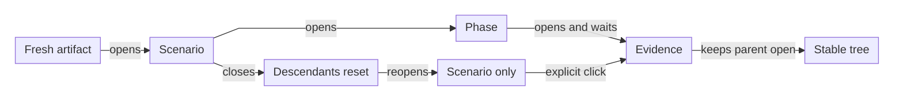

# ATF Testing Guide — layers, responsibilities, and evidence

**J1 scope:** Reporting is an external JAR. Commands that target
`atf-reporting/pom.xml`, native resources, or source audits run in the
producer's `atf_j0` staging; the [J1 guide](ATF_Reporting_Consumer.md) separates gates and ownership.

## At a glance

Reporting defects observed in consumers receive a [permanent regression](../../atf_j0/atf-reporting-tests/README.md#regresia-permanentă-a-fiecărui-defect-reporting)
at the producer, using mock/contract and browser proof according to the affected boundary. Each
candidate JAR passes the external gate in TMP; the harness is not a module in J1.

The guide explains where a test belongs, how to choose the lowest level that can
prove the behavior, and how to move from a local check to composition or
rendering proof. The matrix reflects executable annotations in the live code;
filling every cell is not a goal, and the matrix contains no test counts.

## Canonical verification path

```mermaid
%%{init: {"themeVariables":{"fontSize":"15px"},"themeCSS":".nodeLabel, .nodeLabel p { font-size: 15px !important; line-height: 1.35 !important; } .edgeLabel, .edgeLabel p { font-size: 12px !important; font-weight: 400 !important; line-height: 1.2 !important; } .edgeLabel .labelBkg, .edgeLabel p { background: transparent !important; } .edgeLabel foreignObject { transform: translateY(-18px); overflow: visible; } .node rect { rx: 6px; ry: 6px; }","flowchart":{"curve":"linear","nodeSpacing":24,"rankSpacing":16,"padding":6,"diagramPadding":20}}}%%
flowchart LR
    Requirement["Requirement"] -->|identifies| Owner["Owner"]
    Owner -->|defines| Boundary["Boundary"]
    Boundary -->|selects| Layer["Layer"]
    Layer -->|uses| Setup["Setup"]
    Setup -->|exercises| Contract["Contract"]
    Contract -->|produces| Evidence["Evidence"]
    Evidence -. if browser-dependent .-> Browser["Browser audit"]
```



<details>
<summary><strong>Legend — how to read the path</strong></summary>

- choose the level based on the boundary that must be proved, not the package or
  class name;
- setup is a fixture, typed config, fake, or explicit adapter;
- the test asserts an observable result at the owner's public API;
- browser proof is needed only for DOM, layout, navigation, or interaction
  behavior; it does not replace lower-level tests.

The short labels have the following meanings:

| In diagram | Full meaning |
|---|---|
| Requirement | observable requirement |
| Owner | owning module |
| Boundary | test boundary |
| Layer | unit / component / integration / E2E |
| Setup | typed, controlled setup |
| Contract | public behavior |
| Evidence | assertions and evidence |
| Browser audit | rendered artifact and interaction |
| selects | selects the smallest proof |
| if browser-dependent | if browser-dependent |

</details>

## Choosing the level

| Level | Choose it when verifying | Typical setup | Do not use it for |
|---|---|---|---|
| `unit` | pure policy, model, formatter, parser, or validator | typed input and local dependencies | browser, server, or collaboration across modules |
| `component` | a module or adapter contract with neighboring boundaries isolated | fake/mock, fixture, or local artifact | a complete journey through the application |
| `integration` | real collaboration between multiple components/modules | deterministic fixture and `-am` reactor | every invariant already proved at a lower level |
| `e2e` | behavior that depends on a browser and visible journey | browser and explicit config; external only by opt-in | pure logic, every data variant, or replacing the lower-level suite |

`support` is not an executable level. Fixtures, builders, locators,
loaders, and adapters remain auxiliary; the test method owns the assertion and
the executable class declares exactly one of `@AtfUnitTest`, `@AtfComponentTest`,
`@AtfIntegrationTest`, or `@AtfE2eTest`.

The `UI`/`API`/`UI_API` channel is separate from the level and JUnit tags.
The implemented API for channels, output, setup, and documentation is described in
[Test Infrastructure Annotations](ATF_Test_Infrastructure_Annotations.md).

### Consumer component audit

In AutoEx and Shop, components use the consumer marker and publish
evaluated checks in the standard `Component assertions` step. Unit tests
do not have this requirement; renderer probes remain a separate category in Reporting Tests.

- `AuditedAssertions` and `RecordedAssertions` preserve the single JUnit evaluation;
  result policy, phases, and the default limit of 240 characters are documented in
  [Test Kit](../lib/README.TestKit.md#scope-and-integration).
- The configured budget propagates from the report owner to the collector, including
  when it overrides the default; `Overview → System` shows the effective value. Consumer probes
  verify individual and suite launches, while the shared contract is in
  [Reporting](ATF_Reporting_Library_Atlas.md#verdict-and-assertions).
- A passing component test requires an audited check; a diagnostic or fabricated
  HTTP step does not replace the comparison. Expectations remain independent of observations.
- Comparisons whose meaning is not clear from their values use declarative
  English messages: the invariant and the checked object, without sensitive data. A source
  reference helps traceability but does not replace the meaning of the report row.
- Artifact-reading probes check markers in published markup,
  excluding scripts and styles. A JavaScript selector does not prove
  a FAIL comparison exists; the negative control removes the published marker
  while preserving the runtime. Credential scanning still covers the
  entire HTML, including payloads and scripts.
- A negative `assertThrows` checks the failure point and cause, not only
  the exception family. Fixture preparation precedes the action budget;
  the synchronous DOM counter counts native activations without asynchronous RPC confirmation.
- Individual launches and suites use the same application adapter;
  Extent/fallback validation and disclosure interaction are tested in
  [Reporting Tests](../../atf_j0/atf-reporting-tests/README.md).

The shared session belongs to the declared class or suite; the scenario,
comparisons, and measured timing remain per invocation. Final publication and
path notification follow owner closure, once the artifact exists.

| Verified contract | Probe owner | Regression probe |
|---|---|---|
| Resource and isolated audit | Kit | `ScopedTestResourceTest`, `ScopedComponentAuditExtensionComponentTest` |
| Borrowed scenario and exactly-once close | Reporting Tests | `AssertionAuditRunComponentTest` |
| Method/class/suite and repeated launches | Consumer | `AutoExComponentReportScopeComponentTest`, `ShopComponentReportScopeComponentTest` |
| Executable selectors and excluded comments | Core + ATF Tests | `AtfJavaSourceReferencesTest`, `ConsumerSuiteCoverageGovernanceTest` |

The session and publication thread contract remains with
[Reporting](ATF_Reporting_Library_Atlas.md#components-and-shared-report);
the test inventory and change policy remain with
[ATF Tests](../atf-tests/README.md#test-change-governance).

### Individual and suite business acceptance

The explicit probes for [Shop](../atf-test-practice-shop/README.md#business-failure-acceptance)
and [AutoEx](../atf-test-auto-ex/README.md#business-failure-acceptance)
run the real journeys and lifecycle. The fault changes only the fixture
observation; the expected result, operation, and application verdict remain independent.

| Axis | Acceptance criterion |
|---|---|
| Business point | after account setup, at cart confirmation, and after payment completes |
| Channel | UI and UI_API preserve the same primary cause, phase, and business comparison |
| Individual | inject one fault, then run the same healthy story in the opposite profile in a new browser |
| Fixture suite | Account/Cart/Purchase matrix: six FAILs and six passes; `boundaries`: AutoEx 6/6, Shop 2/2; one HTML per launch |
| Cleanup | capture the original state before navigation; AutoEx confirms owned deletion, Shop closes the scoped reference |
| Counters | mutations are not repeated; browser events and business navigations are measured separately |
| Report | exact checkpoint, expandable expected/actual, Fails → comparison, Setup, screenshots, and healthy neighbors |

Explicit negative cases remain FAIL in JUnit and Extent. The CLI independently
checks the intended number of failures and passes, the same original exception,
context closure, and the existence of an HTML file; fault opt-in is separate from E2E opt-in.

The artifact oracle associates the owner, scenario, and phase with the verdict,
checkpoint, cause, and every screenshot required by the consumer path. The
color marker differs per invocation. It rejects removal or reassignment of a
single screenshot, a changed verdict, a removed cause, and contamination of a
healthy neighbor; Tests/Fails/Overview totals must match the JUnit execution.

- AutoEx preserves the comparison published by `UiCheckpointFailure` and an
  original screenshot; Shop can separately publish a screenshot of the rejected
  checkpoint and a later generic diagnostic. The declared count follows these
  surfaces, not the global presence of a PNG or a FAIL selector in the HTML.
- AutoEx Recalculation/Removal explicitly uses `recalculatesAndRemovesProduct`:
  a quantity mismatch stops removal, and confirming removal cannot repeat the
  deletion. The guest story does not acquire an account or start payment.
- Inject the generic error only after the PASS checkpoint returns;
  `journey.pass(...)` in Shop completes the scenario and does not replace an
  intermediate checkpoint. A later failure has its own diagnostic and preserves the earlier PASS.
- `artifact-expectations.json` comes from execution observations before the
  HTML audit. CLI `audit` mode rechecks that artifact without live opt-in
  or remote mutations. Mutants change only the audit browser DOM.
- `ScopedAcceptanceRun` in the Kit owns the temporary override and caller-selected
  collection; the JUnit launcher and browser remain in the consumer.

- `OTHER` does not become a second AutoEx deletion navigation; two real
  navigations are rejected. The [delete contract](../atf-test-auto-ex/README.md#delete-account--interrupted-navigation)
  separates the full diagnostic from permission to continue, without inventing server-side effects.
- The default preview of 240, effective screenshot policy, and timeouts remain
  owned by the relevant module; unit tests do not artificially receive an E2E/component contract.
- An external outage is not an accepted business fault. Keep its report,
  and do not let a new invocation repeat the uncertain mutation from the previous one.
  `acceptance.json` preserves observations and `verified: false` before
  any acceptance rejection; if fault injection was not reached, the CLI propagates
  the same original cause instead of replacing it with the fixture verdict.
- Canonical selections are not reduced automatically after these probes. Reduction
  requires separate review of the stories, accounts, and configurations that would be removed.

Local components probe injection and the boundary; remote execution and TAB audit
remain separate evidence. The matrix does not measure stability across many repetitions.

## Detailed module × test level matrix

Cells show only levels that exist in the current executable suites.
`—` does not require creating a suite or artificial directory.

| Module | Unit | Component | Integration | E2E | Owner and primary purpose |
|---|:---:|:---:|:---:|:---:|---|
| [`atf-core`](../../atf_j0/atf-core/README.md) | ✅ | — | — | — | neutral contracts and reusable policies |
| [`atf-validation`](../atf-validation/README.md) | ✅ | ✅ | — | — | validation rules and typed results |
| [`atf-console`](../../atf_j0/atf-console/README.md) | ✅ | — | ✅ | — | unit policy/formatter; extension integration with real Jupiter |
| [`atf-mock`](../../atf_j0/atf-mock/README.md) | — | ✅ | — | — | fake transport and deterministic behavior |
| [`atf-ui`](../atf-ui/README.md) | ✅ | ✅ | — | — | generic Playwright policy and adapter |
| [`atf-debug-ui`](../atf-debug-ui/README.md) | — | ✅ | — | — | read-only server and launcher for inspection |
| [`atf-reporting`](ATF_Reporting_Library_Atlas.md) | — | — | — | — | exception: standalone suites without ATF annotations or dependencies |
| [`atf-reporting-tests`](../../atf_j0/atf-reporting-tests/README.md) | ✅ | ✅ | ✅ | ✅ | composition and proof for the Reporting library |
| [`atf-test-practice-shop`](../atf-test-practice-shop/README.md) | ✅ | ✅ | ✅ | ✅ | consumer: contracts, API, flows, and browser journeys |
| [`atf-test-auto-ex`](../atf-test-auto-ex/README.md) | — | ✅ | ✅ | ✅ | consumer: purchase journeys in distinct UI profiles, component probes, and opt-in live API |
| [`atf-tests`](../atf-tests/README.md) | — | ✅ | ✅ | — | boundary and whole-reactor governance |
| [`atf-test-kit`](../lib/README.TestKit.md#scope-and-integration) | ✅ | ✅ | — | — | test layer vocabulary and test-only contracts |

The guard reflects the owners without falsifying the reactor structure:

- `atf-reporting` is `standalone-independent`; its tests run in its own module
  and are not reactor suites with layer annotations;
- `AtfTestLayerArchitectureTest` verifies the exception and requires one annotation per
  executable test in the reactor;
- this guide's matrix links to the owners; it does not duplicate the validator in each cell.

AutoEx has separate suites for component, purchase E2E, and live API.
The usual business run selects `AutoExPurchaseUiE2eTest` directly, a single
purchase. `AutoExE2eSuite` retains the full UI gate, including existing profiles;
evidence selections do not represent independent business intents.

Live API suites are opt-in; they are not included as a prerequisite for the usual UI run.

### Test owner: business, adapter, or infrastructure

The class name and the fact that a test produces HTML do not determine its owner.
Move the invariant, not the fixture or the entire test:

| What the test asserts | Owner | What remains local in the consumer |
|---|---|---|
| application rules, UI/API paths, payloads, and data propagation | [`atf-test-practice-shop`](../atf-test-practice-shop/README.md#boundary-between-shop-and-reporting-tests) / [`atf-test-auto-ex`](../atf-test-auto-ex/README.md#suites-and-evidence-variants) | all business probes, including mock-backed ones; the mock isolates transport without changing ownership |
| translation of the application contract to the public Reporting port | the consumer that owns the adapter | business intent/title, mapping the expectation to the exchange, specific status, and local redaction policy |
| generic semantics of the model, lifecycle, publisher, markup, tables, disclosures, CSS/JS, or report browser | [`atf-reporting-tests`](../../atf_j0/atf-reporting-tests/README.md#regula-limitelor-de-responsabilitate) (or standalone `atf-reporting` tests, depending on the boundary) | neutral probes with no dependency on Shop/AutoEx |
| reusable, strictly test-only APIs and lifecycles: annotations, resolvers, classification, and generic primitives | [`atf-test-kit`](../lib/README.TestKit.md#scope-and-integration) | the application keeps its fixture, lifecycle, and business adapter; the Kit does not take business assertions or Reporting tests |

A probe can remain consumer-owned even if it publishes an artifact: it must
verify only the application adapter contract and use the semantic snapshot or
typed result for that mapping. DOM/HTML structure, CSS, disclosure format,
retry rendering, and other independent invariants are tested once with a generic
fixture at the Reporting owner. Test Kit is not a general place to move tests:
it does not depend on Reporting, Playwright, or consumer code; promote candidates
only if they are neutral infrastructure primitives, not merely because two
applications use them.

### Probe each resource owner

A public facade can delegate to collaborators with different acquisition and
cleanup protocols. A probe for one protocol does not certify another owner just
because they share a facade or produce the same report.

| Event | Independent oracle |
|---|---|
| Partial acquisition | close only handles that were returned; do not leak a resource |
| Body or complete fails | preserve the primary cause identity; close each child before its parent |
| Multiple cleanup failures | attempt each owned close once; retain secondary causes as suppressed |
| Same instance in body and close | no self-suppression and no replacement of the primary cause |

The test injects errors through the public port and records call order; it does
not infer child cleanup from a parent close. A renderer may close recursively,
but that does not prove the neutral publisher contract. Distinguish the business
cause received as evidence from a publication execution cause; cleanup does not
re-evaluate the verdict or repeat the business operation.

These probes belong to the infrastructure owner and use a neutral fixture;
business adaptation remains in the consumer. For Reporting, verify semantic
projection and Extent/fallback rendering separately, including collapsible
assertions, the configured budget, and redaction. A new lifecycle framework is
not needed to extend the existing owner's matrix.

### Reducing the suite without losing coverage

| Primary gate per consumer | Selection |
|---|---|
| Component/local | all local tests, including tests in support packages for package-private access |
| UI E2E | all retained UI classes; each class is included once |
| Live API | real HTTP contracts, with separate read-only/mutation opt-in |

`ConsumerSuiteCoverageGovernanceTest` checks the real inventory against these
three selections. Remove redundant suites, not tests that expose a gap.

- Compare the invariant, input, and exercised path, not test names or
  assertion counts. Two tests that touch the same route can verify different rules.
- Keep a probe for data adaptation and local wiring in the consumer;
  move the generic probe and its negative cases to the owner, using a neutral fixture.
- Delete a copy only after identifying the equivalent probe and running
  both boundaries; for tests, apply the
  [test-change control](../atf-tests/README.md#test-change-governance).
- Count business scenarios, channels, and evidence profiles separately.
  `UI_API` may exercise a precondition or correlation absent from `UI`;
  merely changing screenshot/grouping policy does not add a business case.
- Tests with controlled transport protect the client and application contracts.
  Server confirmation and the real flow remain in opt-in live probes;
  a passing fixture does not certify persistence or remote semantics.

### E2E refactoring contract

The test expresses the story; the runtime executes capabilities, and the JUnit
adapter resolves only the declaration and lifecycle. This is the simplification
target; it does not describe a move already applied to the current harnesses.

| Area | Intended content | Limitation |
|---|---|---|
| Consumer `src/test` | business tests, suites, and minimal execution adapter | no duplicated generic infrastructure |
| Consumer `src/main` | pages, flows, contracts, and reusable application-specific runtime | do not introduce JUnit/Kit through a mechanical move |
| Existing ATF modules | neutral primitives in Kit, browser in UI, model/publication in Reporting | no new module or circular dependencies |

- Keep three primary gates per consumer: local, UI E2E, and live API;
  a screenshot policy does not justify a copied suite or journey.
- UI per-checkpoint, UI with one final screenshot, and UI+API profiles use the
  same complete story; `UNIFIED_FLOW` grouping does not disable intermediate validations.
- Resolve channel, grouping, screenshots, and action details separately;
  `CONFIGURED` must inherit a real base, not a hidden default.
- Tie a success screenshot to the step state or terminal confirmation;
  control failure screenshots separately through policy.
- A shared account has an explicit owner and scope; suite order does not replace
  setup, and a report failure does not prevent releasing the registry.
- Factories without JUnit/Kit can belong to the application runtime:
  `ShopBrowserCaptureProvider` and `ShopScreenshotPolicy` are in Shop main;
  browser/report context and run metadata remain in test.
- Neither a small line count nor an empty `support` directory proves
  quality; compare assertions, ownership, failure path, and actual selection.

The generic evidence contract is in
[ATF Evidence Capture](ATF_Evidence_Capture_Contract.md); verification conditions before mutations are in
[consumer business acceptance](#individual-and-suite-business-acceptance).

### Separating business flows, UI flows, and validations

The architecture below guides migration by operation. AutoEx delivers the pilot
cart review → gate → checkout through `AutoExCartFlow` and `AutoExCartPort`, with
a pure snapshot, UI adapter, and evidence mapper. The account owner is per
execution and shared by Page Object instances.

The rest of Shop/AutoEx is not considered
migrated just because this operation is separated.

```text
E2E test: prerequisite → business intent → expected result
  BusinessFlow: operation order and application rules
    UiFlow: screen transitions for one operation
      Composed UI action: page/component + locators
        PlaywrightActionSequence: one instrumented atomic operation
  Validators: observed snapshot + independent expected value → typed result
  Evidence adapter: result + action/exchange interval → report
```

The path shows responsibilities; it does not require a class for every layer or
click. Keep the existing facade and extract only a responsibility that can be
proved separately.

| Target boundary | Contract and minimum proof |
|---|---|
| Test → business | scenario with explicit input and terminal assertion; the test does not construct locators or markup |
| Business → UI | small application-specific port; component test checks ordering, data, and stopping on failure with controlled neighbors |
| UI flow → page/component | composed semantic actions and explicit synchronization; it does not receive the entire harness, report, or configuration |
| Page → Playwright | operations use the existing instrumented facade; the local probe checks target, result, and errors |
| Validation → result | expectation is independent of observation; nominal, mismatch, and incomplete-state cases, with no verdict calculated from report text |
| Result → evidence | adapter preserves checkpoint identity, action order, and causal exchange; consumer probes verify mapping and Reporting probes verify projection |

- Separate technical synchronization, screen contract, and business rule;
  intermediate validations remain fail-fast, and the test retains the terminal oracle.
- Screenshots, UI/API channel, and compaction change published evidence, not the
  business branch. A real checkout difference gets an explicit strategy.
- Account creation, cart, order, and cleanup actions are not repeated because of
  display recovery or publisher failure; preserve the original cause.
- The first increment is a bounded operation, such as adding to the cart;
  migrate authentication and cleanup after proving this boundary.

Application-specific flows and pages remain in the consumer. UI owns browser
instrumentation, Reporting owns the projection, and the Kit receives only neutral
primitives, without application vocabulary or a generic workflow engine.

Current contracts and probes are in the
[AutoEx stages](../atf-test-auto-ex/README.md#purchase-stages-and-ui-adapter) and
[Shop flow separation](../atf-test-practice-shop/README.md#flow-separation-baseline).
Shared verification criteria are in
[consumer acceptance](#individual-and-suite-business-acceptance).

<details>
<summary><strong>Ports, snapshots, and validations in the target architecture</strong></summary>

The port may have a role such as `PurchaseOperations`; this is an illustrative
name, not a delivered API. Do not expose Run/Context, the full configuration, or
an `Object` that hides the same dependencies.

### Validations are independent and run at the right time

| Category | Owner | Result and timing |
|---|---|---|
| UI technical | operation / UI Flow | visible/enabled control, navigation, or confirmed modal; before reading or continuing |
| Screen contract | DOM reader + snapshot validator | observed structure, fields, and identity; validator does not navigate or publish |
| Business | pure validator + gate in Business Flow | product, quantity, price/total, customer, order, and invoice; before the next dependent mutation |
| Additional API | API validator and evidence adapter | compares observed request/response; verdict distinct from UI, under the causal checkpoint |

- The snapshot does not fill missing values from the expected result. Quantities,
  amounts, and identities have explicit types and provenance; validation does not
  use the truncated report preview as a complete observation.
- A compact profile changes publication, not gate timing.
  The final check confirms the order/invoice without replacing intermediate validations.
- Evaluate existing neutral contracts in Core/Validation before introducing a new
  verdict model. Business code does not import publishers, Extent/HTML, JUnit, or Playwright.

</details>

### Executable inventory after moves and reclassification

- Run the actual suite entry points without selecting included classes again;
  otherwise the same probe may be counted twice.
- Compare identities as `class + method + parameterized invocation`, not just
  totals. For a rename/package move, document old → new mapping and verify that
  cases and assertions are preserved.
- Match Surefire XML files to the classes reported in that execution's log;
  files left by an earlier selection do not belong in the current inventory.
- `ShopComponentSuite` intentionally includes unit/support packages;
  `AutoExComponentSuite` selects the component package;
  `AtfReportingComponentSuite` requires the `component` tag and excludes Suite classes.
- Moved unit/integration probes remain separately verified by their owners,
  including Test Kit; their absence from the component suite is correct only with
  execution proof at the declared layer.
- Do not compensate for a lost test with an unrelated new test; compare the
  missing cases and invariant equivalence before deleting the copy.

Run the shared gate in external staging, without live business traffic:

```text
mvn -pl atf-test-practice-shop,atf-test-auto-ex,atf-reporting-tests -am "-Dtest=ShopComponentSuite,AutoExComponentSuite,AtfReportingComponentSuite" "-Dsurefire.failIfNoSpecifiedTests=false" test
```

## UI/API path and what the tests verify

The mixed checkpoint contract is owned by
[ATF Reporting Contract](ATF_Reporting_Contract.md#request-evidence):

- one Gherkin statement has sibling `UI validation` and `API validation` children;
- real exchanges appear only under `API validation`;
- the journey inspector indexes the summary without cloning the request list.

| Area | Invariant | Suitable proof |
|---|---|---|
| Gherkin checkpoint | one semantic statement owns UI and API validations | integration for composition; E2E for the rendered tree |
| `UI validation` | browser-observed assertions remain distinct from the transport verdict | component for the publisher; E2E only for DOM/interaction |
| `API validation` | each exchange preserves `Request → Response → Execution`; retry remains in execution evidence | component for format and publisher; integration for the selected exchange |
| typed trace ledger | identity, order, and correlation link an exchange to the checkpoint that caused it | unit/component for model and mapping; integration for causality |
| journey aggregate | auth, correlation, counters, signatures, and diagnostics are summarized within bounds, without duplicated bodies | unit/component for aggregate; browser proof for disclosures and collapse |
| `Overview / System` | remains allowlisted operational configuration, not a step or payload log | component for snapshot and contract; no E2E unless rendering is verified |

Do not test two projections by duplicating the same payload. The per-checkpoint
trace owns the canonical exchange; the inspector groups only the facts needed
for navigation and does not replace request/response details. For the consumer
owner, configuration, and lifecycle, continue in the Practice Shop README; for
the renderer, markup, and disclosure, continue in the `atf-reporting-tests` README.

### E2E prerequisites and `SETUP`

Preparing the account, session, or fixture is separate from the business action.
A typed declaration selects the source; setup must pass before `TEST BODY` begins.

```text
SETUP
├─ GIVEN <source / prepared prerequisite>
│  ├─ Setup evidence: CHECK / EXPECTED / ACTUAL / RESULT
│  └─ API validation → canonical exchange (only if selected)
├─ AND <confirmed prerequisite>
└─ PASS → TEST BODY
   └─ one Gherkin statement → UI validation + API validation (siblings)
```

- `Setup evidence` explains what was selected, what was observed, and whether the
  next phase can begin; it does not replace request/response;
- `REUSE_FIXTURE` must state that a fixture was selected, not that a new account
  was created; any creation mode must be explicit;
- do not automatically repeat an uncertain external mutation without an
  idempotency contract; reuse of a resource has a declared and tested scope;
- `UI validation` and `API validation` express different evidence for the same
  business statement; do not duplicate the Gherkin title to separate them;
- runtime diagnostics do not become Gherkin steps and do not change the business verdict.

- The Store and JUnit extensions remain in test. The application runtime may own
  the browser/report in main through explicit ports, without JUnit or Test Kit.
- AutoEx separates `AutoExE2eRun`/`AutoExReportSession` from the JUnit factory
  and adapter; Shop keeps `ShopE2eContext` in test. Ownership follows the contract
  and dependencies, not the `support` directory name.
- `FailureAwareCleanup` in `atf-test-kit` provides neutral cleanup, reverse-order
  closure, and error aggregation.
- `TestRunInitialization` owns acquisition through factories and rollback of
  returned handles; the neutral probe does not start UI or Reporting.
- `TestRunScope` in the Kit explicitly resolves `class` or `suite` through the
  JUnit parameter `atf.test.run.scope`; ownership belongs to the actual Store,
  not a static cache or suite name. `ScopedTestValue` preserves acquisition
  failure and prohibits implicit replay.
- Releasing a reference does not delete the remote resource. Declare retention
  of a created account separately from borrowing a fixture; confirm each session's
  login in `SETUP`. Jupiter probes verify lifecycle, while E2E verifies real registration and purchase.
- The consumer supplies specific factories and callbacks; each factory guarantees
  cleanup of its own partially acquired resources before returning.
- `CloseOnceResource` and `ArmedCleanup` separate exactly-once closure from
  explicitly retryable compensation; their policies are distinct.
- The cursor and snapshot use the existing `UiNetworkInspector` API in
  `atf-ui`; the consumer establishes the causal baseline. `UiScreenAudit` has
  the same owner, with no second implementation in the Kit.
- `AutoExPurchaseSession` remains an internal API of the consumer runtime; it is
  not precedent for a generic port in the Kit. Splitting it into small local
  ports is a separate target from the already delivered source-set move.
- The AutoEx boundary is described in the [Automation Exercise README](../atf-test-auto-ex/README.md),
  and the cross-consumer rule is in the [Test Kit README](../lib/README.TestKit.md#scope-and-integration).

The report shape and ownership of each piece of evidence are defined in the
[ATF Reporting Contract](ATF_Reporting_Contract.md#setup-evidence).

### Expandable section stability — browser verification

Verify stability as a state transition in the tree, not merely by the
presence of text in the HTML:



<details>
<summary><strong>Legend — disclosure tree state</strong></summary>

- interaction with a child keeps the parent open;
- closing the scenario closes its descendants;
- reopening shows only the container until an explicit click.

The short labels have the following meanings:

| In diagram | Full meaning |
|---|---|
| Fresh artifact | Fresh artifact |
| Scenario | Scenario |
| Phase | Phase |
| Evidence | Evidence |
| Stable tree | Stable tree |
| Descendants reset | Descendants reset |
| Scenario only | Scenario only |
| opens | open |
| closes | close |
| opens and waits | open child + wait |
| keeps parent open | parent remains open |
| reopens | reopen |
| explicit click | explicit click |

</details>

| Level | What it demonstrates |
|---|---|
| component/interaction | panel, `aria-expanded`, glyph, and parent/child state stay synchronized; closing the scenario resets descendants |
| browser on a fresh artifact | after delayed normalization, the parent remains open; reopening the scenario does not automatically open children |

Normative details and browser-proof steps are in the
[reporting contract](ATF_Reporting_Contract.md). This gate applies to
disclosure/navigation changes; it does not justify a new E2E for every
content variation.

| Existing regression probe | Demonstrated limitation |
|---|---|
| `ExtentReportDisclosureBrowserComponentTest` | request with its own evidence and child validation; mouse/Enter/Space, ARIA, and both bodies; custom UI title and checkpoint without a synthetic HTTP table |
| `ReportApiViewportParityComponentTest` | request and retry metadata: short Extent content, short/long fallback, standard/narrow viewport, local scroll, and sticky header |
| `ReportEvidenceStyleContractTest` | removing disclosures while retaining the stylesheet is rejected; CSS/JS classes are not proof of content |

These probes do not automatically certify every projection or the local verdict
for each exchange. The contract and proof matrix belongs to
[Reporting Tests](../../atf_j0/atf-reporting-tests/README.md); active gaps remain in the
[feedback register](feedback/README.md), separate from technical controls.

## Principles for short, plug-and-play tests

- a test has one primary intent and names the behavior, not the internal mechanism;
- repeatable setup belongs in the owner's fixture/builder, and selectable
  scenarios use existing typed configuration and annotations;
- a fake proves a deterministic contract; a live HTTP test proves external
  integration only when explicitly opted in and backed by a valid fixture;
- assertions verify the public effect and explain the expected/actual difference;
  do not copy the same suite to each layer just to increase the count;
- static imports suit assertions and unambiguous DSLs; avoid wildcard imports
  and static imports that hide ownership;
- the class annotation determines the layer, while the package organizes the domain;
- `support` code does not own executable verdicts or introduce hidden lifecycle.

Detailed rules for OOP, fixtures, imports, package cohesion, and
anti-duplication are in [code best practices](README_Atf_CodeBestPractices.md).
Test-only contracts and annotations are in [`atf-test-kit`](../lib/README.TestKit.md#scope-and-integration).

## Execution and rendered proof

| Purpose | Base command |
|---|---|
| one targeted test in a module and its dependencies | `mvn -pl <modul> -am "-Dtest=<ClasaTest>" "-Dsurefire.failIfNoSpecifiedTests=false" test` |
| whole-ATF suite | `mvn -pl atf-tests -am "-Dtest=WholeAtfGovernanceSuiteTest" "-Dsurefire.failIfNoSpecifiedTests=false" test` |
| isolated `atf-reporting` library — only in `atf_j0` staging | `mvn -f atf-reporting/pom.xml test` |
| Practice Shop — selected contracts | `mvn -pl atf-test-practice-shop -am "-Dtest=ShopConfigurationTest,ShopCheckoutConfigurationTest" "-Dsurefire.failIfNoSpecifiedTests=false" test` |
| Shop/AutoEx whole-ATF boundaries | `mvn -pl atf-tests -am "-Dtest=ConsumerModuleArchitectureGovernanceTest" "-Dsurefire.failIfNoSpecifiedTests=false" test` |

These commands describe test selection; they do not authorize builds in a
checkout with active processes. For external staging, source synchronization,
E2E runs, and promotion, follow [Build and Execution Safety](ATF_Build_And_Execution_Safety.md). Run Practice Shop E2E tests that reach an external service only with the prerequisite and opt-in documented by the owner.

| Claim | Minimum proof |
|---|---|
| HTML, CSS, JavaScript, disclosure, or visual order | component test for markup and contract |
| rendering or interaction | fresh artifact verified in ATF Debug/TAB MCP, as specified by the [gate](README_Atf_BestPractices.md) |
| old run or artifact name | not permanent evidence |

## Completion criteria

- [ ] the test is placed in its owning module and declares one layer;
- [ ] the selected level is the lowest one that can prove the requirement;
- [ ] setup and data are typed, local, and reused only by their owner;
- [ ] the assertion checks a public result without duplicating lower-level logic;
- [ ] relevant module tests and reactor guards pass in safe staging;
- [ ] if the requirement is visual, verify the fresh artifact through interaction;
- [ ] the stable rule is documented in the owner's README, while feedback
      records only the remaining limitation.

## Where to continue

| Question | Owning document |
|---|---|
| what is a module's boundary? | [ATF Architecture](ATF_Architecture.md) |
| how do I add an API test? | [ATF API Test Guide](ATF_Api_Test_Guide.md) |
| what shape do the evidence and report have? | [ATF Reporting Contract](ATF_Reporting_Contract.md) |
| where are Practice Shop flows and configuration tested? | [Practice Shop README](../atf-test-practice-shop/README.md) |
| what does the whole-reactor suite protect? | [ATF Tests README](../atf-tests/README.md) |
| how do I build without affecting active runs? | [Build and Execution Safety](ATF_Build_And_Execution_Safety.md) |
