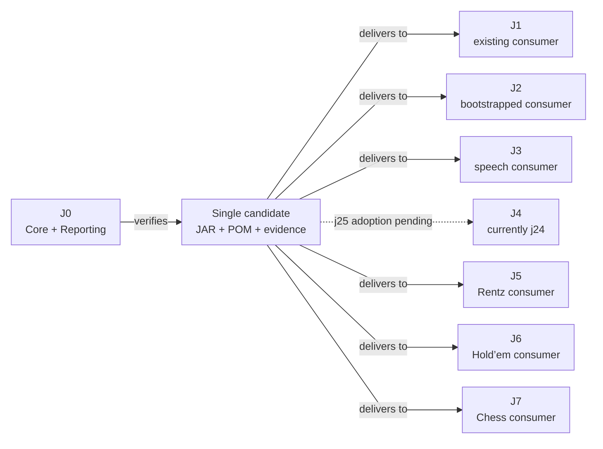

# ATF — J0 reference and consumer synchronization

[Ownership, feedback, and synchronization](../lib/README.md) describes the contract for the five libraries; this page defines the workspace protocol.

## At a glance

`atf_j0` replaces `demo2` as the maintenance reference for Core and Reporting.
The Core/Reporting/Console/Mock/Test Kit implementations and all their native tests remain there; each destination
receives and verifies the release appropriate to its deployment.

## Module and Reporting catalog

| Workspace | ATF boundary | Maven modules | Reporting | POM |
|---|---|---:|---|---|
| `atf_j0` | producer | 12 | source | [POM](../../atf_j0/pom.xml) |
| `atf_j1` | consumer | 6 | 1.0.0-j25 | [POM](../pom.xml) |
| `atf_j2` | consumer · WIP Kafka/messaging | 5 | 1.0.0-j25 | [POM](../../atf_j2/pom.xml) |
| `atf_j3` | consumer · speech | 4 | 1.0.0-j25 | [POM](../../atf_j3/pom.xml) |
| `atf_j4` | consumer · Android/Whist | 3 | 1.0.0-j24 | [POM](../../atf_j4/pom.xml) |
| `atf_j5` | consumer · Rentz | 2 | 1.0.0-j25 | [POM](../../atf_j5/pom.xml) |
| `atf_j6` | consumer · Hold’em Lab | 5 | 1.0.0-j25 | [POM](../../atf_j6/pom.xml) |
| `atf_j7` | consumer · Chess Lab | 1 | 1.0.0-j25 | [POM](../../atf_j7/pom.xml) |

J4 is the version exception: its POM and distributed pair retain Reporting j24. `demo2` remains the historical origin of the J6 release and is not an active maintenance destination.

J1 may have shared changes in progress. The J0 reference does not authorize
overwriting them: reconciliation compares the baseline, diff, and proof for each owner.

## Release direction

The preceding table shows the current state from the POMs; the diagram shows the flow of a shared candidate.

<strong>Legend — one candidate, separate acceptance per consumer</strong>

- The source includes the implementation, assets, native probes, and mock/browser regressions.
- The candidate is built once from the verified snapshot; the same JAR/POM
  pair is offered to destinations, without a separate rebuild under the same version.
- Each release edge requires its own acceptance. J2 has a separate Git repository,
  preserved at its existing baseline; the Eventuate profile explicitly excludes Shop/AutoEx, UI, and Debug UI, while its configurations evolve separately.
- The dotted edge to J4 indicates that adoption of version j25 is pending; its POM remains on j24.
- J3 receives the same Core/Reporting pairs, with its own acceptance; it does not retain Core sources or the Reporting harness.
- The edges represent releases and proofs, not Maven dependencies or additional modules.

## Choosing a workspace

| Change | Owner and boundary |
|---|---|
| renderer, assets, and generic Reporting regressions | J0; native probes and harness remain with the implementation |
| AutoEx/Shop scenarios, fixtures, and adapters | J1; copies in the J0 reactor remain source consumers, with no competing owner |
| queue and message contracts | J2, with its own catalog and bootstrap; it does not automatically inherit J1 web scenarios |
| shared infrastructure | the behavior's owner and affected consumers; selective reconciliation, without mirroring or claiming exclusive ownership of all ATF |

J2 is WIP: three components verify MOCK oracles, and Setup configures
Kafka in Podman through scripts. The Java Kafka client and real acceptance
remain separate; copied infrastructure does not demonstrate them.

## What gets propagated

| Change in reference | Release to each consumer | Required proof |
|---|---|---|
| Reporting Java, assets, API, or POM | new version, JAR/POM and provenance; adoption documents | native tests, permanent regressions, and gate against the physical JAR |
| Core Java, API, or POM | new Core version, JAR/POM pair, and provenance; source and native tests remain in J0 | native tests in J0 and separate JAR acceptance in each consumer; scope and local proof are defined in deployment contracts |
| Reporting regressions only | tests stay in J0; relevance to the consumed version is checked | negative reproduction and acceptance against the affected binary; do not copy the harness into the live workspace |
| other shared source modules (Kit, Validation, UI) or Shop/AutoEx adapters | only the sources and probes selected for the same behavior | compare with local changes and owner tests; a new Reporting JAR is not automatically required |
| documentation or reference relocation | contracts and links adapted to the deployment | documentation governance; no new binary version solely because a directory was renamed |

- `lib` retains one version per library: one JAR/POM pair directly in the folder.
  Hashes and the native catalog are in the root `library-provenance.json`.
- Reactor POMs, `.git`, `testChanges` baselines, local configurations,
  caches, outputs, and reports are not copied through a mirror.
- Reporting feedback is owned by J0. Feedback for a shared implementation
  closes in another deployment only after that code is synchronized and verified.

## Protocol for each increment

1. Capture the J0 snapshot and each destination baseline; inventory local
   changes separately. Declaring a target does not prove it exists as a project.
2. Create dedicated staging in TMP. For links between checkouts, preserve
   the sibling names `atf_j0`, `atf_j1`, and `atf_j2`. Use a separate TMP Maven cache per binary consumer for parallel runs.
3. Fix the issue at its owner and retain the permanent regression. A generic
   rendering, verdict, or expansion issue gets a probe in `atf-reporting-tests`.
4. For a Reporting candidate, build and verify the pinned snapshot;
   run the harness against the real JAR in the TMP consumer. Do not rebuild
   the neighboring source to satisfy the binary contract.
5. Verify each consumer separately: Maven/IDE bootstrap, transitive dependencies,
   CodeSource/hash, governance, and affected adapters. Report changes require Extent/fallback, timing, collapsible assertions, expansions, and the limit of 240.
6. Promote only reconciled files through the [Core guard](../../atf_j0/atf-core/README.md#manifest-și-promovare-guarded).
   If a target differs from its baseline, stop that promotion and revalidate the difference.
7. Re-read live deliverables and record each target's status. A green J1
   is not evidence for J2, and per-file promotion is not a distributed
   atomic transaction across projects.

## Provenance and relocation

| Information | Retention rule |
|---|---|
| current owner | `maintenanceReference` identifies J0 and the maintenance targets |
| existing J6 build | `producerDirectory`, commit, hashes, and acceptance describe the original run; do not rewrite them as if they had run in J0 |
| next build | records the actual J0 snapshot and executed acceptances, without automatically inheriting J6 results |
| CRLF/LF differences | explain separately; textual equivalence does not replace the byte-for-byte hash of an artifact or published inputs |
| Git controls | real baselines per checkout; historical controls are not rebased through text replacement |

Build and promotion follow the [isolated process](ATF_Build_And_Execution_Safety.md).
The inventory contract is documented by the [governance owner](../atf-tests/README.md#shared-java-source-inventory).

| Shared boundary | Contract and limitation |
|---|---|
| Core | literal mask and quoted/truncated Authorization diagnostic; full comparison precedes redaction and preview |
| MIME and headers | distinct negatives, one send; each destination verifies its own snapshot |
| source versus binary | Core acceptance does not rewrite Reporting provenance or certify a real broker |

Consumer domains are distinct: J1 owns the AutoEx/Shop web scenarios,
and J2 is for queues and messages. MOCK acceptance verifies ATF and Reporting integration; broker scenarios have their own contracts and probes.

J2 Eventuate acceptance and the host limitation are documented in [consumer evidence](../../atf_j2/docs/ATF_J2_Verification.md); installing prerequisites does not certify the engine or broker.

## J2 without browser modules — separate scope

J2 declares five source modules, including SQL; Core and Reporting are external libraries.
[J2 scope](../../atf_j2/docs/ATF_J2_Scope.md) defines the contract without
UI/Debug or Playwright; the removal is implemented in the J2 checkout.

Do not restore browser modules through synchronization. Atlases, READMEs, and feedback
remain adapted to each deployment's domain; shared contracts are reconciled
selectively, while the Reporting and web backlogs remain with the J0/J1 owners.

## Core as a library — owner and deployment

J1 consumes Core, Reporting, Console, Mock and Test Kit as external libraries; the module inventory is in the catalog above.

[The Core contract](ATF_Core_Consumer.md) separates source, publication, and consumer acceptance.
Native tests remain in J0, while binary acceptance runs in TMP.

## Release evidence retention

- Project README files, atlases and `docs` describe current contracts and ownership; they do not accumulate per-release Reporting verification notes.
- Keep only `ATF_Reporting_Verification.md` for the current Reporting JAR in its producer packaging stage, beside the effective publication POM. Builds, logs and HTML evidence stay in owned TMP.
- Consumer `library-provenance.json` records the current coordinate, hashes, original `buildStage` and `currentAcceptance.evidence` location. Consumer `lib` retains the latest Core, Reporting, Console, Mock and Test Kit JAR/POM pairs plus its dedicated README; no release notes are stored there.
- Superseded notes are retired after their durable contracts have been reconciled. Historical build/test facts and original evidence paths remain provenance, explicitly marked as retired; they are not current document targets or fresh acceptance.

The verification note in the producer packaging stage identifies the distributed coordinate and matching JAR/POM hashes. [Consumer provenance](../library-provenance.json)
