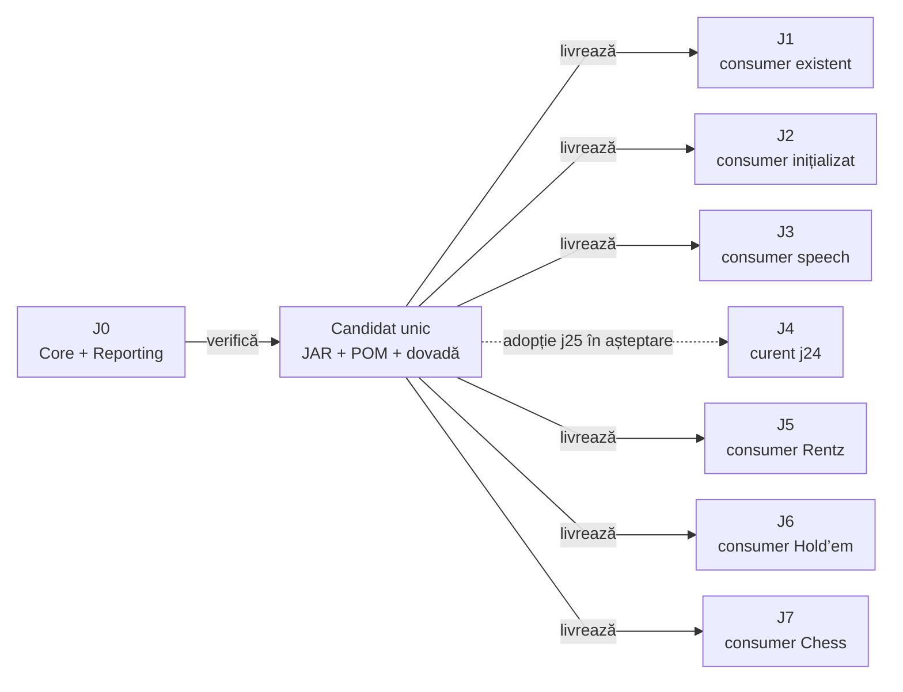

# ATF — referința J0 și sincronizarea consumerilor

[Owner, feedback și sincronizare](../lib/README.md) descrie contractul celor cinci biblioteci; această pagină păstrează protocolul workspace-urilor.

## Pe scurt

`atf_j0` înlocuiește `demo2` ca referință de mentenanță Core și Reporting.
Implementările Core/Reporting/Console/Mock/Test Kit și toate testele lor native rămân aici; fiecare destinație
primește și verifică livrarea potrivită propriului deployment.

## Catalogul de module și Reporting

| Workspace | Boundary ATF | Module Maven | Reporting | POM |
|---|---|---:|---|---|
| `atf_j0` | producer | 12 | source | [POM](../../atf_j0/pom.xml) |
| `atf_j1` | consumer | 6 | 1.0.0-j25 | [POM](../pom.xml) |
| `atf_j2` | consumer · WIP Kafka/mesagerie | 5 | 1.0.0-j25 | [POM](../../atf_j2/pom.xml) |
| `atf_j3` | consumer · speech | 4 | 1.0.0-j25 | [POM](../../atf_j3/pom.xml) |
| `atf_j4` | consumer · Android/Whist | 3 | 1.0.0-j24 | [POM](../../atf_j4/pom.xml) |
| `atf_j5` | consumer · Rentz | 2 | 1.0.0-j25 | [POM](../../atf_j5/pom.xml) |
| `atf_j6` | consumer · Hold’em Lab | 5 | 1.0.0-j25 | [POM](../../atf_j6/pom.xml) |
| `atf_j7` | consumer · Chess Lab | 1 | 1.0.0-j25 | [POM](../../atf_j7/pom.xml) |

J4 este excepția de versiune: POM-ul și perechea distribuită păstrează Reporting j24. `demo2` rămâne originea istorică a livrării J6 și nu este o destinație activă de mentenanță.

J1 poate avea schimbări comune în lucru. Referința J0 nu autorizează
suprascrierea lor: reconcilierea compară baza, diferența și proba fiecărui owner.

## Direcția livrării

Tabelul anterior arată starea curentă din POM-uri; schema arată fluxul unui candidat comun.

<strong>Legendă — un candidat, acceptanțe distincte</strong>

- Sursa include implementarea, assets, probele native și regresiile cu mock/browser.
- Candidatul este construit o dată din snapshot-ul verificat; aceeași pereche
  JAR/POM este oferită destinațiilor, fără rebuild separat sub aceeași versiune.
- Fiecare muchie de livrare cere propria acceptanță. J2 are un Git separat,
  păstrat la baza sa existentă; profilul Eventuate exclude explicit Shop/AutoEx, UI și Debug UI, iar configurațiile lui evoluează separat.
- Muchia punctată spre J4 indică versiunea j25 în așteptarea adoptării; POM-ul lui rămâne pe j24.
- J3 primește aceleași perechi Core/Reporting, cu acceptanță proprie; nu păstrează surse Core ori harness Reporting.
- Muchiile sunt livrări și probe, nu dependențe Maven ori module suplimentare.

## Alegerea workspace-ului

| Schimbare | Owner și limită |
|---|---|
| renderer, assets și regresii generice Reporting | J0; probele native și harness-ul rămân lângă implementare |
| scenarii, fixture-uri și adaptoare AutoEx/Shop | J1; copiile din reactorul J0 rămân consumatori ai sursei, fără owner concurent |
| contracte pentru cozi și mesaje | J2, cu propriul catalog și bootstrap; nu moștenește automat scenariile web din J1 |
| infrastructură comună | ownerul comportamentului și consumatorii afectați; reconciliere selectivă, fără mirror sau proprietate exclusivă asupra întregului ATF |

J2 este WIP: trei componente verifică oracole MOCK, iar Setup configurează
Kafka în Podman prin scripturi. Clientul Kafka Java și acceptanța reală
rămân distincte; infrastructura copiată nu le demonstrează.

## Ce se propagă

| Schimbare în referință | Livrare către fiecare consumer | Dovadă necesară |
|---|---|---|
| Reporting Java, assets, API sau POM | versiune nouă, JAR/POM și proveniență; documentele de adopție | native, regresii permanente și gate pe JAR-ul fizic |
| Core Java, API sau POM | versiune Core nouă, pereche JAR/POM și proveniență; sursa și nativele rămân în J0 | native în J0 și acceptanțe pe JAR separate la fiecare consumer; domeniul și proba locală sunt definite în contractele deployment-ului |
| numai regresii Reporting | testele rămân în J0; se verifică relevanța pentru versiunea consumată | reproducere negativă și acceptanță pe binarul afectat; fără copierea harness-ului în live |
| other shared source modules (Kit, Validation, UI) or Shop/AutoEx adapters | numai sursele și probele selectate pentru același comportament | comparație cu schimbările locale și testele ownerului; un JAR Reporting nou nu este implicit necesar |
| documentație ori mutarea referinței | contracte și linkuri adaptate deployment-ului | guvernanță documentară; fără versiune binară nouă numai pentru redenumirea directorului |

- `lib` păstrează o singură versiune per bibliotecă: câte un JAR/POM direct în folder.
  Hash-urile și catalogul native sunt în `library-provenance.json`, la rădăcină.
- POM-urile reactorului, `.git`, bazele `testChanges`, configurațiile locale,
  cache-urile, output-urile și rapoartele nu se copiază prin mirror.
- Feedback-ul Reporting are owner în J0. Feedback-ul unei implementări comune
  se închide în alt deployment numai după sincronizarea și proba codului său.

## Protocolul fiecărui increment

1. Capturează snapshot-ul J0 și bazele fiecărei destinații; inventariază separat
   schimbările locale. Declarația unei ținte nu dovedește că ea există ca proiect.
2. Creează staging propriu în TMP. Pentru linkurile între checkout-uri, păstrează
   numele surorilor `atf_j0`, `atf_j1` și `atf_j2`. Folosește câte un cache Maven TMP per consumer binar pentru execuții paralele.
3. Repară la owner și păstrează regresia permanentă. O problemă generică de
   randare, verdict ori expandare primește probă în `atf-reporting-tests`.
4. Pentru un candidat Reporting, construiește și verifică snapshot-ul fixat;
   rulează harness-ul pe JAR-ul real în consumerul TMP. Nu construi din nou
   sursa vecină pentru a satisface contractul binar.
5. Verifică separat fiecare consumer: bootstrap Maven/IDE, tranzitive,
   CodeSource/hash, guvernanță și adaptoarele afectate. Schimbările de raport
   cer Extent/fallback, timing, assertions colapsabile, expandări și limita 240.
6. Promovează numai fișierele reconciliate prin [guard-ul Core](../../atf_j0/atf-core/README.md#manifest-și-promovare-guarded).
   Dacă o țintă diferă de baseline, oprește acea promovare și revalidează diferența.
7. Recitește livrabilele live și consemnează starea fiecărei ținte. Un J1 verde
   nu devine dovadă pentru J2, iar promovarea per fișier nu este o tranzacție
   atomică distribuită între proiecte.

## Proveniență și relocare

| Informație | Regula de păstrare |
|---|---|
| owner curent | `maintenanceReference` indică J0 și țintele de mentenanță |
| build J6 existent | `producerDirectory`, commit-ul, hash-urile și acceptanța descriu execuția originală; nu se rescriu ca și cum ar fi rulat în J0 |
| următorul build | înregistrează snapshot-ul efectiv din J0 și acceptanțele executate, fără moștenirea automată a rezultatelor J6 |
| diferențe CRLF/LF | se explică separat; echivalența textuală nu substituie hash-ul byte cu byte al unui artifact sau al intrărilor publicate |
| controale Git | baze reale per checkout; controalele istorice nu se rebazează prin înlocuire de text |

Build-ul și promovarea urmează [procesul izolat](ATF_Build_And_Execution_Safety.md).
Contractul inventarului este la [ownerul guvernanței](../atf-tests/README.md#inventarul-comun-al-surselor-java).

| Boundary comun | Contract și limită |
|---|---|
| Core | mască literală și diagnostic Authorization quoted/trunchiat; comparația integrală precede redacția și preview-ul |
| MIME și headere | negative distincte, o singură expediere; fiecare destinație verifică snapshot-ul propriu |
| sursă versus binar | acceptanța Core nu rescrie proveniența Reporting și nu certifică brokerul real |

Domeniile consumerilor sunt distincte: J1 deține scenariile web AutoEx/Shop,
iar J2 este destinat cozilor și mesajelor. Acceptanța MOCK verifică integrarea ATF și Reporting; scenariile de broker au contracte și probe proprii.

Acceptanța J2 Eventuate și limita hostului sunt în [dovada consumerului](../../atf_j2/docs/ATF_J2_Verification.md); instalarea prerequisites nu certifică engine ori broker.

## J2 fără module browser — perimetru distinct

J2 declară cinci module sursă, inclusiv SQL; Core și Reporting sunt biblioteci externe.
[Scope-ul J2](../../atf_j2/docs/ATF_J2_Scope.md) delimitează contractul fără
UI/Debug sau Playwright; retragerea este implementată în checkout-ul J2.

Nu restaurați modulele browser prin sync. Atlasele, README-urile și feedback-urile
rămân adaptate domeniului fiecărui deployment; contractele comune se reconciliază
selectiv, iar backlog-ul Reporting și cel web rămân la ownerii J0/J1.

## Core ca bibliotecă — owner și deployment

J1 consumă Core, Reporting, Console, Mock și Test Kit ca biblioteci externe;
inventarul modulelor este în catalogul de mai sus.

[Contractul Core](ATF_Core_Consumer.md) separă sursa, publicarea și acceptanțele consumerilor.
Testele native se păstrează în J0, iar acceptanța pe binar rulează în TMP.

## Păstrarea dovezilor de publicare

- Fișierele README ale proiectelor, atlasele și `docs` descriu contractele și responsabilitățile curente; nu acumulează note de verificare Reporting pentru fiecare versiune.
- Păstrează numai `ATF_Reporting_Verification.md` pentru JAR-ul Reporting curent, în etapa de împachetare a producătorului, alături de POM-ul efectiv de publicare. Compilările, jurnalele și dovezile HTML rămân în spațiul TMP deținut.
- `library-provenance.json` al consumatorului înregistrează coordonatele curente, hash-urile, `buildStage` original și locația `currentAcceptance.evidence`. Directorul `lib` al consumatorului păstrează cele mai recente perechi JAR/POM Core, Reporting, Console, Mock și Test Kit, împreună cu README-ul dedicat; notele de versiune nu se stochează acolo.
- Notele înlocuite se arhivează după reconcilierea contractelor lor durabile. Faptele istorice despre compilări/teste și căile originale ale dovezilor rămân în proveniență, marcate explicit ca retrase; ele nu sunt ținte curente ale documentației și nici dovezi ale unei acceptări noi.

The verification note in the producer packaging stage identifies the distributed coordinate and matching JAR/POM hashes. [Consumer provenance](../library-provenance.json)
