# ATF Java Documentation

The documentation describes the J1 deployment, Shop/AutoEx scenarios, and binary consumption of the libraries.
Start with [J1 ownership](ATF_Reporting_Consumer.md), then read the [general atlas](ATF_Context_Atlas.md)
or the [source-free Reporting atlas](ATF_Reporting_Library_Atlas.md).

This directory indexes the stable contracts of ATF Java and project designs
that are explicitly marked as proposals.

- architecture and boundaries;
- adding API tests;
- the Extent reporting contract;
- safe builds, staging, and synchronization;
- active feedback and closure criteria.

The documents describe the framework and its owners, not a particular run or
artifact.

## At a glance

| For | Read first |
|---|---|
| Navigate across projects | [workspaces](ATF_Workspace_Synchronization.md), then the [context atlas](ATF_Context_Atlas.md) |
| Contract and owner | [architecture](ATF_Architecture.md), POM, and module README |
| Issue still open | [feedback register](feedback/README.md); delivered contracts remain with their owner |
| Kafka/Podman in J2 | [WIP atlas](../../atf_j2/docs/ATF_Context_Atlas.md); this is not a web extension of J1 |

J0 owns the Core/Reporting implementation and tests; J1 owns the AutoEx/Shop scenarios.
J2 has started bootstrapping queues and messages;
the [workspace map](ATF_Workspace_Synchronization.md) separates copied infrastructure from messaging contracts and acceptance.

| Level | Documents | Question answered |
|---|---|---|
| workspace and delivery | [ATF_Workspace_Synchronization.md](ATF_Workspace_Synchronization.md) | where is Reporting fixed, and how is each consumer validated independently? |
| progressive context | [ATF_Context_Atlas.md](ATF_Context_Atlas.md) | which contract, entry point, and proof should I read before expanding the context? |
| Reporting library | [JAR atlas](ATF_Reporting_Library_Atlas.md) and [J1 guide](ATF_Reporting_Consumer.md) | how do I integrate without source, and who fixes the library? |
| map | [ATF_Architecture.md](ATF_Architecture.md), root README | who owns what, and in which direction do dependencies flow? |
| contract | [ATF_Reporting_Contract.md](ATF_Reporting_Contract.md), [ATF_Reporting_Display_Contract.md](ATF_Reporting_Display_Contract.md), module guides | which semantic behavior and visible form are stable? |
| cross-cutting evidence | [ATF_Evidence_Capture_Contract.md](ATF_Evidence_Capture_Contract.md) | how are flow, policy, source, and publisher kept separate? |
| practices | [README_Atf_BestPractices.md](README_Atf_BestPractices.md) | how do we add code without drift? |
| testing | [ATF_Testing_Guide.md](ATF_Testing_Guide.md) | which layer, module, and proof should I choose for a behavior? |
| test infrastructure | [ATF_Test_Infrastructure_Annotations.md](ATF_Test_Infrastructure_Annotations.md) | how do I declare the level, channel, output, setup, and documentation? |
| cross-cutting E2E support | The [Test Kit](../lib/README.TestKit.md#scope-and-integration), [Practice Shop](../atf-test-practice-shop/README.md), and [Automation Exercise](../atf-test-auto-ex/README.md) READMEs, together with [ATF architecture](ATF_Architecture.md) | which neutral primitives are reused in Test Kit, and which UI harness stays in the consumer? |
| proposed design | [ATF_AI_Evaluation_Design.md](ATF_AI_Evaluation_Design.md) | which target boundary and contract are under discussion, without claiming they are delivered? |
| execution | [ATF_Build_And_Execution_Safety.md](ATF_Build_And_Execution_Safety.md) | how do we work without stopping runs? |
| feedback / governance | [feedback/README.md](feedback/README.md), active owner documents, and [ATF_Test_Changes_Baseline.md](ATF_Test_Changes_Baseline.md) | which observable gap, rule, or transitional technical control remains? |

The index provides the map; details live in the owner's document and become
more specific as you read further down the page.

## Overview diagram

```mermaid
%%{init: {"themeVariables":{"fontSize":"15px"},"themeCSS":".nodeLabel, .nodeLabel p { font-size: 15px !important; line-height: 1.35 !important; } .edgeLabel, .edgeLabel p { font-size: 12px !important; font-weight: 400 !important; line-height: 1.2 !important; } .edgeLabel .labelBkg, .edgeLabel p { background: transparent !important; } .edgeLabel foreignObject { transform: translateY(-18px); overflow: visible; } .node rect { rx: 6px; ry: 6px; }","flowchart":{"curve":"linear","nodeSpacing":24,"rankSpacing":40,"padding":10,"diagramPadding":16}}}%%
flowchart LR
    Docs["Index"] -->|guides to| Architecture["Architecture"]
    Architecture -->|connects to| Guides["Guides"]
    Guides -->|include| Safety["Build safety"]
    Safety -->|constrains| Practices["Best practices"]
    Practices -->|feeds| Feedback["Feedback"]
```



<details>
<summary><strong>Legend — how to read the documentation map</strong></summary>

- the solid arrow shows a navigation path through the documentation, not a
  dependency between modules;
- `Architecture` defines the modules, boundaries, and dependency direction;
- `Guides` and contracts describe stable framework usage;
- `Safety` describes staging, synchronization, and execution gates;
- `Practices` describes cross-cutting rules, while `Feedback` records only
  reproducible gaps and their ownership.
The short labels have the following meanings:

| In diagram | Full meaning |
|---|---|
| Index | docs index |
| Architecture | architecture |
| Guides | guides + contracts |
| Build safety | build safety |
| Best practices | best practices |
| Feedback | feedback + owner docs |
| guides to | points to |

</details>

## Recommended reading order

| Goal | Starting documents |
|---|---|
| Orientation and ownership | [Architecture](ATF_Architecture.md) · [root README](../README.md) |
| Writing and test layering | [Testing guide](ATF_Testing_Guide.md) · [API guide](ATF_Api_Test_Guide.md) · [Code best practices](README_Atf_CodeBestPractices.md) |
| Reusable annotations and tags | [Implemented contract](ATF_Test_Infrastructure_Annotations.md) · [TestKit](../lib/README.TestKit.md#scope-and-integration) |
| Reporting and evidence | [Reporting contract](ATF_Reporting_Contract.md) · [Display/layout contract](ATF_Reporting_Display_Contract.md) · [Evidence contract](ATF_Evidence_Capture_Contract.md) · [Reporting README](ATF_Reporting_Library_Atlas.md) |
| Consumers and governance | [Practice Shop](../atf-test-practice-shop/README.md) · [AutoEx](../atf-test-auto-ex/README.md) · [ATF Tests](../atf-tests/README.md) · [feedback register](feedback/README.md) |
| AI design and implementation | [Reference design](ATF_AI_Evaluation_Design.md) · [implemented comparator](../atf-validation/README.md#ai-comparator--implemented-contract) · [active gaps](feedback/README_AI_Evaluation.md) |
| Contribution and operations | [Build safety](ATF_Build_And_Execution_Safety.md) · [ATF best practices](README_Atf_BestPractices.md) · [Documentation best practices](README_Atf_DocumentationBestPractices.md) |

The complete reading order is collapsed below:

<details>
<summary>Complete reading order and all documents</summary>

1. [ATF_Architecture.md](ATF_Architecture.md) — modules, dependencies, and responsibilities.
2. [../atf-core/README.md](../../atf_j0/atf-core/README.md) — the neutral kernel, ports,
   and shared models.
3. [../atf-mock/README.md](../../atf_j0/atf-mock/README.md) — deterministic fake,
   YAML catalog, and acceptance transport.
4. [Test Kit](../lib/README.TestKit.md#scope-and-integration) — test contracts,
   unit/component/integration/e2e levels, and the Console `optional compile` exception.
5. [../atf-reporting-tests/README.md](../../atf_j0/atf-reporting-tests/README.md) — API fixtures,
   composition root, and test lifecycle.
6. [../atf-validation/README.md](../atf-validation/README.md) — independent validation
   and the publishing port.
7. [Reporting JAR atlas](ATF_Reporting_Library_Atlas.md) — the renderer,
   pure library contracts, and the component/E2E composition suite for reporting.
8. [../atf-test-practice-shop/README.md](../atf-test-practice-shop/README.md) —
    Practice Shop consumer, configuration, flows, and purchase E2E.
9. [../atf-test-auto-ex/README.md](../atf-test-auto-ex/README.md) — the
    Automation Exercise consumer, UI purchase profiles, and opt-in API contracts.
10. [../atf-tests/README.md](../atf-tests/README.md) — governance for the entire reactor.
11. [../atf-console/README.md](../../atf_j0/atf-console/README.md) — diagnostic
   console projection and output contract.
12. [../atf-ui/README.md](../atf-ui/README.md) — generic policies and the
   Playwright adapter.
13. [../atf-reporting-tests/src/test/java/atf/ui/tests/extent/README.md](../../atf_j0/atf-reporting-tests/src/test/java/atf/ui/tests/extent/README.md)
   — stable contract for API selection, mock-backed expected projection,
   Extent sections, and reusable UI validation.
14. [../atf-debug-ui/README.md](../atf-debug-ui/README.md) — read-only publication
   of an HTML report for manual investigation in Playwright/TAB MCP.
15. [ATF_Api_Test_Guide.md](ATF_Api_Test_Guide.md) — minimum steps for a new API test.
16. [ATF_Evidence_Capture_Contract.md](ATF_Evidence_Capture_Contract.md) —
    cross-cutting contract for flow mode, screenshot policy, source, and test layering.
17. [ATF_Reporting_Contract.md](ATF_Reporting_Contract.md) — Extent tree,
   evidence, reference guard, and rendering rules.
18. [ATF_Reporting_Display_Contract.md](ATF_Reporting_Display_Contract.md) —
    visible hierarchy, layout, disclosures, viewport, and browser proof.
19. [ATF_Build_And_Execution_Safety.md](ATF_Build_And_Execution_Safety.md) —
   build, synchronization, and validation without stopping existing executions.
20. [README_Atf_BestPractices.md](README_Atf_BestPractices.md) — rules index;
   [README_Atf_CodeBestPractices.md](README_Atf_CodeBestPractices.md) covers code,
   OOP, and testing; [README_Atf_DocumentationBestPractices.md](README_Atf_DocumentationBestPractices.md)
   covers structure, diagrams, and readability.
21. [ATF_Testing_Guide.md](ATF_Testing_Guide.md) — layer selection, the
    module × layer matrix, and appropriate proof for UI/API and reporting.
22. [feedback/README.md](feedback/README.md) — active ToDos, closure criteria,
    and ownership register for API, UI, and reporting.
23. [ATF_Test_Changes_Baseline.md](ATF_Test_Changes_Baseline.md) — transitional
    technical controls marked `VERIFIED`, separate from functional requirements.
24. [ATF_AI_Evaluation_Design.md](ATF_AI_Evaluation_Design.md) — target models and
    boundary decisions for AI evaluation/workflow; proposed design, not an inventory of delivered features.
25. [ATF_Test_Infrastructure_Annotations.md](ATF_Test_Infrastructure_Annotations.md) —
    levels and tags, channels, project-relative output, API setup, and documentation; implemented contract and proof limits.

</details>

The module map has a single owner: [ATF_Architecture.md](ATF_Architecture.md).
This index provides only reading paths and links to detailed contracts.

## Working rule for every change

```text
code and live feedback → separate staging → relevant tests → artifact/UI audit → selective promotion
```

Preserve existing runs; do not copy generated artifacts into source trees.
Operational details are in
[ATF_Build_And_Execution_Safety.md](ATF_Build_And_Execution_Safety.md).

| State | Normative location |
|---|---|
| Stable contract | Owner README and its tests |
| Proposed design | [AI design](ATF_AI_Evaluation_Design.md), separate from implementation and feedback score |
| Gap still open | [feedback register](feedback/README.md) and owner document |
| Closed or dated analysis | Outside normative documentation |

Application tests remain in the consumer. This allows `atf-reporting` to be used
as a JAR without depending on `atf-reporting-tests`.

### Promotion rule

- **when:** a ToDo becomes part of the solution;
- **in the owner README:** the stable contract, ownership, and usage;
- **in feedback:** the remaining limitation, closure criterion, and required proof;
- **prohibition:** feedback is not the normative source for a capability that has
  already been delivered.

## Documentation rules

- READMEs describe contracts, ownership, and reproducible flows.
- Descriptive document names use `ATF_<PascalCase>`; the `ATF` acronym appears
  once, in the first segment. A module README remains `README.md`, and the feedback
  index remains `docs/feedback/README.md`.
- Normative READMEs and module contracts do not contain scores, timestamps, report
  names, or intermediate states; prioritization scores belong in feedback and do
  not express the quality of the stable contract.
- Do not keep links to generated HTML artifacts; document only the output type,
  configurable location, and verification criterion.
- A diagram must reflect existing responsibilities and flows; when these change,
  update the diagram together with the tests.
- Code and reports are the source of behavior; documentation cannot invent a
  capability that is not protected by a test.
- Verify every visual or navigation change in the HTML artifact and, when
  relevant, through interaction in TAB MCP.

### Required verification for rendered UI reports

Every change to large classes, CSS, markup, disclosures, or evidence follows
the same proof, whether the report is generated dynamically or audited statically:

```text
GENERATED_API: setup → API/mock → API report → ATF Debug/browser MCP
STATIC_*:      HTML existent → ATF Debug/browser MCP
                                 ↓
                         UI audit → UI report → ATF Debug/browser MCP
```

- **Browser:** DOM, accessibility tree, computed styles, console/network, and tabs;
- **UI evidence:** expand/collapse, actions/observations/assertions as sibling regions, and inline screenshots;
- **API report:** POST/PUT with valid, non-empty request/response JSON reconciled with `ValidationResult`;
- **Verdict:** at least one positive and one negative case.

Build in external staging under `${ATF_STAGING_ROOT}`, not in the project
staging directory; copy the fresh report to
`${ATF_REPORT_OUTPUT_DIR}` or the configured UI subdirectory only after verification through
ATF Debug UI and browser MCP. Use of the real Windows browser and stopping current runs
are prohibited.

## Brief glossary

- `test` = the product intent being verified
- `request` = the HTTP exchange and its technical evidence
- `API contract validation` = evaluated child of the request, with the aggregated assertions table
- `UI/API validation` = semantic evidence attached to the shared Gherkin checkpoint
- `phase` = SETUP, TEST BODY, or TEARDOWN; SETUP and TEARDOWN phases are optional
- `scenario` = the complete test, including phases and final verdict
- `artifact` = the standalone HTML report produced when the session completes

## How to verify the index

| Question | Authority and proof |
|---|---|
| Does the document exist, and is the fragment navigable? | [README guard](../atf-tests/src/test/java/atf/api/tests/governance/documentation/structure/DocumentationReadmeStructureGovernanceTest.java) and [anchor regressions](../atf-tests/src/test/java/atf/api/tests/governance/documentation/DocumentationAnchorGovernanceTest.java) |
| Who owns the contract? | [Architecture](ATF_Architecture.md) and the owner's POM; a link in the index does not transfer responsibility |
| Has the rule been delivered? | The owner's code and proof; [feedback](feedback/README.md) separates open work from the contract |

Valid links do not certify contract semantics. The gate command and its
limitations are documented in [ATF Tests](../atf-tests/README.md#quick-verification).

## Core as a library — owner and deployment

J1 consumes Core, Reporting, Console, Mock, and Test Kit through JAR/POM. The [Core contract](ATF_Core_Consumer.md)
separates source, publication, and consumer acceptance; native tests remain in J0.

## Library identity and release evidence

The [current library provenance](../library-provenance.json) records the delivered pair and its dated acceptance. The latest Reporting verification stays beside the producer package under [evidence retention](ATF_Workspace_Synchronization.md#release-evidence-retention); project documentation retains stable contracts.
