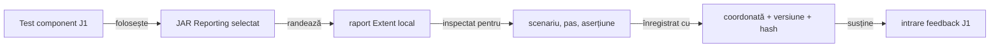

# Dovezi despre consumul Reporting — reproducere locală

## Pe scurt

J1 înregistrează ceea ce observă propriile teste folosind un JAR Reporting
selectat. Pagina păstrează local dovezile reproducerii și identifică biblioteca
prin coordonată, versiune și hash.

## Traseul dovezilor

<strong>Legendă — dovezi reproductibile ale consumerului</strong>

- Testul component deține scenariul local și valorile așteptate.
- Coordonata și hash-ul JAR identifică octeții bibliotecii folosiți de rulare.
- Raportul HTML arată dacă pașii și aserțiunile se extind și navighează corect.
- Constatarea rămâne atașată codului J1 sau unei intrări din feedback-ul J1.

