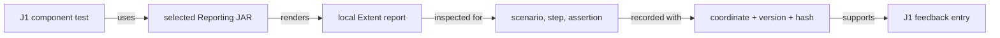

# Reporting consumer evidence — local reproduction

## At a glance

J1 records what its own tests observe from a selected Reporting JAR. This page
keeps reproduction evidence local and identifies the library by coordinate,
version, and hash.

## Evidence path

<strong>Legend — reproducible consumer evidence</strong>

- The component test owns the local scenario and its expected values.
- The JAR coordinate and hash identify the library bytes used by that run.
- The HTML report shows whether steps and assertions expand and navigate as
  expected.
- The finding stays attached to J1 code or a J1 feedback entry.

