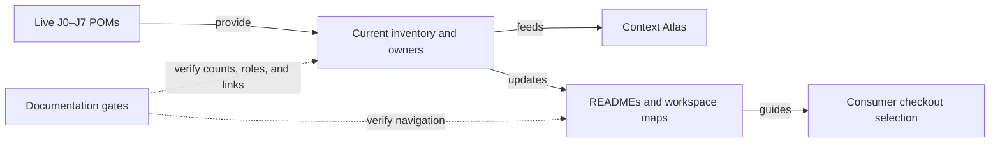

# ATF documentation — deployment fidelity

## At a glance

The atlas points readers to code and POMs, while shared governance belongs to ATF Tests.
An editorial review and passing link checks do not certify every factual claim.

## DOC-CONTEXT-DEPLOYMENT-111 — priority 81

**Priority: 81/100** = impact 31 + gap 24 + feasibility 18 + documentation debt 8.
**Owner:** shared governance coordinated in J1; each deployment retains its own contracts and acceptance.

The original reproduction listed 10 J1 modules, 8 J2 modules, and Reporting J6
in the atlas, although the reactor had 9/7 modules and the binary was J8. This
remains historical context. The J1 factual guard now checks the J0–J7 catalog
from the POMs, including producer/consumer roles and Reporting versions, with
documentation mutants for count, role, and version; its coverage does not
certify claims outside this contract.

- Selectively compare current atlas/index claims with the explicit reactor,
      Reporting ownership, and target provenance; read the expected version
      from the deployment rather than a historical test constant.
- Change only one fact in the negative test: the module count by one from
      the POM, or the current version to one historical version. The guard must
      identify the rejected claim.
- Continue accepting legitimate J6/J7/J8/J9 history and checks against
      their original bases; an old version in the log is not a defect by itself.
- Distinguish ownership of the J0 Core source from JAR consumption of Core
      in J1–J7; do not shrink the catalog implicitly when folders are absent.

**Closure requires:** named and historical documents pass, and current mutants are
rejected without relaxing the boundary. The [local J2 criterion](../../../atf_j2/docs/feedback/ATF_Documentation_Feedback.md)
has its own acceptance and does not implicitly close shared governance.

### Reconcile current claims

The current catalog of modules, roles, and Reporting versions is in
[workspace synchronization](../ATF_Workspace_Synchronization.md#module-and-reporting-catalog);
historical evidence keeps its original coordinates.

- The J1/J2 inventory and counts in the README, Atlas, and synchronization
  table were reconciled with live POMs and are covered by
  [DocumentedWorkspaceCatalogTest](../../atf-tests/src/test/java/atf/api/tests/governance/documentation/factual/DocumentedWorkspaceCatalogTest.java).
- The Core/Reporting and platform guides use the shared catalog for the current
  inventory without repeating module or version snapshots.
- The introductory prose in [J1 architecture](../ATF_Architecture.md) was
  shortened.
- The J1 prose, language, link, structure, and factual gates now pass in the recorded whole-ATF run. The two cross-workspace J0 findings below remain outside this checkout and keep the shared criterion open.

The 163-test result from 2026-11-19 is historical. On 2026-11-20, `WholeAtfGovernanceSuiteTest` passed 171/171 in both documentation editions. The J1 documentation gates pass; the J0 README inventory and retired J4 anchor remain open as cross-workspace findings.

Two cross-workspace findings remain outside the J1 files:

- The table in the [J0 README](../../../atf_j0/README.md) ends at J6 and has
  no J7 row, although the ownership paragraph and J0 atlas already name J1–J7
  consumers.
- The sibling-checkout link gate found a retired J4 anchor in the [J0 inline audit contract](../../../atf_j0/docs/ATF_Inline_Audit_Contract.md); the current
  heading is [Capture and ownership](../../../atf_j4/docs/reporting/ATF_Android.md#capture-and-ownership).

These keep the shared criterion open; the J1 remediation does not mark them resolved.

<strong>Legend — sources, maps, and checks</strong>

- Live POMs define the current module count.
- The inventory centralizes counts and owners and feeds the atlas and short maps.
- The gates verify facts, roles, and navigation destinations.

- Catalog/version contradictions from the 2026-11-01 audit were reconciled
  editorially in increment J12.
- The J1 semantic catalog guard now rejects independent count, role, and version mutants; legitimate historical releases remain accepted. Producer-side chronology controls and the two J0 findings remain shared work.
- J1 coordinates shared governance; each deployment has its own acceptance,
  without mirroring documents.
- Documentation specific to the Core/Reporting APIs remains with J0 owners.

## DOC-LIBRARY-CONTRACTS-147 — keep release chronology outside official contracts

**Priority: 82/100.** J1 owns common documentation governance; J0 owns the Core/Reporting contracts and fixes their factual content. Official README, atlas and contract pages must describe current behavior rather than successive library improvements.

- [ ] Add a permanent producer documentation control for library release narratives and release-specific verification/scorecard pages; mutation controls insert a historical improvement paragraph and a retired-release link into an otherwise valid official document.
- [ ] Preserve legitimate workspace names, semantic configuration examples, current provenance, approved test-change controls and domain implementation journals; do not reject every number or the word incremental.
- [ ] Keep one current verification note per library beside its package and retain original build facts in provenance; official pages link to stable owner contracts.
- [ ] Reconcile current claims with actual POM/source boundaries; a valid link or a high editorial score does not prove the meaning of its surrounding claim.
- [x] Derive J0–J7 module counts and library-consumer roles from each live POM;
      reject one-count and one-role mutants in the factual documentation gate.
      The recorded `DocumentedWorkspaceCatalogTest` result is 6/6 focused cases,
      including count, role, Reporting-version, temporary-harness and stale
      Atlas/README mutants. This bounded check verifies the live J0–J7 catalog;
      producer chronology controls and the two J0 findings remain separate work.
- [ ] Keep the Core ownership/deployment contract canonical in
      `ATF_Core_Consumer.md`; reduce repeated explanatory blocks in the J0
      architecture, atlas and index to short links so those facts cannot drift.
- [ ] Keep Romanian prose consistent across the J0 README, atlas, architecture,
      and library guides; retain English API identifiers and code examples,
      while removing mid-document language switches in explanatory prose.
