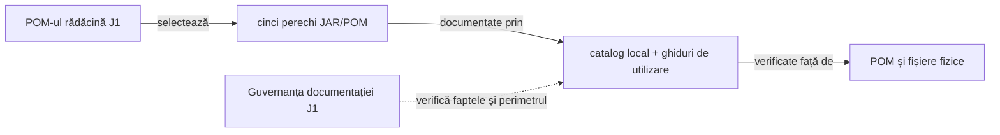

# Documentația ATF — catalogul bibliotecilor și perimetrul local

## Pe scurt

Această constatare urmărește informațiile factuale J1 despre cele cinci
biblioteci consumate și păstrează documentele curente J1 concentrate pe
contractele locale, coordonate și dovezile consumerului.

## DOC-LIBRARY-CONTRACTS-147 — documentarea catalogului de biblioteci

**Stare: Verificat și închis la 2026-11-20.** Catalogul numește cele cinci
coordonate Maven selectate și perechile fizice JAR/POM. Guvernanța factuală le
verifică față de POM-ul și fișierele locale; guvernanța relațiilor păstrează
documentația curentă J1 în perimetrul modulelor locale și al contractelor
bibliotecilor consumate.

### Contract și dovadă

- [Sincronizarea workspace-ului](../ATF_Workspace_Synchronization.md#consumed-library-catalog)
  înregistrează bibliotecile selectate; [utilizarea bibliotecilor platformei](../ATF_Platform_Libraries.md)
  rezumă contractele exercitate de J1.
- [DocumentedLibraryCatalogTest](../../atf-tests/src/test/java/atf/api/tests/governance/documentation/factual/DocumentedLibraryCatalogTest.java)
  verifică coordonatele, perechile fizice, coordonatele din POM și câte un ghid de utilizare per bibliotecă.
- [DocumentationDirectRelationshipGovernanceTest](../../atf-tests/src/test/java/atf/api/tests/governance/documentation/relationship/DocumentationDirectRelationshipGovernanceTest.java)
  scanează tot Markdown-ul J1, inclusiv registrul schimbărilor de teste și `AGENTS.md`, precum și exemplele delimitate prin fence; înregistrările istorice respectă aceeași limită.
- [WholeAtfGovernanceSuiteTest](../../atf-tests/src/test/java/atf/api/tests/governance/WholeAtfGovernanceSuiteTest.java)
  selectează ambele verificări în suita standard de guvernanță.

<strong>Legendă — dovada documentației locale</strong>

- POM-ul rădăcină este sursa versiunilor selectate; fișierele din `lib` sunt
  artefactele fizice rezolvate de J1.
- Testul factual respinge coordonate vechi, nume greșite de fișiere și ghiduri
  lipsă.
- Guvernanța relațiilor permite contractele J1 locale și identificatorii
  bibliotecilor consumate; respinge numele și căile altor workspace-uri ATF.

### Dovezi verificate

| Probă | Rezultat |
|---|---|
| Verificări focusate ale consumerilor și catalogului la închiderea inițială | Shop 21/21, AutoEx 22/22, atf-tests 22/22; 65/65 per ediție. Verificarea de browser local AutoEx a expandat raportul Extent generat. |
| Ultima reverificare a guvernanței întregului reactor | 190/190 în `main` la `e1504f69fdbfefe2670236024cb93f92b9f69ac5` și `main_RO` la `3520c2cae2481d1eba6d05c54559259ebd52c4e7`; fără eșecuri, erori sau teste omise. |
| Ultima comparație a edițiilor și reverificarea ulterioară | Comparația din TMP, pe worktree-uri Git curate, raportează 0 probleme în cele 52 de documente Markdown; testele Node trec 10/10; guvernanța focusată a trecut 18/18 în fiecare ediție la 2026-11-21, după editarea feedback-ului. |

Închiderea acoperă reactorul documentat J1 și contractele bibliotecilor
consumate. Testele verifică artefactele binare selectate și integrările locale;
nu pretind că execută suita independentă de sursă a unei biblioteci.

## DOC-ROOT-OVERVIEW-20261120 — păstrarea overview-ului local-first

**Stare: Reverificat și închis la 2026-11-20.** README-ul root explică acum
cei doi consumatori de aplicație, perimetrul API/browser, responsabilitatea
modulelor, dovezile de raportare și verificarea reactorului. Include un singur
link scurt către indexul final al bibliotecilor, fără nume de workspace-uri
surori sau scoruri de rulare.

`RootReadmeGovernanceTest` impune scopul proiectului, perimetrul API/browser,
inventarul exact de module din POM-ul root, limitele raportării, ordinea
secțiunilor, fluxul conectat până la Extent și un singur link final către indexul
bibliotecilor.

- Fixture-urile negative resping proiectele surori, scorurile, contractul de
  raportare lipsă, fluxurile deconectate, notele despre biblioteci mutate sau
  repetate, modulele lipsă și lungimea excesivă.
- Guvernanța diagramelor cere săgeți etichetate și legendă colapsată.

| Probă | Rezultat |
|---|---|
| Verificări focusate de documentație și control al schimbărilor | 37/37 în EN și RO. |
| Guvernanța întregului reactor la închiderea inițială a overview-ului | 187/187 în EN și RO; fără eșecuri, erori sau teste omise. |
| Ultima reverificare a întregului reactor | 190/190 în EN și RO la commit-urile live de mai sus; fără eșecuri, erori sau teste omise. |
| Instrumente ediții și validarea finală a feedback-ului | Testele Node trec 10/10; comparația din TMP, pe worktree-uri Git curate, raportează 0 probleme în toate cele 52 de documente; guvernanța focusată a trecut 18/18 în EN și RO la 2026-11-21. |

## DOC-CONTEXT-ARTIFACT-GOVERNANCE-20261120 — prevenirea hărților de proiect și a rapoartelor de verificare datate

**Stare: Implementat și verificat la 2026-11-20 pentru tiparele definite.**
Au fost eliminate cele patru artefacte de tip hartă/context și de verificare
datată sau versionată după bibliotecă. `DocumentationContextArtifactGovernanceTest`
scanează acum Markdown-ul întreținut, verifică linkurile și pointerii de
proveniență și include fixture-uri negative pentru aceste tipare. Testul este
selectat de `WholeAtfGovernanceSuiteTest`.

Ultima rulare a întregului reactor a trecut cu 190/190 în ambele ediții.
Următoarea constatare înregistrează întrebarea rămasă de perimetru: regula
curentă nu respinge un document separat de verificare al cărui nume și titlu
nu conțin dată sau versiune de bibliotecă.

## DOC-VERIFICATION-RECORD-SCOPE-20261120 — clasificarea înregistrărilor independente de verificare rămase

**Stare: Deschis.** Regula curentă respinge hărțile de proiect și rapoartele
de verificare/acceptanță datate sau versionate după bibliotecă. Nu respinge un
document generic de verificare fără dată. Documentele întreținute
[`ATF_AutoEx_Search_Verification.md`](../ATF_AutoEx_Search_Verification.md) și
[`ATF_UI_First_Frame_Verification.md`](../ATF_UI_First_Frame_Verification.md)
combină încă regulile durabile pentru consumer cu istoricul rulărilor și
proveniența acestora.

- Stabilește ce comportament aparține README-urilor modulelor AutoEx și UI.
- Mută dovezile temporare ale rulărilor și URL-urile locale de revizie în afara documentației întreținute.
- Dacă înregistrările standalone de verificare sunt în afara perimetrului,
  adaugă un fixture negativ nedatat și fă testul să respingă forma generică.

Păstrează constatarea deschisă până la clasificarea înregistrărilor și
verificarea regulii rezultate în ambele ediții; rezultatul curent 190/190
dovedește doar tiparele mai restrânse deja implementate.

## DOC-EDITION-COMPARATOR-20261120 — separarea terminatoarelor de linie din worktree de diferențele dintre ramuri

**Stare: Verificat la 2026-11-21; nu s-au găsit diferențe de conținut între ramuri.**
Comparația directă a worktree-urilor live a semnalat cele două fișiere `.mjs`
ale instrumentelor edițiilor. ID-urile blob Git sunt identice în `main` și
`main_RO`, iar textul coincide după normalizarea CRLF. O comparație nouă, în
worktree-uri Git curate din TMP, a raportat 0 probleme în cele 52 de documente
Markdown; suita Node a trecut 10/10.

Discrepanța provenea din terminatoarele de linie ale worktree-urilor existente,
nu dintr-o diferență între ediții. Nu este necesară o corecție de cod. Dacă
același rezultat reapare într-un stage Git curat, redeschide constatarea și
adaugă un fixture de regresie LF/CRLF.
