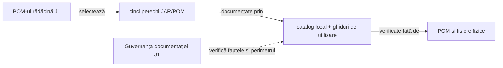

# Documentația ATF — catalogul bibliotecilor și perimetrul local

## Pe scurt

Această constatare urmărește informațiile factuale J1 despre cele cinci
biblioteci consumate și păstrează documentele curente J1 concentrate pe
contractele locale, coordonate și dovezile consumerului.

## DOC-LIBRARY-CONTRACTS-147 — documentarea catalogului de biblioteci

**Stare: Verificat și închis la 2026-11-20.** Catalogul numește cele cinci
coordonate Maven selectate și perechile fizice JAR/POM. Guvernanța factuală le
verifică față de POM-ul și fișierele locale; guvernanța relațiilor păstrează
documentația curentă J1 în perimetrul modulelor locale și al contractelor
bibliotecilor consumate.

### Contract și dovadă

- [Sincronizarea workspace-ului](../ATF_Workspace_Synchronization.md#consumed-library-catalog)
  înregistrează bibliotecile selectate; [utilizarea bibliotecilor platformei](../ATF_Platform_Libraries.md)
  rezumă contractele exercitate de J1.
- [DocumentedLibraryCatalogTest](../../atf-tests/src/test/java/atf/api/tests/governance/documentation/factual/DocumentedLibraryCatalogTest.java)
  verifică coordonatele, perechile fizice, coordonatele din POM și câte un ghid de utilizare per bibliotecă.
- [DocumentationDirectRelationshipGovernanceTest](../../atf-tests/src/test/java/atf/api/tests/governance/documentation/relationship/DocumentationDirectRelationshipGovernanceTest.java)
  scanează tot Markdown-ul J1, inclusiv registrul schimbărilor de teste și `AGENTS.md`, precum și exemplele delimitate prin fence; înregistrările istorice respectă aceeași limită.
- [WholeAtfGovernanceSuiteTest](../../atf-tests/src/test/java/atf/api/tests/governance/WholeAtfGovernanceSuiteTest.java)
  selectează ambele verificări în suita standard de guvernanță.

<strong>Legendă — dovada documentației locale</strong>

- POM-ul rădăcină este sursa versiunilor selectate; fișierele din `lib` sunt
  artefactele fizice rezolvate de J1.
- Testul factual respinge coordonate vechi, nume greșite de fișiere și ghiduri
  lipsă.
- Guvernanța relațiilor permite contractele J1 locale și identificatorii
  bibliotecilor consumate; respinge numele și căile altor workspace-uri ATF.

### Dovezi verificate

| Probă | Rezultat |
|---|---|
| Verificări focusate ale consumerilor și catalogului la închiderea inițială | Shop 21/21, AutoEx 22/22, atf-tests 22/22; 65/65 per ediție. Verificarea de browser local AutoEx a expandat raportul Extent generat. |
| Reverificarea anterioară a commit-urilor întregului reactor | 190/190 în `main` la `e1504f69fdbfefe2670236024cb93f92b9f69ac5` și `main_RO` la `3520c2cae2481d1eba6d05c54559259ebd52c4e7`; fără eșecuri, erori sau teste omise. |
| Verificarea finală a worktree-urilor de revizie | `WholeAtfGovernanceSuiteTest` trece 190/190 în worktree-uri EN și RO proaspete, bazate pe `72c387e98735b03fe1afd65cab1913b76b1d86b4` și `07a1fac012bbdab02916a2ef6d6cd8a735b3d3c0`; testele Node trec 10/10, iar comparația Git raportează 0 probleme în toate cele 50 de documente Markdown păstrate. |

Închiderea acoperă reactorul documentat J1 și contractele bibliotecilor
consumate. Testele verifică artefactele binare selectate și integrările locale;
nu pretind că execută suita independentă de sursă a unei biblioteci.

## DOC-ROOT-OVERVIEW-20261120 — păstrarea overview-ului local-first

**Stare: Reverificat și închis la 2026-11-20.** README-ul root explică acum
cei doi consumatori de aplicație, perimetrul API/browser, responsabilitatea
modulelor, dovezile de raportare și verificarea reactorului. Include un singur
link scurt către indexul final al bibliotecilor, fără nume de workspace-uri
surori sau scoruri de rulare.

`RootReadmeGovernanceTest` impune scopul proiectului, perimetrul API/browser,
inventarul exact de module din POM-ul root, limitele raportării, ordinea
secțiunilor, fluxul conectat până la Extent și un singur link final către indexul
bibliotecilor.

- Fixture-urile negative resping proiectele surori, scorurile, contractul de
  raportare lipsă, fluxurile deconectate, notele despre biblioteci mutate sau
  repetate, modulele lipsă și lungimea excesivă.
- Guvernanța diagramelor cere săgeți etichetate și legendă colapsată.

| Probă | Rezultat |
|---|---|
| Verificări focusate de documentație și control al schimbărilor | 37/37 în EN și RO. |
| Guvernanța întregului reactor la închiderea inițială a overview-ului | 187/187 în EN și RO; fără eșecuri, erori sau teste omise. |
| Reverificarea anterioară a întregului reactor în commit-uri | 190/190 în EN și RO la commit-urile live de mai sus; fără eșecuri, erori sau teste omise. |
| Instrumente ediții și guvernanța finală în worktree-uri | Testele Node trec 10/10; comparația din TMP raportează 0 probleme în toate cele 50 de documente; guvernanța întregului reactor trece 190/190 în worktree-urile EN și RO la 2026-11-21. |

## DOC-CONTEXT-ARTIFACT-GOVERNANCE-20261120 — prevenirea hărților de proiect și a rapoartelor independente de verificare

**Stare: Implementat și verificat la 2026-11-20 pentru tiparele definite.**
Au fost eliminate hărțile de proiect și artefactele de verificare datate sau
versionate după bibliotecă. `DocumentationContextArtifactGovernanceTest`
scanează Markdown-ul întreținut, verifică linkurile și pointerii de proveniență
și include fixture-uri negative. Testul este selectat de
`WholeAtfGovernanceSuiteTest`.

Ultima rulare a întregului reactor a trecut cu 190/190 în ambele ediții la data
acestei înregistrări. Următoarea remediere a extins regula la rapoarte
independente chiar dacă numele și titlul nu conțin o dată sau versiune de bibliotecă.

## DOC-VERIFICATION-RECORD-SCOPE-20261120 — eliminarea înregistrărilor independente de verificare

**Stare: Verificat și închis la 2026-11-21.** Înregistrările independente
pentru căutarea AutoEx și primul cadru UI au fost eliminate; contractele
durabile rămân în [README-ul consumerului AutoEx](../../atf-test-auto-ex/README.md)
și în [README-ul ownerului UI](../../atf-ui/README.md). Dovezile unei rulări
rămân în TMP.

Testul de guvernanță respinge numele de fișiere ale rapoartelor independente și
titlurile de înregistrări de verificare sau acceptanță, inclusiv formele
nedatate, și rămâne selectat de `WholeAtfGovernanceSuiteTest`. Controlul este în
[baseline](../ATF_Test_Changes_Baseline.md).

- AutoEx păstrează contractul GET deținut, DOM-ul nou și comportamentul terminal
  queue-full.
- UI păstrează pregătirea fixture-ului, deadline-urile inputului nativ,
  contextul capturilor și oracolele de pixeli, fără instantanee comise.
- Fixture-urile negative acoperă numele nedatate ale rapoartelor și titlurile
  înregistrărilor de acceptanță; `WholeAtfGovernanceSuiteTest` a trecut 190/190
  în worktree-uri TMP proaspete pentru ambele ediții la 2026-11-21.

## DOC-EDITION-COMPARATOR-20261120 — separarea terminatoarelor de linie din worktree de diferențele dintre ramuri

**Stare: Corectat și verificat la 2026-11-21.** Comparația worktree-urilor live
a semnalat două fișiere `.mjs`, deoarece checkout-ul EN folosește CRLF, iar RO
LF; blob-urile Git sunt identice. Comparatorul omitea `.mjs` din lista fișierelor
text.

- Comparatorul normalizează acum terminatoarele JavaScript și respinge în
  continuare diferențele semantice din sursă.
- Suita de regresie trece 11/11, inclusiv fixture-ul LF/CRLF; POM-urile
  publicate ale bibliotecilor rămân identice octet cu octet.
- Revizia fixată prin commit verifică toate cele 50 de documente fără probleme,
  iar comparația worktree-urilor live trece acum în EN și RO.
