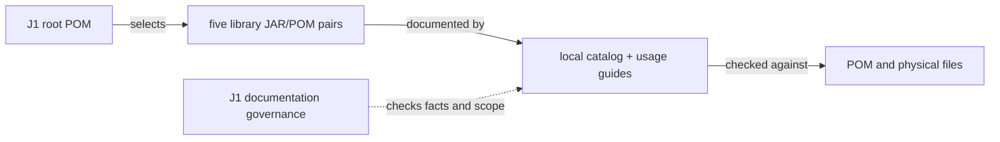

# ATF documentation — library catalog and local scope

## At a glance

This item tracks factual J1 documentation about the five consumed libraries
and keeps current J1 documents focused on local contracts, coordinates, and
consumer evidence.

## DOC-LIBRARY-CONTRACTS-147 — document the consumed library catalog

**Status: Verified and closed on 2026-11-20.** The catalog names the five
selected Maven coordinates and physical JAR/POM pairs. Factual governance checks
them against the local POM and files; relationship governance keeps current J1
documentation scoped to its local modules and consumed library contracts.

### Contract and proof

- [Workspace synchronization](../ATF_Workspace_Synchronization.md#consumed-library-catalog)
  records the selected libraries; [platform library use](../ATF_Platform_Libraries.md)
  summarizes the contracts J1 exercises.
- [DocumentedLibraryCatalogTest](../../atf-tests/src/test/java/atf/api/tests/governance/documentation/factual/DocumentedLibraryCatalogTest.java)
  checks coordinates, physical pairs, POM coordinates, and one usage guide per library.
- [DocumentationDirectRelationshipGovernanceTest](../../atf-tests/src/test/java/atf/api/tests/governance/documentation/relationship/DocumentationDirectRelationshipGovernanceTest.java)
  scans all J1 Markdown, including the test-change baseline and `AGENTS.md`,
  plus fenced examples; historical records follow the same library-only rule.
- [WholeAtfGovernanceSuiteTest](../../atf-tests/src/test/java/atf/api/tests/governance/WholeAtfGovernanceSuiteTest.java)
  selects both checks in the standard governance suite.

<strong>Legend — local documentation proof</strong>

- The root POM is the source of selected versions; files in `lib` are the
  physical artifacts J1 resolves.
- The factual test rejects stale coordinates, wrong file names, and missing
  guides.
- Relationship governance allows local J1 contracts and consumed library
  identifiers; it rejects other ATF workspace names and paths.

### Verified evidence

| Proof | Result |
|---|---|
| Focused consumer and catalog checks in both editions | Shop 21/21, AutoEx 22/22, atf-tests 22/22; 65/65 per edition. The local AutoEx browser check expanded the generated Extent report. |
| Whole-ATF governance at the initial closure | 179/179 in each edition; the revised top-down root-overview governance now records 187/187. |
| Documentation editions | Node tests 10/10; comparison reports no problems across 56 Markdown documents. |

Closure covers the documented J1 reactor and its consumed library contracts.
The tests verify the selected binary artifacts and local integrations; they do
not claim to execute a library's independent source suite.

## DOC-ROOT-OVERVIEW-20261120 — keep the project entry page local-first

**Status: Reverified and closed on 2026-11-20.** The root README now explains
the two application consumers, API/browser scope, module ownership, report
evidence, and how to verify the reactor. It includes one short final library
index link and no sibling-workspace identities or run scores.

`RootReadmeGovernanceTest` enforces project purpose, API/browser scope, the exact
root-POM module inventory, report boundaries, section order, a connected
consumer-to-Extent flow, and one final library-index link.

- Negative fixtures reject sibling names, run scores, a missing report contract,
  disconnected flows, misplaced or repeated library notes, missing modules, and
  excessive length.
- Shared diagram governance requires labeled edges and a collapsed legend.

| Proof | Result |
|---|---|
| Focused documentation and change-control gates | 37/37 in EN and RO. |
| Whole-reactor governance | 187/187 in EN and RO; no failures, errors, or skipped tests. |
| Edition tooling | Node tests 10/10; Markdown structure and link destinations match across the 56 documents. |
