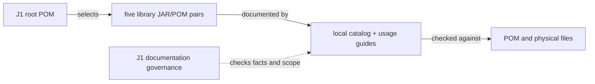

# ATF documentation — library catalog and local scope

## At a glance

This item tracks factual J1 documentation about the five consumed libraries
and keeps current J1 documents focused on local contracts, coordinates, and
consumer evidence.

## DOC-LIBRARY-CONTRACTS-147 — document the consumed library catalog

**Status: Verified and closed on 2026-11-20.** The catalog names the five
selected Maven coordinates and physical JAR/POM pairs. Factual governance checks
them against the local POM and files; relationship governance keeps current J1
documentation scoped to its local modules and consumed library contracts.

### Contract and proof

- [Workspace synchronization](../ATF_Workspace_Synchronization.md#consumed-library-catalog)
  records the selected libraries; [platform library use](../ATF_Platform_Libraries.md)
  summarizes the contracts J1 exercises.
- [DocumentedLibraryCatalogTest](../../atf-tests/src/test/java/atf/api/tests/governance/documentation/factual/DocumentedLibraryCatalogTest.java)
  checks coordinates, physical pairs, POM coordinates, and one usage guide per library.
- [DocumentationDirectRelationshipGovernanceTest](../../atf-tests/src/test/java/atf/api/tests/governance/documentation/relationship/DocumentationDirectRelationshipGovernanceTest.java)
  scans all J1 Markdown, including the test-change baseline and `AGENTS.md`,
  plus fenced examples; historical records follow the same library-only rule.
- [WholeAtfGovernanceSuiteTest](../../atf-tests/src/test/java/atf/api/tests/governance/WholeAtfGovernanceSuiteTest.java)
  selects both checks in the standard governance suite.

<strong>Legend — local documentation proof</strong>

- The root POM is the source of selected versions; files in `lib` are the
  physical artifacts J1 resolves.
- The factual test rejects stale coordinates, wrong file names, and missing
  guides.
- Relationship governance allows local J1 contracts and consumed library
  identifiers; it rejects other ATF workspace names and paths.

### Verified evidence

| Proof | Result |
|---|---|
| Focused consumer and catalog checks at initial closure | Shop 21/21, AutoEx 22/22, atf-tests 22/22; 65/65 per edition. The local AutoEx browser check expanded the generated Extent report. |
| Previous committed whole-reactor governance | 190/190 in `main` at `e1504f69fdbfefe2670236024cb93f92b9f69ac5` and `main_RO` at `3520c2cae2481d1eba6d05c54559259ebd52c4e7`; no failures, errors, or skipped tests. |
| Final review worktree verification | `WholeAtfGovernanceSuiteTest` passes 190/190 in fresh EN and RO worktrees based on `72c387e98735b03fe1afd65cab1913b76b1d86b4` and `07a1fac012bbdab02916a2ef6d6cd8a735b3d3c0`; Node tests pass 10/10 and the Git-backed comparison reports 0 problems across all 50 maintained Markdown documents. |

Closure covers the documented J1 reactor and its consumed library contracts.
The tests verify the selected binary artifacts and local integrations; they do
not claim to execute a library's independent source suite.

## DOC-ROOT-OVERVIEW-20261120 — keep the project entry page local-first

**Status: Reverified and closed on 2026-11-20.** The root README now explains
the two application consumers, API/browser scope, module ownership, report
evidence, and how to verify the reactor. It includes one short final library
index link and no sibling-workspace identities or run scores.

`RootReadmeGovernanceTest` enforces project purpose, API/browser scope, the exact
root-POM module inventory, report boundaries, section order, a connected
consumer-to-Extent flow, and one final library-index link.

- Negative fixtures reject sibling names, run scores, a missing report contract,
  disconnected flows, misplaced or repeated library notes, missing modules, and
  excessive length.
- Shared diagram governance requires labeled edges and a collapsed legend.

| Proof | Result |
|---|---|
| Focused documentation and change-control gates | 37/37 in EN and RO. |
| Whole-reactor governance at initial overview closure | 187/187 in EN and RO; no failures, errors, or skipped tests. |
| Previous committed whole-reactor re-verification | 190/190 in EN and RO at the live commits recorded above; no failures, errors, or skipped tests. |
| Final edition tooling and worktree governance | Node tests pass 10/10; the Git-backed TMP comparison reports 0 problems across all 50 documents; final whole-reactor governance passes 190/190 in EN and RO review worktrees on 2026-11-21. |

## DOC-CONTEXT-ARTIFACT-GOVERNANCE-20261120 — prevent project maps and standalone verification reports

**Status: Implemented and verified on 2026-11-20 for the scoped patterns.**
Project maps and dated or library-versioned verification artifacts were
removed. `DocumentationContextArtifactGovernanceTest` scans maintained
Markdown, checks links and provenance pointers, and includes negative fixtures.
The test is selected by `WholeAtfGovernanceSuiteTest`.

The latest whole-reactor run passed 190/190 in both editions at the time of this
record. The follow-up below tightened the rule to reject standalone reports
even when their paths and titles have no date or library version.

## DOC-VERIFICATION-RECORD-SCOPE-20261120 — remove standalone verification records

**Status: Verified and closed on 2026-11-21.** The standalone AutoEx search and
UI first-frame records were removed; their durable contracts remain in the
[AutoEx consumer README](../../atf-test-auto-ex/README.md) and
[UI owner README](../../atf-ui/README.md). Run-specific receipts stay in owned TMP.

The governance test rejects standalone report filenames and acceptance or
verification record titles, including undated forms, and remains selected by
`WholeAtfGovernanceSuiteTest`. Its change control is in the
[test baseline](../ATF_Test_Changes_Baseline.md).

- AutoEx retains the owned GET, fresh-DOM and terminal queue-full contract.
- UI retains fixture preparation, native action deadlines, screenshot context
  and pixel oracles without committed execution snapshots.
- The negative fixtures cover undated report filenames and acceptance-record
  titles; `WholeAtfGovernanceSuiteTest` passed 190/190 in fresh TMP for both
  editions on 2026-11-21.

## DOC-EDITION-COMPARATOR-20261120 — distinguish worktree line endings from branch drift

**Status: Verified on 2026-11-21; no branch content drift found.** A direct
comparison of the existing live worktrees flagged the two documentation-edition
`.mjs` files. Their Git blob IDs match between `main` and `main_RO`, and their
text matches after CRLF normalization. A fresh Git-backed TMP comparison
reported 0 problems across 50 Markdown documents; the Node suite passed 10/10.

The discrepancy came from the pre-existing worktree line endings, not an edition
content change. No code correction is indicated. If the same result recurs in a
fresh Git-backed stage, reopen this item and add an LF/CRLF regression fixture.
