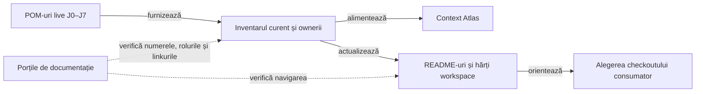

# Documentație ATF — fidelitatea deployment-urilor

## Pe scurt

Atlasul orientează cititorul către cod și POM, iar guvernanța comună aparține ATF Tests.
Nota editorială și trecerea linkurilor nu certifică fidelitatea tuturor afirmațiilor.

## DOC-CONTEXT-DEPLOYMENT-111 — prioritate 81

**Prioritate: 81/100** = impact 31 + lacună 24 + lucrabil 18 + documentare 8.
**Responsabil:** guvernanța comună coordonată în J1; fiecare configurație de livrare păstrează propriile contracte și criterii de acceptanță.

Reproducerea inițială avea J1 cu 10 module, J2 cu 8 și Reporting J6 în atlas,
deși reactorul avea 9/7 module și binarul era J8. Acesta rămâne context istoric.
Guard-ul factual J1 verifică acum catalogul J0–J7 din POM-uri, inclusiv rolurile de producător/consumator și versiunile Reporting, cu mutanți documentari pentru număr,
rol și versiune; acoperirea sa nu certifică afirmațiile din afara acestui contract.

- Confruntați selectiv afirmațiile curente din atlas/index cu reactorul explicit, proprietatea Reporting și proveniența țintei; versiunea așteptată se citește din deployment, fără constantă istorică în test.
- Proba negativă schimbă un singur fapt: numărul modulelor cu o unitate față de POM sau versiunea curentă cu una istorică. Guard-ul indică afirmația respinsă.
- Acceptați în continuare istoricul legitim J6/J7/J8/J9 și controalele la bazele originale; existența unei versiuni vechi în jurnal nu este singură un defect.
- Distingeți ownerul sursei Core J0 de consumul Core prin JAR în J1–J7; catalogul nu se micșorează implicit după foldere absente.

**Criteriu de închidere:** documentele nominale și istorice trec, iar mutanții curenți
sunt refuzați fără relaxarea perimetrului. [Criteriul local J2](../../../atf_j2/docs/feedback/ATF_Documentation_Feedback.md)
are acceptanță proprie; nu închide implicit guvernanța comună.

### Reconcilierea afirmațiilor curente

Catalogul curent de module, roluri și versiuni Reporting este în
[sincronizarea workspace-urilor](../ATF_Workspace_Synchronization.md#catalogul-de-module-și-reporting);
probele istorice își păstrează coordonatele originale.

- Inventarul J1/J2 și numărătorile din README, Atlas și tabelul de sincronizare
  au fost reconciliate cu POM-urile live și sunt acoperite de
  [DocumentedWorkspaceCatalogTest](../../atf-tests/src/test/java/atf/api/tests/governance/documentation/factual/DocumentedWorkspaceCatalogTest.java).
- Ghidurile Core/Reporting și de platformă folosesc catalogul comun pentru
  inventarul curent, fără să repete snapshot-uri de module sau versiuni.
- Proza introductivă din [arhitectura J1](../ATF_Architecture.md) a fost
  scurtată.
- Porțile J1 pentru proză, limbă, linkuri, structură și fapte au trecut în rularea înregistrată a suitei complete ATF. Cele două constatări J0 cross-workspace de mai jos rămân în afara acestui checkout și țin deschis criteriul comun.

Rezultatul de 163 de teste din 2026-11-19 este istoric. La 2026-11-20, `WholeAtfGovernanceSuiteTest` a trecut cu 171/171 în ambele ediții documentare. Porțile de documentație J1 trec; inventarul din README-ul J0 și ancora J4 retrasă rămân constatări cross-workspace deschise.

Rămân două constatări cross-workspace, în afara fișierelor J1:

- Tabelul din [README-ul J0](../../../atf_j0/README.md) se oprește la J6 și nu are rând J7, deși paragraful de ownership și atlasul J0 numesc deja consumerii J1–J7.
- Poarta de verificare a linkurilor dintre checkouturi-surori a găsit ancora J4 retrasă din [contractul de audit inline J0](../../../atf_j0/docs/ATF_Inline_Audit_Contract.md); titlul curent este [Captură și responsabilitate](../../../atf_j4/docs/reporting/ATF_Android.md#capture-and-ownership).

Acestea țin deschis criteriul comun; nu sunt marcate ca rezolvate de remedierea J1.

<strong>Legendă — surse, hărți și verificări</strong>

- POM-urile live definesc numărul curent de module;
- inventarul centralizează numerele și ownerii și alimentează atlasul și hărțile scurte;
- porțile verifică faptele, rolurile și destinațiile de navigare.

- Contradicțiile de catalog/versiune din auditul 2026-11-01 au fost reconciliate editorial în incrementul J12.
- Guard-ul semantic J1 al catalogului respinge acum mutanți independenți pentru număr, rol și versiune; versiunile istorice legitime rămân acceptate. Controalele de cronologie ale producătorului și cele două constatări J0 rămân lucrări comune.
- J1 coordonează guvernanța comună; fiecare deployment are acceptanță proprie, fără mirror al documentelor.
- Documentația specifică API-ului Core/Reporting rămâne la ownerul J0.

## DOC-LIBRARY-CONTRACTS-147 — păstrarea cronologiei versiunilor în afara contractelor oficiale

**Prioritate: 82/100.** J1 deține guvernanța documentară comună; J0 deține contractele Core/Reporting și corectează conținutul lor factual. Paginile oficiale README, atlas și contract trebuie să descrie comportamentul curent, nu succesiunea îmbunătățirilor bibliotecii.

- [ ] Adăugați un control permanent al documentației producătorului pentru descrierile versiunilor bibliotecii și paginile de verificare/fișă de evaluare specifice fiecărei versiuni; mutanții inserează un paragraf despre o îmbunătățire istorică și un link către o versiune retrasă într-un document oficial altfel valid.
- [ ] Păstrați numele legitime ale spațiilor de lucru, exemplele semantice de configurare, proveniența curentă, controalele aprobate pentru schimbarea testelor și jurnalele de implementare pe domenii; nu respingeți orice număr sau cuvântul „incremental”.
- [ ] Păstrați câte o notă de verificare curentă pentru fiecare bibliotecă lângă pachetul ei și mențineți faptele originale de compilare în proveniență; paginile oficiale trimit la contractele stabile ale responsabililor.
- [ ] Confruntați afirmațiile curente cu limitele reale ale POM-urilor și sursei; un link valid sau un scor editorial mare nu dovedește sensul afirmației din jur.
- [x] Derivați numărul de module J0–J7 și rolurile producer/consumer ale bibliotecilor din fiecare POM live;
      respingeți mutanții care schimbă numărul cu unu sau schimbă rolul în poarta de verificare factuală.
      Rezultatul înregistrat pentru `DocumentedWorkspaceCatalogTest` este de 6/6 cazuri
      țintite, inclusiv mutanți pentru număr, rol, versiune Reporting, harness
      temporar și Atlas/README perimate. Verificarea confirmă catalogul live J0–J7;
      controalele de cronologie ale producătorului și cele două constatări J0 rămân lucrări separate.
- [ ] Păstrați contractul de ownership/deployment pentru Core ca sursă canonică în
      `ATF_Core_Consumer.md`; reduceți blocurile explicative repetate din arhitectura,
      atlasul și indexul J0 la linkuri scurte, pentru ca faptele să nu se abată.
- [ ] Păstrați proza română consecventă în README-ul, atlasul, arhitectura și
      ghidurile de biblioteci J0; păstrați identificatorii API și exemplele de cod
      în engleză, dar eliminați schimbările de limbă din mijlocul paragrafelor explicative.
