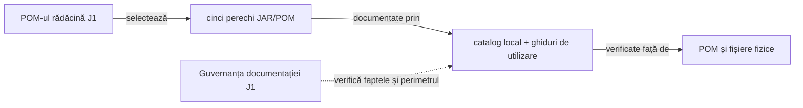

# Documentația ATF — catalogul bibliotecilor și perimetrul local

## Pe scurt

Această constatare urmărește informațiile factuale J1 despre cele cinci
biblioteci consumate și păstrează documentele curente J1 concentrate pe
contractele locale, coordonate și dovezile consumerului.

## DOC-LIBRARY-CONTRACTS-147 — documentarea catalogului de biblioteci

**Stare: Verificat și închis la 2026-11-20.** Catalogul numește cele cinci
coordonate Maven selectate și perechile fizice JAR/POM. Guvernanța factuală le
verifică față de POM-ul și fișierele locale; guvernanța relațiilor păstrează
documentația curentă J1 în perimetrul modulelor locale și al contractelor
bibliotecilor consumate.

### Contract și dovadă

- [Sincronizarea workspace-ului](../ATF_Workspace_Synchronization.md#consumed-library-catalog)
  înregistrează bibliotecile selectate; [utilizarea bibliotecilor platformei](../ATF_Platform_Libraries.md)
  rezumă contractele exercitate de J1.
- [DocumentedLibraryCatalogTest](../../atf-tests/src/test/java/atf/api/tests/governance/documentation/factual/DocumentedLibraryCatalogTest.java)
  verifică coordonatele, perechile fizice, coordonatele din POM și câte un ghid de utilizare per bibliotecă.
- [DocumentationDirectRelationshipGovernanceTest](../../atf-tests/src/test/java/atf/api/tests/governance/documentation/relationship/DocumentationDirectRelationshipGovernanceTest.java)
  scanează tot Markdown-ul J1, inclusiv registrul schimbărilor de teste și `AGENTS.md`, precum și exemplele delimitate prin fence; înregistrările istorice respectă aceeași limită.
- [WholeAtfGovernanceSuiteTest](../../atf-tests/src/test/java/atf/api/tests/governance/WholeAtfGovernanceSuiteTest.java)
  selectează ambele verificări în suita standard de guvernanță.

<strong>Legendă — dovada documentației locale</strong>

- POM-ul rădăcină este sursa versiunilor selectate; fișierele din `lib` sunt
  artefactele fizice rezolvate de J1.
- Testul factual respinge coordonate vechi, nume greșite de fișiere și ghiduri
  lipsă.
- Guvernanța relațiilor permite contractele J1 locale și identificatorii
  bibliotecilor consumate; respinge numele și căile altor workspace-uri ATF.

### Dovezi verificate

| Probă | Rezultat |
|---|---|
| Verificări focusate ale consumerilor și catalogului în ambele ediții | Shop 21/21, AutoEx 22/22, atf-tests 22/22; 65/65 per ediție. Verificarea de browser local AutoEx a expandat raportul Extent generat. |
| Guvernanța Whole-ATF la închiderea inițială | 179/179 în fiecare ediție; guvernanța revizuită a overview-ului root de sus în jos consemnează acum 187/187. |
| Edițiile documentației | Testele Node 10/10; comparația nu raportează probleme între 56 de documente Markdown. |

Închiderea acoperă reactorul documentat J1 și contractele bibliotecilor
consumate. Testele verifică artefactele binare selectate și integrările locale;
nu pretind că execută suita independentă de sursă a unei biblioteci.

## DOC-ROOT-OVERVIEW-20261120 — păstrarea overview-ului local-first

**Stare: Reverificat și închis la 2026-11-20.** README-ul root explică acum
cei doi consumatori de aplicație, perimetrul API/browser, responsabilitatea
modulelor, dovezile de raportare și verificarea reactorului. Include un singur
link scurt către indexul final al bibliotecilor, fără nume de workspace-uri
surori sau scoruri de rulare.

`RootReadmeGovernanceTest` impune scopul proiectului, perimetrul API/browser,
inventarul exact de module din POM-ul root, limitele raportării, ordinea
secțiunilor, fluxul conectat până la Extent și un singur link final către indexul
bibliotecilor.

- Fixture-urile negative resping proiectele surori, scorurile, contractul de
  raportare lipsă, fluxurile deconectate, notele despre biblioteci mutate sau
  repetate, modulele lipsă și lungimea excesivă.
- Guvernanța diagramelor cere săgeți etichetate și legendă colapsată.

| Probă | Rezultat |
|---|---|
| Verificări focusate de documentație și control al schimbărilor | 37/37 în EN și RO. |
| Guvernanța întregului reactor | 187/187 în EN și RO; fără eșecuri, erori sau teste omise. |
| Instrumente ediții | Testele Node 10/10; structura Markdown și destinațiile linkurilor coincid în cele 56 de documente. |
